# Serving Large Language Models on Huawei CloudMatrix384

> **中文题名**：在华为 CloudMatrix384 超节点上服务大语言模型
> **作者**：Pengfei Zuo, Huimin Lin, Junbo Deng, et al.（华为 & SiliconFlow，48 位作者）
> **来源**：[arXiv:2506.12708v3](https://arxiv.org/abs/2506.12708)（2025-06，CC BY 4.0）
> **检索日期**：2026-10-10 ｜ **Reader 生成**：nature-reader 工作流（结构化提取 + 人工级翻译）
> **说明**：段落级中英对照；`Sxxx`=原文块、`Fxxx`=图、`Txxx`=表、`Exxx`=公式，锚点可与 `source_map.json` 互查。公式 E003/E004 为视觉核对后的转写（medium confidence），原图存于 `assets/equations/`。

## 目录

- [1 Introduction](#S510) → 1 引言
- [2 LLM Trends and Their Challenges for Datacenter Infrastructure](#S512) → 2 LLM 发展趋势及其对数据中心基础设施的挑战
  - [2.1 LLM Trends](#S020) → 2.1 LLM 趋势
  - [2.2 Challenges for Datacenter Infrastructure](#S024) → 2.2 数据中心基础设施面临的挑战
- [3 Huawei CloudMatrix](#S513) → 3 华为 CloudMatrix
  - [3.1 Vision for Huawei CloudMatrix](#S031) → 3.1 华为 CloudMatrix 的愿景
  - [3.2 CloudMatrix384 Overview: A Fully Peer-to-Peer Hardware Architecture](#S036) → 3.2 CloudMatrix384 概览：全对等硬件架构
  - [3.3 Hardware Components](#S043) → 3.3 硬件组件
  - [3.3.1 Ascend 910 Chip](#S044) → 3.3.1 昇腾 910（Ascend 910）芯片
  - [3.3.2 Ascend 910 Node](#S045) → 3.3.2 Ascend 910 节点
  - [3.3.3 UB Switch System](#S047) → 3.3.3 UB 交换机系统
  - [3.4 Software Stack](#S050) → 3.4 软件栈
  - [3.4.1 CANN for Ascend NPUs](#S051) → 3.4.1 面向 Ascend NPU 的 CANN
  - [3.4.2 Infrastructure Software for Cloud Deployment](#S059) → 3.4.2 面向云部署的基础设施软件
  - [3.5 Suitability Analysis for DeepSeek Models](#S067) → 3.5 面向 DeepSeek 模型的适配性分析
  - [3.5.1 DeepSeek Models and Their Deployment on NVIDIA H800](#S068) → 3.5.1 DeepSeek 模型及其在 NVIDIA H800 上的部署
  - [3.5.2 Architectural Synergy between CloudMatrix384 and DeepSeek Models](#S074) → 3.5.2 CloudMatrix384 与 DeepSeek 模型的架构协同
- [4 DeepSeek Serving on Huawei CloudMatrix384](#S514) → 4 在华为 CloudMatrix384 上进行 DeepSeek 推理服务
  - [4.1 Overview: A Peer-to-Peer Serving Architecture with PDC Disaggregation](#S082) → 4.1 概览：采用 PDC 分离的对等推理服务架构
  - [4.2 Tightly-Coupled Decode with Large-scale Expert Parallelism](#S094) → 4.2 紧耦合解码与大规模专家并行
  - [4.2.1 Fused Communication Operators for LEP](#S096) → 4.2.1 面向 LEP 的融合通信算子
  - [4.2.2 MLA Optimization](#S112) → 4.2.2 MLA 优化
  - [4.2.3 Microbatch-Based Decode Pipeline](#S123) → 4.2.3 基于微批次的解码流水线
  - [4.2.4 Multiple-Token Prediction Support](#S128) → 4.2.4 多 token 预测（MTP）支持
  - [4.3 Resource-Efficient Prefill with Hybrid Parallelism and Microbatching](#S135) → 4.3 基于混合并行与微批次的资源高效 prefill
  - [4.3.1 Hybrid Parallelism for MLA Computation](#S136) → 4.3.1 面向 MLA 计算的混合并行
  - [4.3.2 Microbatch-Based Prefill Pipeline](#S147) → 4.3.2 基于微批次的 prefill 流水线
  - [4.3.3 Low-interference Transferring between Prefill and Decode](#S154) → 4.3.3 prefill 与解码之间的低干扰切换
  - [4.4 UB-Driven Distributed Caching with Unified Memory Access](#S162) → 4.4 基于统一内存访问的 UB 驱动分布式缓存
  - [4.4.1 Disaggregated Memory Pooling](#S164) → 4.4.1 分离式内存池化
  - [4.4.2 Context Caching](#S176) → 4.4.2 上下文缓存
  - [4.4.3 Model Caching](#S184) → 4.4.3 模型缓存
  - [4.5 INT8 Quantization](#S190) → 4.5 INT8 量化
- [5 Evaluations](#S500) → 5 评估
  - [5.1 Experimental Setup](#S198) → 5.1 实验设置
  - [5.2 Overall Performance](#S203) → 5.2 整体性能
  - [5.3 Accuracy](#S209) → 5.3 精度
  - [5.4 Ablation Study](#S216) → 5.4 消融实验
  - [5.4.1 Microbatch-based Pipeline](#S217) → 5.4.1 基于微批次的流水线
  - [5.4.2 MTP](#S223) → 5.4.2 多 token 预测（MTP）
  - [5.4.3 Context Caching](#S228) → 5.4.3 上下文缓存
  - [5.5 Performance of Operators](#S232) → 5.5 算子性能
  - [5.5.1 Communication Operators](#S233) → 5.5.1 通信算子
  - [5.5.2 MLA Operator](#S238) → 5.5.2 MLA 算子
  - [5.5.3 GEMM Operator](#S240) → 5.5.3 GEMM 算子
- [6 Discussions on Future Directions](#S502) → 6 未来方向的讨论
  - [6.1 Future CloudMatrix Evolutions](#S243) → 6.1 CloudMatrix 的未来演进
  - [6.1.1 Unifying VPC and RDMA Planes](#S244) → 6.1.1 VPC 平面与 RDMA 平面的统一
  - [6.1.2 Larger-scale Supernodes](#S246) → 6.1.2 更大规模的超节点
  - [6.1.3 Physical Disaggregation and Pooling of CPUs](#S253) → 6.1.3 CPU 的物理分离与池化
  - [6.2 Future Serving System Enhancements](#S258) → 6.2 推理服务系统的未来增强
  - [6.2.1 Component-Level Disaggregation](#S259) → 6.2.1 组件级分离
  - [6.2.2 Hybrid and Adaptive Deployment](#S263) → 6.2.2 混合与自适应部署
- [7 Conclusion](#S511) → 7 结论

## 公式索引

- [E001 · Eq. (1)](#E001) — p.22，通信缓冲区预分配大小公式
- [E002 · Eq. (2)](#E002) — p.22，单个对端最坏情况下 token 数上限
- [E003 · Eq. (3)](#E003) — p.37，自适应缩放搜索：量化前后输出对齐的优化目标
- [E004 · Eq. (4)](#E004) — p.38，块级裁剪：逐块求解最优裁剪因子 α

## 术语表

| 英文术语 | 中文译法 | 说明 |
|---|---|---|
| Unified Bus (UB) / 灵衢 | 统一总线（UB） | 华为超节点互连总线，统一内存语义 |
| supernode | 超节点 | 384 NPU + 192 CPU 统一逻辑节点 |
| CloudMatrix384 / CloudMatrix-Infer | 不译 | 系统名/推理服务方案名 |
| prefill / decode | 预填充 / 解码 | 两阶段推理 |
| PDC disaggregation | prefill-解码-缓存分离 | peer-to-peer 对等架构 |
| expert parallelism (EP / LEP) | （大规模）专家并行 | EP320 = 320 路专家并行 |
| MLA / MTP | 多头潜在注意力 / 多 token 预测 | DeepSeek 架构特性 |
| microbatch | 微批次 | 流水线Overlap 单元 |
| TPOT / TTFT | 每 token 输出时间 / 首 token 时间 | 时延 SLO 指标 |
| AIV-direct / SDMA | AIV 直连通信 / SDMA | 两种跨 NPU 通信机制 |
| FusedDispatch / FusedCombine | 不译（融合分发/合并算子） | 替换 all-to-all 的融合算子 |
| EMS | 弹性内存服务 | UB 驱动的分离式内存池 |
| UB plane | UB 平面 | 与 VPC 平面相对 |
| die | 芯粒 | Ascend 910 双芯粒架构 |
| scale-up | 纵向扩展 | 相对 scale-out 横向扩展 |

---

**Source:** p.1 S002（作者列表）

**Original:** Pengfei Zuo, Huimin Lin, Junbo Deng, Nan Zou, Xingkun Yang, Yingyu Diao, Weifeng Gao, Ke Xu, Zhangyu Chen, Shirui Lu, Zhao Qiu, Peiyang Li, Xianyu Chang, Zhengzhong Yu, Fangzheng Miao, Jia Zheng, Ying Li, Yuan Feng, Bei Wang, Zaijian Zong, Mosong Zhou, Wenli Zhou, Houjiang Chen, Xingyu Liao, Yipeng Li, Wenxiao Zhang, Ping Zhu *, Yinggang Wang *, Chuanjie Xiao *, Depeng Liang *, Dong Cao *, Juncheng Liu *, Yongqiang Yang, Xiaolong Bai, Yi Li, Huaguo Xie, Huatao Wu, Zhibin Yu, Lv Chen, Hu Liu, ✉ Yujun Ding, Haipei Zhu, Jing Xia, Yi Xiong, Zhou Yu, Heng Liao

**中文:** Pengfei Zuo, Huimin Lin, Junbo Deng, Nan Zou, Xingkun Yang, Yingyu Diao, Weifeng Gao, Ke Xu, Zhangyu Chen, Shirui Lu, Zhao Qiu, Peiyang Li, Xianyu Chang, Zhengzhong Yu, Fangzheng Miao, Jia Zheng, Ying Li, Yuan Feng, Bei Wang, Zaijian Zong, * * * * Mosong Zhou, Wenli Zhou, Houjiang Chen, Xingyu Liao, Yipeng Li, Wenxiao Zhang, Ping Zhu *, Yinggang Wang *, Chuanjie Xiao *, Depeng Liang *, Dong Cao *, Juncheng Liu *, Yongqiang Yang, Xiaolong Bai, Yi Li, Huaguo Xie, Huatao Wu, Zhibin Yu, Lv Chen, Hu Liu, ✉ ✉ Yujun Ding, Haipei Zhu, Jing Xia, Yi Xiong, Zhou Yu, Heng Liao

**Source:** p.1 S003（作者列表）

**Original:** Huawei * SiliconFlow

**中文:** 华为 * SiliconFlow

### 摘要 / Abstract

**Source:** p.1 S005

**Original:** The rapid evolution of large language models (LLMs), driven by increasing parameter scales, adoption of mixture-of-experts (MoE) architectures, and expanding context lengths, imposes unprecedented demands on AI infrastructure. Conventional AI clusters are increasingly constrained by compute intensity, memory bandwidth limitations, inter-chip communication overhead, and stringent latency requirements. In real-world deployments, these challenges are further compounded by the need to handle diverse, bursty workloads, variable-length inputs, and imbalanced expert activations, while meeting strict service-level objectives. Over-coming these constraints requires a fundamentally re-architected, co-designed hardware and software stack. To address these challenges, this paper introduces Huawei CloudMatrix, a next-generation AI datacen-ter architecture that embodies Huawei’s vision for reshaping the foundation of AI infrastructure. Huawei CloudMatrix384 represents the first production-grade realization of this vision. It integrates 384 Ascend 910 NPUs, 192 Kunpeng CPUs, and other hardware components into a unified supernode, interconnected via an ultra-high-bandwidth, low-latency Unified Bus (UB) network. Unlike conventional hierarchical designs, this architecture enables direct all-to-all communication via UB, allowing compute, memory, and network resources to be dynamically pooled, uniformly accessed, and independently scaled. These architectural features are particularly beneficial for communication-intensive operations such as large-scale MoE expert parallelism and distributed key-value (KV) cache access, making CloudMatrix384 a scalable and high-performance foundation for next-generation LLM serving. To fully harness CloudMatrix384’s capabilities, we propose CloudMatrix-Infer, a comprehensive LLM serving solution that establishes a best practice for deploying large-scale MoE models such as DeepSeek-R1. CloudMatrix-Infer incorporates three core innovations. First, we design a peer-to-peer serving architecture that disaggregates prefill, decode, and caching into independently scalable resource pools. Unlike existing KV cache-centric architectures, this design enables high-bandwidth, uniform access to cached data via the UB network, thus reducing data locality constraints, simplifying task scheduling, and improving cache efficiency. Second, we design a large-scale expert parallelism (EP) strategy that leverages the UB network to achieve efficient token dispatch and expert output combination. This strategy supports a very large EP degree, e.g., EP320, enabling each NPU die to host exactly one expert, thus achieving low decode latency. Finally, we propose a set of hardware-aware optimizations tailored to CloudMatrix384, including highly-optimized operators, microbatch-based pipelining, and INT8 quantization, to enhance execution efficiency and resource utilization. Our extensive evaluation with the DeepSeek-R1 model shows that CloudMatrix-Infer achieves state-of-the-art efficiency without sacrificing accuracy. CloudMatrix-Infer delivers a prefill throughput of 6,688 tokens/s per NPU, and a decode throughput of 1,943 tokens/s per NPU (at <50 ms TPOT). These results correspond to compute efficiencies of 4.45 tokens/s/TFLOPS for prefill and 1.29 tokens/s/TFLOPS for decode, both exceeding published results for SGLang on NVIDIA H100 and DeepSeek on NVIDIA H800. CloudMatrix-Infer also effectively manages the throughput-latency trade-off, sustaining a decode throughput of 538 tokens/s per NPU even under the stricter sub-15 ms TPOT constraint. Furthermore, the INT8 quantization on Ascend 910 maintains model accuracy comparable to the official DeepSeek-R1 API across 16 distinct benchmarks.

**中文:** 大语言模型（LLM）在参数规模持续增长、混合专家（MoE）架构广泛采用以及上下文长度不断扩展的驱动下快速演进，对 AI 基础设施提出了前所未有的要求。传统 AI 集群日益受到计算强度、内存带宽限制、芯片间通信开销以及严苛时延要求的制约。在真实部署中，系统还须在满足严格服务级目标（SLO）的同时应对多样化、突发性的负载、变长输入和不均衡的专家激活，这些挑战进一步叠加。要突破这些约束，需要一个从根本上重新架构、软硬件协同设计的技术栈。为应对这些挑战，本文介绍华为 CloudMatrix——一种体现华为重塑 AI 基础设施根基这一愿景的下一代 AI 数据中心架构。Huawei CloudMatrix384 是该愿景的首个生产级实现：它将 384 颗昇腾 910（Ascend 910）NPU、192 颗鲲鹏（Kunpeng）CPU 及其他硬件组件整合为一个统一的超节点，通过超高带宽、低时延的统一总线（UB，灵衢）网络互连。与传统层次化设计不同，该架构支持经由 UB 的直接 all-to-all 通信，使算力、内存和网络资源可以被动态池化、统一访问并独立扩展。这些架构特性对大规模 MoE 专家并行、分布式键值（KV）缓存访问等通信密集型操作尤为有利，使 CloudMatrix384 成为下一代 LLM 推理服务的可扩展、高性能基础。为充分释放 CloudMatrix384 的能力，我们提出 CloudMatrix-Infer——一套完整的 LLM 推理服务解决方案，为部署 DeepSeek-R1 等大规模 MoE 模型确立了最佳实践。CloudMatrix-Infer 包含三项核心创新。第一，我们设计了将对等的推理服务架构，把 prefill（预填充）、解码与缓存分离为可独立扩展的资源池。与现有以 KV 缓存为中心的架构不同，该设计通过 UB 网络实现对缓存数据的高带宽、统一访问，从而缓解数据局部性约束、简化任务调度并提升缓存效率。第二，我们设计了利用 UB 网络实现高效 token 分发与专家输出合并的大规模专家并行（EP）策略。该策略支持极高的 EP 并行度（如 EP320），使每个 NPU 芯粒恰好承载一个专家，从而实现低解码时延。最后，我们提出一组为 CloudMatrix384 量身定制的硬件感知优化，包括高度优化的算子、基于微批次的流水线以及 INT8 量化，以增强执行效率和资源利用率。基于 DeepSeek-R1 模型的大量评估表明，CloudMatrix-Infer 在不牺牲精度的前提下实现了业界领先的效率：其 prefill 吞吐量达每 NPU 6,688 tokens/s，解码吞吐量达每 NPU 1,943 tokens/s（TPOT < 50 ms），分别对应 prefill 4.45 tokens/s/TFLOPS、解码 1.29 tokens/s/TFLOPS 的计算效率，均超过 SGLang 在 NVIDIA H100 与 DeepSeek 在 NVIDIA H800 上已发表的结果。此外，CloudMatrix-Infer 还能有效管理吞吐量与时延之间的折中：即便在更严格的 15 ms 以内（sub-15 ms）TPOT 约束下，仍可维持每 NPU 538 tokens/s 的解码吞吐量。此外，Ascend 910 上的 INT8 量化在 16 项不同基准测试上均保持了与官方 DeepSeek-R1 API 相当的模型精度。

> ✉ Corresponding authors: yuzhou@huawei.com, liao.heng@hisilicon.com.  
> **中文:** ✉ 通信作者：yuzhou@huawei.com，liao.heng@hisilicon.com。

## 1 Introduction / 1 引言

**Source:** p.4 S008

**Original:** The landscape of large language models (LLMs) has undergone a dramatic transformation in recent years, driven by several defining trends: the exponential growth of parameter scales, the widespread adoption of mixture-of-experts (MoE) architectures, and the substantial extension of context lengths [33]. Modern LLMs such as DeepSeek-R1 [13], LLaMA-4 [39], and Qwen-3 [49] routinely scale to hundreds of billions or even trillions of parameters, placing unprecedented demands on compute power and memory capabilities. MoE models introduce structural sparsity by selectively activating a small subset of experts per token, enabling greater efficiency at scale while introducing new system-level challenges in expert routing and synchronization [18, 30, 34]. Simultaneously, context windows have expanded from tens of thousands to over a million tokens [21, 45], imposing immense strain on attention computation and key-value (KV) cache storage. The total KV cache capacity grows linearly with the number of concurrent users, placing significant constraints on how KV cache is distributed, placed, and accessed across the system to support efficient inference. These trends collectively cause intense pressure on AI infrastructure, requiring massive compute power, high memory capacity and bandwidth, intensive inter-chip communication, and stringent latency constraints, ultimately pushing conventional AI clusters to their scalability limits.

**中文:** 近年来，大语言模型（LLM）的格局发生了深刻变革，其背后是几大决定性趋势：参数规模的指数级增长、混合专家（MoE）架构的广泛采用，以及上下文长度的显著扩展 [33]。DeepSeek-R1 [13]、LLaMA-4 [39]、Qwen-3 [49] 等现代 LLM 的参数量普遍达到数千亿乃至上万亿，对计算能力和内存能力提出了前所未有的要求。MoE 模型通过按 token 选择性激活一小部分专家引入结构性稀疏，在提升规模化效率的同时，也带来了专家路由与同步方面新的系统级挑战 [18, 30, 34]。与此同时，上下文窗口已从数万 token 扩展到超过一百万 token [21, 45]，给注意力计算和键值（KV）缓存存储带来巨大压力。KV 缓存总容量随并发用户数线性增长，如何在整个系统中分布、放置和访问 KV 缓存以支撑高效推理，构成了重要约束。这些趋势共同给 AI 基础设施带来巨大压力——既需要海量算力、高内存容量与带宽、密集的芯片间通信，又要满足严苛的时延约束，最终将传统 AI 集群推向其可扩展性极限。

**Source:** p.4 S009

**Original:** In production environments, serving such models is further complicated by the dynamic and heterogeneous nature of real-world workloads. To be specific, LLM serving systems must accom-modate variable-length user inputs, imbalanced expert activations across tokens, and highly bursty user queries, while sustaining stringent latency and throughput targets. Meeting these demands goes beyond simply scaling up hardware resources. It demands a comprehensive hardware and software co-design, including tightly integrated compute, memory, and network hardware resources complemented by intelligent task scheduling, adaptive runtime orchestration, and elastic resource management strategies that dynamically respond to evolving model structures and fluctuating workloads. In summary, as LLMs continue to scale in both size and complexity, it becomes essential to reimagine the design of AI infrastructure from the ground up.

**中文:** 在生产环境中，真实负载的动态性与异构性使此类模型的推理服务进一步复杂化。具体而言，LLM 推理服务系统必须应对变长的用户输入、跨 token 的不均衡专家激活以及高度突发的用户查询，同时维持严苛的时延与吞吐量目标。满足这些需求绝不仅仅是简单扩大硬件资源规模，而是需要全面的软硬件协同设计：既要有紧密集成的算力、内存与网络硬件资源，也要辅以智能任务调度、自适应运行时编排，以及能够动态响应模型结构演进与负载波动的弹性资源管理策略。总而言之，随着 LLM 在规模和复杂性上持续增长，从根本上重新构想 AI 基础设施的设计已成为必然。

**Source:** p.4 S010

**Original:** In response to these needs, we present Huawei CloudMatrix, a next-generation AI datacen-ter architecture built on the principle of fully peer-to-peer high-bandwidth interconnectivity and fine-grained resource disaggregation. We specifically highlight CloudMatrix384, the first production-grade implementation of this innovative architectural concept. CloudMatrix384 is an AI supernode purpose-built for large-scale AI workloads, featuring a fully peer-to-peer interconnected hardware design. It comprises 384 Ascend 910 NPUs and 192 Kunpeng CPUs, interconnected via an ultra-high-bandwidth and low-latency network named *unified bus (UB) *. In particular, this UB network enables direct all-to-all data exchange across all compute and memory components. Unlike conventional hierarchical architectures with uneven intra-node and inter-node interconnect bandwidth, Cloud- Matrix384 allows the entire supernode to operate as a logically unified, tightly coupled compute entity, embodying the fully peer-to-peer principle that “everything can be pooled, treated equally, and combined freely”. These architectural features are particularly beneficial for communication-intensive operations such as large-scale MoE expert parallelism and distributed KV cache access, making CloudMatrix384 a scalable and high-performance foundation for next-generation LLM serving.

**中文:** 为回应这些需求，我们提出华为 CloudMatrix——一种建立在完全对等的高带宽互连与细粒度资源分离原则之上的下一代 AI 数据中心架构。我们着重介绍 CloudMatrix384，它是这一创新架构理念的首个生产级实现。CloudMatrix384 是面向大规模 AI 负载专门构建的 AI 超节点，采用完全对等互连的硬件设计。它由 384 颗 Ascend 910 NPU 和 192 颗 Kunpeng CPU 组成，通过名为统一总线（UB，灵衢）的超高带宽、低时延网络互连。尤其重要的是，该 UB 网络支持在所有算力与内存组件之间进行直接的 all-to-all 数据交换。与节点内和节点间互连带宽不均衡的传统层次化架构不同，CloudMatrix384 使整个超节点能够作为一个逻辑上统一、紧耦合的计算实体运行，体现了“一切皆可池化、被平等对待、自由组合”的完全对等原则。这些架构特性对大规模 MoE 专家并行、分布式 KV 缓存访问等通信密集型操作尤为有利，使 CloudMatrix384 成为下一代 LLM 推理服务的可扩展、高性能基础。

**Source:** p.4 S011

**Original:** The initial design of CloudMatrix384 predates the widespread adoption of MoE architectures [15, 39, 49], as the design and deployment of such a comprehensive supernode system typically spans several years. Nonetheless, CloudMatrix384 was purpose-built to enhance interconnect bandwidth and communication efficiency—core capabilities essential for scaling large training and inference workloads. The emergence of large-scale MoE models such as DeepSeek-R1 [13] validates this

**中文:** CloudMatrix384 的最初设计早于 MoE 架构的广泛普及 [15, 39, 49]，因为这样一个完整超节点系统的设计与部署通常耗时数年。尽管如此，CloudMatrix384 的构建目标正是提升互连带宽与通信效率——这是扩展大规模训练与推理负载所必需的核心能力。DeepSeek-R1 [13] 等大规模 MoE 模型的出现验证了这一

**Source:** p.5 S012

**Original:** architectural foresight, highlighting that communication bandwidth is as crucial as compute and memory bandwidth capabilities in modern LLM deployments.

**中文:** 架构前瞻性，并凸显出在现代 LLM 部署中，通信带宽与计算、内存带宽能力同等关键。

**Source:** p.5 S013

**Original:** To fully exploit CloudMatrix384’s capabilities, we propose CloudMatrix-Infer, a comprehensive LLM serving solution that represents *a best practice *for deploying large-scale MoE models such as DeepSeek-R1. CloudMatrix-Infer introduces three core innovations.

**中文:** 为充分挖掘 CloudMatrix384 的能力，我们提出 CloudMatrix-Infer——一套完整的 LLM 推理服务解决方案，代表了部署 DeepSeek-R1 等大规模 MoE 模型的最佳实践。CloudMatrix-Infer 引入三项核心创新。

**Source:** p.5 S014

**Original:** First, we design a novel *peer-to-peer serving architecture *that disaggregates the LLM inference system into three independent subsystems: prefill, decode, and caching. Peer-to-peer means that the three subsystems operate as equal and independent resource pools, without being orchestrated around a centralized entity. This contrasts sharply with conventional KV cache-centric architec-tures [41, 48], which tightly couple request scheduling to the physical placement of cached KV blocks, adding scheduling complexity and limiting flexibility in resource assignment. By leveraging the high-bandwidth UB interconnect, we construct a disaggregated memory pool that provides shared caching services across the system. All NPUs in the prefill and decode subsystems can access cached KV data directly from this pool in a peer-to-peer manner, with uniform bandwidth and latency, regardless of where the data was originally computed or stored. This design decouples request scheduling from data locality, greatly simplifying task scheduling logic, improving cache efficiency, and enhancing overall system resource utilization.

**中文:** 第一，我们设计了一种新颖的对等推理服务架构，将 LLM 推理系统分离为三个独立子系统：prefill（预填充）、解码与缓存。所谓对等，是指这三个子系统作为地位平等且相互独立的资源池运行，而非围绕某个中心化实体进行编排。这与传统以 KV 缓存为中心的架构 [41, 48] 形成鲜明对比——后者将请求调度与已缓存 KV 块的物理放置紧耦合，既增加了调度复杂性，又限制了资源分配的灵活性。借助高带宽 UB 互连，我们构建了一个跨系统提供共享缓存服务的分离式内存池。prefill 与解码子系统中的所有 NPU 都能以对等方式、以统一的带宽和时延直接从该池访问已缓存的 KV 数据，而无论这些数据最初在何处计算或存储。这一设计将请求调度与数据局部性解耦，大幅简化任务调度逻辑、提升缓存效率，并提高整体系统资源利用率。

**Source:** p.5 S015

**Original:** Second, we develop a *large-scale expert parallelism (LEP) *strategy specifically optimized for MoE models. The core principle of LEP is to aggregate compute power and memory bandwidth across a large number of NPUs to accelerate the computation of attention and feed-forward networks. This acceleration comes at the cost of increased communication overhead due to token dispatch and expert output combination. However, CloudMatrix384’s ultra-high-bandwidth UB interconnect ensures that this communication latency remains bounded and does not become the dominant performance bottleneck. Furthermore, our LEP strategy supports extremely high degrees of expert parallelism, such as EP320, enabling each NPU die to host exactly one expert for DeepSeek-R1. This configuration minimizes serial execution among experts within the same rank, thereby reducing overall MoE execution latency. Together, these design choices enable low decode latency and deliver substantial end-to-end performance gains for MoE-based inference.

**中文:** 第二，我们开发了专为 MoE 模型优化的大规模专家并行（LEP）策略。LEP 的核心原则是汇聚大量 NPU 的算力与内存带宽，以加速注意力与前馈网络的计算。这种加速的代价是 token 分发与专家输出合并带来的通信开销增加。然而，CloudMatrix384 的超高带宽 UB 互连确保该通信时延始终有界，不会成为主导性能瓶颈。此外，我们的 LEP 策略支持极高的专家并行度，例如 EP320，使每个 NPU 芯粒恰好为 DeepSeek-R1 承载一个专家。这一配置最大限度减少了同一 rank 内专家之间的串行执行，从而降低整体 MoE 执行时延。这些设计选择共同实现了低解码时延，并为基于 MoE 的推理带来显著的端到端性能收益。

**Source:** p.5 S016

**Original:** Finally, we introduce a suite of *hardware-aware optimizations *explicitly tailored for CloudMa-trix384, including highly-optimized Ascend operators, microbatch-based pipelining, and INT8 quantization. The optimized operators accelerate end-to-end execution and provide efficient sup-port for LEP. The microbatch-based pipelining design enhances both resource utilization and system throughput by overlapping the processing of two consecutive microbatches. INT8 quantization boosts computational efficiency and substantially reduces memory bandwidth consumption. Collec-tively, these optimizations are co-designed with the unique architectural features of CloudMatrix384, including on-chip cube, vector, and communication engines, as well as the high-bandwidth UB interconnect, to maximize overall execution efficiency.

**中文:** 最后，我们提出一套明确为 CloudMatrix384 量身定制的硬件感知优化，包括高度优化的 Ascend 算子、基于微批次的流水线以及 INT8 量化。优化后的算子加速端到端执行，并为 LEP 提供高效支撑。基于微批次的流水线设计通过重叠处理两个连续微批次，同时提升资源利用率与系统吞吐量。INT8 量化提高计算效率，并大幅降低内存带宽消耗。总体而言，这些优化与 CloudMatrix384 的独特架构特性——包括片上 cube、向量与通信引擎，以及高带宽 UB 互连——协同设计，以最大化整体执行效率。

**Source:** p.5 S017

**Original:** Our evaluation of CloudMatrix-Infer on the CloudMatrix384, using the 671-billion-parameter DeepSeek-R1 model, demonstrates impressive performance and hardware efficiency. In the prefill phase, CloudMatrix-Infer achieves a throughput of 6,688 tokens/s per NPU for a 4K prompt length. This translates to a compute efficiency of 4.45 tokens/s per TFLOPS. For the decode phase, the system sustains 1,943 tokens/s per NPU for a 4K KV cache Length while maintaining a time-per-output-token (TPOT) consistently below 50 ms, yielding an efficiency of 1.29 tokens/s per TFLOPS. Notably, the compute efficiency metrics for both phases surpass those of leading frameworks like SGLang on NVIDIA H100 and DeepSeek on NVIDIA H800. CloudMatrix-Infer also demonstrates effective management of the fundamental throughput-latency trade-off. To meet a stricter sub-15 ms TPOT requirement, CloudMatrix-Infer can dynamically adjust its batch size, achieving a decode throughput of 538 tokens/s per NPU. This highlights its predictable performance and adaptability

**中文:** 我们在 CloudMatrix384 上使用 6710 亿参数的 DeepSeek-R1 模型对 CloudMatrix-Infer 进行评估，结果展示了出色的性能与硬件效率。prefill 阶段，在 4K 提示长度下，CloudMatrix-Infer 达到每 NPU 6,688 tokens/s 的吞吐量，折合计算效率 4.45 tokens/s/TFLOPS。解码阶段，在 4K KV 缓存长度下，系统维持每 NPU 1,943 tokens/s 的吞吐量，同时将每 token 输出时间（TPOT）持续控制在 50 ms 以下，对应计算效率 1.29 tokens/s/TFLOPS。值得注意的是，两个阶段的计算效率指标均超过 SGLang 在 NVIDIA H100、DeepSeek 在 NVIDIA H800 等领先框架的已发表结果。CloudMatrix-Infer 还展现出对吞吐量-时延这一根本性折中的有效管理：为满足更严格的 sub-15 ms TPOT 要求，CloudMatrix-Infer 可动态调整批大小，实现每 NPU 538 tokens/s 的解码吞吐量。这凸显了其可预测的性能与适应性

**Source:** p.6 S018

**Original:** under varying service-level objectives. Furthermore, the INT8 quantization maintains accuracy comparable to the official DeepSeek-R1 API across 16 representative benchmarks. These results collectively establish CloudMatrix384, in combination with our peer-to-peer serving solution CloudMatrix-Infer, as a scalable, high-throughput, and production-grade platform for large-scale LLM deployment.

**中文:** 在变化的服务级目标（SLO）之下。此外，INT8 量化在 16 个代表性基准测试上保持了与 DeepSeek-R1 官方 API 相当的精度。这些结果共同确立了 CloudMatrix384 与我们的对等（peer-to-peer）推理服务方案 CloudMatrix-Infer 相结合，构成一个可扩展、高吞吐、生产级的大规模 LLM 部署平台。

**Source:** p.6 S019

**Original:** The remainder of this paper is organized as follows. Section 2 begins by reviewing key LLM trends and presenting system-level challenges inherent in conventional datacenter infrastructure. Section 3 describes the vision of Huawei CloudMatrix and details the design of CloudMatrix384. We then introduce the serving system architecture and optimization techniques employed in CloudMatrix-Infer in Section 4. A detailed performance evaluation is presented in Section 5. Finally, Section 6 outlines our future research directions before Section 7 concludes the paper.

**中文:** 本文其余部分组织如下。第 2 节首先回顾 LLM 的关键趋势，并给出传统数据中心基础设施所固有的系统级挑战。第 3 节阐述华为 CloudMatrix 的愿景并详述 CloudMatrix384 的设计。随后在第 4 节介绍 CloudMatrix-Infer 所采用的推理服务系统架构与优化技术。第 5 节给出详尽的性能评估。最后，第 6 节展望未来的研究方向，第 7 节对全文进行总结。

## 2 LLM Trends and Their Challenges for Datacenter Infrastructure / 2 LLM 发展趋势及其对数据中心基础设施的挑战

**Source:** p.6 S515

**Original:** In this section, we first discuss recent trends in large language model (LLM) design that are shaping the landscape of AI computing (§2.1). We then present the corresponding system-level challenges these trends impose on conventional datacenter infrastructure (§2.2).

**中文:** 本节首先讨论正在重塑 AI 计算格局的大语言模型（LLM）设计新趋势（§2.1），随后给出这些趋势给传统数据中心基础设施带来的相应系统级挑战（§2.2）。

### 2.1 LLM Trends / 2.1 LLM 趋势

**Source:** p.6 S021

**Original:** **Ever-Larger Parameter Counts.**Empirical scaling laws suggest that increasing the number of parameters in LLMs leads to improved model performance across various tasks [33]. Recent developments exemplify this trend: Meta’s Llama 4 Behemoth boasts nearly 2 trillion parameters, while its counterpart, Llama 4 Maverick, comprises 400 billion parameters [39]. DeepSeek-V3, developed by DeepSeek-AI, contains 671 billion parameters [15]. Google’s PaLM model includes 540 billion parameters [8], and xAI’s Grok-1 features 314 billion parameters [54]. These models underscore the industry’s ongoing pursuit of scaling LLMs to enhance capabilities in reasoning, multilingual understanding, and code generation.

**中文:** **参数量持续攀升。**经验缩放定律表明，增大 LLM 的参数数量可以提升模型在各类任务上的性能 [33]。近期的进展印证了这一趋势：Meta 的 Llama 4 Behemoth 拥有近 2 万亿参数，其同系列的 Llama 4 Maverick 包含 4000 亿参数 [39]。DeepSeek-AI 开发的 DeepSeek-V3 包含 6710 亿参数 [15]。Google 的 PaLM 模型包含 5400 亿参数 [8]，xAI 的 Grok-1 拥有 3140 亿参数 [54]。这些模型凸显了业界持续扩大 LLM 规模以增强推理、多语言理解与代码生成能力的努力。

**Source:** p.6 S022

**Original:** **Sparsity through MoE.**To manage the escalating costs of training and inference, modern LLMs increasingly adopt sparsely-activated MoE architectures, which decouple total model capacity from per-token computational requirements. Notable implementations include Mixtral 8×7B, which comprises 46.7 billion total parameters but activates only 12.9 billion per token by routing each token to 2 of 8 experts per layer, achieving performance comparable to GPT-3.5 while maintaining computational efficiency [32]. Databricks’ DBRX employs a fine-grained MoE architecture with 132 billion total parameters, activating 36 billion per token through the selection of 4 out of 16 smaller experts, enhancing throughput and reducing latency [19]. Meta’s Llama 4 series introduces MoE in open-source models, with Llama 4 Maverick utilizing 128 experts and Llama 4 Scout employing 16 experts, both maintaining 17 billion active parameters per token [39]. DeepSeek-V3 expands upon its predecessor by increasing the number of routed experts per layer from 160 to 256, thereby enhancing model capacity without proportionally increasing computational load [14, 15]. Alibaba’s Qwen3-235B model incorporates 128 experts, activating 22 billion parameters per token, balancing large-scale capacity with computational efficiency [49]. Huawei’s Pangu Ultra MoE model scales to 718 billion parameters, with 39 billion active parameters per token. It employs an MoE architecture featuring 256 experts per layer, of which 8 are activated per token [52]. Collectively, these models underscore a paradigm shift in LLM scaling strategies, emphasizing the importance of architectural sparsity over sheer parameter count to achieve enhanced performance and efficiency.

**中文:** **以 MoE（混合专家）实现稀疏化。**为控制不断攀升的训练与推理成本，现代 LLM 日益采用稀疏激活的 MoE 架构，将模型总容量与每 token 的计算需求解耦。代表性实现包括 Mixtral 8×7B：总参数量 467 亿，但通过将每个 token 路由到每层 8 个专家中的 2 个，每 token 仅激活 129 亿参数，在保持计算效率的同时取得与 GPT-3.5 相当的性能 [32]。Databricks 的 DBRX 采用细粒度 MoE 架构，总参数 1320 亿，通过从 16 个更小的专家中选出 4 个，每 token 激活 360 亿参数，从而提升吞吐并降低时延 [19]。Meta 的 Llama 4 系列将 MoE 引入开源模型，其中 Llama 4 Maverick 使用 128 个专家、Llama 4 Scout 使用 16 个专家，二者每 token 激活参数均为 170 亿 [39]。DeepSeek-V3 在前代基础上将每层路由专家数从 160 增至 256，在不按比例增加计算负载的前提下增强了模型容量 [14, 15]。阿里巴巴的 Qwen3-235B 模型包含 128 个专家，每 token 激活 220 亿参数，在大规模容量与计算效率之间取得平衡 [49]。华为的 Pangu Ultra MoE 模型规模达 7180 亿参数，每 token 激活 390 亿参数；它采用每层 256 个专家的 MoE 架构，其中每 token 激活 8 个 [52]。这些模型共同表明，LLM 的扩展策略正在发生范式转变：为获得更高的性能与效率，架构稀疏性比单纯堆砌参数量更为关键。

**Source:** p.7 S023

**Original:** **Extension of Context Windows.**The expansion of context windows in LLMs enables the processing of longer sequences, which is vital for tasks requiring extended reasoning and coherence. Recent advancements reflect this shift: OpenAI’s GPT-4.5 supports a context window of 128,000 tokens [45], while Google’s Gemini 2.5 Pro offers a context window of up to 1 million tokens [21]. Benchmarks such as LongBench [6] quantify the benefits of extended context windows for tasks like question answering, summarization, and multi-step reasoning. However, feeding LLMs with long prompts significantly increases computational costs and prolongs inference latency. To mitigate these costs, production systems adopt context caching, wherein key-value (KV) blocks generated from earlier prompt segments are stored and reused across subsequent turns or requests. This approach eliminates redundant attention computations for prompts, thereby reducing latency and improving efficiency [20, 48].

**中文:** **上下文窗口的扩展。**LLM 上下文窗口的扩大使其能够处理更长的序列，这对需要长程推理与连贯性的任务至关重要。近期进展反映了这一转变：OpenAI 的 GPT-4.5 支持 128,000 token 的上下文窗口 [45]，而 Google 的 Gemini 2.5 Pro 提供最高 100 万 token 的上下文窗口 [21]。LongBench [6] 等基准量化了扩展上下文窗口对问答、摘要与多步推理等任务的收益。然而，向 LLM 输入长提示词会显著推高计算成本并拉长推理时延。为缓解这些成本，生产系统采用上下文缓存：将较早提示词分段生成的键值（KV）块存储起来，并在后续轮次或请求中复用。这一做法消除了提示词的冗余注意力计算，从而降低时延、提升效率 [20, 48]。

### 2.2 Challenges for Datacenter Infrastructure / 2.2 数据中心基础设施面临的挑战

**Source:** p.7 S025

**Original:** **Challenge 1: Scaling Communication-Intensive Parallelism.**As model sizes grow, state-of-the-art AI models often exceed the capacity of a single compute node, necessitating multi-node parallelism strategies. While existing AI clusters support inter-node communication via RDMA networks, their bandwidth and topology are typically optimized for data or pipeline parallelism (DP/PP), which involve modest inter-node traffic. However, tensor parallelism (TP) and expert parallelism (EP) demand frequent, fine-grained, and low-latency communication that is difficult to scale efficiently across node boundaries. This forces many deployments to confine TP/EP groups within a single compute node, limiting scalability.

**中文:** **挑战 1：扩展通信密集型并行。**随着模型规模增长，最先进的 AI 模型常常超出单个计算节点的容量，需要多节点并行策略。现有 AI 集群虽支持经 RDMA 网络的节点间通信，但其带宽与拓扑通常面向节点间流量不大的数据并行或流水线并行（DP/PP）优化。而张量并行（TP）与专家并行（EP）要求频繁、细粒度、低时延的通信，这类通信难以高效地跨节点边界扩展。这迫使许多部署将 TP/EP 组限制在单个计算节点内，制约了可扩展性。

**Source:** p.7 S026

**Original:** **Challenge 2: Maintaining High Utilization under Heterogeneous AI Workloads.**Modern AI workloads exhibit highly diverse and dynamic resource requirements. Training is typically compute-intensive, inference (particularly the decode phase of LLMs) is often limited by memory bandwidth, and tasks such as autonomous-driving model training involve substantial CPU-side data preprocessing. Fixed node configurations cannot efficiently accommodate this diversity, often leading to over-provisioning or underutilization. To maximize efficiency and adaptability, modern AI infrastructure must enable dynamic, fine-grained composition of heterogeneous resources, e.g., NPUs, CPUs, and memory, adapted to the specific demands of each workload.

**中文:** **挑战 2：在异构 AI 负载下维持高利用率。**现代 AI 负载的资源需求高度多样且动态变化。训练通常属于计算密集型，推理（尤其是 LLM 的解码阶段）常受内存带宽限制，而自动驾驶模型训练等任务则涉及大量 CPU 侧数据预处理。固定的节点配置无法高效适应这种多样性，往往导致过度配置或资源利用率低下。为最大化效率与适应性，现代 AI 基础设施必须支持 NPU、CPU、内存等异构资源的动态、细粒度组合，以匹配每种负载的具体需求。

**Source:** p.7 S027

**Original:** **Challenge 3: Enabling Converged Execution of AI and Data-Intensive Workloads.**AI workflows increasingly intersect with traditional data-intensive operations such as data inges-tion, preprocessing, retrieval, analytics, and simulation. Meanwhile, general-purpose workloads, e.g., databases, big data, and HPC, are themselves evolving to incorporate AI capabilities. These converged execution patterns demand high-throughput, low-latency communication and flexible resource orchestration. However, legacy datacenter infrastructures primarily optimized for conven-tional general-purpose workloads struggle to meet these stringent requirements. Enabling efficient convergence of AI and data-intensive tasks requires a fundamentally new infrastructure.

**中文:** **挑战 3：支持 AI 与数据密集型负载的融合执行。**AI 工作流日益与传统数据密集型操作交汇，如数据摄取、预处理、检索、分析与仿真。与此同时，数据库、大数据、高性能计算（HPC）等通用负载自身也在逐步融入 AI 能力。这些融合执行模式要求高吞吐、低时延的通信与灵活的资源编排。然而，主要为传统通用负载优化的既有数据中心基础设施难以满足这些严苛要求。要实现 AI 与数据密集型任务的高效融合，需要一种从根本上全新的基础设施。

**Source:** p.7 S028

**Original:** **Challenge 4: Delivering Memory-class Storage Performance.**Modern AI pipelines operate at unprecedented data scales that far exceed the capabilities of traditional storage systems. Tasks,

**中文:** **挑战 4：提供内存级存储性能。**现代 AI 流水线所处理的数据规模空前，远超传统存储系统的能力。诸如

**Source:** p.8 S029

**Original:** such as ingesting petabyte-scale datasets, managing multi-terabyte model checkpoints, and sup-porting latency-sensitive inference, particularly with large KV caches and retrieval-augmented generation (RAG) modules, require storage subsystems with memory-class bandwidth, latency, and IOPS. Legacy storage hierarchies, designed around disk-based access patterns, frequently become performance bottlenecks, leading to NPU underutilization due to data starvation.

**中文:** 摄取 PB 级数据集、管理多 TB 模型检查点，以及支撑时延敏感的推理（尤其是涉及大容量 KV 缓存与检索增强生成（RAG）模块的场景）等任务，都要求存储子系统具备内存级的带宽、时延与 IOPS。围绕磁盘访问模式设计的传统存储层级经常成为性能瓶颈，导致 NPU 因数据供给不足而利用率低下。

## 3 Huawei CloudMatrix / 3 华为 CloudMatrix

**Source:** p.8 S516

**Original:** To address these emerging challenges in AI workloads, Huawei proposes CloudMatrix, a next- generation AI datacenter architecture designed to reshape the foundation of AI infrastructure. This architectural vision centers on constructing a unified, tightly-coupled compute fabric that can efficiently support the scale, heterogeneity, and communication demands of modern AI applications. CloudMatrix384 represents the first production-grade realization of this vision, delivering a purpose- built platform optimized for large-scale AI workloads. This section begins by outlining the CloudMatrix vision (§3.1). We then provide an overview of the fully peer-to-peer hardware architecture of CloudMatrix384 (§3.2), followed by a breakdown of its core hardware components (§3.3). Next, we present the software stack that enables CloudMatrix deployment in Huawei Cloud (§3.4). Finally, we analyze its suitability for efficiently serving large- scale MoE models like DeepSeek-R1 (§3.5).

**中文:** 为应对 AI 负载中的这些新兴挑战，华为提出 CloudMatrix——一种旨在重塑 AI 基础设施根基的新一代 AI 数据中心架构。这一架构愿景的核心，是构建一个统一、紧耦合的计算互联网络，以高效支撑现代 AI 应用的规模、异构性与通信需求。CloudMatrix384 是该愿景的首个生产级实现，交付了一个面向大规模 AI 负载优化的专用平台。

**Source:** p.8 S030

**Original:** This section begins by outlining the CloudMatrix vision (§3.1). We then provide an overview of the fully peer-to-peer hardware architecture of CloudMatrix384 (§3.2), followed by a breakdown of its core hardware components (§3.3). Next, we present the software stack that enables CloudMatrix deployment in Huawei Cloud (§3.4). Finally, we analyze its suitability for efficiently serving large-scale MoE models like DeepSeek-R1 (§3.5).

**中文:** 本节首先概述 CloudMatrix 的愿景（§3.1），随后总览 CloudMatrix384 的全对等硬件架构（§3.2），继而拆解其核心硬件组件（§3.3）。接着介绍使 CloudMatrix 得以部署在华为云的软件栈（§3.4）。最后，我们分析其高效推理服务 DeepSeek-R1 等大规模 MoE 模型的适配性（§3.5）。

### 3.1 Vision for Huawei CloudMatrix / 3.1 华为 CloudMatrix 的愿景

**Source:** p.9 S032

**Original:** beyond traditional CPU-centric hierarchical designs. It facilitates direct, high-performance commu-nication among all heterogeneous system components, including NPUs, CPUs, DRAM, SSDs, NICs, and domain-specific accelerators, notably without requiring CPU mediation.

**中文:** 超越了传统以 CPU 为中心的分层设计。它支持所有异构系统组件之间直接的高性能通信，包括 NPU、CPU、DRAM、SSD、网卡与领域专用加速器，尤为关键的是无需 CPU 中转。

**Source:** p.9 S033

**Original:** At the heart of this architecture is the ultra-high-bandwidth, low-latency *Unified Bus (UB) * network, which facilitates efficient, system-wide data movement and coordination. Built upon this interconnect substrate, CloudMatrix delivers four foundational capabilities that collectively define a new paradigm for AI-native infrastructure: **Scalable Communication for TP/EP.**(1) The UB interconnect supports direct, high-throughput peer-to-peer communication across NPUs, enabling TP and EP groups to scale beyond the boundary of a single node. This removes inter-node bottlenecks and allows large models to be efficiently distributed across the supernode. **Flexible Resource Composition for Heterogeneous Workloads.**(2) CloudMatrix disaggre-gates CPUs, NPUs, and memory into independently pooled resources, enabling fine-grained, workload-driven composition. This flexibility allows resource allocation at fine granularity based on workload needs, e.g., memory-rich caching nodes, CPU-heavy preprocessing nodes, freeing deployments from fixed node configurations or PCIe-based host-device coupling.

**中文:** 该架构的核心是超高带宽、低时延的*统一总线（Unified Bus，UB，灵衢）*网络，可实现高效的全系统数据搬运与协同。在这一互连底座之上，CloudMatrix 提供四项基础能力，共同定义了 AI 原生基础设施的新范式：**面向 TP/EP 的可扩展通信。**(1) UB 互连支持跨 NPU 的直接、高吞吐对等通信，使 TP 与 EP 组能够扩展到单个节点的边界之外。这消除了节点间瓶颈，使大模型得以高效分布到整个超节点上。**面向异构负载的灵活资源组合。**(2) CloudMatrix 将 CPU、NPU 与内存分离为相互独立、各自池化的资源，实现细粒度、按负载驱动的组合。这种灵活性允许依据负载需求进行细粒度资源分配，例如内存充裕的缓存节点、CPU 密集的预处理节点，使部署摆脱固定节点配置或基于 PCIe 的主机-设备耦合。

**Source:** p.9 S034

**Original:** (3)**Unified Infrastructure for Converged Workloads.** The high-bandwidth UB network supports both AI and data-intensive applications within a single, scale-up infrastructure. This enables converged execution of LLM inference, training, simulation, and analytics workloads, an increasingly common requirement for hybridized AI pipelines. **Memory-class Storage via Disaggregated Memory Pool.**(4) CloudMatrix aggregates CPU-attached DRAM across the cluster into a shared, high-performance memory pool accessible via UB. This substrate powers services such as the elastic memory service (EMS) [26], which accelerates latency-critical operations like KV cache reuse, parameter loading, and model checkpointing by eliminating conventional I/O bottlenecks.

**中文:** (3)**面向融合负载的统一基础设施。** 高带宽 UB 网络在单一 scale-up（纵向扩展）基础设施内同时支撑 AI 与数据密集型应用，使 LLM 推理、训练、仿真与分析负载得以融合执行——这正日益成为混合化 AI 流水线的普遍要求。**基于分离式内存池的内存级存储。**(4) CloudMatrix 将全集群 CPU 侧 DRAM 聚合为一个可经 UB 访问的共享高性能内存池。该底座支撑弹性内存服务（EMS）[26] 等服务，通过消除传统 I/O 瓶颈，加速 KV 缓存复用、参数加载与模型检查点等时延敏感操作。

**Source:** p.9 S035

**Original:** Huawei CloudMatrix384, described in the following sections, is the first production-grade real-ization of this architectural vision. It is specifically engineered to meet the compute, memory, and communication demands of next-generation AI workloads at scale.

**中文:** 下文将描述的华为 CloudMatrix384 正是这一架构愿景的首个生产级实现，专为在规模化场景下满足下一代 AI 负载的计算、内存与通信需求而打造。

### 3.2 CloudMatrix384 Overview: A Fully Peer-to-Peer Hardware Architecture / 3.2 CloudMatrix384 概览：全对等硬件架构

**Source:** p.9 S037

**Original:** To support diverse traffic patterns and maintain compatibility with legacy datacenter networks, CloudMatrix384 incorporates three distinct yet complementary network planes:

**中文:** 为支撑多样的流量模式并保持与传统数据中心网络的兼容，CloudMatrix384 引入了三个相互独立又互为补充的网络平面：

**Source:** p.9 S038

**Original:** **1) UB Plane.**The UB plane forms the primary ultra-high-bandwidth scale-up fabric within the supernode. It directly interconnects all 384 NPUs and 192 CPUs in a non-blocking all-to-all topology. UB enables: (1) efficient implementation of fine-grained parallelism strategies such as TP and EP,

**中文:** **1) UB 平面。**UB 平面构成超节点内主要的超高带宽 scale-up 互联网络，以无阻塞的 all-to-all 通信拓扑直接互连全部 384 个 NPU 与 192 个 CPU。UB 支持：(1) 高效实现 TP、EP 等细粒度并行策略，

**Source:** p.10 S039

**Original:** unconstrained by node boundaries; (2) fast peer-to-peer access to pooled memory (spanning both CPU and NPU memory), which is crucial for efficiently caching model weights and KV caches.

**中文:** 且不受节点边界约束；(2) 对池化内存（同时涵盖 CPU 与 NPU 内存）的快速对等访问，这对高效缓存模型权重与 KV 缓存至关重要。

### Fig. 2. 图 2

**Placed near:** S039
**Source:** p.10 C002

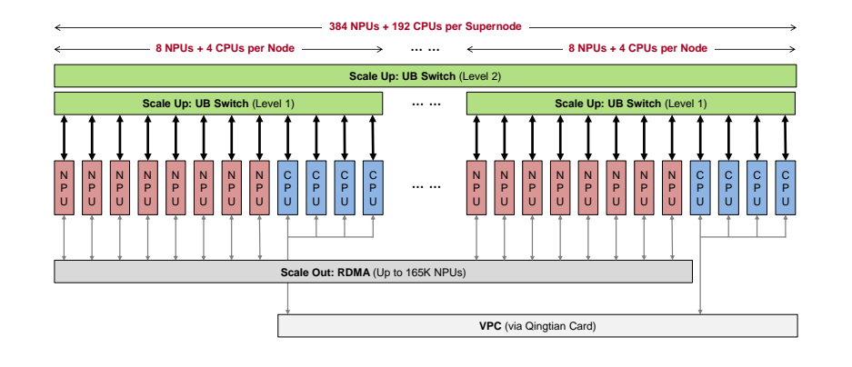

**Original caption:** Fig. 2. Peer-to-peer hardware architecture of a CloudMatrix384 supernode, featuring an ultra-high-bandwidth Unified Bus (UB) plane for intra-supernode scaling, an RDMA plane for inter-supernode communication, and a Virtual Private Cloud (VPC) plane for integration with the datacenter network. All reported network bandwidth values denote unidirectional bandwidth.

**中文图注:** Fig. 2. CloudMatrix384 超节点的对等硬件架构：超节点内部通过超高带宽统一总线（UB，灵衢）平面进行 scale-up（纵向扩展），超节点之间通过 RDMA 平面通信，并通过虚拟私有云（VPC）平面接入数据中心网络。图中所有网络带宽数值均指单向带宽。

**Source:** p.10 S040

**Original:** **2) RDMA Plane.**The RDMA plane enables scale-out communication across CloudMatrix384 supernodes and external RDMA-compatible systems. It currently adopts RDMA over Converged Ethernet (RoCE) to ensure compatibility with standard RDMA stacks. 1 NPUs are the sole participants in this plane, isolating RDMA traffic from control and storage operations. Key functions include: (1) high-speed transfer of active KV cache data between prefill and decode NPUs during inference; (2) support for distributed training and inference using RDMA-compliant frameworks; (3) low-latency interconnect across supernodes in multi-cluster deployments.

**中文:** **2) RDMA 平面。**RDMA 平面负责跨 CloudMatrix384 超节点的 scale-out（横向扩展）通信以及与外部 RDMA 兼容系统的互联。目前它采用融合以太网上的 RDMA（RoCE），以兼容标准 RDMA 协议栈。1 仅 NPU 参与该平面，从而将 RDMA 流量与控制及存储操作相互隔离。其主要功能包括：(1) 推理期间在 prefill（预填充）NPU 与解码 NPU 之间高速传输活跃 KV 缓存数据；(2) 支持使用兼容 RDMA 框架的分布式训练与推理；(3) 在多集群部署中提供跨超节点的低时延互连。

**Source:** p.10 S041

**Original:** **3) VPC Plane.**The virtual private cloud (VPC) plane connects the CloudMatrix384 supernode to the broader datacenter network via high-speed NICs (Huawei’s *Qingtian *card). It operates over standard Ethernet and IP protocols, optionally augmented with UB-over-Ethernet (UBoE). The VPC plane handles: (1) management and control-plane operations such as deployment, monitoring, and scheduling; (2) access to persistent storage, including the object storage service (OBS), the elastic volume service (EVS), and the scalable file system service (SFS); (3) external service communication from CPU-resident workloads, e.g., databases and user interfaces.

**中文:** **3) VPC 平面。**虚拟私有云（VPC）平面经由高速网卡（华为*擎天（Qingtian）*卡）将 CloudMatrix384 超节点接入更广的数据中心网络。它运行于标准以太网与 IP 协议之上，并可选地叠加以太网上的 UB（UB-over-Ethernet，UBoE）增强。VPC 平面承担：(1) 部署、监控、调度等管理与控制面操作；(2) 访问持久存储，包括对象存储（OBS）、弹性卷服务（EVS）与可扩展文件系统服务（SFS）；(3) 来自驻留 CPU 之负载（如数据库与用户界面）的外部服务通信。

**Source:** p.10 S042

**Original:** Although the long-term vision of CloudMatrix aims to converge RDMA and VPC planes into a single unified plane as shown in Figure 1, the current CloudMatrix384 separates them to ensure backward compatibility with legacy datacenter infrastructure. We discuss the future work of unifying VPC and RDMA planes in §6.1.1.

**中文:** 尽管如图 1 所示，CloudMatrix 的长期愿景是将 RDMA 与 VPC 平面融合为单一的统一平面，但当前 CloudMatrix384 仍将二者分离，以确保与传统数据中心基础设施的向后兼容。我们将在 §6.1.1 讨论统一 VPC 与 RDMA 平面的未来工作。

### Fig. 1. 图 1

**Placed near:** S042
**Source:** p.8 C001

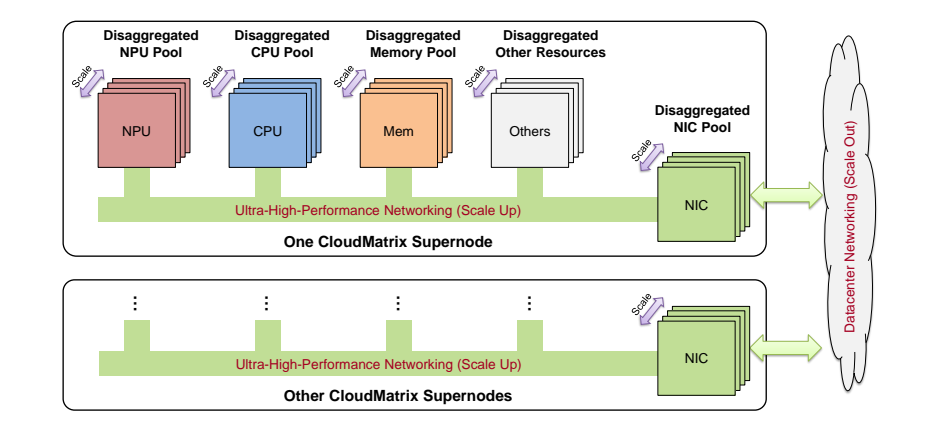

**Original caption:** Fig. 1. Huawei’s CloudMatrix architecture vision reimagines AI datacenter infrastructure from the ground up. By dismantling traditional siloed designs, it enables full peer-to-peer disaggregation and pooling of CPUs, NPUs, memory, NICs, and other resources over a unified, ultra-high-performance networking, forming the foundation for scalable, AI-native datacenters.

**中文图注:** Fig. 1. 华为 CloudMatrix 架构愿景从底层重新构想 AI 数据中心基础设施。它打破传统的烟囱式（siloed）设计，在统一的超高性能网络之上实现 CPU、NPU、内存、网卡（NIC）等资源的完全对等分离与池化，为可扩展的 AI 原生数据中心奠定基础。

### 3.3 Hardware Components / 3.3 硬件组件

### Fig. 3. 图 3

**Placed near:** S043
**Source:** p.11 C003

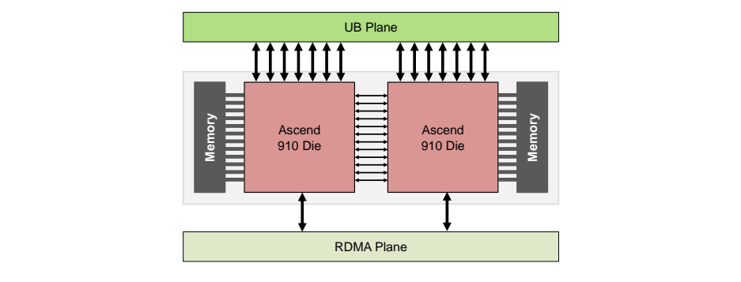

**Original caption:** Fig. 3. Logical overview of the Huawei Ascend 910 chip, highlighting its dual-die architecture. All reported network bandwidth values denote unidirectional bandwidth.

**中文图注:** Fig. 3. 华为昇腾 910（Ascend 910）芯片的逻辑概览，重点展示其双芯粒架构。图中所有网络带宽数值均指单向带宽。

### 3.3.1 Ascend 910 Chip / 3.3.1 昇腾 910（Ascend 910）芯片

### 3.3.2 Ascend 910 Node / 3.3.2 Ascend 910 节点

**Source:** p.11 S046

**Original:** Within the CPU complex, the four Kunpeng CPU sockets are interconnected via a full-mesh NUMA topology, enabling uniform memory access across all CPU-attached DRAM. One of the CPUs hosts the node’s *Qingtian *card, a dedicated data processing unit (DPU) that not only integrates high-speed network interfaces but also performs essential node-level resource management functions. This *Qingtian *card serves as the primary north–south egress point from the node, interfacing with the third distinct network plane: the datacenter’s *VPC plane *. 1 An alternative design, *RDMA over UB *, leverages UB’s native support for remote memory access to form a unified UB domain for both intra-and inter-supernode communication. While this approach offers streamlined semantics and avoids protocol translation overhead, the current implementation opts for RoCE to ensure immediate compatibility with existing RDMA libraries and tooling.

**中文:** 在 CPU 复合体中，四路鲲鹏（Kunpeng）CPU 插槽经全互连（full-mesh）NUMA 拓扑互连，实现对所有 CPU 侧 DRAM 的统一内存访问。其中一颗 CPU 承载节点的*擎天*卡——一款专用数据处理器（DPU），它不仅集成高速网络接口，还承担关键的节点级资源管理职能。该*擎天*卡是节点南北向流量的主要出口，与第三个独立的网络平面——数据中心的*VPC 平面*——对接。1 另一种设计方案 *RDMA over UB* 利用 UB 对远程内存访问的原生支持，为超节点内与超节点间通信构建统一的 UB 域。该方案语义更简洁，并可规避协议转换开销，但当前实现选择 RoCE，以确保与既有 RDMA 库及工具链的即时兼容。

### 3.3.3 UB Switch System / 3.3.3 UB 交换机系统

### Fig. 4. 图 4

**Placed near:** S047
**Source:** p.12 C004

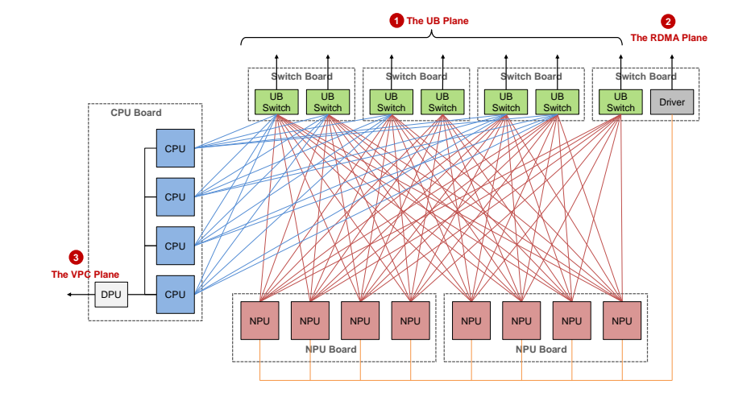

**Original caption:** Fig. 4. Logical overview of an Ascend 910 node within the CloudMatrix384. All reported network bandwidth values denote unidirectional bandwidth.

**中文图注:** Fig. 4. CloudMatrix384 中单个 Ascend 910 节点的逻辑概览。图中所有网络带宽数值均指单向带宽。

**Source:** p.12 S048

**Original:** Figure 5 illustrates the topology between the on-board first-tier (L1) UB switches (located inside each Ascend 910 node) and the rack-level L2 UB switches. The network is designed to be non-blocking, meaning there is *no *bandwidth oversubscription at the L2 switching tier. The L2 switches are partitioned into 7 independent *sub-planes *. Each sub-plane contains 16 L2 UB switch chips, and each L2 switch chip provides 48 ports.

**中文:** 图 5 展示了板载第一级（L1）UB 交换机（位于每个 Ascend 910 节点内部）与机柜级 L2 UB 交换机之间的拓扑。该网络按无阻塞设计，意味着 L2 交换层*不存在*带宽收敛（oversubscription）。L2 交换机被划分为 7 个独立的*子平面*。每个子平面包含 16 颗 L2 UB 交换芯片，每颗 L2 交换芯片提供 48 个端口。

### Fig. 5. 图 5

**Placed near:** S048
**Source:** p.13 C005

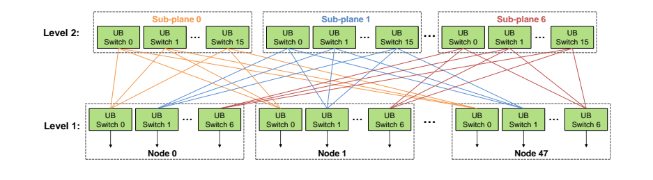

**Original caption:** Fig. 5. The UB switch system in the CloudMatrix384. All reported network bandwidth values denote unidi-rectional bandwidth.

**中文图注:** Fig. 5. CloudMatrix384 中的 UB 交换系统。图中所有网络带宽数值均指单向带宽。

**Source:** p.12 S049

**Original:** Inside each node, the 7 on-board L1 UB switch chips map one-to-one onto these 7 L2 sub-planes. Each L1 switch chip fans out over 16 links (one link to every L2 switch chip in its corresponding sub-plane). This configuration ensures that a node’s aggregate uplink bandwidth to the L2 fabric precisely matches its internal UB capacity, maintaining the non-blocking characteristic across the supernode.

**中文:** 在每个节点内部，7 颗板载 L1 UB 交换芯片与这 7 个 L2 子平面一一对应。每颗 L1 交换芯片通过 16 条链路扇出（通往其对应子平面中每颗 L2 交换芯片各一条链路）。这一配置确保节点通往 L2 网络的聚合上行带宽与其内部 UB 容量精确匹配，从而在整个超节点范围内保持无阻塞特性。

### 3.4 Software Stack / 3.4 软件栈

### 3.4.1 CANN for Ascend NPUs / 3.4.1 面向 Ascend NPU 的 CANN

**Source:** p.13 S052

**Original:** **CANN Architecture.**The CANN software stack (Figure 6) is composed of three primary layers: the driver, runtime, and libraries, an architecture analogous to NVIDIA’s CUDA ecosystem [40].

**中文:** **CANN 架构。**CANN 软件栈（图 6）由三个主要层次构成：驱动、运行时与库，其架构与 NVIDIA 的 CUDA 生态类似 [40]。

### Fig. 6. 图 6

**Placed near:** S052
**Source:** p.14 C006

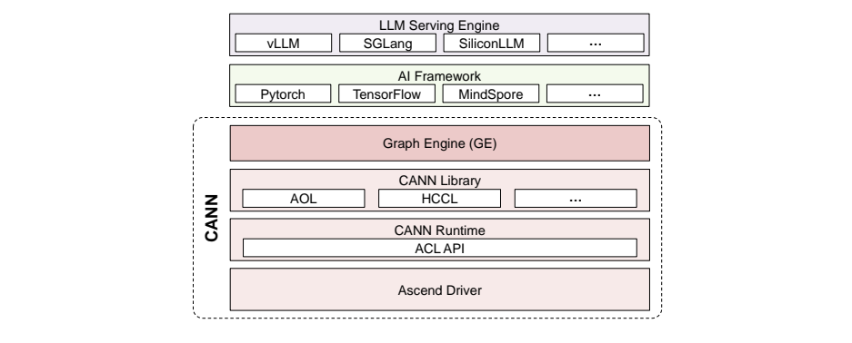

**Original caption:** Fig. 6. The CANN software stack for Huawei Ascend NPUs.

**中文图注:** Fig. 6. 面向华为 Ascend NPU 的 CANN 软件栈。

**Source:** p.13 S053

**Original:** *1) Driver Layer: *At the foundation, the Ascend NPU driver, comprising kernel modules and firmware, acts as the low-level interface between the operating system and the Ascend NPUs. It manages essential hardware interactions, including device initialization, resource allocation (memory, streams), command scheduling, and inter-NPU communication setup.

**中文:** *1) 驱动层：*处于最底层，昇腾 NPU 驱动由内核模块与固件构成，充当操作系统与 Ascend NPU 之间的底层接口。它管理关键的硬件交互，包括设备初始化、资源分配（内存、流）、命令调度以及 NPU 间通信的建立。

**Source:** p.13 S054

**Original:** *2) Runtime Layer: *The CANN Runtime is the core execution engine for applications on Ascend NPUs. It oversees the application lifecycle, orchestrates model computations, and provides compre-hensive device control, memory management, and execution management for models and operators. These functionalities are primarily accessed via the Ascend computing language (ACL) API.

**中文:** *2) 运行时层：*CANN Runtime 是 Ascend NPU 上应用的核心执行引擎。它监管应用生命周期、编排模型计算，并为模型与算子提供全面的设备控制、内存管理与执行管理。这些功能主要经昇腾计算语言（ACL）API 访问。

**Source:** p.13 S055

**Original:** *3) Library Layer: *This layer offers a suite of highly optimized software components to accelerate diverse AI workloads. Key elements include domain-specific acceleration libraries (AOL), the Huawei collective communication library (HCCL) for distributed tasks, an extensive operator package (OPP) with pre-optimized kernels, and engines for neural network acceleration (NNAE) and offline inference (NNRT). Support for custom operator development (e.g., via Ascend C) and integration with third-party libraries to further enhance its capabilities.

**中文:** *3) 库层：*该层提供一整套高度优化的软件组件，用于加速多样的 AI 负载。关键要素包括领域专用加速库（AOL）、面向分布式任务的华为集合通信库（HCCL）、内置大量预优化内核的算子包（OPP），以及神经网络加速引擎（NNAE）与离线推理引擎（NNRT）。此外还支持自定义算子开发（如通过 Ascend C）及与第三方库的集成，以进一步增强其能力。

**Source:** p.13 S056

**Original:** Beyond the core layers, the *graph engine (GE) *compiles and optimizes computation graphs from frameworks like PyTorch, TensorFlow, and MindSpore [28]. It bridges high-level models and low-level execution by applying whole-graph optimizations such as operator fusion, memory planning, dynamic shape handling, and scheduling. These optimizations reduce overhead and improve execution efficiency on Ascend NPUs.

**中文:** 在核心层之外，*图引擎（GE）*负责编译并优化来自 PyTorch、TensorFlow、MindSpore 等框架的计算图 [28]。它通过算子融合、内存规划、动态 shape 处理与调度等全图优化，在高层次模型与底层执行之间架设桥梁。这些优化降低了开销，提升了在 Ascend NPU 上的执行效率。

**Source:** p.13 S057

**Original:** **Framework Integration.**CANN offers extensive support for popular AI frameworks, signifi-cantly lowering the barrier to entry for adopting Ascend NPUs for existing and new AI projects: • *PyTorch: *Through the PyTorch Ascend adapter (torch_npu) [4], developers can seamlessly leverage Ascend NPU acceleration within their existing PyTorch workflows. Huawei pro-vides straightforward installation via pre-built Python wheel packages, comprehensive documentation on API compatibility and best practices, and simplified tools or guidelines for migrating CUDA-based code to CANN. • *TensorFlow: *CANN’s TF_Adapter [5] integrates Ascend acceleration capabilities directly into the TensorFlow framework, enabling high performance and straightforward adoption for TensorFlow-based AI projects with minimal code modification. • *ONNX: *Huawei offers a dedicated CANN execution provider [43] for the ONNX runtime. This enables efficient execution of models exported in the open neural network exchange (ONNX) format [42], facilitating broad model compatibility and streamlined deployment across heterogeneous hardware environments that include Ascend NPUs.

**中文:** **框架集成。**CANN 对主流 AI 框架提供广泛支持，显著降低了在既有与全新 AI 项目中采用 Ascend NPU 的门槛：• *PyTorch：*借助 PyTorch Ascend 适配器（torch_npu）[4]，开发者可在现有 PyTorch 工作流中无缝利用 Ascend NPU 加速。华为提供预构建 Python wheel 包以简化安装、覆盖 API 兼容性与最佳实践的完备文档，以及将 CUDA 代码迁移至 CANN 的简化工具或指南。• *TensorFlow：*CANN 的 TF_Adapter [5] 将 Ascend 加速能力直接集成进 TensorFlow 框架，使基于 TensorFlow 的 AI 项目只需极少代码改动即可获得高性能与顺畅接入。• *ONNX：*华为为 ONNX Runtime 提供了专用的 CANN execution provider [43]，可高效执行以开放神经网络交换（ONNX）格式导出的模型 [42]，在包含 Ascend NPU 的异构硬件环境中实现广泛的模型兼容与顺畅部署。

**Source:** p.14 S058

**Original:** In summary, CANN delivers a vertically-integrated software stack including driver, runtime, and libraries comparable to NVIDIA’s CUDA while being tailored to Ascend NPUs. Its GE compiles whole-graph representations into highly-optimized execution plans, and rich framework adapters make porting existing workloads almost friction-free. Together, these components enable devel-opers to harness Ascend hardware with minimal code changes while achieving near-peak device performance across a broad spectrum of AI applications.

**中文:** 综上，CANN 提供了覆盖驱动、运行时与库的垂直整合软件栈，可媲美 NVIDIA 的 CUDA，同时针对 Ascend NPU 定制。其 GE 将全图表示编译为高度优化的执行计划，丰富的框架适配器使既有负载的移植几乎毫无摩擦。这些组件相辅相成，使开发者以极少的代码改动即可驾驭昇腾硬件，并在广泛的 AI 应用中达到接近峰值的设备性能。

### 3.4.2 Infrastructure Software for Cloud Deployment / 3.4.2 面向云部署的基础设施软件

**Source:** p.14 S060

**Original:** **MatrixResource**manages physical resource provisioning within a supernode, including com-pute instance allocation based on topology-aware scheduling. The instance provisioning tasks are executed by a MatrixResource agent that runs on the *Qingtian *card in each compute node of the CloudMatrix384.

**中文:** **MatrixResource** 负责超节点内的物理资源供给，包括基于拓扑感知调度的计算实例分配。实例供给任务由运行在 CloudMatrix384 每个计算节点*擎天*卡上的 MatrixResource 代理执行。

**Source:** p.14 S061

**Original:** **MatrixLink**delivers service-oriented networking for the UB and RDMA networks, supporting QoS guarantees and dynamic routing. It manages link-level configurations and enables network-aware workload placement for optimal communication efficiency. These tasks are also executed by a MatrixLink agent on the *Qingtian *card in each compute node.

**中文:** **MatrixLink** 为 UB 与 RDMA 网络提供面向服务的组网能力，支持 QoS 保障与动态路由。它管理链路级配置，并支持网络感知的负载放置以获取最优通信效率。这些任务同样由每个计算节点*擎天*卡上的 MatrixLink 代理执行。

**Source:** p.14 S062

**Original:** **MatrixCompute**coordinates the lifecycle of CloudMatrix instances, from bare-metal provi-sioning to auto-scaling and fault recovery. It orchestrates resource composition across multiple physical nodes to create tightly-coupled *logical supernode instances *.

**中文:** **MatrixCompute** 统筹 CloudMatrix 实例的生命周期，覆盖裸金属供给、自动扩缩容与故障恢复。它跨多个物理节点编排资源组合，构建紧耦合的*逻辑超节点实例*。

**Source:** p.14 S063

**Original:** **MatrixContainer**provides container services based on Kubernetes, enhanced with topology-aware scheduling to exploit CloudMatrix’s high-performance interconnect. It enables users to deploy distributed AI workloads using familiar containerized workflows.

**中文:** **MatrixContainer** 提供基于 Kubernetes 的容器服务，并辅以拓扑感知调度，以充分释放 CloudMatrix 高性能互连的潜力。用户可使用熟悉的容器化工作流部署分布式 AI 负载。

**Source:** p.14 S064

**Original:** **ModelArts**sits atop the infrastructure stack, offering end-to-end AI platform services [27]. It comprises: *ModelArts Lite *, for direct access to Ascend hardware via bare-metal and containerized

**中文:** **ModelArts** 位于基础设施栈的顶层，提供端到端 AI 平台服务 [27]。它包含：*ModelArts Lite*，用于通过裸金属与容器化

**Source:** p.15 S065

**Original:** environments; *ModelArts Standard *, which supports full AI development and MLOps pipelines; *ModelArts Studio *, which delivers Model-as-a-Service (MaaS) capabilities for fast deployment and customization of LLMs and other models.

**中文:** 环境直接访问昇腾硬件；*ModelArts Standard*，支持完整的 AI 开发与 MLOps 流水线；*ModelArts Studio*，提供模型即服务（MaaS）能力，用于 LLM 及其他模型的快速部署与定制。

### Fig. 7. 图 7

**Placed near:** S065
**Source:** p.15 C007

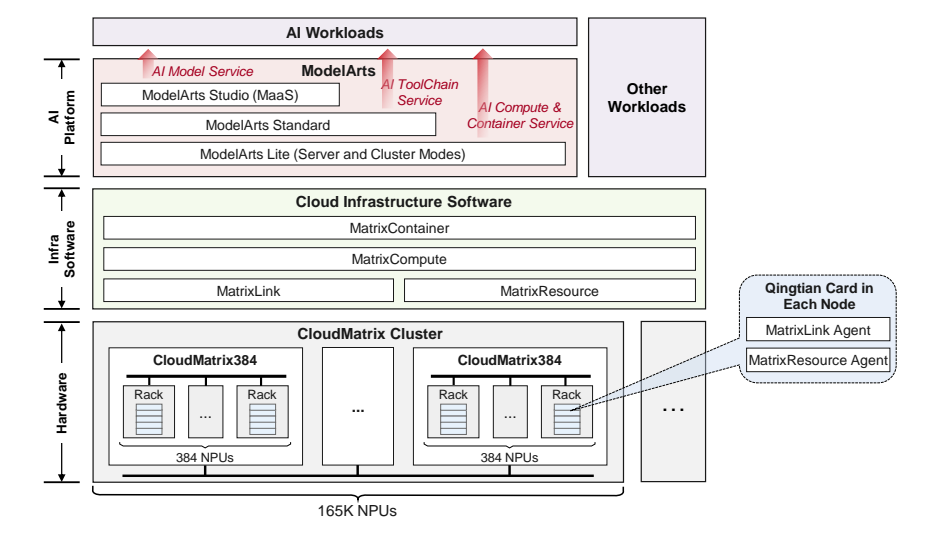

**Original caption:** Fig. 7. The cloud infrastructure software stack for deploying CloudMatrix384.

**中文图注:** Fig. 7. 用于部署 CloudMatrix384 的云基础设施软件栈。

**Source:** p.15 S066

**Original:** Together, these components enable users to build and deploy large-scale AI applications efficiently on CloudMatrix384, abstracting underlying complexity while preserving performance.

**中文:** 这些组件相辅相成，使用户能够在 CloudMatrix384 上高效构建并部署大规模 AI 应用，在屏蔽底层复杂性的同时保持性能。

### 3.5 Suitability Analysis for DeepSeek Models / 3.5 面向 DeepSeek 模型的适配性分析

### 3.5.1 DeepSeek Models and Their Deployment on NVIDIA H800 / 3.5.1 DeepSeek 模型及其在 NVIDIA H800 上的部署

**Source:** p.15 S069

**Original:** DeepSeek deploys its V3 and R1 models on clusters of NVIDIA H800 GPUs, each equipped with 80 GB of memory and connected via NVLink within nodes and 400 Gbps InfiniBand across nodes [11]. The deployment adopts a disaggregated prefill-decode architecture. In the prefill phase, DeepSeek organizes four H800 nodes (32 GPUs in total) into a single deployment unit. Within each unit, 256 router experts are strategically distributed across GPUs, with each GPU hosting nine router experts and one shared expert. This configuration, denoted as *DP32+EP32 *, employs expert parallelism (EP) across the 32 GPUs, while both the shared expert and the MLA mechanism are replicated

**中文:** DeepSeek 将其 V3 与 R1 模型部署于 NVIDIA H800 GPU 集群，每颗 GPU 配备 80 GB 内存，节点内经 NVLink 互连，跨节点采用 400 Gbps InfiniBand [11]。该部署采用分离式 prefill-解码架构。prefill 阶段，DeepSeek 将四个 H800 节点（共 32 颗 GPU）组织为一个部署单元。在每个单元内，256 个路由专家被策略性分布到各 GPU，每颗 GPU 承载 9 个路由专家与 1 个共享专家。该配置记作 *DP32+EP32*，在 32 颗 GPU 间采用专家并行（EP），而共享专家与多头潜在注意力（MLA）机制则经

**Source:** p.16 S070

**Original:** via data parallelism (DP) across the same group of GPUs. During the decode phase, DeepSeek expands parallelism further to *DP144+EP144 *, grouping 18 nodes for a total of 144 GPUs. Under this larger deployment, each GPU manages two router experts and one shared expert, maintaining a system-wide redundancy of 32 router expert replicas.

**中文:** 跨同一组 GPU 的数据并行（DP）进行复制。解码阶段，DeepSeek 将并行规模进一步扩展为 *DP144+EP144*，编组 18 个节点、共 144 颗 GPU。在这一更大规模的部署下，每颗 GPU 管理 2 个路由专家与 1 个共享专家，并维持全系统 32 份路由专家副本的冗余。

**Source:** p.16 S071

**Original:** To optimize throughput and latency, DeepSeek employs a dual-microbatch pipeline strategy that overlaps computation and all-to-all communication effectively. Specifically, while one microbatch is involved in MoE-related dispatch and combination, the next microbatch concurrently undergoes local attention or MLP computations.

**中文:** 为优化吞吐与时延，DeepSeek 采用双微批次流水线策略，使计算与 all-to-all 通信高效重叠。具体而言，当一个微批次参与 MoE 相关的 token 分发与合并时，下一个微批次同时执行本地注意力或 MLP 计算。

**Source:** p.16 S072

**Original:** This carefully orchestrated deployment delivers substantial throughput gains. Each H800 GPU achieves up to 9,213 tokens/s during prefill, aided by a 56.3% context caching hit rate, resulting in an effective throughput of 4,026 tokens/s when cache hits are excluded. During decoding, each GPU sustains an average throughput of 1,850 tokens/s.

**中文:** 这一精心编排的部署带来了可观的吞吐收益。prefill 期间每颗 H800 GPU 最高可达 9,213 tokens/s，在 56.3% 的上下文缓存命中率加持下，剔除缓存命中后有效吞吐为 4,026 tokens/s。解码期间，每颗 GPU 平均维持 1,850 tokens/s 的吞吐。

**Source:** p.16 S073

**Original:** These performance optimization strategies serve as valuable references for the forthcoming deployment of DeepSeek models on Huawei CloudMatrix384.

**中文:** 这些性能优化策略为随后在华为 CloudMatrix384 上部署 DeepSeek 模型提供了宝贵参考。

### 3.5.2 Architectural Synergy between CloudMatrix384 and DeepSeek Models / 3.5.2 CloudMatrix384 与 DeepSeek 模型的架构协同

**Source:** p.16 S075

**Original:** **MoE Communication Synergy: Efficient Dispatch and Combination.**DeepSeek-R1 adopts an MoE architecture, which imposes substantial inter-NPU communication demands during token dispatch and expert output combination. CloudMatrix384’s high-bandwidth, low-latency UB inter-connect is particularly well-suited to these requirements. During dispatch, tokens must be routed from routers to selected experts, potentially spanning hundreds of NPUs. The all-to-all UB topology ensures rapid delivery with minimal overhead. Similarly, in the combination phase, multiple ex-perts’ outputs must be merged via weighted summation across distributed compute units. The high bandwidth of the UB plane enables efficient collection of expert output, outperforming traditional architectures where network performance can severely hinder MoE inference throughput.

**中文:** **MoE 通信协同：高效的分发与合并。**DeepSeek-R1 采用 MoE 架构，在 token 分发与专家输出合并期间对 NPU 间通信提出很高要求。CloudMatrix384 高带宽、低时延的 UB 互连恰好契合这些需求。分发阶段，token 必须从路由器送往被选中的专家，跨度可达数百个 NPU；all-to-all 的 UB 拓扑确保以极小开销快速送达。类似地，合并阶段需要跨分布式计算单元以加权求和方式融合多个专家的输出。UB 平面的高带宽使专家输出得以高效汇集，优于网络性能可能严重拖累 MoE 推理吞吐的传统架构。

**Source:** p.16 S076

**Original:** **Memory Capacity and Management: Accommodating Large Models and KV Caches.** DeepSeek-R1, with parameter counts approaching 671B, requires vast memory resources for both weights and activations, including attention KV caches. CloudMatrix384 provides a huge amount of total NPU-attached memory, enabling distributed storage of model weights through a combination of tensor, pipeline, and expert parallelism. Beyond model weights, LLMs’ attention mechanisms maintain sizable KV caches, especially under long-context or high-batch workloads. CloudMatrix384’s generous memory footprint supports these scenarios, but efficient partitioning and synchronization of KV caches across NPUs remain essential.

**中文:** **内存容量与管理：容纳大模型与 KV 缓存。**DeepSeek-R1 参数量接近 671B，其权重与激活（包括注意力 KV 缓存）都需要庞大的内存资源。CloudMatrix384 提供总量巨大的 NPU 侧内存，可通过张量并行、流水线并行与专家并行相结合的方式分布式存储模型权重。除模型权重外，LLM 的注意力机制还会维持可观的 KV 缓存，在长上下文或高批次负载下尤甚。CloudMatrix384 充裕的内存规模能够支撑这些场景，但跨 NPU 高效划分与同步 KV 缓存依然必不可少。

**Source:** p.16 S077

**Original:** **Context Cache Reuse: Accelerating Cache Access.**LLM workloads, especially in multi-turn dialogue and long-context applications, benefit substantially from prefix cache reuse, with DeepSeek-AI reporting cache hit rates exceeding 56%. In conventional systems, retrieving historical KV cache from off-chip DRAM or even slower storage layers introduces significant latency, impeding inference performance. CloudMatrix384 mitigates this bottleneck by enabling NPUs to access a disaggregated, CPU-attached DRAM pool directly over the high-bandwidth UB plane (§4.4.1). This architecture delivers memory-class bandwidth and latency for remote KV cache access. As a result, it minimizes redundant prefill computation, significantly lowers time-to-first-token (TTFT), and scales efficiently to long-context workloads without exhausting limited NPU memory.

**中文:** **上下文缓存复用：加速缓存访问。**LLM 负载——尤其是多轮对话与长上下文应用——能从前缀缓存复用中显著获益，DeepSeek-AI 报告的缓存命中率超过 56%。在传统系统中，从片外 DRAM 乃至更慢的存储层检索历史 KV 缓存会引入显著时延，拖累推理性能。CloudMatrix384 让 NPU 经高带宽 UB 平面直接访问分离式的 CPU 侧 DRAM 池，从而化解这一瓶颈（§4.4.1）。该架构为远程 KV 缓存访问提供内存级的带宽与时延，因而能最大限度减少冗余 prefill 计算、显著降低首 token 时间（TTFT），并可高效扩展至长上下文负载而不耗尽有限的 NPU 内存。

**Source:** p.16 S078

**Original:** **Quantization for Efficiency: INT8 Support.**The Ascend 910’s support for INT8 computation (as described in §3.3.1) presents a valuable opportunity for optimizing the inference performance

**中文:** **面向效率的量化：INT8 支持。**Ascend 910 对 INT8 计算的支持（如 §3.3.1 所述）为优化推理性能

**Source:** p.17 S079

**Original:** of DeepSeek models. Quantifying model weights and activations from higher precision formats (like FP16 or BF16) to INT8 can significantly decrease the model’s memory footprint, reduce computational overhead, and lessen memory bandwidth demands during execution. These benefits can translate into improved throughput and reduced latency.

**中文:** DeepSeek 模型。将模型权重与激活从更高精度格式（如 FP16 或 BF16）量化为 INT8，可以显著降低模型的内存占用、减少计算开销，并减轻执行期间的内存带宽需求。这些收益能够转化为更高的吞吐量与更低的时延。

**Source:** p.17 S080

**Original:** In summary, CloudMatrix384’s architecture, including its large-scale NPU compute, extensive memory capacity, high-bandwidth UB interconnect, and DRAM-pool-based caching, is tightly aligned with the needs of large-scale LLM serving. These synergies provide a solid foundation for the optimized inference architecture presented in subsequent sections.

**中文:** 总而言之，CloudMatrix384 的架构——包括大规模 NPU 算力、充裕的内存容量、高带宽 UB 互连以及基于 DRAM 池化的缓存——与大规模 LLM 推理服务的需求高度契合。这些协同优势为后续小节提出的优化推理架构奠定了坚实基础。

## 4 DeepSeek Serving on Huawei CloudMatrix384 / 4 在华为 CloudMatrix384 上进行 DeepSeek 推理服务

**Source:** p.17 S517

**Original:** To fully exploit CloudMatrix384’s capabilities, we propose CloudMatrix-Infer, a comprehensive LLM serving solution that establishes a best practice for deploying large-scale MoE models. We use the DeepSeek-R1 model as a representative example to illustrate our recommended architecture and techniques that exploit cross-layer optimizations for efficient LLM serving on the CloudMatrix384. Figure 8 provides an overview of the proposed optimization techniques across multiple layers of the AI software stack. In this section, we begin by introducing a novel peer-to-peer serving architecture based on prefill- decode-caching (PDC) disaggregation, which decouples prefill, decode, and caching responsibilities and maps them to dedicated NPU and CPU groups connected via high-performance UB intercon- nects (§4.1). We then introduce our tightly-coupled decode optimizations, which scale large-scale expert parallelism (LEP) across hundreds of NPU dies to accelerate MoE inference (§4.2). Next, we describe resource-efficient prefill strategies that apply hybrid parallelism and pipeline to improve compute efficiency (§4.3). We further elaborate on UB-driven distributed caching mechanisms that unify memory access across nodes, enabling low-latency access of models and historical KV caches (§4.4). Finally, we detail the system’s support for INT8 quantization, which further boosts end-to-end inference efficiency (§4.5).

**中文:** 为了充分发挥 CloudMatrix384 的能力，我们提出 CloudMatrix-Infer，一套完整的 LLM 推理服务方案，为部署大规模 MoE（混合专家）模型确立了最佳实践。我们以 DeepSeek-R1 模型为代表性示例，阐述我们推荐的架构与技术，通过跨层优化在 CloudMatrix384 上实现高效 LLM 推理服务。Figure 8 概述了所提出的横跨 AI 软件栈多个层次的优化技术。

### Fig. 8. 图 8

**Placed near:** S517
**Source:** p.17 C008

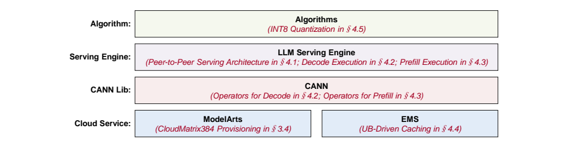

**Original caption:** Fig. 8. An overview of our proposed optimization techniques in different layers of the AI software stack.

**中文图注:** Fig. 8. 我们提出的各项优化技术在 AI 软件栈不同层次中的总览。

**Source:** p.17 S081

**Original:** In this section, we begin by introducing a novel *peer-to-peer serving architecture *based on prefill-decode-caching (PDC) disaggregation, which decouples prefill, decode, and caching responsibilities and maps them to dedicated NPU and CPU groups connected via high-performance UB intercon-nects (§4.1). We then introduce our *tightly-coupled decode optimizations *, which scale large-scale expert parallelism (LEP) across hundreds of NPU dies to accelerate MoE inference (§4.2). Next, we describe *resource-efficient prefill strategies *that apply hybrid parallelism and pipeline to improve compute efficiency (§4.3). We further elaborate on *UB-driven distributed caching mechanisms *that unify memory access across nodes, enabling low-latency access of models and historical KV caches (§4.4). Finally, we detail the system’s support for *INT8 quantization *, which further boosts end-to-end inference efficiency (§4.5).

**中文:** 在本节中，我们首先介绍一种新颖的*对等推理服务架构（peer-to-peer serving architecture）*，它基于 prefill-解码-缓存分离（PDC 分离），将 prefill（预填充）、解码与缓存三类职责解耦，并映射到经由高性能 UB 互连的专用 NPU 与 CPU 组（§4.1）。随后我们介绍*紧耦合解码优化*，将大规模专家并行（LEP）扩展到数百个 NPU 芯粒上以加速 MoE 推理（§4.2）。接着，我们描述*资源高效的 prefill 策略*，通过混合并行与流水线提升计算效率（§4.3）。我们进一步阐述*UB 驱动的分布式缓存机制*，统一跨节点的内存访问，实现对模型与历史 KV 缓存的低时延访问（§4.4）。最后，我们详述系统对 *INT8 量化*的支持，进一步提升端到端推理效率（§4.5）。

### 4.1 Overview: A Peer-to-Peer Serving Architecture with PDC Disaggregation / 4.1 概览：采用 PDC 分离的对等推理服务架构

**Source:** p.18 S083

**Original:** workload demands, maximizing resource utilization and end-to-end performance. These subsys-tems are interconnected through CloudMatrix384’s high-bandwidth networking to form a tightly integrated inference pipeline: • *Prefill Cluster: *A set of NPUs dedicated to processing the input prompt, consisting of all tokens in the user’s query or context, to generate the first output token and construct the initial KV cache. • *Decode Cluster: *A distinct group of NPUs responsible for autoregressively generating subse-quent tokens by consuming and updating the KV cache until an end-of-sequence token is emitted or the output length limit is reached. • *Caching Cluster: *A UB-connected caching layer built on a disaggregated memory pool, providing (i) *context caching *to accelerate prefill through KV cache reuse, and (ii) *model * *caching *to expedite model block loading and reduce cold-start latency.

**中文:** ……负载需求，从而最大化资源利用率与端到端性能。这些子系统通过 CloudMatrix384 的高带宽网络互连，构成一条紧密集成的推理流水线：• *Prefill 集群：*一组专门处理输入 prompt 的 NPU，输入 prompt 包含用户 query 或上下文中的全部 token，用于生成首个输出 token 并构建初始 KV 缓存。• *解码（Decode）集群：*另一组 NPU，负责以自回归方式生成后续 token，在此过程中消费并更新 KV 缓存，直到产生序列结束（end-of-sequence）token 或达到输出长度上限。• *缓存（Caching）集群：*构建在分离式内存池之上、由 UB 互连的缓存层，提供（i）*上下文缓存（context caching）*，通过 KV 缓存复用加速 prefill；（ii）*模型缓存（model caching）*，加速模型分块加载并降低冷启动时延。

**Source:** p.18 S084

**Original:** To better understand the motivation and effectiveness of our proposed design, it is instructive to contrast it with existing *KVCache-centric *architectures [41, 48] that dominate existing LLM serving systems.

**中文:** 为了更好地理解我们设计的动机与有效性，不妨将其与现有 LLM 推理服务系统中占主导地位的 *KVCache 中心化（KVCache-centric）*架构 [41, 48] 进行对比。

**Source:** p.18 S085

**Original:** **KVCache-centric vs. Peer-to-Peer Serving Architectures:**Existing LLM serving systems such as NVIDIA Dynamo [41] and Mooncake [48] follow a *KVCache-centric *design, where request scheduling is tightly coupled with KV cache locality. In these systems, requests are typically routed to the specific compute nodes that already hold the corresponding KV cache from previous interactions. This cache-aware scheduling is essential to mitigate the significant performance penalty of remote memory access, as intra-node memory access (e.g., via PCIe at ~256 GB/s) vastly outpaces inter-node bandwidth (typically at ~25 GB/s or 200 Gbps). As a result, remote KV cache loading often incurs substantial latency. However, this design introduces non-trivial scheduling complexity and risks degrading load balance, especially under dynamic workloads. Additionally, this design limits global resource efficiency, as DRAM on decode nodes usually remains siloed and underutilized, unable to contribute meaningfully to shared caching capacity.

**中文:** **KVCache 中心化 vs. 对等推理服务架构：**NVIDIA Dynamo [41] 与 Mooncake [48] 等现有 LLM 推理服务系统遵循 *KVCache 中心化*设计，请求调度与 KV 缓存局部性紧密耦合。在这类系统中，请求通常被路由到已持有前次交互对应 KV 缓存的特定计算节点。这种缓存感知调度对于缓解远程内存访问的显著性能损失至关重要：节点内内存访问（例如经由 PCIe，约 256 GB/s）远超节点间带宽（通常约 25 GB/s，即 200 Gbps）。因此，远程加载 KV 缓存往往会带来可观的时延。然而，这种设计引入了不小的调度复杂度，并有损害负载均衡的风险，在动态负载下尤甚。此外，该设计还限制了全局资源效率：解码节点上的 DRAM 通常彼此割裂且利用率不足，难以为共享缓存容量做出有效贡献。

**Source:** p.18 S086

**Original:** Our *peer-to-peer serving architecture *in CloudMatrix-Infer takes full advantage of the Cloud- Matrix384’s ultra-high-bandwidth UB interconnect. This enables uniform access to a distributed caching cluster (Section 4.4) built on a disaggregated memory pool. Crucially, all NPUs, regardless of whether they serve prefill or decode tasks, can directly access this shared disaggregated memory pool, which spans both prefill and decode nodes. This fully peer-to-peer design effectively *flattens * *the memory hierarchy *, bridging the traditional gap between local and remote access latency.

**中文:** CloudMatrix-Infer 中的*对等推理服务架构*充分利用了 CloudMatrix384 超高带宽的 UB 互连，使构建在分离式内存池之上的分布式缓存集群（Section 4.4）可以被统一访问。关键在于，所有 NPU 无论承担 prefill 还是解码任务，都可以直接访问这个横跨 prefill 节点与解码节点的共享分离式内存池。这种完全对等的设计有效地*拉平了内存层次结构（flattens the memory hierarchy）*，弥合了本地访问与远程访问时延之间的传统鸿沟。

**Source:** p.18 S087

**Original:** Decoupling request scheduling from KV cache placement offers several key advantages. First, it enables lightweight, stateless scheduling, allowing inference requests to be dispatched to any available NPU instance without constraints imposed by data locality. This significantly improves system-wide load balancing and NPU utilization. Second, it eliminates the need for complex, affinity-aware scheduling mechanisms, thereby reducing architectural complexity and easing system maintenance. Third, by pooling DRAM resources across prefill and decode nodes, the system forms a unified, elastic caching substrate that enhances memory utilization, increases cache hit rates, and offers greater resilience under skewed or bursty workloads.

**中文:** 将请求调度与 KV 缓存放置解耦带来若干关键优势。其一，实现了轻量级的无状态调度，推理请求可以被派发到任何可用的 NPU 实例，而不受数据局部性约束，显著改善了全系统负载均衡与 NPU 利用率。其二，免除了复杂的亲和性感知调度机制，降低了架构复杂度并减轻了系统维护负担。其三，通过将 prefill 节点与解码节点的 DRAM 资源池化，系统形成一个统一且富有弹性的缓存基底，提升内存利用率、提高缓存命中率，并在倾斜或突发负载下具备更强的韧性。

**Source:** p.18 S088

**Original:** **Prefill and Decode Deployments.**Aligned with prior work [41, 47, 48, 57], CloudMatrix-Infer adopts the strategy of disaggregating the prefill and decode phases across distinct NPU groups. By decoupling these two phases (each characterized by distinct performance bottlenecks), CloudMatrix- Infer enables phase-specific hardware allocation, parallelism execution, and independent scalability in response to dynamic workload characteristics.

**中文:** **Prefill 与解码的部署方式。**与先前工作 [41, 47, 48, 57] 一致，CloudMatrix-Infer 采取将 prefill 与解码两个阶段分离到不同 NPU 组的策略。通过解耦这两个性能瓶颈特征各异的阶段，CloudMatrix-Infer 得以按阶段特性进行硬件分配与并行执行，并随动态负载特征独立扩展。

**Source:** p.18 S089

**Original:** Each prefill instance is provisioned with 16 Ascend 910 NPUs (32 dies) on CloudMatrix384 and operates with 32-way expert parallelism (EP32). The expert configuration includes 10 experts per

**中文:** 每个 prefill 实例在 CloudMatrix384 上配置 16 颗昇腾 910（Ascend 910）NPU（32 个芯粒），以 32 路专家并行（EP32）运行。该专家配置在每个

**Source:** p.19 S090

**Original:** rank: one shared expert, eight router experts, and one redundant router expert to support expert parallelism load balancing (EPLB). To further improve efficiency, we employ a hybrid parallelism strategy for MLA computation and apply a microbatch-based pipeline to overlap communication overheads (§4.3).

**中文:** rank 中包含 10 个专家：一个共享专家、八个路由专家，以及一个用于支持专家并行负载均衡（EPLB）的冗余路由专家。为进一步提升效率，我们在多头潜在注意力（MLA）计算中采用混合并行策略，并应用基于微批次的流水线来掩盖通信开销（§4.3）。

### Fig. 9. 图 9

**Placed near:** S090
**Source:** p.19 C009

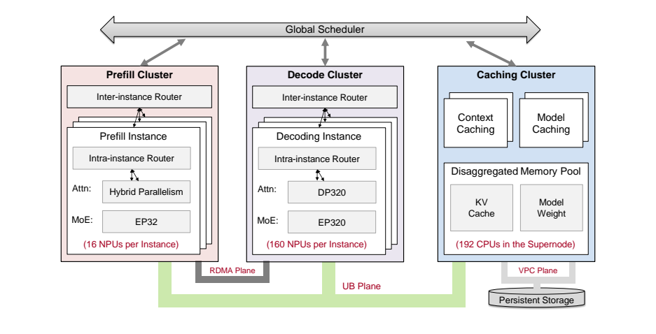

**Original caption:** Fig. 9. Peer-to-peer serving architecture with prefill-decode-caching (PDC) disaggregation on CloudMatrix384, enabling all NPUs to uniformly access a shared caching cluster backed by a disaggregated memory pool over the ultra-high-bandwidth UB network.

**中文图注:** Fig. 9. CloudMatrix384 上采用 prefill-解码-缓存分离（PDC 分离）的对等推理服务架构，使所有 NPU 都能经由超高带宽 UB 网络统一访问由分离式内存池支撑的共享缓存集群。

**Source:** p.19 S091

**Original:** Each decode instance is allocated a significantly larger NPU group, typically 160 Ascend 910 NPUs (320 dies), to meet the high throughput and low latency demands of autoregressive generation. This setup corresponds to 320-way expert parallelism (EP320) for the MoE layers. Each rank hosts one expert, with the overall configuration consisting of 32 shared experts, 256 distinct router experts, and 32 redundant router experts to facilitate EPLB. To further accelerate decoding, we introduce optimized Ascend-native operators, a pipelined decoding strategy, and multiple-token prediction support, as detailed in §4.2.

**中文:** 每个解码实例则分配规模大得多的 NPU 组，通常为 160 颗昇腾 910 NPU（320 个芯粒），以满足自回归生成对高吞吐与低时延的要求。该配置对应 MoE 层的 320 路专家并行（EP320）。每个 rank 承载一个专家，整体配置包括 32 个共享专家、256 个互不相同的路由专家，以及 32 个便于 EPLB 的冗余路由专家。为进一步加速解码，我们引入了优化的昇腾原生算子、流水线化解码策略以及多 token 预测（MTP）支持，详见 §4.2。

**Source:** p.19 S092

**Original:** **Dynamic Adjustment for Asynchronous Real-World Workloads.**In real-world online serving scenarios, the disaggregated PDC serving architecture enables dynamic, fine-grained ad-justment of the numbers of prefill, decode, and caching nodes based on the statistical characteristics of incoming workloads. For example, requests with longer input prompts increase the relative demand for prefill nodes, while workloads generating longer outputs require more decode capacity. These ratios are not fixed but adapt over time to maximize efficiency and maintain latency SLOs.

**中文:** **面向异步真实负载的动态调整。**在真实在线服务场景中，分离式的 PDC 服务架构支持根据流入负载的统计特征，动态、细粒度地调整 prefill、解码与缓存节点的数量。例如，输入 prompt 较长的请求会提高对 prefill 节点的相对需求，而生成较长输出的负载则需要更多解码容量。这些比例并非固定不变，而是随时间自适应调整，以最大化效率并维持时延服务级目标（SLO）。

**Source:** p.19 S093

**Original:** Furthermore, user sessions arrive and depart asynchronously, each with its own start time, prompt length, and generation duration. To cope with this highly dynamic and unpredictable work-load pattern, the responsibility of CloudMatrix-Infer is to enforce pseudo-synchronous execution through batching and scheduling mechanisms. Specifically, it aligns requests at token boundaries, allowing multiple sessions to be co-scheduled and processed concurrently. This batching strategy amortizes computation, improves throughput, and ensures high resource utilization, even under fully asynchronous request arrival patterns.

**中文:** 此外，用户会话的到达与离开都是异步的，各自具有不同的起始时间、prompt 长度与生成时长。为应对这种高度动态且不可预测的负载模式，CloudMatrix-Infer 的职责是通过批处理与调度机制强制实现伪同步执行。具体而言，它在 token 边界处对齐请求，使多个会话可以被协同调度、并发处理。这种批处理策略摊薄了计算成本、提升了吞吐量，即使在完全异步的请求到达模式下也能确保较高的资源利用率。

### 4.2 Tightly-Coupled Decode with Large-scale Expert Parallelism / 4.2 紧耦合解码与大规模专家并行

**Source:** p.20 S095

**Original:** To address these challenges, we introduce a set of hardware-aware optimization techniques tailored to the CloudMatrix384. First, we present our fused communication operator design that exploits the UB plane for low-latency, high-throughput MoE execution (§4.2.1). Next, we detail our custom MLA implementation for the Ascend 910 (§4.2.2) and describe a microbatch-based decode pipeline that overlaps two execution streams to hide latency (§4.2.3). Finally, we explain how the CloudMatrix-Infer supports multiple-token prediction (MTP), a feature leveraged by DeepSeek-R1 to improve decode throughput (§4.2.4).

**中文:** 为应对这些挑战，我们提出一套面向 CloudMatrix384 的硬件感知优化技术。首先，我们介绍融合通信算子设计，利用 UB 平面实现低时延、高吞吐的 MoE 执行（§4.2.1）。接着，我们详述面向昇腾 910 的定制 MLA 实现（§4.2.2），并描述一种基于微批次的解码流水线，通过重叠两条执行流来掩盖时延（§4.2.3）。最后，我们说明 CloudMatrix-Infer 如何支持多 token 预测（MTP）——DeepSeek-R1 借助该特性提升解码吞吐量（§4.2.4）。

### 4.2.1 Fused Communication Operators for LEP / 4.2.1 面向 LEP 的融合通信算子

**Source:** p.20 S097

**Original:** (1) *Communication Overheads: *The three all-to-all communications introduce significant latency, exacerbated by the large communication domain (hundreds of NPUs).

**中文:** (1) *通信开销：*三次 all-to-all 通信会引入可观的时延，而庞大的通信域（数百个 NPU）又进一步加剧了这一问题。

**Source:** p.20 S098

**Original:** (2) *Dynamic Shapes: *Data shapes for all-to-all communication are dynamic because the number of tokens assigned to each expert varies per decode iteration. This dynamism reduces execution efficiency due to the need for dynamic memory allocation and frequent CPU-NPU synchronization.

**中文:** (2) *动态形状：*all-to-all 通信的数据形状是动态变化的，因为每个解码迭代中分配给各专家的 token 数量不同。这种动态性要求动态内存分配和频繁的 CPU-NPU 同步，从而降低执行效率。

**Source:** p.20 S099

**Original:** (3) *Sequential Dependencies: *The sequential execution nature of the MoE computation creates dependencies between steps, reducing resource utilization and throughput.

**中文:** (3) *顺序依赖：*MoE 计算的串行执行特性在步骤之间制造了依赖关系，降低了资源利用率与吞吐量。

**Source:** p.20 S100

**Original:** To address these inefficiencies, we developed FusedDispatch and FusedCombine, two fused operators that integrate communication and computation, specifically designed to achieve optimal decode performance on CloudMatrix384. First, to reduce the overheads of all-to-all communications, the two fused operators replace all all-to-all communications with the send-receive primitive. We further leverage the direct writes among NPUs in the UB plane to reduce the communication latency and move the quantization operation in the dispatch stage before the NPU-to-NPU communication to reduce the message size. Second, to eliminate the overheads related to the dynamic shapes, we pre-allocate all necessary memory space needed for the operators, thus enabling static graph execution. Third, to reduce the overheads of sequential execution, communication and computation steps within the operators are also organized into a pipeline, improving resource utilization and throughput. These optimizations are detailed as follows.

**中文:** 为消除这些低效问题，我们开发了 FusedDispatch 与 FusedCombine（融合分发/融合合并）这两个通信与计算一体化的融合算子，专门为在 CloudMatrix384 上取得最优解码性能而设计。第一，为降低 all-to-all 通信开销，这两个融合算子用收发（send-receive）原语取代了所有 all-to-all 通信；我们还利用 UB 平面中 NPU 间的直接写入来降低通信时延，并将分发（dispatch）阶段中的量化操作前移到 NPU 间通信之前，以减小消息尺寸。第二，为消除动态形状带来的开销，我们为算子预先分配全部所需内存空间，从而支持静态图执行。第三，为降低串行执行的开销，算子内部的通信与计算步骤也被组织成流水线，提升资源利用率与吞吐量。这些优化详述如下。

**Source:** p.21 S101

**Original:** 1**AIV-Direct Communication across NPUs:**The conventional all-to-all communication among NPUs typically relies on communication firmware such as a system direct memory access (SDMA) engine to transfer data (red line in Figure 11). However, SDMA introduces considerable startup overhead, which becomes a critical performance bottleneck in ultra-low-latency scenarios, particularly during decode. To overcome this bottleneck, we design a new communication mecha-nism, which we refer to as *AIV-Direct *. AIV-Direct enables AI vector (AIV) cores to directly write data into the memory of remote NPUs via the UB interconnect, completely bypassing the latency-prone SDMA path (blue line in Figure 11). By eliminating SDMA’s startup overhead, AIV-Direct provides a fast and lightweight pathway for peer-to-peer communication. This sharply reduces transfer initiation latency and accelerates inter-NPU data exchange, significantly improving performance in latency-sensitive operations such as decode. **Early Quantization:**2 In the original MoE computation flow, as shown in Figure 10a, BF16 token data is transmitted during token dispatch, resulting in high communication volume. To mitigate this, we introduce *early quantization *by performing INT8 quantization before sending token data within FusedDispatch. Specifically, instead of sending BF16 data, we transmit INT8- quantized data together with its scaling factor. This reduces the communication payload during the data exchange phase. Given a token data with 7,168 dimensions, the INT8 representation requires 7 KB per token. The scaling factor occupies 4 bytes (INT32), but for alignment, we allocate 512 B. As a result, the transfer message size for each token is 7.5 KB. This optimization substantially reduces communication overhead in the most bandwidth-intensive stage.

**中文:** 1**跨 NPU 的 AIV 直连通信：**NPU 之间常规的 all-to-all 通信通常依赖 SDMA（系统 DMA）引擎之类的通信固件来传输数据（Figure 11 中红线）。然而，SDMA 会引入可观的启动开销，在超低时延场景（尤其是解码期间）成为关键性能瓶颈。为突破该瓶颈，我们设计了一种新的通信机制，称为 *AIV-Direct*。AIV-Direct 使 AI 向量核（AIV）能够经由 UB 互连直接将数据写入远程 NPU 的内存，完全绕开易引入时延的 SDMA 路径（Figure 11 中蓝线）。通过消除 SDMA 的启动开销，AIV-Direct 为对等通信提供了一条快速轻量的通路，大幅降低了传输发起时延，加速了 NPU 间数据交换，显著提升了解码等时延敏感操作的性能。**提前量化（Early Quantization）：**2 在原始 MoE 计算流程中，如 Figure 10a 所示，token 分发阶段传输的是 BF16 token 数据，通信量很大。为缓解这一问题，我们在 FusedDispatch 内部发送 token 数据之前执行 INT8 量化，即引入*提前量化（early quantization）*。具体而言，我们不再发送 BF16 数据，而是传输 INT8 量化后的数据及其缩放因子，从而减少数据交换阶段的通信载荷。对于 7,168 维的 token 数据，INT8 表示每 token 需要 7 KB；缩放因子占用 4 字节（INT32），为对齐起见我们分配 512 B。因此每 token 的传输消息大小为 7.5 KB。该优化在带宽消耗最大的阶段大幅削减了通信开销。

### Fig. 10. 图 10

**Placed near:** S101
**Source:** p.21 C010

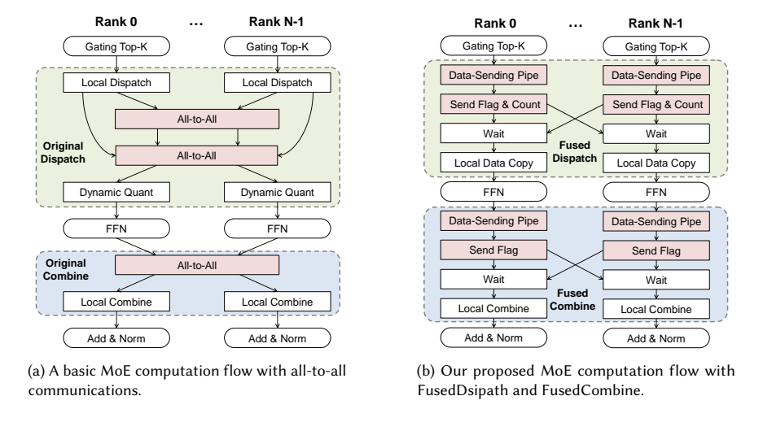

**Original caption:** Fig. 10. Comparison between basic MoE computation flow with all-to-all communications and our proposed MoE computation flow with fused communication operators.

**中文图注:** Fig. 10. 采用 all-to-all 通信的基本 MoE（混合专家）计算流程与我们提出的采用融合通信算子的 MoE 计算流程的对比。

### Fig. 11. 图 11

**Placed near:** S101
**Source:** p.22 C011

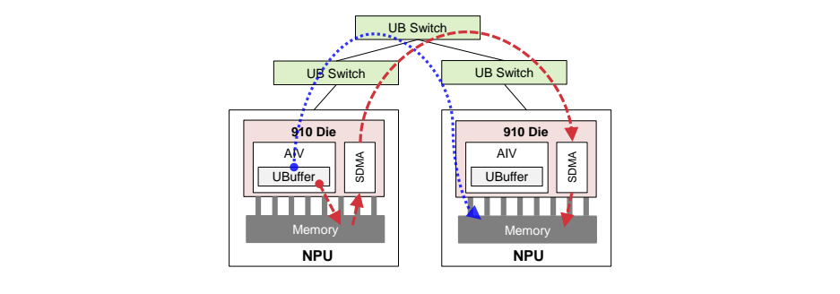

**Original caption:** Fig. 11. SDMA-based vs. AIV-direct communication across NPUs. The red and blue lines indicate data transmission paths using SDMA and AIV-direct, respectively.

**中文图注:** Fig. 11. NPU 间基于 SDMA（系统 DMA）的通信与 AIV 直连通信的对比。红线与蓝线分别表示使用 SDMA 与 AIV 直连的数据传输路径。

**Source:** p.21 S102

**Original:** 3**Static Execution via Shared-Memory Pre-allocation:**To avoid dynamic memory alloca-tion and its associated CPU-NPU synchronization overhead, we statically pre-allocate shared-memory buffers in each NPU rank for data arriving from every other rank in the MoE layer. The required buffer size is:

**中文:** 3**基于共享内存预分配的静态执行：**为避免动态内存分配及其伴随的 CPU-NPU 同步开销，我们在每个 NPU rank 中静态预分配共享内存缓冲区，用于存放 MoE 层中来自其他所有 rank 的数据。所需缓冲区大小为：

**Source:** p.22 E001 · Eq. (1)

$$
\text{buffer\_size}=\text{rank\_num}\times\text{max\_tokens}\times\text{msg\_size}
$$

**中文说明：** 通信缓冲区预分配大小公式（符号保持原样，已对照原 PDF 裁片核验。）

**Source:** p.22 S103

**Original:** where

**中文:** 其中

**Source:** p.22 E002 · Eq. (2)

$$
\text{max\_tokens}=\text{local\_batch}\times\min(\text{topK},\ \text{experts\_per\_die})
$$

**中文说明：** 单个对端最坏情况下 token 数上限（符号保持原样，已对照原 PDF 裁片核验。）

**Source:** p.22 S104

**Original:** With this space pre-allocated, both FusedDispatch and FusedCombine directly write data into the target NPU memory buffer via AIV-direct communication, avoiding an intermediate local copy and the subsequent remote read, thus reducing memory traffic and synchronization latency.

**中文:** 凭借这块预分配空间，FusedDispatch 与 FusedCombine 都通过 AIV 直连通信将数据直接写入目标 NPU 的内存缓冲区，避免了中间的本地拷贝以及随后的远程读取，从而降低内存流量与同步时延。

**Source:** p.22 S105

**Original:** Because FusedDispatch and FusedCombine execute back-to-back, sharing a single buffer would create a race: a faster NPU could launch FusedCombine and overwrite a peer’s buffer before that peer finishes consuming the prior FusedDispatch payload, corrupting data. We eliminate this FusedDispatch FusedCombine hazard with *double buffering *: distinct buffers are reserved for and, ensuring that one buffer is always free for writers while the other is being read.

**中文:** 由于 FusedDispatch 与 FusedCombine 背靠背执行，共享同一缓冲区会产生竞争：较快的 NPU 可能启动 FusedCombine，并在对端尚未消费完先前 FusedDispatch 载荷时覆写其对端缓冲区，导致数据损坏。我们通过*双缓冲（double buffering）*消除 FusedDispatch 与 FusedCombine 之间的这一冒险：为二者分别保留独立缓冲区，确保写者始终有一个空闲缓冲区可用，而另一个缓冲区正被读取。

**Source:** p.22 S106

**Original:** The pre-allocation memory overhead is modest. In our experimental setup, each die handles a local max tokens = × (,) = batch of at most 96 tokens and hosts up to two experts, yielding _ 96 min 8 1 96.. Across a communication domain of 320 ranks, the dispatch buffer occupies 320 × 96 × 7 5 KB ≈ 225 MB, and the combine buffer 320 × 96 × 14 KB ≈ 420 MB. The two buffers together consume only about 645 MB memory per die. **Data-Sending Pipeline:**4 Remote data writes require computing the target offset within a peer NPU’s pre-allocated memory buffer. However, performing this calculation and the transfer sequentially would stall execution. To avoid this, we design a data-sending pipeline inside each fused operator as shown in Figure 12, which pipelines the following three stages: (1) copy the next token into the local UBuffer; (2) compute the remote buffer offset and apply INT8 quantization if enabled; (3) issue the AIV-Direct write to the peer NPU’s memory. Tokens flow through this pipeline as one-token microbatches. While Stage 3 of a microbatch transmits data, Stages 1 and 2 of the following microbatches execute in parallel. This overlap hides both computation and communication latency, enabling continuous and efficient token dispatch.

**中文:** 预分配带来的内存开销并不大。在我们的实验配置中，每个芯粒处理本地批次最多 96 个 token，且最多承载两个专家，即 max_tokens = 96 × min(8, 1) = 96。在由 320 个 rank 组成的通信域中，分发缓冲区占用 320 × 96 × 7.5 KB ≈ 225 MB，合并缓冲区占用 320 × 96 × 14 KB ≈ 420 MB。两个缓冲区合计每芯粒仅消耗约 645 MB 内存。**数据发送流水线：**4 远程数据写入需要计算对端 NPU 预分配内存缓冲区内的目标偏移量。但如果串行地执行该计算与传输，执行将会停顿。为避免这一点，我们在每个融合算子内部设计了数据发送流水线（如 Figure 12 所示），将以下三个阶段流水线化：(1) 将下一个 token 拷贝进本地 UBuffer；(2) 计算远程缓冲区偏移量，并在启用时施加 INT8 量化；(3) 发起对对端 NPU 内存的 AIV-Direct 写入。token 以单 token 微批次的形式流经该流水线：当某个微批次的阶段 3 在传输数据时，后续微批次的阶段 1 和阶段 2 并行执行。这种重叠同时掩盖了计算与通信时延，使 token 分发得以持续高效地进行。

### Fig. 12. 图 12

**Placed near:** S106
**Source:** p.23 C012

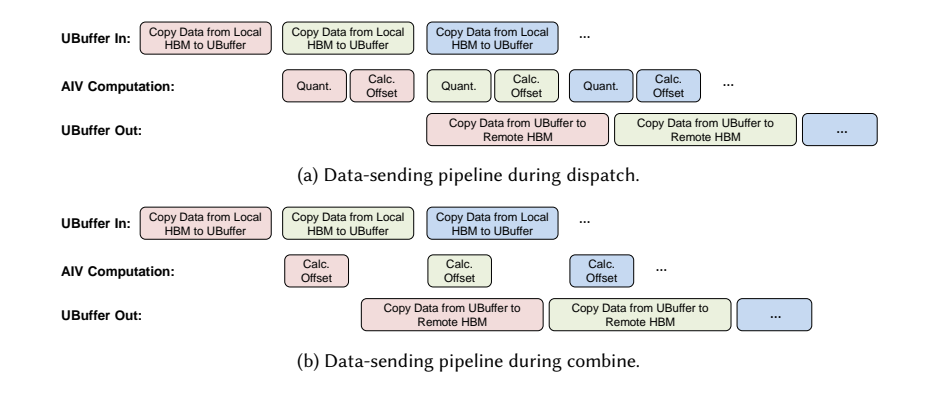

**Original caption:** Fig. 12. Data-sending pipelines for token dispatch, which employs dynamic quantization, and for combine, which transmits unquantized data.

**中文图注:** Fig. 12. token 分发与 token 合并的数据发送流水线：前者采用动态量化，后者传输未量化数据。

**Source:** p.22 S107

**Original:** By combining these techniques, including AIV-direct communication, early quantization, pre-allocated double-buffered memory, and data-sending pipeline, the FusedDispatch and FusedCombine

**中文:** 通过综合运用 AIV 直连通信、提前量化、预分配的双缓冲内存以及数据发送流水线等技术，FusedDispatch 与 FusedCombine

**Source:** p.23 S108

**Original:** operators significantly reduce the latency of the MoE layer during decode compared to basic imple-mentations. The workflows of the two fused operators are illustrated in Figure 10b.

**中文:** 这两个算子相比基础实现显著降低了解码期间 MoE 层的时延。这两个融合算子的工作流程如 Figure 10b 所示。

**Source:** p.23 S109

**Original:** The FusedDispatch operator proceeds in three main steps. The first step is a pipelined token-sending phase (Opt. 4). Each rank iterates over the tokens assigned to remote experts. For each token, the dispatch AIV cores first load the relevant token data from memory into the local UBuffer, then quantize the token data to INT8 format (Opt. 2) while appending the associated scale. Routing metadata, including the source rank ID, batch-slot ID, and key offset, is attached to each token data. The system then determines the target rank for each expert ID and writes the data packet into the peer’s pre-allocated shared memory buffer via AIV-direct (Opt. and). In the second step, once 1 3 all data packets are issued, a barrier ensures that all token data writes are completed before flags are sent. The dispatch cores compute the token count per expert in parallel, synchronize across cores, and then issue completion flags and token counts to the corresponding peers using AIV-direct (Opt. 1 and 3). The final step involves coordination and output assembly. Each rank polls the flags written by remote ranks and waits until all flags are set to ‘1’. It then reads the associated token counts to compute output offsets. Finally, all dispatch cores work in parallel to assemble the received token data, quantization scales, and per-expert token counts from shared memory into contiguous output buffers, ready for the subsequent FFN computation stage.

**中文:** FusedDispatch 算子的执行包含三个主要步骤。第一步是流水线化的 token 发送阶段（Opt. 4）。每个 rank 遍历分配给远程专家的 token：对每个 token，分发 AIV 核先将相关 token 数据从内存载入本地 UBuffer，随后将其量化为 INT8 格式（Opt. 2）并附加相应的缩放因子；同时为每条 token 数据附带路由元数据，包括源 rank ID、批次槽位 ID 和键偏移量。系统随后为每个专家 ID 确定目标 rank，并经由 AIV 直连将数据包写入对端预分配的共享内存缓冲区（Opt. 1 和 3）。第二步，一旦所有数据包都已发出，便由一个屏障（barrier）确保所有 token 数据写入完成后才发送标志位：分发核并行计算每个专家的 token 数量，在核间同步后，再使用 AIV 直连向相应对端发出完成标志与 token 计数（Opt. 1 和 3）。最后一步是协调与输出组装：每个 rank 轮询远程 rank 写入的标志位，等待所有标志位均被置为'1'；随后读取相应的 token 计数以计算输出偏移量；最后，所有分发核并行工作，将共享内存中收到的 token 数据、量化缩放因子以及每个专家的 token 计数组装进连续的输出缓冲区，为后续 FFN 计算阶段做好准备。

**Source:** p.23 S110

**Original:** The FusedCombine workflow similarly consists of three main steps. The first step is a pipelined data-sending phase (Opt. 4), in which each combine AIV core loops over its assigned peer ranks. The core reads the corresponding receive count for each peer and copies the associated FFN result data into the local UBuffer. It uses the token’s source metadata—specifically the source rank ID, batch-slot ID, and key offset—to compute the destination address on the peer. The token data is then transmitted back via AIV-direct into the pre-allocated buffer on the originating rank (Opt. 1 and 3). In the second step, each token’s metadata is again used to compute the target address for its flag update. The combine AIV core issues an atomic-add operation over AIV-direct to increment the corresponding flag on the peer side, signaling that one contribution has been delivered (Opt. 1 and 3). In the final step, each core waits until the flags for its assigned batch are all set to ‘1’, indicating that all expert outputs for that token have been received. The combine core then gathers the expert FFN outputs from shared memory, retrieves the corresponding scale factors

**中文:** FusedCombine 的工作流程同样由三个主要步骤构成。第一步是流水线化的数据发送阶段（Opt. 4）：每个合并 AIV 核循环遍历其负责的对端 rank，读取每个对端相应的接收计数，并将对应的 FFN 结果数据拷贝进本地 UBuffer；它利用 token 的源元数据——具体为源 rank ID、批次槽位 ID 和键偏移量——计算对端上的目的地址，随后通过 AIV 直连将 token 数据传回源 rank 上的预分配缓冲区（Opt. 1 和 3）。第二步，再次利用每个 token 的元数据计算其标志位更新的目标地址：合并 AIV 核经 AIV 直连发起一次原子加（atomic-add）操作，递增对端相应的标志位，表明一份贡献已送达（Opt. 1 和 3）。在最后一步，每个核等待其负责批次的标志位全部置为'1'，表明该 token 的所有专家输出均已到达；随后合并核从共享内存中收集专家 FFN 输出，并从内存中取出相应的

**Source:** p.24 S111

**Original:** from memory, performs element-wise scaling, and sums the results. The combined expert outputs are then added to the shared FFN output to produce the final result for each token.

**中文:** 缩放因子，执行逐元素缩放并对结果求和。合并后的专家输出再加上共享 FFN 的输出，得到每个 token 的最终结果。

### 4.2.2 MLA Optimization / 4.2.2 MLA 优化

**Source:** p.24 S113

**Original:** (1) *Launch Overhead of Fine-Grained Operators: *MLA introduces numerous fine-grained op-erations, such as RMSNorm, linear projections, and RoPE encoding, that are typically implemented as separate NPU operators. Each operator invocation incurs non-negligible launch latency, stemming from CPU-side dispatch, parameter loading, instruction schedul-ing, and tiling configuration. Although capturing these operators into a graph can amortize the CPU dispatch overhead by grouping multiple operations, it does not eliminate the per-operator startup cost on the NPU. As a result, the accumulation of these small kernel launches introduces significant latency in the MLA execution path.

**中文:** (1) *细粒度算子的启动开销：*MLA 引入了大量细粒度操作，如 RMSNorm、线性投影和 RoPE 编码，它们通常被实现为独立的 NPU 算子。每次算子调用都会带来不可忽略的启动时延，来源于 CPU 侧派发、参数加载、指令调度与切分（tiling）配置。虽然将这些算子捕获进图中可以通过把多个操作成组来摊薄 CPU 派发开销，却无法消除 NPU 上每个算子的启动成本。因此，这些细小内核启动的不断累积在 MLA 执行路径中引入了可观的时延。

**Source:** p.24 S114

**Original:** (2) *KV Cache Format Conversion Overhead: *To support high-performance matrix computations, the L1 Cache of the Ascend 910 NPU’s AI cube cores (AICs) optimally stores data in an NZ format (a specialized hybrid row-major and column-major layout, resulting in a combined N-shaped and Z-shaped traversal path). However, the KV cache is typically stored in the NPU’s memory using a standard N-Dimensional (ND) format. Consequently, operator internals often need to explicitly convert KV cache data to the NZ format before AICs can perform matrix calculations. This explicit format conversion consumes memory bandwidth and impacts access efficiency, thereby reducing the effective memory bandwidth available for computation.

**中文:** (2) *KV 缓存格式转换开销：*为支持高性能矩阵计算，昇腾 910 NPU 的 AI Cube 核（AIC）的 L1 Cache 以 NZ 格式存储数据时效率最优（NZ 是一种行主序与列主序混合的专门布局，形成 N 形与 Z 形相结合的遍历路径）。然而，KV 缓存通常以标准 N 维（ND）格式存放在 NPU 内存中。因此，算子内部往往需要先将 KV 缓存数据显式转换为 NZ 格式，AIC 才能执行矩阵计算。这种显式格式转换消耗内存带宽、影响访问效率，从而减少了可用于计算的有效内存带宽。

**Source:** p.24 S115

**Original:** (3) *Load Imbalance with Multi-Token Prediction (MTP): *When MTP is enabled, the decode phase must validate multiple tokens predicted in the previous step. This results in varying effective sequence lengths for different queries within the same batch (as detailed in §4.2.4). The original tiling strategies for attention operators, often assuming a BNSD (Batch, Num-heads, Sequence-length, Head-dimension) memory layout, can lead to significant load imbalance. Specifically, without MTP, all queries in a decode step typically have a sequence length $BN$ of 1, allowing tiling strategies based on and axes to create compute tasks of equal size (as $S$ and $D$ are constant per task), thus ensuring load balance. With MTP active, the sequence length $S$ can differ per query. Persisting with $B$ -axis and $N$ -axis tiling under these conditions leads to substantial load disparities among NPU cores, extending the overall MLA computation time.

**中文:** (3) *多 token 预测（MTP）带来的负载不均衡：*启用 MTP 后，解码阶段需要验证上一步预测出的多个 token，导致同一批次内不同 query 的有效序列长度各不相同（详见 §4.2.4）。面向注意力算子的原有切分策略通常假定 BNSD（Batch、Num-heads、Sequence-length、Head-dimension）内存布局，可能造成显著的负载不均衡。具体而言，不启用 MTP 时，一个解码步中所有 query 的序列长度 $S$ 通常为 1，基于 $B$ 轴与 $N$ 轴的切分策略可以据此创建大小相等的计算任务（因为每个任务的 $S$ 与 $D$ 均为常量），从而保证负载均衡；而 MTP 生效时，序列长度 $S$ 会因 query 而异。在这种情况下若仍沿用 $B$ 轴与 $N$ 轴切分，将在 NPU 各核之间造成显著的负载差异，拉长 MLA 的整体计算时间。

**Source:** p.25 S116

**Original:** To overcome these limitations and fully exploit the capabilities of Ascend NPUs, we propose the following NPU-friendly optimizations:

**中文:** 为克服上述局限并充分发掘昇腾 NPU 的能力，我们提出以下对 NPU 友好的优化：

**Source:** p.25 S117

**Original:** **Fused Operators: MLAProlog and Fused Attention (FA).**To drastically reduce the launch overhead from numerous small operators in the MLA computation path, we employ aggressive operator fusion, as illustrated conceptually in Figure 13.

**中文:** **融合算子：MLAProlog 与融合注意力（FA）。**为大幅降低 MLA 计算路径中大量小算子带来的启动开销，我们采用激进的算子融合，概念性示意如 Figure 13 所示。

### Fig. 13. 图 13

**Placed near:** S117
**Source:** p.24 C013

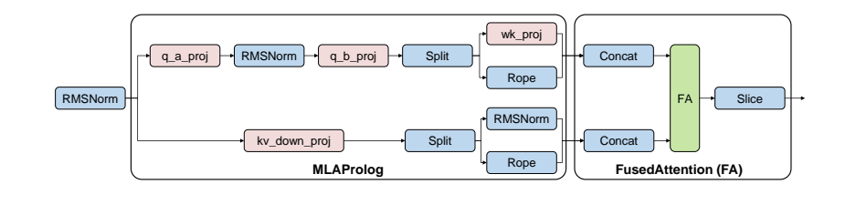

**Original caption:** Fig. 13. The MLAProlog and FA operators, key components of our MLA optimization.

**中文图注:** Fig. 13. MLAProlog 与 FA 算子，是我们 MLA（多头潜在注意力）优化的关键组件。

**Source:** p.25 S118

**Original:** Firstly, multiple pre-attention operations, including RMSNorm, Q/K/V projections, and RoPE, are consolidated into a single composite operator, termed MLAProlog. This fusion reduces the operator startup costs from those of many individual operators to only one. Furthermore, MLAProlog is designed with internal micro-parallelism, dividing its workload into multiple sub-tasks that are executed in a pipelined fashion across the AIC and AIV units. This fine-grained AIC-AIV parallelism allows the computation times of different sub-tasks on these heterogeneous cores to effectively mask each other, further minimizing the fused operator’s execution time.

**中文:** 首先，将 RMSNorm、Q/K/V 投影和 RoPE 等多个注意力前（pre-attention）操作合并为一个复合算子，称为 MLAProlog。这一融合把算子启动成本从多个独立算子的开销降到仅一次。此外，MLAProlog 在设计上具备内部微并行性，将工作负载划分为多个子任务，在 AIC 与 AIV 单元之间以流水线方式执行。这种细粒度的 AIC-AIV 并行，使不同子任务在这些异构核上的计算时间能够相互掩盖，进一步最小化融合算子的执行时间。

**Source:** p.25 S119

**Original:** Secondly, to complement MLAProlog, we developed a fused attention (FA) operator that integrates Concat FlashAttention with adjacent data shaping operations, such as pre-attention (for preparing Q, K, V) and post-attention Slice (for extracting relevant outputs). This further minimizes kernel launches and improves data locality throughout the attention computation path.

**中文:** 其次，作为 MLAProlog 的补充，我们开发了融合注意力（FA）算子，将 Concat、FlashAttention 与相邻的数据整形操作整合在一起，例如注意力前的准备操作（用于生成 Q、K、V）以及注意力后的 Slice（用于提取相关输出）。这进一步减少了内核启动次数，并改善了整个注意力计算路径的数据局部性。

**Source:** p.25 S120

**Original:** **NZ-Formatted KV Cache.**To eliminate tensor format conversion overhead, we natively store the KV cache in NZ format within NPU memory. During the MLA computation, the calculated KV tensors are appended to the KV cache directly in this NZ format. In the decode phase, as new KV tensors are generated token by token, they can be efficiently written to NPU memory according to NZ format rules. Ascend NPUs provide data movement interfaces capable of on-the-fly format conversion during memory writes. This *write-with-format-conversion *capability avoids an explicit, separate ND-to-NZ data transformation step for the KV cache, thereby improving effective NPU memory bandwidth utilization.

**中文:** **NZ 格式的 KV 缓存。**为消除张量格式转换开销，我们在 NPU 内存中原生以 NZ 格式存储 KV 缓存。在 MLA 计算过程中，计算得到的 KV 张量直接以该 NZ 格式追加进 KV 缓存。在解码阶段，随着新 KV 张量逐 token 生成，可按 NZ 格式规则高效写入 NPU 内存。昇腾 NPU 提供的数据搬移接口能够在内存写入过程中即时完成格式转换。这种*带格式转换的写入（write-with-format-conversion）*能力避免了对 KV 缓存执行显式、独立的 ND 到 NZ 数据变换步骤，从而提升了 NPU 有效内存带宽利用率。

**Source:** p.25 S121

**Original:** **MTP-Aware Tiling with BSND Layout.**To restore load balance under MTP, we shift from BNSD to BSND memory layout and adopt a dynamic tiling strategy along batch ($B$) and sequence ($S$) axes, which vary across queries. Since the $N$ (number of heads) and $D$ (head dimension) values remain relatively stable during these operations, this ensures better uniformity in task size across AIC cores, reducing tail latency caused by straggling compute tasks.

**中文:** **基于 BSND 布局的 MTP 感知切分。**为了在 MTP 下恢复负载均衡，我们将内存布局从 BNSD 调整为 BSND，并沿随 query 变化的批次（$B$）轴与序列（$S$）轴采用动态切分策略。由于 $N$（头数）与 $D$（头维度）在这些操作中保持相对稳定，这保证了各 AIC 核之间任务大小更加均匀，减少了由拖后计算任务造成的尾时延。

**Source:** p.25 S122

**Original:** Together, these three strategies, including operator fusion, native NZ storage, and adaptive tiling, maximize the performance of MLA-based inference on CloudMatrix384, yielding substantial gains in latency and throughput for DeepSeek models.

**中文:** 算子融合、原生 NZ 存储与自适应切分这三种策略相互配合，最大化了 CloudMatrix384 上基于 MLA 的推理性能，为 DeepSeek 模型带来时延与吞吐量的大幅提升。

### 4.2.3 Microbatch-Based Decode Pipeline / 4.2.3 基于微批次的解码流水线

**Source:** p.25 S124

**Original:** Our proposed resource partitioning and pipelining strategies diverge from DeepSeek’s method due to both the unique characteristics of the Ascend NPU and our specific parallelism deployment for MoE models. Unlike DeepSeek’s deployment on NVIDIA H800s, which co-locates three experts per GPU (one shared expert and two router experts) as shown in Figure 14a, our deployment on CloudMatrix384 involves deploying a large expert parallelism degree (EP320) with typically one expert per NPU die for low decode latency. Without the shared expert computation, the compute latency of ATTN-0 alone is insufficient to fully mask the MoE dispatch latency. This necessitates a different load-balanced pipelining strategy.

**中文:** 由于昇腾 NPU 的独特特性以及我们针对 MoE 模型的特定并行部署方式，我们所提出的资源划分与流水线策略与 DeepSeek 的方法有所不同。DeepSeek 在 NVIDIA H800 上的部署如 Figure 14a 所示，每个 GPU 上共置三个专家（一个共享专家和两个路由专家）；而我们在 CloudMatrix384 上的部署采用很大的专家并行度（EP320），通常每个 NPU 芯粒仅承载一个专家，以获得低解码时延。由于没有共享专家计算可依托，仅靠 ATTN-0 的计算时延不足以完全掩盖 MoE 分发时延。这就需要一种不同的负载均衡流水线策略。

### Fig. 14. 图 14

**Placed near:** S124
**Source:** p.26 C014

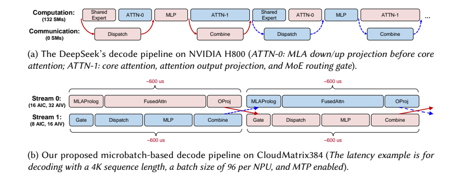

**Original caption:** Fig. 14. Comparison of decode pipelines: (a) DeepSeek’s approach on H800 and (b) our proposed pipeline on CloudMatrix384. Alternating colors denote two interleaved microbatches.

**中文图注:** Fig. 14. 解码流水线对比：(a) DeepSeek 在 H800 上的方案与 (b) 我们提出的 CloudMatrix384 流水线。交替的颜色表示两个交错执行的微批次。

**Source:** p.26 S125

**Original:** To achieve efficient latency overlap under these conditions, we implement a microbatch-based pipeline with *asymmetric AIC and AIV partitioning *for CloudMatrix384, as illustrated in Figure 14b. The pipeline comprises two interleaved execution streams, each responsible for distinct portions of the decode process and provisioned with differing compute capacity: • *Stream 0 (Attention Path): *Executes MLAProlog, FusedAttention, and O_PROJ. These are compute-heavy or memory-intensive operators and thus assigned more NPU resources—16 AICs and 32 AIVs. Under typical decode conditions (4K sequence, batch size 96, MTP $μ$ enabled), this stream has a per-microbatch latency of 600 s. • *Stream 1 (MoE Path): *Handles the MoE sequence: Gate, Dispatch, MLP, and Combine. Due to the inclusion of both compute and communication phases, this stream is given 8 AICs $μ$ and 16 AIVs, half the resources of Stream 0, yet achieves a comparable latency (600 s) owing to lower computational load but higher communication latency.

**中文:** 为了在这些条件下实现高效的时延重叠，我们在 CloudMatrix384 上实现了带有 *AIC 与 AIV 非对称划分*的微批次流水线，如 Figure 14b 所示。该流水线由两条交错的执行流组成，各自负责解码过程的不同部分，并被分配不同的计算资源：• *流 0（注意力路径）：*执行 MLAProlog、FusedAttention 与 O_PROJ。这些算子计算密集或访存密集，因此被分配更多 NPU 资源——16 个 AIC 和 32 个 AIV。在典型解码条件（4K 序列、batch size 96、启用 MTP）下，该流的每微批次时延为 600 μs。• *流 1（MoE 路径）：*处理 MoE 序列：Gate、Dispatch、MLP 与 Combine。由于同时包含计算与通信阶段，该流仅分配 8 个 AIC 和 16 个 AIV，是流 0 资源的一半；但由于计算负载较低而通信时延较高，其时延仍与流 0 相当（600 μs）。

**Source:** p.26 S126

**Original:** The asymmetric allocation ensures a close per-layer latency when executing Streams 0 and 1, thereby enabling the perfect overlap of two interleaved microbatches. As depicted by alternating colors in Figure 14b, Stream 0 processes attention computation for one microbatch while Stream 1 simultaneously performs MoE computation and communication for another.

**中文:** 这种非对称分配确保流 0 与流 1 执行时每层时延接近，从而使两个交错的微批次能够完美重叠。如 Figure 14b 中交替的颜色所示，当流 0 处理一个微批次的注意力计算时，流 1 同时对另一个微批次执行 MoE 计算与通信。

**Source:** p.26 S127

**Original:** To accommodate changing runtime conditions, such as variable KV cache lengths, the allocation of compute resources to the two streams can be adjusted adaptively. This elasticity ensures that latency balance is preserved, enabling sustained performance across diverse workloads.

**中文:** 为适应不断变化的运行时条件（例如 KV 缓存长度的变化），两条流的计算资源分配可以自适应调整。这种弹性确保时延均衡得以保持，使系统在多样负载下持续保持性能。

### 4.2.4 Multiple-Token Prediction Support / 4.2.4 多 token 预测（MTP）支持

**Source:** p.26 S129

**Original:** As shown in Figure 15b (naïve MTP pipeline), MTP typically triggers $k$ + 1 compute graphs per decode step, $k$ for speculative modules and one for final validation. Each graph dispatch introduces. −. a startup latency of 0 6 0 8 ms. This overhead, especially under CPU-mediated orchestration,

**中文:** 如 Figure 15b（朴素的 MTP 流水线）所示，MTP 通常在每个解码步触发 $k$ + 1 个计算图，其中 $k$ 个用于投机（speculative）模块，一个用于最终验证。每次计算图派发会引入 0.6–0.8 ms 的启动时延。这一开销——尤其是在由 CPU 居中协调的情况下——

### Fig. 15. 图 15

**Placed near:** S129
**Source:** p.27 C015

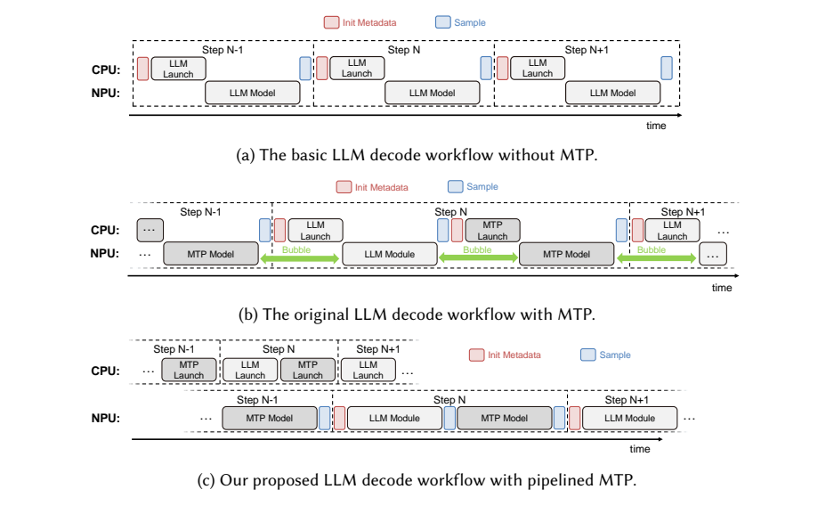

**Original caption:** Fig. 15. The pipelined MTP optimization on Asend NPUs.

**中文图注:** Fig. 15. Ascend NPU 上的流水线化多 token 预测（MTP）优化。

**Source:** p.27 S130

**Original:** leads to idle bubbles on NPUs, undermining the benefits of MTP. We identify two main sources of these obstacles: • *CPU Intervention for Dynamic Metadata Initialization: *Both the MTP modules and the main LLM rely on metadata, such as the current sequence length, which changes dynamically during decoding. This metadata can only be finalized after the completion of the preceding module’s execution. For example, an MTP module requires the sequence length deter-mined after the previous LLM validation. As shown in Figure 15b, the CPU initializes and transfers this metadata before dispatching each graph, resulting in frequent CPU-NPU synchronization barriers. • *CPU-Intervened Sampling Disrupts NPU Execution: *After MTP modules and the main LLM generate token distributions, sampling is needed to select the actual tokens. This process involves a mix of CPU procedures and discrete NPU operations. These frequent CPU-NPU interactions create overhead from data copying between the host and device. Crucially, because each subsequent computational graph relies on the sampled output from the previous one, this introduces serialization, preventing consecutive NPU execution.

**中文:** 会导致 NPU 上出现空闲气泡，削弱 MTP 的收益。我们识别出造成这些障碍的两个主要来源：• *动态元数据初始化需要 CPU 介入：*MTP 模块与主 LLM 都依赖诸如当前序列长度之类的元数据，这些元数据在解码过程中动态变化，且只有在前一模块执行完成后才能最终确定。例如，MTP 模块需要用到上一次 LLM 验证之后才确定的序列长度。如 Figure 15b 所示，CPU 在派发每个计算图之前都要初始化并传输该元数据，导致频繁的 CPU-NPU 同步屏障。• *CPU 介入的采样干扰 NPU 执行：*在 MTP 模块与主 LLM 生成 token 分布之后，需要进行采样以选出实际的 token。该过程混合了 CPU 流程与离散的 NPU 操作，频繁的 CPU-NPU 交互带来了主机与设备之间数据拷贝的开销。更关键的是，由于每个后续计算图都依赖前一个计算图的采样输出，这引入了串行化，使 NPU 无法连续执行。

**Source:** p.27 S131

**Original:** To overcome these bottlenecks, we introduce a pipelined MTP execution technique (Figure 15c) that eliminates these CPU dependencies and enables efficient graph execution:

**中文:** 为突破这些瓶颈，我们提出一种流水线化 MTP 执行技术（Figure 15c），消除上述 CPU 依赖，实现高效的计算图执行：

**Source:** p.27 S132

**Original:** **Aggregated Metadata Initialization.**Rather than performing metadata setup separately for each of the $k$ + 1 graphs, we precompute and batch all metadata tensors at the start of the decode step. These tensors that are stored directly in NPU memory include incremental sequence lengths for each MTP module and a metadata block for the validation graph. This eliminates repeated CPU involvement and enables seamless, metadata-aware execution on the NPU.

**中文:** **聚合元数据初始化。**我们不再为 $k$ + 1 个计算图分别执行元数据设置，而是在解码步开始时预先计算并批量准备全部元数据张量。这些直接存储在 NPU 内存中的张量包括每个 MTP 模块的增量序列长度，以及验证图的元数据块。这消除了 CPU 的反复介入，使 NPU 上能够无缝执行感知元数据的计算图。

**Source:** p.28 S133

**Original:** **CPU-Free In-NPU Sampling.**To eliminate NPU execution stalls frequently caused by CPU-based sampling, we migrate the entire sampling process to the NPU. This strategy involves imple-menting the necessary sampling operations, such as token probability sorting, cumulative sum calculations, and candidate filtering, as a sequence of NPU operators. Furthermore, to minimize the launch overhead that could arise from dispatching numerous NPU sampling operators, these oper-ators are fused into the MTP and LLM validation graphs. By keeping sampling entirely on-device, we prevent execution stalls between MTP stages and the LLM validation stage, allowing compute graphs to execute back-to-back with no host intervention.

**中文:** **免 CPU 的 NPU 内采样。**为消除基于 CPU 的采样频繁造成的 NPU 执行停顿，我们将整个采样过程迁移到 NPU 上。该策略将所需的各种采样操作——如 token 概率排序、累加和计算以及候选过滤——实现为一串 NPU 算子。此外，为尽量减少分发大量 NPU 采样算子带来的启动开销，这些算子被融合进 MTP 与 LLM 验证计算图中。通过让采样完全在设备内完成，我们避免了 MTP 各阶段与 LLM 验证阶段之间的执行停顿，使计算图无需主机干预即可背靠背连续执行。

**Source:** p.28 S134

**Original:** Together, these enhancements eliminate the frequent pipeline breaks caused by CPU-NPU coordination in naïve MTP implementations. As the NPU executes one compute graph, the CPU concurrently schedules the next, enabling sustained parallelism and continuous NPU execution. This achieves a seamless flow of operations on the NPU, maximizing its utilization and fully realizing the potential latency benefits of MTP.

**中文:** 这些增强措施相辅相成，消除了朴素 MTP 实现中因 CPU-NPU 协同而频繁出现的流水线中断。当 NPU 执行某一个计算图时，CPU 并发调度下一个计算图，从而维持持续的并行度和不间断的 NPU 执行。由此在 NPU 上实现无缝的操作流，最大化其利用率，并充分释放 MTP 在时延上的潜在收益。

### 4.3 Resource-Efficient Prefill with Hybrid Parallelism and Microbatching / 4.3 基于混合并行与微批次的资源高效 prefill

### 4.3.1 Hybrid Parallelism for MLA Computation / 4.3.1 面向 MLA 计算的混合并行

**Source:** p.29 S137

**Original:** leads to suboptimal load balancing and resource utilization on Ascend NPUs. This inefficiency stems from two primary reasons:

**中文:** 导致 Ascend NPU 上的负载均衡与资源利用率欠佳。这种低效主要源于两方面原因：

**Source:** p.29 S138

**Original:** (1) *Sequence-Length Skew: *In practice, incoming requests often have varying input sequence lengths. With a typical 32-way DP configuration, NPUs assigned shorter sequences complete their work earlier and then idle while waiting for those processing the longest sequence in the batch, leading to wasted compute cycles.

**中文:** (1) *序列长度偏斜：*实践中，到来的请求往往具有不同的输入序列长度。在典型的 32 路 DP 配置下，分到较短序列的 NPU 会更早完成工作，随后在等待批次中最长序列处理完毕期间处于空闲，造成计算周期浪费。

**Source:** p.29 S139

**Original:** (2) *Insufficient Concurrency: *If the number of in-flight requests is less than the DP degree (e.g., fewer than 32 requests for DP32), some DP shards receive no work. Delaying processing to accumulate a full batch of 32 requests increases TTFT, while proceeding with a partial batch underutilizes the NPU resources.

**中文:** (2) *并发不足：*若在途请求数少于 DP 度（例如 DP32 下不足 32 个请求），部分 DP 分片将无任务可执行。若延迟处理以凑满 32 个请求的完整批次，会增大 TTFT；若以部分批次运行，又会造成 NPU 资源利用不足。

**Source:** p.29 S140

**Original:** To mitigate these inefficiencies, we introduce a *staged hybrid parallelism *strategy optimized for MLA computation during the prefill phase, visually contrasted with basic DP in Figures 16a and 16b. We decompose MLA into three stages and apply different parallelism schemes to each.

**中文:** 为缓解上述低效问题，我们提出一种针对 prefill 阶段 MLA 计算优化的*分阶段混合并行*策略，图 16a 与图 16b 将其与基本 DP 进行了直观对比。我们将 MLA 分解为三个阶段，并对每个阶段采用不同的并行方案。

**Source:** p.29 S141

**Original:** The first stage, which includes processing the layer input and the down_proj operation, and the third stage, comprising the o_proj operation, involve computations that are not inherently dependent on token positions within the sequence for their parallelization strategy. For these stages, we leverage *Sequence Parallelism (SP) combined with sequence packing *, replacing pure DP. This method involves concatenating the prompt sequences of multiple requests and then distributing segments of this packed super-sequence across the SP ranks. Consequently, tokens from requests of varying lengths are distributed in an approximately uniform manner among the NPU dies, achieving effective load balancing irrespective of individual request lengths.

**中文:** 第一阶段（包括层输入处理与 down_proj 算子）和第三阶段（包括 o_proj 算子）所涉及的计算，其并行化策略本质上并不依赖于 token 在序列中的位置。对于这两个阶段，我们采用*序列并行（SP）与序列打包（sequence packing）相结合*的方式，取代纯 DP。该方法将多个请求的 prompt 序列拼接起来，再把打包后的超序列切分成段分布到各 SP rank 上。这样，不同长度请求的 token 便能近似均匀地分布到各 NPU 芯粒上，无论单个请求长度如何，都能实现有效的负载均衡。

**Source:** p.29 S142

**Original:** The second stage, which includes q_up_proj, kv_up_proj, and the core FlashAttention mecha-nism, critically depends on token positions for the attention computation. For this stage, we apply tensor parallelism (TP) to ensure a balanced distribution of the computational load across NPU dies. In our prefill implementation, MLA is typically performed without certain weight matrix absorption to enhance raw computational efficiency, allowing it to be treated effectively as a standard 128-head multi-head attention (MHA) operation. Given that MHA computation is independent for each attention head, we apply TP by distributing these attention heads evenly across the NPU dies.

**中文:** 第二阶段包括 q_up_proj、kv_up_proj 以及核心的 FlashAttention 机制，其注意力计算关键性地依赖于 token 位置。对该阶段，我们采用张量并行（TP），以确保计算负载在各 NPU 芯粒间均衡分布。在我们的 prefill 实现中，MLA 通常不做部分权重矩阵吸收（absorption），以提升原始计算效率，从而可将其有效地当作标准的 128 头多头注意力（MHA）运算来处理。鉴于 MHA 计算对每个注意力头相互独立，我们通过将这些注意力头均匀分布到各 NPU 芯粒来实施 TP。

**Source:** p.29 S143

**Original:** Transitioning between these different parallelism strategies across stages necessitates data redistribution. We insert an All-Gather between Stages 1 and 2 and an All-to-All between Stages 2 and 3 to correctly re-shard and distribute the activation data among the ranks.

**中文:** 在阶段之间切换不同的并行策略需要重新分布数据。我们在阶段 1 与阶段 2 之间插入一次 All-Gather，在阶段 2 与阶段 3 之间插入一次 All-to-All，以在各 rank 间正确地重新分片并分发激活数据。

**Source:** p.29 S144

**Original:** Figure 17 provides an illustrative example of this hybrid parallelism data flow with four inputs of varying lengths (Input 0, Input 1, Input 2, Input 3) processed across four NPU ranks. Initially, in Stage 1, tokens from these inputs are packed and distributed using SP. Each rank processes a contiguous segment of the packed sequence, ensuring that all ranks receive a roughly equal number of tokens,

**中文:** 图 17 给出了这种混合并行数据流的一个示例：四个长度不同的输入（Input 0、Input 1、Input 2、Input 3）在四个 NPU rank 上处理。起初在阶段 1，来自这些输入的 token 经打包后以 SP 方式分布。每个 rank 处理打包序列中的一段连续片段，确保所有 rank 分到大致相等数量的 token，

### Fig. 17. 图 17

**Placed near:** S144
**Source:** p.29 C017

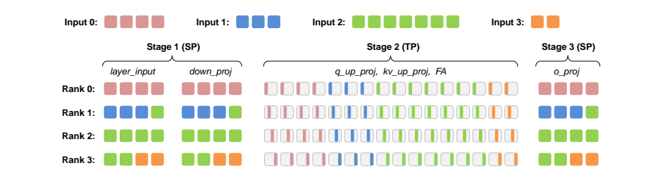

**Original caption:** Fig. 17. Illustrative data flow of the staged hybrid parallelism (SP-TP-SP) for MLA computation in prefill.

**中文图注:** Fig. 17. prefill 中 MLA 计算的分阶段混合并行（SP-TP-SP）数据流示意图。

**Source:** p.30 S145

**Original:** thereby balancing load despite the differing original query lengths. For Stage 2, after an All-Gather, the data is redistributed for TP. Here, each rank processes a shard (e.g., a subset of attention heads) of all tokens from all four inputs. The colored blocks in the figure at this stage indicate how each All-to-All rank now handles parts of every input. Finally, following an operation to gather results from the TP stage, Stage 3 performs its computations with data once again organized according to SP, similar to Stage 1. This example highlights how the hybrid approach maintains load balance throughout the MLA computation.

**中文:** 从而尽管各原始查询长度不同，仍能均衡负载。进入阶段 2，先执行一次 All-Gather，再为 TP 重新分布数据：此时每个 rank 处理来自全部四个输入所有 token 的一个分片（例如注意力头的一个子集）。图中该阶段的彩色块表明，每个 All-to-All rank 此时负责每个输入的一部分。最后，经过一次从 TP 阶段收集结果的算子后，阶段 3 以与阶段 1 类似的方式、再次按 SP 组织的数据执行计算。该示例凸显了混合方法如何在 MLA 计算全程维持负载均衡。

**Source:** p.30 S146

**Original:** Compared to a conventional DP strategy (Figure 16a), this hybrid parallelism introduces these two additional collective communication steps. However, their overhead is carefully managed. The All-Gather operation is performed after a dimensionality reduction step (implied by down_proj), thus operating on potentially smaller tensors. The All-to-All collective primarily redistributes the tensor-parallel shards of the attention mechanism. Since these shards are already reduced in size by the TP degree, the data exchanged per rank during this operation is substantially less than collectives that might handle full, unsharded tensors. On the CloudMatrix384 with its high-bandwidth UB plane, the communication overhead of both operators is relatively small.

**中文:** 与常规 DP 策略（图 16a）相比，这种混合并行引入了上述两步额外的集合通信，但其开销经过了仔细控制：All-Gather 在一次降维步骤（由 down_proj 隐含）之后执行，因而作用于可能更小的张量；All-to-All 集合通信主要重新分布注意力机制的张量并行分片，这些分片已按 TP 度缩小了规模，因此该操作中每个 rank 交换的数据量远小于可能处理完整未分片张量的集合通信。在具备高带宽 UB 平面的 CloudMatrix384 上，这两个算子的通信开销相对较小。

### Fig. 16. 图 16

**Placed near:** S146
**Source:** p.28 C016

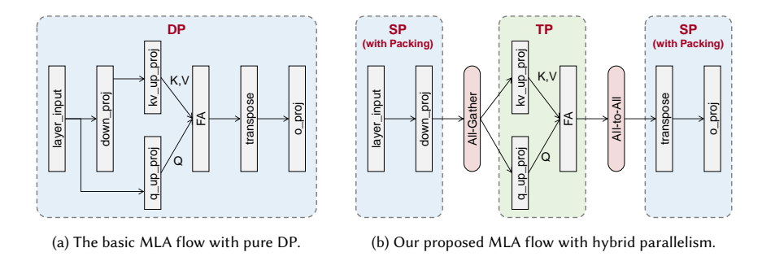

**Original caption:** Fig. 16. Comparison between basic MLA flow using pure DP and our proposed MLA flow leveraging hybrid parallelism during the prefill phase.

**中文图注:** Fig. 16. prefill（预填充）阶段采用纯数据并行（DP）的基本 MLA 流程与我们提出的利用混合并行的 MLA 流程的对比。

### 4.3.2 Microbatch-Based Prefill Pipeline / 4.3.2 基于微批次的 prefill 流水线

**Source:** p.30 S148

**Original:** However, directly porting this strategy to the Ascend 910 NPU on CloudMatrix384 proves inefficient due to architectural mismatches. The pipeline on H800 typically reserves a subset of its streaming multiprocessors (SMs) for communication tasks, enabling concurrency but reducing available compute resources. In contrast, the Ascend 910 offers a heterogeneous compute fabric, which comprises AICs for matrix operations, AIVs for lightweight computation, and SDMA engines for data movement, enabling finer-grained, role-specific task distribution.

**中文:** 然而，由于架构不匹配，将这一策略直接移植到 CloudMatrix384 上的昇腾 910（Ascend 910）NPU 并不高效。H800 上的流水线通常预留一部分流式多处理器（SM）专门处理通信任务，借此获得并发能力，但减少了可用的计算资源。相比之下，Ascend 910 提供异构计算结构，由负责矩阵运算的 AIC、负责轻量计算的 AIV 以及负责数据搬运的 SDMA（系统 DMA）引擎组成，可实现更细粒度、按角色分工的任务分发。

**Source:** p.30 S149

**Original:** To fully exploit this heterogeneity, we introduce an optimized *microbatch-based prefill pipeline * for CloudMatrix384, illustrated in Figure 18b. Our design orchestrates workload distribution across the AIC, AIV, and SDMA subsystems as follows:

**中文:** 为充分利用这种异构性，我们为 CloudMatrix384 引入了经优化的*基于微批次的 prefill 流水线*，如图 18b 所示。该设计将工作负载在 AIC、AIV 与 SDMA 子系统之间编排分发，具体如下：

### Fig. 18. 图 18

**Placed near:** S149
**Source:** p.31 C018

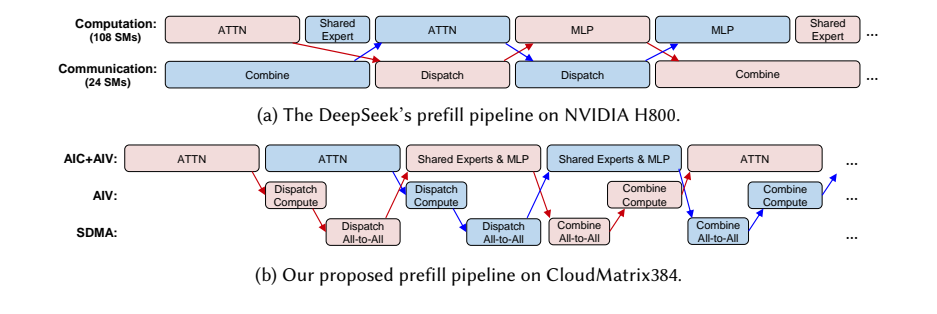

**Original caption:** Fig. 18. Comparison of prefill pipeline strategies: (a) DeepSeek’s approach on H800, reserving compute units for communication, versus (b) our proposed pipeline on CloudMatrix384, leveraging heterogeneous AIC, AIV, and SDMA units for specialized task execution and enhanced computation-communication overlap. In both diagrams, alternating colors are used to distinguish the two interleaved microbatches being processed.

**中文图注:** Fig. 18. prefill 流水线策略对比：(a) DeepSeek 在 H800 上的方案，为通信预留计算单元；(b) 我们在 CloudMatrix384 上提出的流水线，利用异构的 AIC、AIV 和 SDMA 单元执行专门化任务，增强计算与通信的重叠。两幅图中，交替的颜色用于区分正在处理的两个交错微批次。

**Source:** p.30 S150

**Original:** First, we offload low-intensity auxiliary computations to the AIVs, freeing the AICs to focus on compute-intensive operators such as ATTN and MLP. Tasks like token reordering and metadata generation prior to Dispatch (denoted DispatchCompute), and expert output accumulation af-ter Combine (denoted CombineCompute), are assigned to AIVs. These operations are lightweight and vectorizable, making them ideal for AIV execution. As depicted in Figure 18b, AIVs can pro- DispatchCompute cess for one microbatch while AICs execute core computations for another microbatch, achieving fine-grained operator-level overlap.

**中文:** 首先，我们将低强度的辅助计算卸载到 AIV，让 AIC 专注于 ATTN、MLP 等计算密集型算子。诸如 Dispatch 之前的 token 重排与元数据生成（记为 DispatchCompute），以及 Combine 之后的专家输出累加（记为 CombineCompute）等任务，都被分配给 AIV。这些操作轻量且可向量化，非常适合 AIV 执行。如图 18b 所示，AIV 可以为一个微批次处理 DispatchCompute，同时 AIC 为另一个微批次执行核心计算，实现细粒度的算子级重叠。

**Source:** p.30 S151

**Original:** Second, we explicitly route high-volume data transfers, such as All-to-All communication for MoE Dispatch and Combine, to SDMA engines. By isolating these memory operations to a dedicated transfer stream, we prevent contention with AIC and AIV execution. This segregation ensures that compute-heavy operations can proceed uninterrupted, and communication latency is overlapped by concurrently executing AIC/AIV tasks. Given that prefill workloads are dominated by dense matrix operations and communications, this explicit channeling of data flow through SDMA plays a crucial role in preserving peak NPU throughput.

**中文:** 其次，我们将大规模数据传输（例如 MoE Dispatch 与 Combine 的 all-to-all 通信）显式路由到 SDMA 引擎。通过将这些内存操作隔离到一条专用传输流中，可避免其与 AIC、AIV 的执行产生争用。这种隔离保证了重计算操作能够不受干扰地持续进行，而通信时延则被并发执行的 AIC/AIV 任务所掩盖。鉴于 prefill 工作负载以稠密矩阵运算和通信为主，这种经由 SDMA 的显式数据流疏导对维持 NPU 峰值吞吐量至关重要。

**Source:** p.30 S152

**Original:** This hardware-aware task assignment, i.e., AIC for primary compute, AIV for auxiliary vector tasks, and SDMA for communications, improves concurrency and minimizes execution stalls.

**中文:** 这种硬件感知的任务分派——即 AIC 负责主计算、AIV 负责辅助向量任务、SDMA 负责通信——提升了并发度，并将执行停顿降至最低。

**Source:** p.31 S153

**Original:** Moreover, this design is notably different from our decode-phase pipeline (§4.2.3), where commu-nication logic is more tightly coupled with compute streams due to different latency and throughput requirements. In prefill, the need to process longer sequences and larger microbatches makes it more sensitive to compute saturation and bandwidth contention. Thus, separating concerns through dedi-cated execution units and overlapping tasks at the operator level aligns better with the performance characteristics of CloudMatrix384.

**中文:** 此外，该设计与我们的解码阶段流水线（§4.2.3）有明显不同：后者因时延与吞吐量需求不同，通信逻辑与计算流的耦合更紧密。在 prefill 中，处理更长序列和更大微批次的需求使其对计算饱和与带宽争用更加敏感。因此，通过专用执行单元实现关注点分离，并在算子级重叠任务，更契合 CloudMatrix384 的性能特征。

### 4.3.3 Low-interference Transferring between Prefill and Decode / 4.3.3 prefill 与解码之间的低干扰切换

**Source:** p.31 S155

**Original:** **RDMA-plane-based KV Cache Transfer.**Upon completion of the prefill phase, the complete KV cache is transferred to the assigned decode node. To eliminate potential interference with decode-phase communication, this NPU-to-NPU transfer is conducted via the RDMA plane, which is physically and logically decoupled from the UB plane used for bandwidth-intensive decode operations such as token dispatch and expert output combination. Using the dedicated path of the RDMA plane, we isolate the movement of the KV cache from the latency-critical decode traffic. Furthermore, since the KV cache of each request is transferred only once, the RDMA plane offers sufficient bandwidth without becoming a performance bottleneck.

**中文:** **基于 RDMA 平面的 KV 缓存传输。**prefill 阶段完成后，完整的 KV 缓存将被传输至指定的解码节点。为消除其对解码阶段通信的潜在干扰，这一 NPU 到 NPU 的传输经由 RDMA 平面进行——该平面与用于 token 分发、专家输出合并等带宽密集型解码操作的 UB 平面在物理和逻辑上均实现解耦。借助 RDMA 平面的专用路径，我们将 KV 缓存的搬运与时延敏感的解码流量隔离开。此外，由于每个请求的 KV 缓存仅传输一次，RDMA 平面可提供充足带宽而不致成为性能瓶颈。

**Source:** p.31 S156

**Original:** **Asynchronous Prefill Scheduling.**To further minimize interference between the two phases, we offload prefill scheduling and KV cache transfer to a dedicated background thread in the decode scheduler. When a new inference request arrives, the inference engine immediately yields control back to the background thread, which asynchronously performs the following steps: (i) allocates a KV cache buffer on the target decode node, (ii) routes the prefill task to a low-load prefill node, and (iii) triggers RDMA-based cache transfer upon completion. This design ensures that decode threads are never blocked by prefill computation or data transfer, thus enabling continuous decode scheduling and improved responsiveness.

**中文:** **异步 prefill 调度。**为进一步降低两个阶段之间的干扰，我们将 prefill 调度与 KV 缓存传输卸载到解码调度器中的一个专用后台线程。当新的推理请求到达时，推理引擎立即将控制权交还给该后台线程，由其异步执行以下步骤：(i) 在目标解码节点上分配 KV 缓存缓冲区；(ii) 将 prefill 任务路由到低负载的 prefill 节点；(iii) 在 prefill 完成后触发基于 RDMA 的缓存传输。该设计确保解码线程绝不会被 prefill 计算或数据传输阻塞，从而实现连续的解码调度并提升响应速度。

**Source:** p.32 S157

**Original:** **Load-balanced Prefill-Decode Connection Mapping.**A common scenario in a PD-disaggregated system is the use of different parallel configurations for the prefill and decode phases. For instance, the decode phase may employ a combination of tensor parallelism (TP) and data parallelism (DP), while the prefill phase typically uses a larger TP degree to accelerate the processing of long input sequences. A key characteristic of the DeepSeek-R1 model, which uses the MLA with a single latent head, is that all ranks within a TP group (tp_rank) hold an identical, complete copy of the KV Cache.

**中文:** **负载均衡的 prefill-解码连接映射。**在 prefill-解码分离式（PD-disaggregated）系统中，一种常见场景是 prefill 与解码阶段采用不同的并行配置。例如，解码阶段可采用张量并行（TP）与数据并行（DP）的组合，而 prefill 阶段通常使用更大的 TP 度以加速长输入序列的处理。DeepSeek-R1 模型采用单潜在头的 MLA，其一个关键特性是：TP 组（tp_rank）内的所有 rank 都持有一份完全相同的完整 KV 缓存副本。

**Source:** p.32 S158

**Original:** While this data redundancy provides flexibility, it also introduces a risk of creating network hot spots if not managed correctly. If all ranks of a decode instance are to pull the KV cache from the same source prefill rank, that single network link would become a severe bottleneck. To prevent this, we developed a *deterministic group connection mechanism *that ensures a balanced transfer load. This mapping scheme is calculated as follows: • Let *prefill_tp_size *be the TP size of the prefill instance. • Let *decode_tp_size *and *decode_dp_size *be the TP and DP sizes of the decode instance, respectively. • Let *decode_tp_rank_id *and *decode_dp_rank_id *be the TP and DP rank ids of a specific decode process.

**中文:** 这种数据冗余虽然带来了灵活性，但若管理不当，也会引入网络热点的风险。如果一个解码实例的所有 rank 都从同一个源 prefill rank 拉取 KV 缓存，该单条网络链路将成为严重瓶颈。为避免这一问题，我们设计了*确定性分组连接机制*以确保传输负载均衡。该映射方案的计算方式如下：设 prefill_tp_size 为 prefill 实例的 TP 规模；设 decode_tp_size 与 decode_dp_size 分别为解码实例的 TP 与 DP 规模；设 decode_tp_rank_id 与 decode_dp_rank_id 为某个解码进程的 TP 与 DP rank id。

**Source:** p.32 S159

**Original:** First, the grouping parameters are established: *ratio *= *prefill_tp_size *and *group_size *= *decode_dp_size *. *decode_tp_size ratio *

**中文:** 首先确定分组参数：ratio = prefill_tp_size / decode_tp_size，group_size = decode_dp_size / ratio。

**Source:** p.32 S160

**Original:** Subsequently, each decode rank determines its source prefill rank using the following mapping: *group_id *= ⌊ *decode_dp_rank_id *⌋ and *prefill_tp_rank_id *= (*group_id *× *decode_tp_size *)+ *decode_tp_rank_id *. *group_size * This scheme ensures a balanced connection topology across all prefill-decode links, avoiding com-munication hotspots and sustaining high throughput.

**中文:** 随后，每个解码 rank 按以下映射确定其源 prefill rank：group_id = ⌊decode_dp_rank_id / group_size⌋，prefill_tp_rank_id = (group_id × decode_tp_size) + decode_tp_rank_id。该方案确保所有 prefill-解码链路的连接拓扑均衡，避免通信热点并维持高吞吐量。

**Source:** p.32 S161

**Original:** Together, these three techniques enable a seamless and low-interference handoff from prefill to decode, preserving system efficiency and ensuring high-performance serving of large-scale LLMs under disaggregated architectures.

**中文:** 这三项技术相辅相成，实现了 prefill 到解码的无缝、低干扰交接，保持系统效率，并在分离式架构下保障大规模 LLM 的高性能推理服务。

### 4.4 UB-Driven Distributed Caching with Unified Memory Access / 4.4 基于统一内存访问的 UB 驱动分布式缓存

**Source:** p.32 S163

**Original:** This section details the UB-driven distributed caching for LLM serving on CloudMatrix384. We first describe the disaggregated memory pooling foundation (§4.4.1), which leverages the high-bandwidth UB plane to build a disaggregated memory pool with unified memory access. We then introduce two key caching services built atop this pool: Context Caching (§4.4.2) and Model Caching (§4.4.3), both delivered via Huawei Cloud’s elastic memory service (EMS) [26].

**中文:** 本节详述 CloudMatrix384 上面向 LLM 推理服务的 UB 驱动分布式缓存。我们首先描述分离式内存池化这一基础（§4.4.1），它利用高带宽 UB 平面构建具备统一内存访问能力的分离式内存池；随后介绍构建于该内存池之上的两项关键缓存服务：上下文缓存（§4.4.2）与模型缓存（§4.4.3），二者均通过华为云弹性内存服务（EMS）[26] 提供。

### 4.4.1 Disaggregated Memory Pooling / 4.4.1 分离式内存池化

**Source:** p.33 S165

**Original:** plane, enabling efficient, unified memory access to this distributed DRAM and allowing NPUs to rapidly retrieve necessary data regardless of its physical location, facilitating a peer-to-peer serving architecture as presented in §4.1. The design’s efficacy is critically driven by the following UB’s hardware capabilities: *1) High-Speed Peer-to-Peer Fabric: *The UB network enables fast inter-node data transfers, allowing any NPU or CPU to access DRAM on other nodes efficiently; *2) DMA * *over UB: *Zero-copy data transfers are enabled via direct memory access (DMA), bypassing CPU mediation and cutting transfer latencies; *3) Low-Level Memory Primitives: *The UB protocol exposes primitives for remote memory registration and access, allowing the software stack to maintain a global memory view.

**中文:** 平面，从而实现对这份分布式 DRAM 的高效统一内存访问，使 NPU 无论数据物理位于何处都能快速取回所需内容，支撑起 §4.1 所述的对等推理服务架构。该设计的有效性关键取决于 UB 的以下硬件能力：*1) 高速对等互连网络：*UB 网络支持快速的节点间数据传输，使任意 NPU 或 CPU 都能高效访问其他节点上的 DRAM；*2) UB 上的 DMA：*通过直接内存访问（DMA）实现零拷贝数据传输，绕过 CPU 中介，削减传输时延；*3) 底层内存原语：*UB 协议暴露远端内存注册与访问原语，使软件栈得以维护全局内存视图。

**Source:** p.33 S166

**Original:** As illustrated in Figure 19, this disaggregated memory pool is managed by a dedicated, three-component software architecture: *1) MP SDK: *Embedded in AI application’s processes, it translates upper-layer caching requests into distributed memory operations, exposing key-value store style APIs like Put and Get; *2) MP Controller: *A centralized control plane that maintains metadata (e.g., distributed hash table (DHT) view, namespaces), coordinates operations, and orchestrates resource management; *3) MP Server: *Deployed on DRAM-contributing nodes, it manages local memory, handles tiering and recovery, and participates in load balancing.

**中文:** 如图 19 所示，该分离式内存池由一个专门的三组件软件架构管理：*1) MP SDK：*嵌入 AI 应用进程之中，将上层缓存请求翻译为分布式内存操作，对外暴露 Put、Get 等键值存储风格的 API；*2) MP Controller：*集中式控制平面，维护元数据（如分布式哈希表（DHT）视图、命名空间），协调操作并统筹资源管理；*3) MP Server：*部署在贡献 DRAM 的节点上，管理本地内存，处理分层与恢复，并参与负载均衡。

### Fig. 19. 图 19

**Placed near:** S166
**Source:** p.33 C019

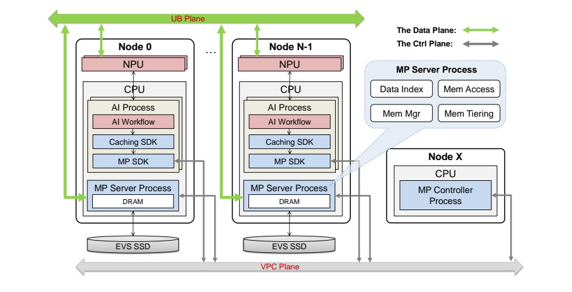

**Original caption:** Fig. 19. The deployment architecture of the UB-driven disaggregated memory pool in EMS.

**中文图注:** Fig. 19. 弹性内存服务（EMS）中由 UB 驱动的分离式内存池的部署架构。

**Source:** p.33 S167

**Original:** The interplay of these software components with the UB plane enables several key operational mechanisms and system features:

**中文:** 这些软件组件与 UB 平面的协同，催生了若干关键运行机制与系统特性：

**Source:** p.33 S168

**Original:** **Distributed Data Indexing and Placement.**To determine the placement of a key-value pair within the disaggregated memory pool and to efficiently locate it, the memory pool employs a *global consistent hashing *index. This index maps an input key to a responsible MP Server node. A DHT view, whose overall consistency and metadata are managed by the MP Controller, underpins this scheme. Individual MP Servers participate in the DHT by managing their local data portions and responding to routed requests. The MP SDK utilizes this mechanism to distribute keys to specific nodes and DRAM addresses for data access.

**中文:** **分布式数据索引与放置。**为确定一个键值对在分离式内存池中的放置位置并高效定位它，内存池采用*全局一致性哈希*索引。该索引将输入键映射到负责它的 MP Server 节点；由 MP Controller 管理整体一致性与元数据的 DHT 视图则是这一方案的基础。各 MP Server 通过管理本地的数据分片并响应被路由来的请求参与 DHT。MP SDK 利用该机制将键分布到具体节点与 DRAM 地址以完成数据访问。

**Source:** p.33 S169

**Original:** **High-Performance Remote Memory Access.**A critical function enabled by the UB plane and managed by the software components is direct, high-performance access to remote DRAM by NPUs. This involves a memory mapping and registration process established during the initialization of

**中文:** **高性能远端内存访问。**由 UB 平面使能、并受上述软件组件管理的一项关键功能，是 NPU 对远端 DRAM 的直接高性能访问。这涉及在

**Source:** p.34 S170

**Original:** MP Server instances and MP SDK clients. Control messages are negotiated to exchange physical address ranges of DRAM segments designated for the pool, which are then registered with the UB fabric and the MP Controller. This cross-node mapping capability leverages the CloudMatrix384 supernode’s support for global unified memory addressing and routing, allowing UB switches to route NPU SDMA-driven access requests directly to the target MP Server’s managed DRAM.

**中文:** MP Server 实例与 MP SDK 客户端初始化期间建立的内存映射与注册流程。在此过程中，系统通过协商控制消息来交换划拨给内存池的 DRAM 段物理地址范围，随后将这些地址范围注册到 UB 网络与 MP Controller。这种跨节点映射能力依托 CloudMatrix384 超节点对全局统一内存寻址与路由的支持，使 UB 交换机能够将 NPU 发起的 SDMA 驱动的访问请求直接路由到目标 MP Server 所管理的 DRAM。

**Source:** p.34 S171

**Original:** **Fine-Grained Local Memory Management.**To effectively manage its allocated DRAM seg-ment and combat fragmentation from variable-sized data objects (such as KV cache blocks or model shards), each MP Server employs a multi-granularity memory allocation system. A key aspect is the use of *huge pages *to reduce the frequency of memory slice allocations and associated management overhead. For data allocation, the system supports variable-length memory partitions, significantly improving memory utilization compared to fixed-size allocators. Furthermore, the MP Server allows dynamic memory flow between different granularities within its managed DRAM, enhancing resource efficiency based on workload-dependent usage patterns.

**中文:** **细粒度本地内存管理。**为有效管理所分配的 DRAM 段并对抗变长数据对象（如 KV 缓存块或模型分片）造成的碎片化，每个 MP Server 采用多粒度内存分配系统。其中一个关键点是使用*大页（huge pages）*来降低内存切片分配的频率及相关管理开销。在数据分配方面，系统支持变长内存分区，相比固定尺寸分配器显著提升内存利用率。此外，MP Server 允许内存在其管理的 DRAM 内不同粒度之间动态流动，依据随工作负载而变的访问模式提升资源效率。

**Source:** p.34 S172

**Original:** **Memory Tiering with Persistence and Recovery.**To manage storage costs and ensure data persistence, the disaggregated memory pool incorporates an SSD-based tiering layer managed by the MP Server. This layer leverages cloud-provisioned elastic volume service (EVS) SSDs to provide large-capacity, persistent storage. An alternative to EVS-based tiering is using the cloud’s scalable file system service (SFS), which however incurs higher costs. Within this hierarchy, the distributed DRAM pool acts as a fast cache layered above the EVS tier, enabling low-latency access to frequently used data. Persistence is enforced by writing all data to EVS. As EVS volumes have finite capacity, the system employs local eviction policies, e.g., least recently used (LRU), to free space when needed. The MP Server manages DRAM residency independently, using its own LRU eviction logic and capacity thresholds for the DRAM tier. Data evicted from DRAM remains persistently stored in EVS unless it is later removed by EVS’s own space management routines. This tiered structure ensures fault resilience: if in-memory data is lost (e.g., due to node failure), it can be recovered from the EVS tier, assuming it has not been evicted.

**中文:** **带持久化与恢复的内存分层。**为控制存储成本并保证数据持久化，分离式内存池纳入了一个由 MP Server 管理的基于 SSD 的分层。该层利用云上提供的弹性云硬盘（EVS）SSD 提供大容量持久化存储。除基于 EVS 的分层外，另一种选择是使用云的弹性文件服务（SFS），但成本更高。在这一层级结构中，分布式 DRAM 池充当位于 EVS 层之上的快速缓存，实现对高频访问数据的低时延访问。持久化通过将所有数据写入 EVS 来保证。由于 EVS 卷容量有限，系统采用本地淘汰策略（如最近最少使用，LRU）在需要时释放空间。MP Server 独立管理 DRAM 驻留，对 DRAM 层使用自己的 LRU 淘汰逻辑与容量阈值。从 DRAM 中淘汰的数据仍持久保存在 EVS 中，除非其后被 EVS 自身的空间管理例程清除。这种分层结构确保了容错能力：若内存中数据丢失（如因节点故障），只要其未被淘汰，即可从 EVS 层恢复。

**Source:** p.34 S173

**Original:** Importantly, while the per-node bandwidth to access EVS via the *Qingtian *card is relatively modest, typically under 400 Gbps, the disaggregated memory pool in the CloudMatrix384 aggregates this bandwidth across all 48 nodes, yielding a total EVS access bandwidth of up to 48 × 400 Gbps. Since data is partitioned into fine-grained blocks and distributed across nodes, NPUs can concurrently fetch these blocks from multiple nodes via the high-bandwidth UB plane. This enables high aggregate load bandwidth even when the requested data resides in the EVS tier, effectively amortizing the limitations of per-node EVS access through system-wide parallelism.

**中文:** 重要的是，尽管通过擎天（Qingtian）网卡访问 EVS 的单节点带宽相对有限（通常低于 400 Gbps），CloudMatrix384 中的分离式内存池将全部 48 个节点的带宽聚合起来，使 EVS 总访问带宽最高可达 48 × 400 Gbps。由于数据被切分为细粒度块并分布到各节点，NPU 可以经由高带宽 UB 平面并发地从多个节点抓取这些块。这样，即使请求的数据位于 EVS 层，也能获得很高的聚合加载带宽，通过全系统并行有效摊薄了单节点 EVS 访问的限制。

**Source:** p.34 S174

**Original:** **Namespace Isolation.**To support multi-tenancy and manage data for different Context Caching and Model Caching instances, the disaggregated memory pool provides KV Namespace isolation. This is primarily orchestrated by the MP Controller, which manages namespace creation, deletion, and metadata. Each MP Server is aware of active namespaces and ensures that data operations are confined to the designated namespace, providing logical data segregation and capacity usage limitation within the shared pool.

**中文:** **命名空间隔离。**为支持多租户并管理不同上下文缓存与模型缓存实例的数据，分离式内存池提供 KV Namespace 隔离。这主要由 MP Controller 统筹，其负责命名空间的创建、删除与元数据管理。每个 MP Server 都感知活跃的命名空间，并确保数据操作被限制在指定命名空间内，从而在共享内存池中提供逻辑上的数据隔离与容量使用限制。

**Source:** p.34 S175

**Original:** In summary, CloudMatrix384’s UB-driven disaggregated memory pool delivers a high-throughput, scalable memory tier for LLM inference. By combining hardware-level peer-to-peer access with distributed memory management software, the system supports efficient caching for both KV cache and model parameters, forming the backbone of EMS.

**中文:** 总而言之，CloudMatrix384 的 UB 驱动分离式内存池为 LLM 推理提供了高吞吐量、可扩展的内存层。通过将硬件级对等访问与分布式内存管理软件相结合，该系统同时支持对 KV 缓存与模型参数的高效缓存，构成 EMS 的骨架。

### 4.4.2 Context Caching / 4.4.2 上下文缓存

**Source:** p.35 S177

**Original:** especially valuable in scenarios involving recurring prefixes, such as multi-turn conversations, few-shot prompting, and repeated system instructions. Within our architecture, *Context Caching * refers to a dedicated mechanism for storing and efficiently retrieving these historical KV caches.

**中文:** 在涉及重复前缀的场景（如多轮对话、few-shot 提示、重复的系统指令）中尤其有价值。在我们的架构中，*上下文缓存（Context Caching）*指专门用于存储并高效检索这些历史 KV 缓存的机制。

**Source:** p.35 S178

**Original:** Context Caching is implemented by EMS [26], a service on Huawei Cloud. EMS leverages the UB-driven disaggregated memory pool (§4.4.1) to create a shared, distributed repository for historical KV caches. These caches are organized into paged blocks (e.g., 128–512 tokens per block) based on model characteristics and UB transfer efficiency. All NPUs in the serving cluster can access or contribute to this cache via EMS APIs.

**中文:** 上下文缓存由 EMS [26] 实现，它是华为云上的一项服务。EMS 利用 UB 驱动的分离式内存池（§4.4.1）为历史 KV 缓存构建一个共享的分布式存储库。这些缓存按模型特性与 UB 传输效率组织成分页块（例如每块 128–512 个 token）。推理集群中的所有 NPU 都可以通过 EMS API 访问该缓存或向其贡献数据。

**Source:** p.35 S179

**Original:** **Indexing, Deduplication, and Retrieval.**EMS provides a specialized Context Caching SDK (i.e., API layer) to the upper-level LLM serving framework for storing and retrieving historical KV cache blocks. Internally, this EMS SDK utilizes the APIs of the MP SDK (§4.4.1) to interact with the underlying distributed DRAM and tiered storage. Each KV cache block is associated with a unique hash key derived from its token sequence and augmented with a prefix hash to enable content-addressable indexing. This allows for fast lookups and deduplication: identical KV blocks are stored once and reused across requests.

**中文:** **索引、去重与检索。**EMS 向上层 LLM 推理服务框架提供专门的上下文缓存 SDK（即 API 层），用于存储和检索历史 KV 缓存块。在内部，该 EMS SDK 利用 MP SDK（§4.4.1）的 API 与底层分布式 DRAM 及分层存储交互。每个 KV 缓存块关联一个由其 token 序列派生的唯一哈希键，并附加前缀哈希以支持内容寻址索引。由此可实现快速查找与去重：相同的 KV 块只存储一次，并可跨请求复用。

**Source:** p.35 S180

**Original:** The portion of the disaggregated memory pool allocated to Context Caching is subject to capacity constraints. When nearing these limits, the MP Server (§4.4.1) triggers eviction of colder KV cache blocks from DRAM to the EVS-backed SSD tier. If SSD capacity is also constrained, data is removed entirely based on LRU-style policies. This eviction process ensures fair and efficient resource sharing between context and model caches within the unified pool.

**中文:** 分配给上下文缓存的分离式内存池份额受容量约束制约。当接近这些上限时，MP Server（§4.4.1）会触发将较冷的 KV 缓存块从 DRAM 淘汰到 EVS 支撑的 SSD 层。若 SSD 容量也受限，则基于 LRU 类策略将数据彻底删除。这一淘汰过程确保上下文缓存与模型缓存在统一内存池内公平、高效地共享资源。

**Source:** p.35 S181

**Original:** **Interaction with PDC Disaggregation.**EMS tightly integrates with the disaggregated prefill and decode pipeline:

**中文:** **与 prefill-解码-缓存分离（PDC 分离）的交互。**EMS 与分离式的 prefill 与解码流水线紧密集成：

**Source:** p.35 S182

**Original:** *Prefill – Reuse and Store: *Upon receiving a new request, the prefill engine queries EMS with a hash of the input prefix to identify reusable KV cache blocks. If found, these blocks are fetched via the UB plane and loaded directly into NPU memory, bypassing redundant computation. The engine then processes the remaining suffix and generates the corresponding KV cache blocks. These new blocks are asynchronously stored back to EMS, enabling reuse in future requests without stalling ongoing computation.

**中文:** *prefill——复用与存储：*收到新请求后，prefill 引擎以输入前缀的哈希查询 EMS，以识别可复用的 KV 缓存块。若命中，这些块经 UB 平面取回并直接加载进 NPU 内存，从而跳过冗余计算。随后引擎处理剩余的后缀部分并生成相应的 KV 缓存块。这些新块被异步写回 EMS，供未来请求复用，且不会阻塞正在进行的计算。

**Source:** p.35 S183

**Original:** *Decode – Selective Cache Storage: *KV cache generated during the decode phase can be reused for non-reasoning models, but not for reasoning models like DeepSeek-R1. These reasoning models emit intermediate reasoning tokens followed by final response tokens. Intermediate tokens are typically not re-ingested in subsequent turns, and hence final response tokens shift in position when included in later prompts. Such positional changes disrupt cache validity due to position-sensitive attention. As a result, decode-generated caches are usually excluded from storage. However, if the system adopts approximate KV reuse techniques that tolerate positional shifts, selectively storing final response tokens’ cache blocks can offer performance benefits.

**中文:** *解码——选择性缓存存储：*解码阶段生成的 KV 缓存对非推理模型可以复用，但对 DeepSeek-R1 这类推理模型则不然。这些推理模型先输出中间推理 token，再输出最终回答 token。中间 token 通常不会在后续轮次被重新摄入，因此当最终回答 token 被纳入后续 prompt 时，其位置会发生偏移。由于注意力对位置敏感，这种位置变化会破坏缓存有效性。因此，解码生成的缓存通常不纳入存储。不过，若系统采用可容忍位置偏移的近似 KV 复用技术，则有选择地存储最终回答 token 的缓存块可带来性能收益。

### 4.4.3 Model Caching / 4.4.3 模型缓存

**Source:** p.36 S185

**Original:** To address these challenges, we incorporate Model Caching provided by EMS. At its core, EMS utilizes the UB-driven disaggregated memory pool (§4.4.1) as a high-performance, distributed caching substrate to support low-latency model access across the system. To integrate with upper-layer serving frameworks, EMS provides a Model Caching SDK that exposes APIs for checking, prefetching, and loading models from the cache. Specifically, the SDK allows users to query whether a model is currently cached in the EMS memory pool, initiate asynchronous prefetching of model blocks from persistent storage into EMS, and trigger model block loading into target NPU memory for inference. When a model is already partially cached, prefetching acts as a hint to promote blocks from slower tiers (e.g., SSD) to faster tiers (e.g., DRAM), further optimizing access latency.

**中文:** 为应对这些挑战，我们引入了 EMS 提供的模型缓存。其核心在于，EMS 将 UB 驱动的分离式内存池（§4.4.1）用作高性能分布式缓存底座，以支撑跨系统的低时延模型访问。为与上层推理服务框架集成，EMS 提供模型缓存 SDK，暴露用于检查、预取和从缓存加载模型的 API。具体而言，该 SDK 允许用户查询某模型当前是否缓存在 EMS 内存池中、发起将模型块从持久存储异步预取到 EMS 的操作，以及触发将模型块加载到目标 NPU 内存以供推理。当模型已被部分缓存时，预取相当于一种提示，促使数据块从较慢层（如 SSD）提升到较快层（如 DRAM），进一步优化访问时延。

**Source:** p.36 S186

**Original:** **Cache Management Policies.**Internally, EMS decomposes each model into memory blocks and stores them as key-value entries within the disaggregated memory pool. A centralized metadata service tracks the mapping from each model to its corresponding set of blocks, enabling fine-grained, sharded model loading and efficient retrieval during inference. EMS manages cached model blocks through coordinated policies spanning admission, eviction, and versioning. For admission and prefetching, EMS loads model blocks into DRAM or SSD tiers based on application hints and observed access patterns. Eviction is handled by the native LRU-based policy of the disaggregated memory pool, which, due to the coherent access behavior of model blocks, typically operates at model-level granularity, i.e., entire models or large segments are evicted together, avoiding fragmented state. For versioning, EMS ensures NPUs always execute the correct model version by maintaining version-aware identifiers and associating each model with its corresponding block set. When a new version is deployed, the serving framework requests it explicitly, while stale versions are gradually phased out via natural cache eviction.

**中文:** **缓存管理策略。**在内部，EMS 将每个模型分解为内存块，并以键值条目的形式存入分离式内存池。一个集中式元数据服务跟踪每个模型到其对应块集合的映射，从而支持细粒度的分片化模型加载以及推理期间的高效检索。EMS 通过覆盖准入、淘汰与版本管理的协同策略管理缓存的模型块。在准入与预取方面，EMS 依据应用提示与观测到的访问模式，将模型块加载到 DRAM 或 SSD 层。淘汰由分离式内存池原生的基于 LRU 的策略处理；由于模型块的访问行为具有一致性，该策略通常以模型级粒度运作，即整个模型或大段被一并淘汰，避免产生碎片化状态。在版本管理方面，EMS 通过维护版本感知的标识符并将每个模型与其对应的块集相关联，确保 NPU 始终执行正确的模型版本。部署新版本时，推理服务框架会显式请求该版本，而旧版本则随着自然的缓存淘汰逐渐退场。

**Source:** p.36 S187

**Original:** **Benefits of Model Caching with the UB-driven Disaggregated Memory Pool.**EMS lever-ages the UB-driven disaggregated memory pool to achieve two key advantages for model caching. First, the high-bandwidth, low-latency UB plane facilitates fast transfer of model blocks from EMS memory tiers (e.g., DRAM or SSD) to NPU memory, substantially reducing model loading latency. Second, EMS uses a unified, cluster-wide memory pool that eliminates data redundancy, allowing a single cached model version to be shared by all NPU instances. This design reduces both the pressure on persistent storage bandwidth and the cumulative DRAM and SSD footprint required for caching, resulting in improved scalability and resource efficiency.

**中文:** **模型缓存依托 UB 驱动分离式内存池的收益。**EMS 借助 UB 驱动的分离式内存池，为模型缓存带来两大关键优势。其一，高带宽、低时延的 UB 平面支持模型块从 EMS 各内存层（如 DRAM 或 SSD）向 NPU 内存的快速传输，显著降低模型加载时延。其二，EMS 使用全集群统一的内存池，消除了数据冗余，使单一缓存模型版本可被所有 NPU 实例共享。这一设计既减轻了持久存储带宽的压力，又降低了缓存所需的 DRAM 与 SSD 总占用，带来更好的可扩展性与资源效率。

**Source:** p.37 S188

**Original:** Table 1 quantifies these benefits through a performance comparison across different model loading strategies for a 671B-parameter model with INT8 quantization. When no caching is used, all 8 model instances concurrently loading the model from OBS experience a cold start latency of approximately 2,560 seconds each, due to severe contention on the shared 2.5 GB/s OBS bandwidth. Local DRAM caching offers no improvement in this cold start latency, as each node still independently fetches the full model from OBS. In contrast, EMS reduces cold start latency to only ~320 seconds by enabling shared loading through the memory pool and reusing model blocks across instances.

**中文:** 表 1 通过对一个 671B 参数、INT8 量化的模型在不同模型加载策略下的性能对比，量化了这些收益。不使用缓存时，8 个模型实例同时从对象存储（OBS）加载模型，由于共享的 2.5 GB/s OBS 带宽上发生严重争用，每个实例的冷启动时延约为 2,560 秒。本地 DRAM 缓存无法改善该冷启动时延，因为每个节点仍要独立地从 OBS 拉取完整模型。相比之下，EMS 通过内存池实现共享加载并跨实例复用模型块，将冷启动时延降至仅约 320 秒。

### Table 1. 表 1

**Placed near:** S188
**Source:** p.36 C020

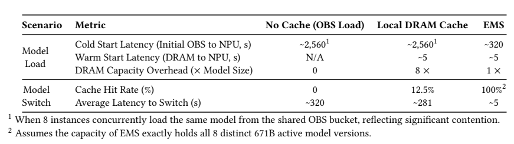

**Original caption:** Table 1. Performance comparison of model loading strategies for loading a 671B INT8 model (approximately 671GB data size) into 8 model instances within a CloudMatrix384 (The model is originally stored in an OBS bucket with 2.5GB/s bandwidth. We consider two scenarios: 1) Model load: all 8 instances concurrently load the same model using different load strategies for comparing their load latency and DRAM overhead; 2) Model switch: with 8 distinct active models, we compare the model switch latency and cache hit rate when one instance performs a random model switching to one of these 8 models. Latencies are illustrative and representative of defined scenarios.).

**中文图注:** Table 1. 在 CloudMatrix384 内将一个 671B INT8 模型（数据量约 671GB）加载到 8 个模型实例的不同模型加载策略的性能对比（模型最初存储在带宽为 2.5GB/s 的对象存储（OBS）桶中。我们考虑两种场景：1) 模型加载：8 个实例采用不同加载策略并发加载同一模型，比较其加载时延与 DRAM 开销；2) 模型切换：在 8 个不同模型同时活跃的情况下，比较某一实例随机切换到这 8 个模型之一时的模型切换时延与缓存命中率。表中时延为示意值，能够代表所定义场景下的典型水平。）

**Source:** p.37 S189

**Original:** Beyond latency, EMS also improves memory efficiency. Local DRAM caching results in an 8 × DRAM overhead where each of the 8 instances stores a full model replica. EMS, in comparison, requires only 1 × DRAM footprint to serve all instances, while maintaining an identical warm start latency of ~5 seconds. In model switching scenarios, EMS achieves a 100% cache hit rate with an average switch latency of ~5 seconds, significantly outperforming local DRAM caching, which yields only a 12.5% hit rate and a latency of ~281 seconds. These results highlight EMS as a highly effective solution for minimizing both model access latency and memory resource overhead in large-scale inference environments.

**中文:** 除时延外，EMS 还提升了内存效率。本地 DRAM 缓存带来 8 倍 DRAM 开销，即 8 个实例各自保存一份完整模型副本；相比之下，EMS 只需 1 倍 DRAM 占用即可服务所有实例，同时保持相同的约 5 秒热启动时延。在模型切换场景中，EMS 实现了 100% 的缓存命中率，平均切换时延约 5 秒，显著优于本地 DRAM 缓存——后者命中率仅 12.5%，时延约 281 秒。这些结果凸显出 EMS 是大规模推理环境中同时最小化模型访问时延与内存资源开销的高效方案。

### 4.5 INT8 Quantization / 4.5 INT8 量化

**Source:** p.37 S191

**Original:** **Mixed-Precision Strategy.**Our quantization scheme employs a *mixed-precision strategy *that classifies different operators within the model based on a trade-off between their impact on overall performance (e.g., computational load, memory access) and their sensitivity to numerical precision. The most computationally intensive operations in the critical execution path, such as large matrix multiplications in feed-forward networks (FFNs) and attention mechanisms, are quantized to INT8 to leverage the highest throughput. Conversely, sub-modules or specific operations that are more sensitive to quantization errors but constitute a smaller fraction of the overall memory access or computational burden (e.g., certain normalization layers or critical gating mechanisms) retain higher precision using BF16 or FP32. This flexible partitioning of bit-widths ensures that the entire model can execute efficiently within a unified hardware pipeline, while precision bottlenecks in critical, numerically sensitive pathways are avoided.

**中文:** **混合精度策略。**我们的量化方案采用*混合精度策略*，依据各算子对整体性能的影响（如计算负载、内存访问）与其对数值精度的敏感度之间的权衡，对模型中不同算子进行分类。关键执行路径上计算最密集的操作，如前馈网络（FFN）和注意力机制中的大规模矩阵乘法，被量化为 INT8 以获取最高吞吐量。反之，对量化误差更敏感、但在整体内存访问或计算负担中占比较小的子模块或特定操作（如某些归一化层或关键门控机制），则用 BF16 或 FP32 保留更高精度。这种灵活的位宽划分确保整个模型能在统一的硬件流水线中高效执行，同时避免在关键且数值敏感的路径上出现精度瓶颈。

**Source:** p.37 S192

**Original:** **Adaptive Scale Search.**Effective quantization requires careful alignment of the dynamic range of floating-point values to the limited range of INT8 integers. For each weight tensor and activation tensor destined for INT8 quantization, we introduce a lightweight, *adaptive scale search process *. $s$ ∗ This process automatically determines the optimal scaling factor that minimizes the quantization error, effectively aligning the value distributions before and after quantization. The scale search is formulated as an optimization problem:

**中文:** **自适应缩放因子搜索。**有效的量化需要将浮点值的动态范围仔细对齐到 INT8 整数的有限范围。对于每个待 INT8 量化的权重张量和激活张量，我们引入一个轻量的*自适应缩放因子搜索过程*。$s$ ∗ 该过程自动确定使量化误差最小化的最优缩放因子，使量化前后的数值分布得到有效对齐。缩放因子搜索被表述为一个优化问题：

**Source:** p.37 E003 · Eq. (3)

$$
s^{*}=\arg\min_{s}\ \mathcal{L}(s),\quad \text{where}\ \mathcal{L}(s)=\bigl\lVert Q(W\cdot s)(s^{-1}\cdot X)-WX\bigr\rVert
$$

**中文说明：** 自适应缩放搜索：量化前后输出对齐的优化目标（符号保持原样，已对照原 PDF 裁片核验。）

**Source:** p.38 S193

**Original:** **Outlier Suppression and Structural Transformation.**Certain components within large models, particularly specific expert subnetworks or gating structures in MoE architectures, can exhibit activation or weight distributions with long tails or significant outliers. These outliers can disproportionately affect the quantization range, leading to a loss of precision for the majority of values. To mitigate this, we employ an *outlier suppression technique involving structural trans- * *formations *. Prior to quantization, simple linear transformations (conceptually similar to applying learned orthogonal basis rotations or absorbing scaling factors into preceding/succeeding layers) are introduced. These transformations aim to redistribute the extreme values into a more balanced and quantization-friendly range without altering the underlying mathematical function of the layer. By reducing the impact of outliers, this method minimizes the risk of large quantization errors and curtails subsequent error amplification through the network.

**中文:** **离群值抑制与结构变换。**大模型中的某些组件，尤其是 MoE 架构中的特定专家子网络或门控结构，其激活值或权重分布可能呈现长尾或显著离群值。这些离群值会对量化范围产生不成比例的影响，导致大多数数值出现精度损失。为缓解这一问题，我们采用一种*基于结构变换的离群值抑制技术*：在量化之前引入简单的线性变换（概念上类似于施加学习得到的正交基旋转，或将缩放因子吸收进前序/后继层）。这些变换旨在把极端值重新分布到更均衡、更利于量化的数值范围内，同时不改变该层原本的数学函数。通过降低离群值的影响，该方法最大程度地减小了出现大量化误差的风险，并抑制了误差在网络中的后续放大。

**Source:** p.38 S194

**Original:** **Efficient INT8 Matrix Multiplication Kernels.**The performance benefits of INT8 quantization are critically dependent on highly optimized execution kernels. We leverage a *mixed-granularity * $X$ *quantization scheme for matrix multiplications *: activations () are quantized on a per-token basis $W$ (dynamic range determined per token), while weights () are quantized on a per-channel basis (typically per-output-channel, static range per channel). This approach balances the need to adapt to rapidly changing activation statistics with the desire to maintain stable weight representations. This mixed granularity, combined with carefully aligned memory layouts for both weights and activations, allows for full utilization of the specialized integer matrix multiplication instructions available on Ascend NPUs. Compared to equivalent BF16 or FP16 implementations, these optimized INT8 kernels can deliver severalfold increases in inference throughput on the same hardware, while ensuring that any accuracy degradation remains within application-acceptable tolerances.

**中文:** **高效的 INT8 矩阵乘算子。**INT8 量化的性能收益在很大程度上取决于高度优化的执行算子。我们为矩阵乘采用*$X$/$W$ 混合粒度量化方案*：激活值（$X$）按 token 粒度量化（动态范围逐 token 确定），而权重（$W$）按通道粒度量化（通常为逐输出通道、每通道静态范围）。该方案既满足了适应快速变化的激活统计特性的需要，又兼顾了保持权重表示稳定性的诉求。这种混合粒度，再加上为权重与激活精心对齐的内存布局，使 Ascend NPU 上专用的整数矩阵乘指令得以被充分利用。与等效的 BF16 或 FP16 实现相比，这些优化后的 INT8 算子在同一硬件上可带来数倍的推理吞吐量提升，同时确保任何精度下降都保持在应用可接受的容差范围内。

**Source:** p.38 S195

**Original:** **Block-Level Clipping and Error Compensation.**To further refine accuracy and handle local variations within large weight tensors, we implement *block-level clipping and error compensation *. Weights are statistically analyzed and partitioned into smaller blocks. For each block, a distinct, tolerable clipping range is established. This range can be determined by optimizing a scaling factor $α$ for clipping (e.g., $W$ = $α$ · max ($W$) and $W$ = $α$ · min ($W$)) that minimizes the clip_max block clip_min block quantization error for that specific block, for instance, by solving: $XWXQWα$

**中文:** **块级裁剪与误差补偿。**为进一步提升精度并处理大型权重张量内部的局部差异，我们实现了*块级裁剪与误差补偿*。先对权重进行统计分析并划分为较小的块，然后为每个块建立一个独立的、可容忍的裁剪范围。该范围可通过为裁剪优化缩放因子 $α$ 来确定（例如 $W$ = $α$ · max($W$) 与 $W$ = $α$ · min($W$)），使该特定块的 clip_max block clip_min block 量化误差最小化，例如通过求解：$XWXQWα$

**Source:** p.38 E004 · Eq. (4)

$$
\arg\min_{\alpha}\ \bigl\lVert \text{Block}(X;W)-\text{Block}(X;Q(W;\alpha))\bigr\rVert
$$

**中文说明：** 块级裁剪：逐块求解最优裁剪因子 α（符号保持原样，已对照原 PDF 裁片核验。）

**Source:** p.38 S196

**Original:** In concert, these five strategies form a robust and hierarchical INT8 quantization framework that enables high-performance inference for massive models like DeepSeek-V3/R1 on Ascend hardware, carefully balancing computational efficiency with the preservation of model accuracy.

**中文:** 这五种策略相互配合，构成了一个稳健且分层的 INT8 量化框架，使 DeepSeek-V3/R1 这类超大模型能够在 Ascend 硬件上进行高性能推理，并在计算效率与模型精度保持之间实现了精心平衡。

## 5 Evaluations / 5 评估

**Source:** p.38 S501

**Original:** In this section, we present a comprehensive performance evaluation for our proposed serving system CloudMatrix-Infer, previously detailed in §4, when deployed on the CloudMatrix384. We begin by outlining the common experimental setup used for our evaluation (§5.1). Subsequently, we analyze several key aspects of performance and efficacy: this includes the overall system performance (§5.2); the inference accuracy achieved with our INT8 quantization scheme (§5.3); an ablation study that

**中文:** 本节对我们提出的推理服务系统 CloudMatrix-Infer（前文 §4 已详述）部署于 CloudMatrix384 之上时的表现进行全面性能评估。我们首先概述评估所用的通用实验设置（§5.1）；随后从若干关键维度分析性能与效果：包括整体系统性能（§5.2）；INT8 量化方案下的推理精度（§5.3）；一项消融研究，

**Source:** p.39 S197

**Original:** investigates the specific contributions of different optimization techniques employed (§5.4); and finally, a look at the performance of critical underlying operators (§5.5).

**中文:** 考察所采用的各种优化技术的具体贡献（§5.4）；最后是关键底层算子的性能分析（§5.5）。

### 5.1 Experimental Setup / 5.1 实验设置

**Source:** p.39 S199

**Original:** **Decode Cluster:**We deploy a single decode instance utilizing 160 Ascend 910 NPUs (across 20 compute nodes, yielding 320 NPU dies). This instance employs an expert parallelism degree of 320 (EP320) for the sparse MoE layers. For other components like MLA and dense FFN layers, a data parallelism degree of 320 (DP320) is used across the NPU dies. Within these 320 EP ranks, we deploy one expert instance per rank. The expert configuration comprises 32 copies of the shared expert, 256 distinct router experts, and an additional 32 redundant router experts to facilitate expert parallelism load balancing (EPLB).

**中文:** **解码集群：**我们部署单个解码实例，使用 160 个 Ascend 910 NPU（分布在 20 个计算节点上，即 320 个 NPU 芯粒）。该实例对稀疏 MoE 层采用 320 的专家并行度（EP320）；对于 MLA 和密集 FFN 层等其他组件，则在全部 NPU 芯粒上采用 320 的数据并行度（DP320）。在这 320 个 EP rank 中，每个 rank 部署一个专家实例。专家配置包括 32 份共享专家副本、256 个不同的路由专家，以及额外的 32 个冗余路由专家，用于支持专家并行负载均衡（EPLB）。

**Source:** p.39 S200

**Original:** **Prefill Cluster:**The prefill cluster consists of 6 prefill instances, each allocated 16 Ascend 910 NPUs (two compute nodes per instance, yielding 32 NPU dies). In total, the prefill cluster uses 96 NPUs. Each prefill instance employs an expert parallelism degree of 32 (EP32) for sparse MoE layers. MLA components within prefill instances utilize a hybrid parallelism strategy detailed in §4.3.1. For expert deployment within each 32-rank prefill instance, we configure 10 experts per rank, consisting of 1 shared expert, 8 router-selected experts, and 1 redundant router expert for effective EPLB.

**中文:** **prefill（预填充）集群：**prefill 集群由 6 个 prefill 实例组成，每个实例分配 16 个 Ascend 910 NPU（每个实例 2 个计算节点，即 32 个 NPU 芯粒）。prefill 集群总计使用 96 个 NPU。每个 prefill 实例对稀疏 MoE 层采用 32 的专家并行度（EP32）。prefill 实例中的 MLA 组件采用 §4.3.1 详述的混合并行策略。在每个 32-rank 的 prefill 实例内部，每个 rank 配置 10 个专家，包括 1 个共享专家、8 个路由选择的专家和 1 个冗余路由专家，以实现有效的 EPLB。

**Source:** p.39 S201

**Original:** **Caching Cluster (EMS):**The distributed caching provided by EMS is realized by leveraging the host CPU DRAM of all physical compute nodes that constitute the prefill and decode clusters. The Kunpeng CPUs and their associated DRAM on these 32 compute nodes (20 for the decode cluster + 12 for the prefill cluster) collectively form the UB-driven disaggregated memory pool. EMS utilizes this pool for both Model Caching (§4.4.3) and Context Caching (§4.4.2). Access to this shared memory pool from all NPUs is facilitated by the CloudMatrix384’s high-speed UB plane.

**中文:** **缓存集群（弹性内存服务，EMS）：**EMS 提供的分布式缓存通过利用构成 prefill 与解码集群的全部物理计算节点的主机 CPU DRAM 来实现。这 32 个计算节点（解码集群 20 个 + prefill 集群 12 个）上的鲲鹏（Kunpeng）CPU 及其配套 DRAM 共同构成由 UB 驱动的分离式内存池。EMS 将该池同时用于模型缓存（Model Caching，§4.4.3）与上下文缓存（Context Caching，§4.4.2）。所有 NPU 对该共享内存池的访问依托 CloudMatrix384 的高速 UB 平面完成。

**Source:** p.39 S202

**Original:** This experimental configuration serves as the basis for the accuracy and performance evaluation in subsequent sections. The DeepSeek-R1 model evaluated is the 671B parameter version, which has been quantized to INT8 (§4.5) for execution on the Ascend 910 NPUs.

**中文:** 上述实验配置是后文精度与性能评估的基础。所评估的 DeepSeek-R1 模型为 671B 参数版本，已量化为 INT8（§4.5）以在 Ascend 910 NPU 上执行。

### 5.2 Overall Performance / 5.2 整体性能

**Source:** p.39 S204

**Original:** **Prefill Throughput.**We begin by examining prefill throughput, a critical factor for efficiently processing input prompts. Table 2 details these per-accelerator comparisons. Effective MoE model 2 https://www.siliconflow.com/

**中文:** **prefill 吞吐量。**我们首先考察 prefill 吞吐量，这是高效处理输入提示词的关键因素。Table 2 详细列出了按每加速器口径的对比。有效的 MoE 模型 2 https://www.siliconflow.com/

### Table 2. 表 2

**Placed near:** S204
**Source:** p.40 C021

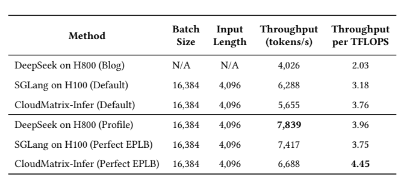

**Original caption:** Table 2. Overall prefill throughput (per accelerator) for DeepSeek-R1.

**中文图注:** Table 2. DeepSeek-R1 的整体 prefill 吞吐量（每加速器）。

**Source:** p.40 S205

**Original:** serving during prefill also significantly depends on robust EPLB, as highlighted by SGLang’s analysis [53]. The DeepSeek (Profile) data, with its high throughput (7,839 tokens/s per GPU), may reflect performance under near-ideal expert load balancing. To provide a comparable analytical baseline against such optimized scenarios, Table 2 includes *Perfect EPLB *configurations for both SGLang and CloudMatrix-Infer. These results represent projected performance under an idealized assumption of perfect load distribution across experts.

**中文:** 推理服务在 prefill 阶段同样在很大程度上依赖健壮的 EPLB，这一点在 SGLang 的分析 [53] 中被重点指出。DeepSeek（Profile）数据吞吐量很高（每 GPU 7,839 tokens/s），可能反映的是接近理想专家负载均衡下的性能。为了与这类优化场景建立可比的分析基线，Table 2 为 SGLang 与 CloudMatrix-Infer 均列入了 *Perfect EPLB* 配置。这些结果表示在专家间完全均匀负载分布的理想化假设下的预测性能。

**Source:** p.40 S206

**Original:** In its default configuration, CloudMatrix-Infer processes 5,655 tokens/s per NPU, yielding a compute efficiency of 3.76 tokens/s per TFLOPS. This is significantly more efficient than SGLang’s default configuration on NVIDIA H100 (3.18 tokens/s per TFLOPS), despite the latter having slightly higher raw throughput. When tested under an idealized "Perfect EPLB" condition, CloudMatrix- Infer achieves 6,688 tokens/s per NPU, translating to an efficiency of 4.45 tokens/s per TFLOPS, surpassing both SGLang’s ideal efficiency on H100 (3.75 tokens/s per TFLOPS) and the DeepSeek profile on H800 (3.96 tokens/s per TFLOPS). These comparisons underscore the strong potential of CloudMatrix-Infer, while the gap between our default and ideal results highlights the opportunity for further improvement in our load-balancing algorithms.

**中文:** 在默认配置下，CloudMatrix-Infer 每 NPU 处理 5,655 tokens/s，计算效率为 3.76 tokens/s per TFLOPS。尽管 SGLang 在 NVIDIA H100 上的默认配置原始吞吐量略高，其效率（3.18 tokens/s per TFLOPS）仍明显低于我们。在理想化的 "Perfect EPLB" 条件下测试时，CloudMatrix-Infer 达到每 NPU 6,688 tokens/s，折合 4.45 tokens/s per TFLOPS 的效率，同时超越了 SGLang 在 H100 上的理想效率（3.75 tokens/s per TFLOPS）与 DeepSeek 在 H800 上的 Profile 效率（3.96 tokens/s per TFLOPS）。这些对比凸显了 CloudMatrix-Infer 的强劲潜力，而我们默认结果与理想结果之间的差距也表明负载均衡算法仍有进一步改进空间。

**Source:** p.40 S207

**Original:** **Decode Throughput.**Next, we analyze performance during the auto-regressive decode phase, as detailed in Table 3. We assess absolute decode throughput (tokens/s) targeting a time-per-output-token (TPOT) SLO of below 50 ms, and also evaluate throughput normalized by the accelerator’s computer power (tokens/s per TFLOPS) as an indicator of compute efficiency. Notably, both the SGLang (Simulated MTP) and CloudMatrix-Infer configurations utilize multi-token prediction (MTP) with an assumed effective acceptance rate of 70% for a single speculative token.

**中文:** **解码吞吐量。**接下来，我们分析自回归解码阶段的性能，详见 Table 3。我们评估在每 token 输出时间（TPOT）低于 50 ms 的服务级目标（SLO）约束下的绝对解码吞吐量（tokens/s），同时评估按加速器算力归一化的吞吐量（tokens/s per TFLOPS），作为计算效率的指标。值得注意的是，SGLang（Simulated MTP）与 CloudMatrix-Infer 两种配置均采用了多 token 预测（MTP），并假设单个投机 token 的有效接受率为 70%。

### Table 3. 表 3

**Placed near:** S207
**Source:** p.40 C022

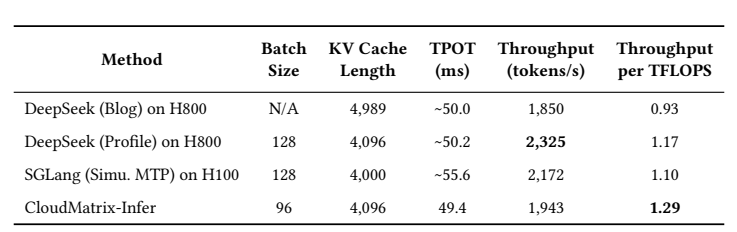

**Original caption:** Table 3. Overall decode throughput (per accelerator) for DeepSeek-R1.

**中文图注:** Table 3. DeepSeek-R1 的整体解码吞吐量（每加速器）。

**Source:** p.41 S208

**Original:** CloudMatrix-Infer, configured with a batch size of 96 per NPU and a KV cache length of 4,096 tokens, achieves an excellent TPOT of 49.4 ms. In terms of absolute system throughput, CloudMatrix- Infer yields 1,943 tokens/s per NPU with its batch size of 96. This is higher than the DeepSeek (Blog) H800 baseline (1,850 tokens/s per GPU). While numerically lower than DeepSeek (Profile) on H800 (2,325 tokens/s per GPU) and SGLang on H100 (2,172 tokens/s per GPU), these latter systems were benchmarked with a larger batch size of 128. The throughput per TFLOPS metric offers further insight into system compute efficiency. CloudMatrix-Infer achieves the highest compute efficiency (1.29 tokens/s per TFLOPS), which is higher than SGLang on H100 (1.10 tokens/s per TFLOPS), DeepSeek (Blog) on H800 (0.93 tokens/s per TFLOPS), and DeepSeek (Profile) on H800 (1.17 tokens/s per TFLOPS). This indicates that our serving solution effectively utilizes the available compute power of the CloudMatrix384 during decoding.

**中文:** CloudMatrix-Infer 配置为每 NPU batch size 96、KV 缓存长度 4,096 tokens，实现了 49.4 ms 的优异 TPOT。在绝对系统吞吐量方面，CloudMatrix-Infer 在 batch size 为 96 时达到每 NPU 1,943 tokens/s，高于 DeepSeek（Blog）在 H800 上的基线（每 GPU 1,850 tokens/s）。虽然数值上低于 DeepSeek（Profile）在 H800（每 GPU 2,325 tokens/s）和 SGLang 在 H100（每 GPU 2,172 tokens/s）上的结果，但后两个系统是在更大的 batch size 128 下测得的。每 TFLOPS 吞吐量指标进一步揭示了系统计算效率：CloudMatrix-Infer 取得了最高的计算效率（1.29 tokens/s per TFLOPS），高于 SGLang 在 H100 上的 1.10 tokens/s per TFLOPS、DeepSeek（Blog）在 H800 上的 0.93 tokens/s per TFLOPS，以及 DeepSeek（Profile）在 H800 上的 1.17 tokens/s per TFLOPS。这表明我们的推理服务方案在解码阶段有效利用了 CloudMatrix384 的可用算力。

### Table 4. 表 4

**Placed near:** S208
**Source:** p.41 C023

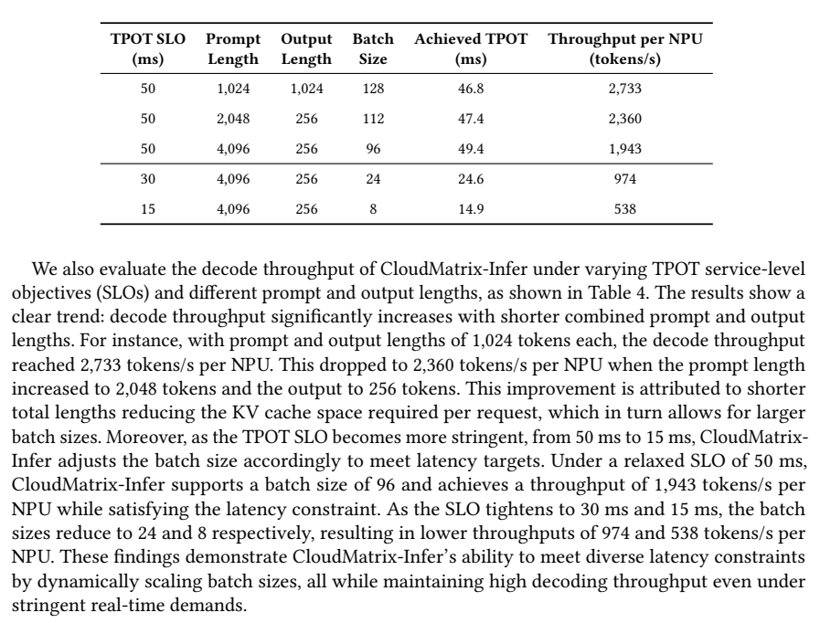

**Original caption:** Table 4. The decode throughput of CloudMatrix-Infer under different TPOT SLOs and prompt/output lengths.

**中文图注:** Table 4. CloudMatrix-Infer 在不同每 token 输出时间（TPOT）服务级目标（SLO）与 prompt/输出长度下的解码吞吐量。

### 5.3 Accuracy / 5.3 精度

**Source:** p.42 S210

**Original:** methodology against the live DeepSeek-R1 API to ensure a fair and direct comparison of practical performance.

**中文:** 方法与在线 DeepSeek-R1 API 进行对照，以确保对实际性能的比较公平且直接。

**Source:** p.42 S211

**Original:** Our evaluation suite is derived from the extensive list in the DeepSeek-R1 technical report and other widely utilized benchmarks, comprising 16 distinct benchmarks for a multifaceted assessment. Exclusions include AlpacaEval 2.0 [17] and Arena-Hard [36], due to their reliance on GPT-4 for 3 evaluation (which is outside our current setup), and CodeForces because of the lack of readily available automated evaluation scripts. The selected benchmarks cover a broad range of capabilities: English (MMLU [23], MMLU-Pro [9], DROP [16], IFEval [58], GPQA Diamond [50], SimpleQA [44]), Code Generation (LiveCodeBench [31], HumanEval [7]), Mathematics (AIME 2024 [3], MATH- 500 [24], CNMO 2024 [1], MGSM [51]), and Chinese (CLUEWSC [55], C-Eval [25], C-SimpleQA [22], C-MMLU [35]). We believe this curated set provides a robust basis for evaluating accuracy.

**中文:** 我们的评测套件源自 DeepSeek-R1 技术报告中的详尽清单以及其他广泛使用的 benchmark，共包含 16 个不同的 benchmark，用于多维度评估。排除项包括 AlpacaEval 2.0 [17] 与 Arena-Hard [36]——它们依赖 GPT-4 进行 3 评测（超出我们当前的实验条件），以及 CodeForces——因其缺乏现成的自动化评测脚本。所选 benchmark 覆盖广泛的能力维度：英文（MMLU [23]、MMLU-Pro [9]、DROP [16]、IFEval [58]、GPQA Diamond [50]、SimpleQA [44]），代码生成（LiveCodeBench [31]、HumanEval [7]），数学（AIME 2024 [3]、MATH-500 [24]、CNMO 2024 [1]、MGSM [51]），以及中文（CLUEWSC [55]、C-Eval [25]、C-SimpleQA [22]、C-MMLU [35]）。我们相信这一精选集合为精度评估提供了稳健的基础。

**Source:** p.42 S212

**Original:** For consistency in evaluation, prompts for benchmarks such as MMLU, DROP, MGSM, GPQA Diamond, HumanEval, MATH-500, SimpleQA, and C-SimpleQA are sourced from the simple-evals framework. Others, including CMMLU, C-Eval, LiveCodeBench, IFEval, and CLUEWSC, utilize the OpenCompass framework 4. Adhering to the methodology in the DeepSeek-R1 technical report, MMLU-Pro, C-Eval, and CLUEWSC are tested in a zero-shot setting, while other test sets follow their original protocols. Mathematics competition benchmarks (AIME 2024 and CNMO 2024) undergo 32 repeated test runs each to accurately estimate their pass@1 metrics. For *MATH-500 *, *SimpleQA *, and *C-SimpleQA *benchmarks where official evaluations reportedly utilize various GPT-4 versions, we 5 employ Qwen2.5-72B-Instruct as the grading model for assessing the outputs of both DeepSeek-R1 (INT8) and the DeepSeek-R1 API. While this choice ensures internal consistency for our study, it may contribute to variations when comparing our scores to those in the DeepSeek-R1 technical

**中文:** 为保证评估的一致性，MMLU、DROP、MGSM、GPQA Diamond、HumanEval、MATH-500、SimpleQA 与 C-SimpleQA 等 benchmark 的提示词取自 simple-evals 框架；其余 benchmark，包括 CMMLU、C-Eval、LiveCodeBench、IFEval 与 CLUEWSC，则使用 OpenCompass 框架 4。遵循 DeepSeek-R1 技术报告中的方法，MMLU-Pro、C-Eval 与 CLUEWSC 在 zero-shot 设置下测试，其他测试集遵循其原始协议。数学竞赛类 benchmark（AIME 2024 与 CNMO 2024）各进行 32 次重复测试，以准确估计其 pass@1 指标。对于 *MATH-500*、*SimpleQA* 与 *C-SimpleQA* 这些官方评估据报道使用了不同版本 GPT-4 的 benchmark，我们 5 采用 Qwen2.5-72B-Instruct 作为评分模型，对 DeepSeek-R1（INT8）与 DeepSeek-R1 API 的输出进行评估。虽然这一选择确保了本研究内部的评估一致性，但与 DeepSeek-R1 技术

**Source:** p.42 S213

**Original:** 3 https://codeforces.com 4 https://github.com/open-compass/opencompass 5 https://huggingface.co/Qwen/Qwen2.5-72B-Instruct

**中文:** 3 https://codeforces.com 4 https://github.com/open-compass/opencompass 5 https://huggingface.co/Qwen/Qwen2.5-72B-Instruct

**Source:** p.43 S214

**Original:** report, which relies on GPT-4-based grading. Key generation parameters include a temperature of 0.6 and top-p of 0.95, aligning with settings specified in the DeepSeek-R1 technical report [13].

**中文:** 报告中的分数相比，由于后者依赖基于 GPT-4 的评分，可能存在一定偏差。关键生成参数包括温度 0.6 与 top-p 0.95，与 DeepSeek-R1 技术报告 [13] 中指定的设置保持一致。

**Source:** p.43 S215

**Original:** The comparative accuracy results are presented in Table 5. Overall, our DeepSeek-R1 (INT8) implementation on Ascend 910 demonstrates performance largely comparable to both the official DeepSeek-R1 API and the metrics reported in the original technical paper. This indicates that the INT8 quantization applied for deployment on Ascend 910 effectively preserves the model’s capabilities across a diverse range of tasks.

**中文:** 对比精度结果见 Table 5。总体而言，我们在 Ascend 910 上实现的 DeepSeek-R1（INT8）表现出与官方 DeepSeek-R1 API 以及原技术论文所报告指标大体相当的性能。这表明为部署到 Ascend 910 而实施的 INT8 量化在多样化的任务上有效保持了模型能力。

### Table 5. 表 5

**Placed near:** S215
**Source:** p.42 C024

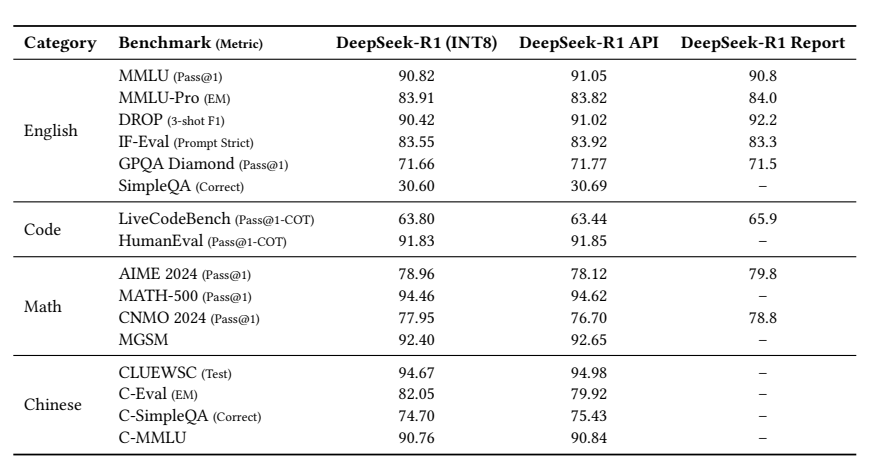

**Original caption:** Table 5. Accuracy comparison of DeepSeek-R1 with INT8 quantization on Ascend 910, the official DeepSeek- R1 API [10], and results reported in the DeepSeek-R1 technical report [13] across multiple benchmarks (Results from benchmarks with testing configurations deemed inconsistent have been excluded.).

**中文图注:** Table 5. 在多个 benchmark 上对 DeepSeek-R1 的精度比较，包括 Ascend 910 上经 INT8 量化的版本、DeepSeek-R1 官方 API [10]，以及 DeepSeek-R1 技术报告 [13] 中报告的结果（测试配置被视为不一致的 benchmark 结果已被排除）。

### 5.4 Ablation Study / 5.4 消融实验

### 5.4.1 Microbatch-based Pipeline / 5.4.1 基于微批次的流水线

**Source:** p.43 S218

**Original:** **Decode Pipeline.**We first evaluate our microbatch-based pipeline for the decode phase, pre-viously detailed in §4.2.3. The ablation compares system performance with and without this microbatch optimization. Figure 20a illustrates the decode throughput across various batch sizes. We observe that enabling the microbatch-based pipeline improves decode throughput by 5.8%, 9.4%, and 6.9% for batch sizes of 64, 96, and 128, respectively. This gain, while beneficial, is rela-tively more modest when compared to potential improvements reported for other platforms (e.g., SGLang [53] cited 35% on NVIDIA H100 clusters). This difference is primarily attributed to the inherently lower MoE dispatch and combine communication overheads on the CloudMatrix384 with its high-performance UB plane (as detailed in Section 5.5.1), compared to NVIDIA GPU clusters typically utilizing RDMA. With smaller MoE communication stalls on the UB plane, the improve-ment ceiling from communication hiding via microbatching is naturally more constrained for the CloudMatrix384.

**中文:** **解码流水线。**我们首先评估前文 §4.2.3 详述的解码阶段基于微批次的流水线。该消融实验对比启用与不启用这一微批次优化时的系统性能。Figure 20a 展示了不同 batch size 下的解码吞吐量。我们观察到，启用基于微批次的流水线后，batch size 为 64、96 和 128 时解码吞吐量分别提升 5.8%、9.4% 和 6.9%。这一收益虽然有益，但与其他平台报道的潜在改进（例如 SGLang [53] 在 NVIDIA H100 集群上称达 35%）相比相对温和。这一差异主要归因于：与通常采用 RDMA 的 NVIDIA GPU 集群相比，CloudMatrix384 凭借高性能 UB 平面，其 MoE 分发（dispatch）与合并（combine）的通信开销本身更低（详见 Section 5.5.1）。由于 UB 平面上的 MoE 通信停顿更小，通过微批次实现通信隐藏所能带来的改进上限对 CloudMatrix384 而言自然更受限制。

### Fig. 20. 图 20

**Placed near:** S218
**Source:** p.43 C025

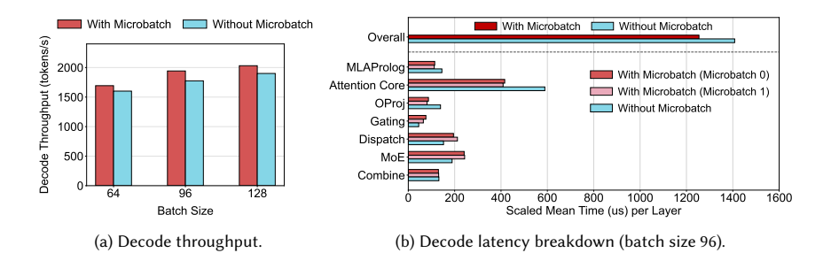

**Original caption:** Fig. 20. Decode throughput and per-layer latency breakdown with and without the microbatch-based pipeline. All requests have a 4,096-token KV cache length. In (b), the “Overall” with Microbatch indicates the per-layer latency after overlapping two microbatches (Microbatch 0 and Microbatch 1).

**中文图注:** Fig. 20. 采用与不采用基于微批次的流水线时的解码吞吐量与每层时延分解。所有请求的 KV 缓存长度均为 4,096 token。在 (b) 中，带 Microbatch 的“Overall”表示两个微批次（Microbatch 0 与 Microbatch 1）重叠后的每层时延。

**Source:** p.43 S219

**Original:** Figure 20b provides a per-layer latency breakdown for decode execution with a batch size of 96. It reveals that although individual microbatch execution latency for stages like Gating, Dispatch MoE, and is marginally increased due to decreased per-stream compute resources (e.g.,

**中文:** Figure 20b 给出了 batch size 为 96 时解码执行的逐层时延分解。结果显示，尽管门控（Gating）、分发（Dispatch）、MoE 等阶段的单个微批次执行时延因每流计算资源减少（例如

**Source:** p.44 S220

**Original:** AICs from 24 to 16), the microbatch-based pipeline significantly benefits overall performance. This is achieved by effectively overlapping the attention path (Stream 0) and MoE path (Stream 1) for different microbatches, leading to an approximate 10% reduction in overall per-layer latency and a corresponding considerable enhancement in end-to-end decode throughput.

**中文:** AIC 数量从 24 减至 16）而略有增加，基于微批次的流水线仍显著改善了整体性能。其机制在于让不同微批次的注意力路径（Stream 0）与 MoE 路径（Stream 1）有效重叠，使整体逐层时延降低约 10%，并相应带来端到端解码吞吐量的可观提升。

**Source:** p.44 S221

**Original:** **Prefill Pipeline.**Next, we examine the impact of our proposed microbatch-based prefill pipeline, detailed in Section 4.3.2. Figure 21a shows the prefill throughput under various prompt lengths, com-paring performance with and without this pipeline. We observe that enabling the microbatch-based pipeline significantly improves prefill throughput by 23% to 31% across the tested configurations. Moreover, prefill throughput decreases as prompt lengths increase. This trend occurs because the per-token execution latency of attention computation increases with prompt length.

**中文:** **prefill 流水线。**接下来，我们考察所提出的基于微批次的 prefill 流水线的影响，详见 Section 4.3.2。Figure 21a 展示了不同提示词长度下的 prefill 吞吐量，对比启用与不启用该流水线的性能。我们观察到，在所有测试配置中，启用基于微批次的流水线可使 prefill 吞吐量显著提升 23% 至 31%。此外，prefill 吞吐量随提示词长度增加而下降。这一趋势的原因在于，注意力计算的每 token 执行时延随提示词长度增加而上升。

### Fig. 21. 图 21

**Placed near:** S221
**Source:** p.44 C026

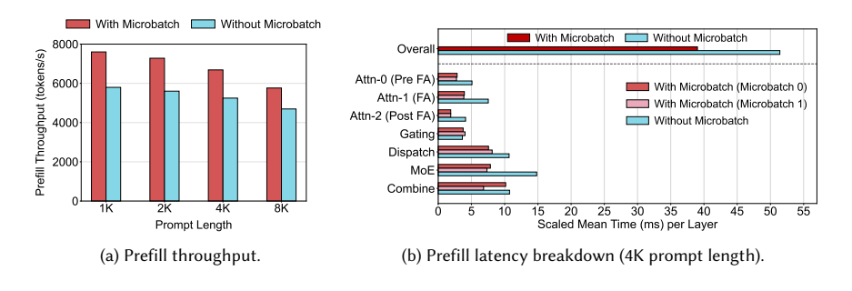

**Original caption:** Fig. 21. Prefill throughput and per-layer latency breakdown with and without the microbatch-based pipeline. All experiments are executed with a batch containing 16K total tokens per NPU. In (b), the “Overall” with Microbatch indicates the per-layer latency after overlapping Microbatch 0 and Microbatch 1.

**中文图注:** Fig. 21. 采用与不采用基于微批次的流水线时的 prefill 吞吐量与每层时延分解。所有实验均以每 NPU 共含 16K token 的批次执行。在 (b) 中，带 Microbatch 的“Overall”表示 Microbatch 0 与 Microbatch 1 重叠后的每层时延。

**Source:** p.44 S222

**Original:** Figure 21b provides a corresponding per-layer latency breakdown for request execution with a 4K prompt length. The data reveals that the overall execution latency per layer is reduced by approximately 24% when the microbatch pipeline is active. This substantial gain is primarily achieved by offloading lightweight computational tasks associated with communication (e.g., DispatchCompute, CombineCompute) to AIVs, and dedicating SDMA engines for bulk data transfers (e.g., All-to-All for MoE). This strategy allows their execution latency to be effectively overlapped with the core computations (like ATTN and FFN) performed on the AICs, leading to higher NPU utilization and reduced end-to-end prefill time.

**中文:** Figure 21b 给出了 4K 提示词长度下请求执行的相应逐层时延分解。数据显示，微批次流水线启用时，每层整体执行时延降低约 24%。这一可观收益主要来自：将与通信相关的轻量计算任务（如 DispatchCompute、CombineCompute）卸载到 AIV，并让 SDMA（系统 DMA）引擎专职执行批量数据传输（如 MoE 的 All-to-All 通信）。这一策略使上述操作的执行时延能够与 AIC 上执行的核心计算（如 ATTN 与 FFN）有效重叠，从而带来更高的 NPU 利用率和更短的端到端 prefill 时间。

### 5.4.2 MTP / 5.4.2 多 token 预测（MTP）

**Source:** p.44 S224

**Original:** As shown in Figure 22a, we observe that enabling MTP with a single speculative token improves decode throughput by 6% to 49% compared to the non-MTP baseline across different batch sizes. This speedup ratio is observed to be more pronounced for smaller batch sizes. This phenomenon may occur because at smaller batch sizes, the baseline non-MTP system is further from its peak efficiency (e.g., due to fixed per-iteration overheads being less amortized). The additional token accepted via MTP (at the 70% rate) then provides a larger relative throughput gain. As batch sizes

**中文:** 如 Figure 22a 所示，我们观察到，在不同 batch size 下，启用单投机 token 的 MTP 相比非 MTP 基线可使解码吞吐量提升 6% 至 49%，且加速比在较小 batch size 下更为显著。这一现象的可能原因在于：较小 batch size 时，非 MTP 基线系统距离其峰值效率更远（例如，固定的每迭代开销难以被充分摊销），此时经 MTP 额外接受的 token（接受率 70%）带来更大的相对吞吐收益。随着 batch size

### Fig. 22. 图 22

**Placed near:** S224
**Source:** p.45 C027

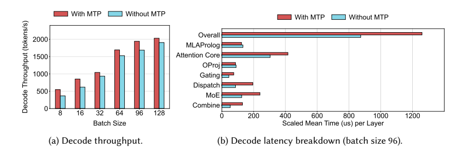

**Original caption:** Fig. 22. Decode throughput and per-layer latency breakdown with and without MTP. All experiments use an input sequence length of 4,096 tokens. In (b), “Overall” refers to the per-layer latency after overlapping two microbatches, and the operator latency represents the latency of a single microbatch.

**中文图注:** Fig. 22. 采用与不采用 MTP 时的解码吞吐量与每层时延分解。所有实验的输入序列长度均为 4,096 token。在 (b) 中，“Overall”指两个微批次重叠后的每层时延，算子时延表示单个微批次的时延。

**Source:** p.45 S225

**Original:** increase, while MTP can still offer an absolute benefit, its relative speedup may diminish as the baseline system itself becomes more saturated or as MTP’s own overheads become more prominent.

**中文:** 增大，虽然 MTP 仍能带来绝对收益，但由于基线系统本身趋于饱和或 MTP 自身开销变得更加显著，其相对加速比可能减小。

**Source:** p.45 S226

**Original:** However, this throughput enhancement is accompanied by an increase in the execution latency per decode layer iteration when MTP is active. As depicted in Figure 22b for a batch size of 96, using MTP increases the per-layer execution latency by approximately 44% (e.g., from a baseline of 874 µs to 1,260 µs with MTP). This is primarily because each MTP-enabled LLM decode step processes two input tokens per request from the last iteration: a base token and a speculative token. This larger effective batch size per iteration naturally leads to longer execution times for core operations such as Attention Core, Gating, Dispatch, MoE, and Combine.

**中文:** 然而，吞吐量的这一提升伴随着 MTP 启用时每个解码层迭代执行时延的增加。如 Figure 22b（batch size 为 96）所示，使用 MTP 使每层执行时延增加约 44%（例如从基线的 874 µs 增至启用 MTP 后的 1,260 µs）。这主要是因为每个启用 MTP 的 LLM 解码步要为每个请求处理来自上一次迭代的两个输入 token：一个基 token 和一个投机 token。每次迭代中更大的有效 batch size 自然导致 Attention Core、Gating、Dispatch、MoE 与 Combine 等核心操作的执行时间变长。

**Source:** p.45 S227

**Original:** Despite this increase in per-iteration latency, the overall throughput improves. The successful validation of speculative tokens at a 70% acceptance rate means that, on average, 1.7 tokens (1 base token + 0.7 speculative token) are produced per MTP-enabled iteration. This gain in tokens per iteration outweighs the approximate 44% longer iteration time, confirming the net positive impact of our MTP implementation for 4K sequence length workloads on CloudMatrix384.

**中文:** 尽管每次迭代的时延有所增加，整体吞吐量仍得到提升。投机 token 以 70% 的接受率成功通过验证，意味着平均每个启用 MTP 的迭代可产出 1.7 个 token（1 个基 token + 0.7 个投机 token）。每迭代 token 数上的收益超过了约 44% 的迭代时间增幅，证实了我们的 MTP 实现对 CloudMatrix384 上 4K 序列长度负载具有净正向收益。

### 5.4.3 Context Caching / 5.4.3 上下文缓存

**Source:** p.45 S229

**Original:** Figure 23 illustrates the performance trends as a function of the token reuse rate for these different EMS configurations. As shown in Figure 23a, there is a strong positive correlation between throughput and the reuse rate for both network configurations. For EMS with UB, increasing the reuse rate from 12.5% to 50% resulted in a 1.42 × increase in prefill throughput. At a 90% reuse rate, the throughput improved by 2.28 × over the baseline without EMS. This substantial improvement occurs because a higher reuse rate translates to a larger portion of the input sequence’s KV cache

**中文:** Figure 23 展示了这些不同 EMS 配置下性能随 token 复用率变化的趋势。如 Figure 23a 所示，两种网络配置下吞吐量与复用率均呈强正相关。对于基于 UB 的 EMS，复用率从 12.5% 提高到 50% 使 prefill 吞吐量提升 1.42 ×；在 90% 复用率下，吞吐量相较无 EMS 的基线提升 2.28 ×。这一显著改善的原因在于，更高的复用率意味着输入序列 KV 缓存中

### Fig. 23. 图 23

**Placed near:** S229
**Source:** p.46 C028

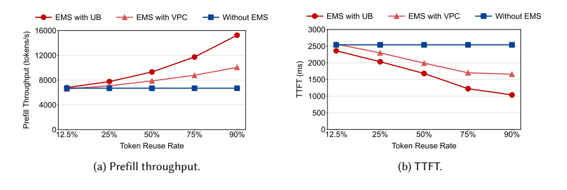

**Original caption:** Fig. 23. The overall prefill throughput and TTFT using EMS-Context Caching with different configurations.

**中文图注:** Fig. 23. 采用不同配置的 EMS 上下文缓存（EMS-Context Caching）时的整体 prefill 吞吐量与首 token 时间（TTFT）。

**Source:** p.46 S230

**Original:** being loaded directly from the EMS cache rather than being recomputed, significantly reducing the computational load on prefill NPUs. Furthermore, when comparing the two network configurations, EMS with UB consistently outperforms EMS with VPC. Using the UB plane improves prefill throughput by up to 1.52 ×. This gain is directly attributable to the significantly higher bandwidth and lower latency of the UB plane, which accelerates the loading of KV cache blocks from the distributed EMS cache to the NPUs.

**中文:** 有更大比例可以直接从 EMS 缓存加载而无需重新计算，从而显著降低 prefill NPU 上的计算负载。此外，对比两种网络配置，基于 UB 的 EMS 始终优于基于 VPC 的 EMS：使用 UB 平面最多可将 prefill 吞吐量提升 1.52 ×。这一收益直接归因于 UB 平面显著更高的带宽和更低的时延，它加速了 KV 缓存块从分布式 EMS 缓存向 NPU 的加载。

**Source:** p.46 S231

**Original:** Concurrently, TTFT significantly decreases as the token reuse rate increases, as depicted in Figure 23b. For instance, with EMS on UB, a 50% token reuse rate reduced TTFT by 861 ms (34%) compared to no context caching, while a 90% reuse rate led to a 1,505 ms (59%) decrease. This marked reduction in TTFT is a direct consequence of bypassing substantial prefill computation when a cache hit occurs. The ability to quickly load historical KV cache from EMS, particularly when accessed via the high-bandwidth UB plane and potentially served from the DRAM tier of the disaggregated memory pool, translates directly into faster initial token generation. Similarly, accessing the EMS cache via the UB plane yields consistently lower TTFT compared to the VPC plane across all reuse rates, underscoring the importance of a high-performance interconnect for latency-sensitive cache retrieval.

**中文:** 与此同时，如 Figure 23b 所示，TTFT（首 token 时间）随 token 复用率提高而显著下降。例如，对于基于 UB 的 EMS，50% 的 token 复用率使 TTFT 相比无上下文缓存减少 861 ms（34%），而 90% 复用率带来 1,505 ms（59%）的降幅。TTFT 的这一显著降低是缓存命中时跳过大量 prefill 计算的直接结果。快速从 EMS 加载历史 KV 缓存的能力——特别是在经由高带宽 UB 平面访问、且可能由分离式内存池的 DRAM 层提供服务时——直接转化为更快的首 token 生成。同样地，在所有复用率下，经由 UB 平面访问 EMS 缓存的 TTFT 均持续低于 VPC 平面，凸显了高性能互连对时延敏感型缓存检索的重要性。

### 5.5 Performance of Operators / 5.5 算子性能

### 5.5.1 Communication Operators / 5.5.1 通信算子

**Source:** p.46 S234

**Original:** For the Dispatch operation, the CANN EP implementation on CloudMatrix384 (CM384) con-sistently demonstrates lower latencies compared to DeepEP on H800 across all tested EP degrees.

**中文:** 对于分发（Dispatch）操作，CloudMatrix384（CM384）上的 CANN EP 实现在所有测试的 EP 度下均比 H800 上的 DeepEP 表现出更低的时延。

**Source:** p.47 S235

**Original:** For example, at an EP degree of 8, CM384 achieves a latency of 116 µs, while the H800 records 163 µs. This latency advantage for CM384 persists as the EP degree increases, with CM384 showing 152 µs at EP256 versus H800’s 194 µs. In terms of per-rank bandwidth for Dispatch, CM384 exhibits superior performance, at smaller EP degrees (e.g., 71 GB/s vs. 46 GB/s at EP8). However, under large EP degrees, we observe a significant decline in the effective bandwidth of CANN EP on Cloud- Matrix384. This degradation highlights a scalability bottleneck in the current EP implementation, which we leave as an avenue for future optimization.

**中文:** 例如，在 EP 度为 8 时，CM384 的时延为 116 µs，而 H800 为 163 µs。随着 EP 度增大，CM384 的时延优势持续保持：EP256 下 CM384 为 152 µs，H800 为 194 µs。在 Dispatch 的每 rank 带宽方面，CM384 在较小 EP 度下表现更优（例如 EP8 下 71 GB/s 对 46 GB/s）。然而，在较大 EP 度下，我们观察到 CANN EP 在 CloudMatrix384 上的有效带宽显著下降。这一退化凸显了当前 EP 实现中的可扩展性瓶颈，我们将其留作未来的优化方向。

### Table 6. 表 6

**Placed near:** S235
**Source:** p.47 C029

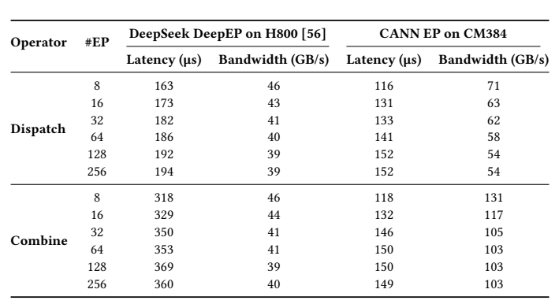

**Original caption:** Table 6. Communication operator performance (latency and bandwidth per rank) on NVIDIA H800 (RDMA) and CloudMatrix384 (UB plane) for Dispatch and Combine operations across different EP degrees.

**中文图注:** Table 6. 不同专家并行（EP）度数下，NVIDIA H800（RDMA）与 CloudMatrix384（UB 平面）上 Dispatch 与 Combine 操作的通信算子性能（每个 rank 的时延与带宽）。

**Source:** p.47 S236

**Original:** The Combine operation reveals an even more pronounced performance advantage for CANN on CM384. Latencies are significantly lower on CM384 across all EP scales. For instance, at EP8, CM384’s latency is 118 µs compared to H800’s 318 µs. This substantial latency reduction is maintained up to EP256 (149 µs on CM384 vs. 360 µs on H800). Furthermore, the achieved per-rank bandwidth for Combine on CM384 is markedly higher than on H800. At EP8, CM384 delivers 131 GB/s per rank, nearly three times the 46 GB/s achieved on H800. This bandwidth superiority continues across all tested EP degrees, with CM384 providing a strong 103 GB/s per rank at EP256, while the H800 offers 40 GB/s.

**中文:** 合并（Combine）操作则显示出 CANN 在 CM384 上更为显著的性能优势：在所有 EP 规模下，CM384 的时延均明显更低。例如，EP8 时 CM384 的时延为 118 µs，而 H800 为 318 µs；这一大幅时延优势一直保持到 EP256（CM384 为 149 µs，H800 为 360 µs）。此外，CM384 上 Combine 达到的每 rank 带宽也显著高于 H800：EP8 时 CM384 每 rank 达 131 GB/s，几乎是 H800 所达 46 GB/s 的三倍。这一带宽优势在所有测试的 EP 度下均保持，EP256 时 CM384 仍提供强劲的每 rank 103 GB/s，而 H800 为 40 GB/s。

**Source:** p.47 S237

**Original:** These results underscore the efficiency of the CANN collective communication library and the high-performance capabilities of the UB plane in CloudMatrix384 for MoE-specific communication patterns. The consistently lower latencies and higher per-rank bandwidth achieved on Cloud- Matrix384 are crucial for mitigating communication bottlenecks inherent in large-scale expert parallelism.

**中文:** 这些结果凸显了 CANN 集合通信库的效率，以及 CloudMatrix384 的 UB 平面在应对 MoE 特有通信模式方面的高性能能力。CloudMatrix384 上持续更低的时延与更高的每 rank 带宽，对于缓解大规模专家并行所固有的通信瓶颈至关重要。

### 5.5.2 MLA Operator / 5.5.2 MLA 算子

**Source:** p.47 S239

**Original:** Table 7 presents the TFLOPS utilization for MLA operators when the workload is primarily compute-bound. The DeepSeek FlashMLA on H800 achieves a compute utilization of 66.7%. Our CANN MLA on CloudMatrix384, also operating in BF16/FP16, achieves a comparable utilization of 65.4%. This indicates that the efficiency in utilizing the available compute power for MLA is similar between the two platforms in compute-intensive scenarios.

**中文:** Table 7 给出了负载以计算受限为主时 MLA 算子的 TFLOPS 利用率。H800 上的 DeepSeek FlashMLA 达到 66.7% 的计算利用率；我们在 CloudMatrix384 上的 CANN MLA 同样以 BF16/FP16 运行，达到了相当的 65.4% 利用率。这表明在计算密集场景下，两个平台对 MLA 可用算力的利用效率处于相近水平。

### Table 7. 表 7

**Placed near:** S239
**Source:** p.48 C030

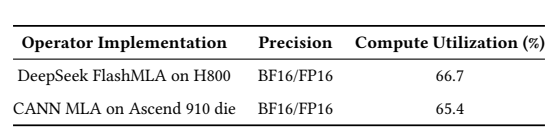

**Original caption:** Table 7. Utilization of MLA operators on NVIDIA H800 and an Ascend 910 die (CloudMatrix384) in compute-intensive settings (BF16/FP16 precision).

**中文图注:** Table 7. 计算密集场景下 MLA 算子在 NVIDIA H800 与单颗 Ascend 910 芯粒（CloudMatrix384）上的利用率（BF16/FP16 精度）。

### 5.5.3 GEMM Operator / 5.5.3 GEMM 算子

### Table 8. 表 8

**Placed near:** S240
**Source:** p.48 C031

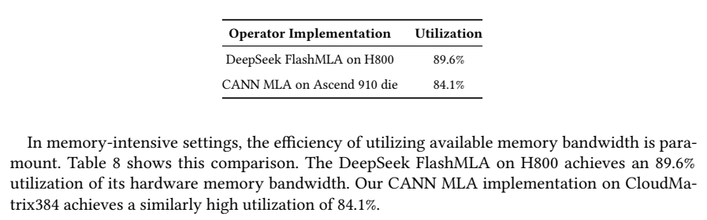

**Original caption:** Table 8. Memory bandwidth utilization of MLA operators on NVIDIA H800 and an Ascend 910 die (CloudMa-trix384) in memory-intensive settings.

**中文图注:** Table 8. 访存密集场景下 MLA 算子在 NVIDIA H800 与单颗 Ascend 910 芯粒（CloudMatrix384）上的内存带宽利用率。

**Source:** p.48 S241

**Original:** As indicated in Table 9, the CANN INT8 GEMM kernels on the Ascend 910 die demonstrate consis-tently high compute utilization, ranging from 77.4% to 82.7% across various matrix shapes (M, N, K) and group counts. For example, with 4 groups and dimensions M=7168, N=4096, K=8192, the kernel achieves an 82.7% utilization. This high efficiency is maintained across different configurations, indicating robust performance of the INT8 compute units on the Ascend 910 die.

**中文:** 如 Table 9 所示，Ascend 910 芯粒上的 CANN INT8 GEMM 算子在各种矩阵形状（M、N、K）与分组数下均表现出持续的高计算利用率，范围从 77.4% 到 82.7%。例如，在 4 个分组、维度 M=7168、N=4096、K=8192 时，该算子达到 82.7% 的利用率。这种高效率在不同配置下均得以保持，表明 Ascend 910 芯粒上 INT8 计算单元的稳健性能。

### Table 9. 表 9

**Placed near:** S241
**Source:** p.49 C032

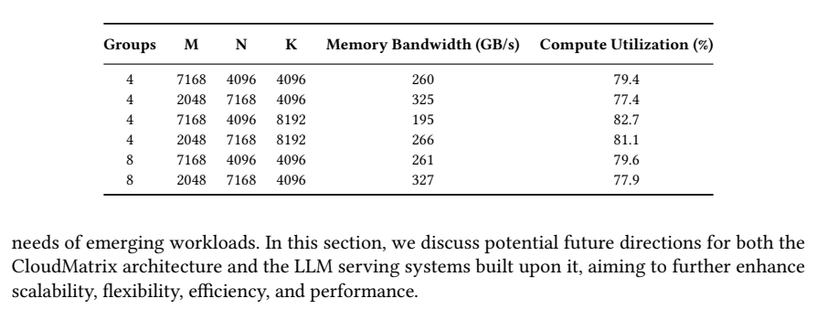

**Original caption:** Table 9. INT8 GEMM achieved memory bandwidth and compute utilization on an Ascend 910 die (CloudMa-trix384) across different configurations, using INT8 inputs and BF16 outputs. Tiling: BM × BN = 128 × 152.

**中文图注:** Table 9. 在不同配置下，单颗 Ascend 910 芯粒（CloudMatrix384）上 INT8 GEMM（通用矩阵乘）达到的内存带宽与计算利用率，采用 INT8 输入与 BF16 输出。分块（Tiling）：BM × BN = 128 × 152。

**Source:** p.48 S242

**Original:** The table also reports the sustained memory bandwidth achieved during these GEMM operations, which ranges from 195 GB/s to 327 GB/s. These values are substantially below the Ascend 910 die’s peak memory bandwidth. This observation, when coupled with the high compute utilization figures, strongly suggests that these INT8 GEMM operations are predominantly compute-bound rather than memory-bandwidth-bound for the tested matrix dimensions. Such a characteristic indicates efficient data reuse within the NPU’s internal cache hierarchy and registers, allowing the compute units to operate at a high fraction of their peak capability without being consistently starved for data transfers from memory.

**中文:** 该表还给出了这些 GEMM 操作期间达到的持续内存带宽，范围为 195 GB/s 至 327 GB/s。这些数值远低于 Ascend 910 芯粒的峰值内存带宽。这一观察与高计算利用率相结合，有力地表明在所测试的矩阵维度下，这些 INT8 GEMM 操作主要受计算限制而非内存带宽限制。这一特性表明数据在 NPU 内部缓存层次与寄存器中得到了高效复用，使计算单元能够在接近峰值能力的水平上运行，而不会持续因来自内存的数据传输供给不足而受限。6 未来方向的讨论 AI 模型的快速演进及其无处不在的应用，持续对 AI 基础设施提出日益严苛的要求。虽然 CloudMatrix384 标志着紧耦合 AI 计算扩展的一个重要架构里程碑，但要满足

## 6 Discussions on Future Directions / 6 未来方向的讨论

**Source:** p.48 S503

**Original:** The rapid evolution of AI models and their pervasive application continue to impose increasingly stringent demands on AI infrastructure. While CloudMatrix384 represents a major architectural milestone in scaling tightly-coupled AI computation, further evolution is necessary to meet the needs of emerging workloads. In this section, we discuss potential future directions for both the CloudMatrix architecture and the LLM serving systems built upon it, aiming to further enhance scalability, flexibility, efficiency, and performance.

**中文:** AI 模型的快速演进及其无处不在的应用，持续对 AI 基础设施提出日益严苛的要求。虽然 CloudMatrix384 标志着紧耦合 AI 计算扩展的一个重要架构里程碑，但要满足新兴工作负载的需求，仍需进一步演进。本节讨论 CloudMatrix 架构与构建于其上的 LLM 推理系统两者的潜在未来方向，旨在进一步增强可扩展性、灵活性、效率与性能。

### 6.1 Future CloudMatrix Evolutions / 6.1 CloudMatrix 的未来演进

### 6.1.1 Unifying VPC and RDMA Planes / 6.1.1 VPC 平面与 RDMA 平面的统一

**Source:** p.49 S245

**Original:** Building on this observation, a unified network architecture based on the VPC plane can enable the construction of large-scale AI clusters at the availability zone (AZ) scale. It accommodates heterogeneous generations of AI hardware, enables flexible and modular expansion using supern-odes as the basic unit, and supports seamless interconnection across regions through data center network (DCN) technologies.

**中文:** 基于这一观察，以 VPC 平面为基础的统一网络架构可以支撑构建可用区（AZ）规模的大型 AI 集群。它能够容纳多代异构的 AI 硬件，以超节点为基本单元实现灵活、模块化的扩展，并借助数据中心网络（DCN）技术支持跨区域的无缝互联。

### 6.1.2 Larger-scale Supernodes / 6.1.2 更大规模的超节点

**Source:** p.49 S247

**Original:** **1) Scaling to Match Model Evolution:**As LLMs continue to scale in parameter size and architectural sophistication, the infrastructure required to serve them must evolve accordingly. Future models are expected to feature significantly larger parameter counts, longer input sequences, and an increasing number of sparsely activated experts, particularly in MoE designs. These trends place growing demands on compute, memory, and interconnect bandwidth within each inference session. Moreover, emerging architectural patterns, such as modular sub-networks for specialized reasoning, retrieval-augmented generation, or hybrid dense–sparse computation, require tighter coupling between model components, leading to increased intra-model communication and syn-chronization. Efficiently supporting these workloads necessitates co-locating compute and memory within a single, tightly integrated supernode to minimize communication latency and maintain

**中文:** **1) 扩容以匹配模型演进：**随着 LLM 的参数规模与架构复杂度持续攀升，支撑其推理服务的基础设施也必须相应演进。未来的模型预计将具有大得多的参数量、更长的输入序列以及数量更多的稀疏激活专家（在 MoE 设计中尤为明显）。这些趋势对每次推理会话中的算力、内存和互连带宽提出了越来越高的要求。此外，新兴的架构模式——例如面向专门推理的模块化子网络、检索增强生成或稠密–稀疏混合计算——要求模型组件之间更紧密的耦合，导致模型内通信与同步增多。要高效支撑这些工作负载，就需要将算力与内存共同部署在单个紧密集成的超节点内，以最小化通信时延并维持

**Source:** p.50 S248

**Original:** high throughput. As a result, scaling up supernode capacity is critical not only to meet raw resource requirements but also to sustain the fine-grained locality and performance characteristics demanded by next-generation LLMs.

**中文:** 高吞吐量。因此，扩大超节点容量不仅对满足原始资源需求至关重要，也是维持下一代 LLM 所要求的细粒度局部性与性能特征的必要条件。

**Source:** p.50 S249

**Original:** **2) Improved Resource Allocation Efficiency:**Scaling up supernode size also enhances system-wide resource utilization in real-world heterogeneous workload conditions. Based on real production traces, we simulate future NPU request patterns by modeling each AI task as a set of *tightly-coupled * *blocks *, where each block is a contiguous group of NPUs that must be provisioned within a single supernode to meet intra-job bandwidth and latency constraints. As shown in Figure 24, larger supernodes consistently achieve higher NPU allocation rates across a broad range of average block sizes. For instance, at an average block size of 10.08, a 384-NPU supernode achieves over 94% allocation, while a 224-NPU supernode drops below 91%. This improvement stems from reduced fragmentation and better statistical multiplexing—larger resource pools offer greater placement flexibility for non-uniform job sizes. Conversely, for a fixed supernode size, increasing block size leads to lower allocation efficiency due to packing difficulty. When the average block size reaches 11.28, the allocation rate of the 224-NPU supernode drops below 85%. These results highlight that scaling supernode size significantly improves system throughput and efficiency under realistic workload distributions.

**中文:** **2) 提升资源分配效率：**扩大超节点规模还能在真实世界的异构负载条件下提升全系统的资源利用率。我们基于真实生产 trace，将每个 AI 任务建模为一组*紧耦合块*，以此模拟未来的 NPU 请求模式，其中每个块是必须在单个超节点内完成供给的一段连续 NPU，以满足作业内部的带宽与时延约束。如 Figure 24 所示，在很宽的平均块大小范围内，更大的超节点始终能取得更高的 NPU 分配率。例如，平均块大小为 10.08 时，384-NPU 超节点的分配率超过 94%，而 224-NPU 超节点则降至 91% 以下。这一改善源于碎片减少与更优的统计复用——更大的资源池为大小不一的作业提供了更高的放置灵活性。反之，在超节点规模固定时，块大小增大会因装箱困难而降低分配效率：当平均块大小达到 11.28 时，224-NPU 超节点的分配率跌破 85%。这些结果突出表明，在真实负载分布下，扩大超节点规模能显著提升系统吞吐量与效率。

### Fig. 24. 图 24

**Placed near:** S249
**Source:** p.50 C033

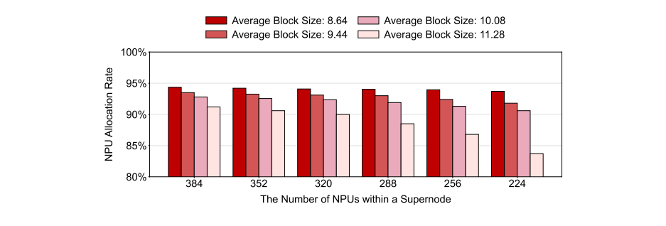

**Original caption:** Fig. 24. NPU allocation rates under different supernode scales and tightly-coupled block sizes.

**中文图注:** Fig. 24. 不同超节点规模与紧耦合块大小下的 NPU 分配率。

**Source:** p.50 S250

**Original:** **3) Nearly Constant Amortized Network Cost:**Scaling up the size of a supernode does not inherently lead to higher per-NPU network costs. Given the same network architecture, e.g., a 2-tier Clos-like switching topology, the amortized cost of network infrastructure per NPU remains nearly constant across different supernode sizes as long as the configuration achieves full switch port utilization. As shown in Table 10, configurations with 192, 288, or 384 NPUs all achieve 100% switch utilization with the same per-NPU amortized switch cost. Intermediate configurations, such as 256 or 352 NPUs, suffer from underutilized switches, slightly increasing per-node costs. These results suggest that scaling supernode size to the upper end of a given switching tier does not introduce additional cost overhead, making it a cost-effective strategy from a networking perspective.

**中文:** **3) 近乎恒定的摊销网络成本：**扩大超节点规模本身并不会推高每 NPU 的网络成本。在网络架构相同（例如两层类 Clos 交换拓扑）的前提下，只要配置能够实现交换机端口的完全利用，不同超节点规模下每 NPU 摊销的网络基础设施成本几乎保持不变。如 Table 10 所示，192、288 或 384 NPU 的配置均实现 100% 的交换机利用率，每 NPU 摊销的交换机成本相同；而 256 或 352 NPU 等中间配置则存在交换机利用不足的问题，会略微抬高单节点成本。这些结果表明，将超节点规模扩展到给定交换层级的上限并不会引入额外的成本开销，从网络角度看是一种高性价比的策略。

### Table 10. 表 10

**Placed near:** S250
**Source:** p.51 C034

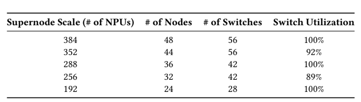

**Original caption:** Table 10. Switch utilization across different supernode scales. Note that each logical switch consists of two physical switch chips presented in §3.3.3.

**中文图注:** Table 10. 不同超节点规模下的交换机利用率。注意，每个逻辑交换机由两颗物理交换芯片组成，如 §3.3.3 所述。

**Source:** p.50 S251

**Original:** **4) Accommodating Increased Resource Heterogeneity:**Future AI workloads will require increasingly diverse hardware support within the same execution context. Alongside NPUs and CPUs, next-generation supernodes are likely to incorporate specialized accelerators for tasks such as physics simulation, real-time video processing, lossless data compression, and cryptographic computation. These units are becoming essential components in end-to-end AI pipelines, particu-larly for multimodal or domain-specific applications. To be efficiently utilized, such heterogeneous resources must share the same high-bandwidth, low-latency interconnect fabric and be accessible as first-class compute peers within the supernode. Supporting this diversity at scale requires both

**中文:** **4) 容纳更高的资源异构性：**未来的 AI 工作负载将要求在同一执行上下文中获得越来越多样化的硬件支持。除 NPU 与 CPU 之外，下一代超节点还可能纳入面向物理模拟、实时视频处理、无损数据压缩和密码计算等任务的专用加速器。这些单元正日益成为端到端 AI 流水线中不可或缺的组成部分，在多模态或特定领域应用中尤为如此。要高效利用这类异构资源，它们必须共享同一高带宽、低时延的互连网络，并在超节点内以一等计算对等体的身份被访问。要在规模化场景下支撑这种多样性，既需要

**Source:** p.51 S252

**Original:** an expanded supernode size and a more flexible interconnect architecture, further reinforcing the trend toward larger, more heterogeneous compute domains that can handle tightly coupled, cross-functional AI workloads.

**中文:** 更大的超节点规模，也需要更灵活的互连架构，这进一步强化了向更大、更异构、能够处理紧耦合跨功能 AI 工作负载的计算域演进的趋势。

### 6.1.3 Physical Disaggregation and Pooling of CPUs / 6.1.3 CPU 的物理分离与池化

**Source:** p.51 S254

**Original:** The motivation for physical disaggregation arises from the rigidity of conventional CPU-NPU pairings in fixed node configurations, where static NPU-to-CPU ratios constrain the system’s ability to match workload demands. For example, some inference workloads require intensive CPU pre/post-processing or large memory-backed caching, resulting in CPU bottlenecks despite idle NPUs. Conversely, training workloads might saturate NPUs while leaving CPU resources underutilized. In such cases, tightly coupled CPU-NPU configurations lead to suboptimal hardware utilization and inflexible scaling.

**中文:** 物理分离的动机源自固定节点配置中传统 CPU-NPU 配对的僵化：静态的 NPU 与 CPU 配比制约了系统匹配负载需求的能力。例如，某些推理负载需要密集的 CPU 前后处理或大容量内存支撑的缓存，导致 NPU 空闲时却出现 CPU 瓶颈；反过来，训练负载可能使 NPU 饱和，CPU 资源却利用不足。在这些情形下，紧耦合的 CPU-NPU 配置会导致欠优的硬件利用率和僵化的扩展能力。

**Source:** p.51 S255

**Original:** Although CloudMatrix384 ’s peer-to-peer UB topology already decouples logical resource as-signment, enabling flexible CPU-NPU matching across the supernode, physically separating CPU and NPU resources into dedicated resource pools unlocks further advantages:

**中文:** 尽管 CloudMatrix384 的对等 UB 拓扑已经解耦了逻辑资源分配，使 CPU 与 NPU 可以在整个超节点内灵活配对，但将 CPU 和 NPU 资源物理分离为各自的专用资源池还能带来更多优势：

**Source:** p.51 S256

**Original:** **1) Independent and Optimized Scaling:**Physically separate NPU-centric nodes (e.g., with a minimal local CPU for basic management but maximized NPU density) and CPU-centric nodes (e.g., with many CPU cores, large DRAM capacities, and rich I/O options, serving as the supernode’s primary CPU and memory resource pool) could be developed. This allows the NPU compute capacity and the general-purpose CPU/memory capacity of the supernode to be scaled independently and more economically. Datacenter operators could then compose supernodes with highly variable NPU-to-CPU-and-memory ratios, precisely tailored to the dominant workloads (e.g., NPU-rich for training, CPU/memory-rich for data-intensive pre-processing or large-scale EMS caching).

**中文:** **1) 独立且经过优化的扩展：**可以发展物理上分离的以 NPU 为中心的节点（例如仅保留用于基本管理的最小本地 CPU，但将 NPU 密度最大化）和以 CPU 为中心的节点（例如配备大量 CPU 核心、大容量 DRAM 与丰富的 I/O 选项，充当超节点的主 CPU 与内存资源池）。这样，超节点的 NPU 算力与通用 CPU/内存容量便可独立地、也更经济地各自扩展。数据中心运营商进而可以组合出 NPU 与 CPU/内存配比高度可变的超节点，精确适配主导性负载（例如面向训练采用高 NPU 配比，面向数据密集型预处理或大规模 EMS 缓存采用高 CPU/内存配比）。

**Source:** p.51 S257

**Original:** **2) Enhanced Resource Utilization and Specialization:**Specialized node designs allow for hardware optimization specific to the primary resource type. NPU nodes could focus on power delivery and cooling for accelerators, while CPU/memory nodes could optimize for memory density, I/O bandwidth, or specific CPU instruction sets. This can lead to better overall efficiency and performance for each resource type compared to a one-size-fits-all hybrid node design.

**中文:** **2) 更高的资源利用率与专用化：**专用节点设计便于针对其主要资源类型做专门的硬件优化。NPU 节点可以专注于加速器的供电与散热，而 CPU/内存节点则可针对内存密度、I/O 带宽或特定 CPU 指令集进行优化。与一刀切的混合节点设计相比，这能为每种资源类型带来更好的整体效率与性能。

### 6.2 Future Serving System Enhancements / 6.2 推理服务系统的未来增强

### 6.2.1 Component-Level Disaggregation / 6.2.1 组件级分离

**Source:** p.52 S260

**Original:** **1) Decode-Attention Disaggregation and Offloading:**While prefill instances are compute-bound and decode instances are often memory-bound, the Adrenaline system [37] shows that additional performance gains can be achieved by disaggregating memory-intensive attention computation from the decode path and offloading it to underutilized prefill instances. This approach improves overall memory bandwidth utilization and enables larger batch sizes on decode instances, thereby increasing compute efficiency. It relies on low-latency synchronization, careful co-location of offloaded tasks, and SLO-aware offloading policies. The result is improved throughput without compromising latency, exemplifying how attention disaggregation can unlock latent capacity within existing serving deployments.

**中文:** **1) 解码-注意力分离与卸载：**prefill 实例受算力约束、解码实例常受内存约束，而 Adrenaline 系统 [37] 表明，通过将内存密集型的注意力计算从解码路径中分离出来，并卸载到利用不足的 prefill 实例上，可以获取额外的性能收益。这一做法提升了整体内存带宽利用率，并使解码实例能够采用更大的 batch size，从而提高计算效率。它依赖于低时延同步、对被卸载任务的谨慎共置以及 SLO 感知的卸载策略。其结果是在不牺牲时延的前提下提升了吞吐量，展示了注意力分离如何在既有推理服务部署中释放潜在容量。

**Source:** p.52 S261

**Original:** **2) Attention and MoE Disaggregation:**Large-scale MoE models present unique challenges due to sparse expert activation and extreme memory demands. MegaScale-Infer [59] proposes disaggregating attention and expert components into separate execution services, enabling different parallelism strategies and hardware mappings. Attention layers, which process every token, are deployed using data-parallelism on memory-optimized nodes, while expert FFNs are distributed via expert parallelism across a dedicated resource pool. This disaggregated execution reduces contention, improves throughput, and allows independent scaling of attention and expert resources, which is critical for efficiently serving trillion-parameter MoE models.

**中文:** **2) 注意力与 MoE 分离：**大规模 MoE 模型因专家稀疏激活与极高的内存需求而带来独特挑战。MegaScale-Infer [59] 提出将注意力组件与专家组件分离为各自独立的执行服务，从而支持不同的并行策略与硬件映射。需要处理每一个 token 的注意力层以数据并行（DP）方式部署在内存优化的节点上，而专家 FFN 则经由专家并行（EP）分布到专用资源池中。这种分离式执行减少了争用、提升了吞吐量，并允许注意力资源与专家资源独立扩展，这对高效服务万亿参数级 MoE 模型至关重要。

**Source:** p.52 S262

**Original:** Together, these disaggregation techniques represent a shift toward viewing LLMs as collections of loosely coupled microservices, each with distinct performance profiles. This granularity allows better mapping to heterogeneous hardware and improves load balancing and scalability across a supernode.

**中文:** 这些分离技术共同代表了一种转变：将 LLM 视为一组松耦合的微服务集合，每个微服务拥有各自独特的性能特征。这种粒度使负载能更好地映射到异构硬件，并改善超节点范围内的负载均衡与可扩展性。

### 6.2.2 Hybrid and Adaptive Deployment / 6.2.2 混合与自适应部署

**Source:** p.52 S264

**Original:** **1) Hardware-aware Microservice Placement:**Each microservice can be mapped to the most suitable hardware type based on its performance profile. For instance, attention layers, which are typically memory bandwidth-bound, should be prioritized on NPUs with high memory throughput; compute-intensive FFN modules benefit from allocation on NPUs with strong compute capabilities; and lightweight or latency-tolerant operations, such as KV cache indexing, can be offloaded to

**中文:** **1) 硬件感知的微服务放置：**每个微服务都可以依据其性能特征映射到最合适的硬件类型。例如，通常受内存带宽约束的注意力层应优先放置在内存吞吐量高的 NPU 上；计算密集的 FFN 模块受益于分配到算力强大的 NPU；而轻量级或时延不敏感的操作（如 KV 缓存索引）则可以卸载到

**Source:** p.53 S265

**Original:** pooled CPUs or lower-cost general-purpose accelerators. This fine-grained matching enables more efficient use of heterogeneous hardware and reduces cost without compromising performance.

**中文:** 池化的 CPU 或成本更低的通用加速器上。这种细粒度匹配能更高效地利用异构硬件，并在不损害性能的前提下降低成本。

**Source:** p.53 S266

**Original:** **2) Hybrid Microservice Co-location:**Disaggregated microservices can also be dynamically co-located to improve resource utilization across the supernode. For example, memory-bound attention operations from the decode phase can be offloaded to memory-underutilized prefill instances [37]. Such hybrid co-location strategies help alleviate resource bottlenecks, improve utilization across phases, and increase effective system throughput, especially under variable or bursty workloads.

**中文:** **2) 微服务混合共置：**分离后的微服务还可以动态共置，以提升整个超节点的资源利用率。例如，解码阶段受内存约束的注意力操作可以卸载到内存利用不足的 prefill 实例上 [37]。这类混合共置策略有助于缓解资源瓶颈、改善各阶段的利用率，并提高有效系统吞吐量，在波动或突发性负载下尤其如此。

**Source:** p.53 S267

**Original:** **3) Adaptive and Independent Scaling of Microservices:**A key advantage of microservice disaggregation is the ability to scale each component independently based on real-time workload characteristics. For example, during the processing of long-context inputs, the attention microservice may experience higher load and be scaled accordingly, without necessitating additional FFN or expert resources. This granularity prevents systemic over-provisioning and allows the system to elastically adapt to workload dynamics.

**中文:** **3) 微服务的自适应独立扩展：**微服务分离的一项关键优势在于能够根据实时负载特征独立扩展每个组件。例如，在处理长上下文输入期间，注意力微服务可能承受更高负载，可以相应地单独扩展，而无需追加 FFN 或专家资源。这种粒度避免了系统性的过度预配，使系统能够弹性适应负载动态。

**Source:** p.53 S268

**Original:** To fully exploit these capabilities, the serving infrastructure must incorporate a sophisticated orchestration layer capable of continuously profiling system load, predicting performance bottle-necks, and making real-time, SLO-aware scheduling and scaling decisions. This orchestrator serves as the control plane for the hybrid deployment model, ensuring that performance guarantees are met even as workloads and resource availability fluctuate.

**中文:** 要充分释放这些能力，推理服务基础设施必须引入一个完善的编排层，持续剖析系统负载、预测性能瓶颈，并做出实时的、SLO 感知的调度与扩展决策。该编排器充当混合部署模型的控制平面，确保即便负载与资源可用性发生波动，性能保障仍能得到满足。

**Source:** p.53 S269

**Original:** In summary, hybrid and adaptive deployment strategies, enabled by component-level disaggre-gation, represent a promising frontier in LLM serving system design. They allow for more precise resource utilization, seamless load balancing across heterogeneous hardware, and the ability to meet future demands posed by increasingly complex and diverse model architectures.

**中文:** 综上所述，以组件级分离为基础的混合与自适应部署策略代表了 LLM 推理服务系统设计中一个富有前景的前沿方向。它们能够实现更精确的资源利用、跨异构硬件的无缝负载均衡，并具备满足日益复杂多样的模型架构所带来的未来需求的能力。

## 7 Conclusion / 7 结论

**Source:** p.53 S270

**Original:** In this paper, we introduce Huawei CloudMatrix, a next-generation AI datacenter architecture that embodies Huawei’s vision for advanced AI infrastructure. We specifically highlight Huawei CloudMatrix384, the first production-grade implementation of this innovative architectural concept. CloudMatrix384 is an AI supernode engineered to efficiently support large-scale AI workloads, featuring a fully peer-to-peer interconnected hardware design. It integrates 384 Ascend 910 NPUs and 192 Kunpeng CPUs interconnected via an ultra-high-bandwidth, low-latency Unified Bus (UB) network. This unique architecture facilitates dynamic resource pooling, streamlined memory management, and exceptional inter-node communication, effectively addressing the scalability and efficiency challenges common in traditional datacenter architecture.

**中文:** 本文介绍了 Huawei CloudMatrix——一种体现华为先进 AI 基础设施愿景的下一代 AI 数据中心架构。我们重点介绍了 Huawei CloudMatrix384，即这一创新架构理念的首个生产级实现。CloudMatrix384 是为高效支撑大规模 AI 工作负载而打造的 AI 超节点，采用全对等互连的硬件设计。它通过超高带宽、低时延的统一总线（UB）网络互连 384 个 Ascend 910 NPU 与 192 个鲲鹏 CPU。这一独特的架构便于动态资源池化、简化的内存管理以及卓越的节点间通信，有效解决了传统数据中心架构中常见的可扩展性与效率难题。

**Source:** p.53 S271

**Original:** Leveraging CloudMatrix384, we propose CloudMatrix-Infer, a comprehensive serving solution featuring a peer-to-peer serving architecture that disaggregates the inference workflow into dis-tinct prefill, decode, and caching subsystems. This architecture significantly simplifies scheduling, enhances load balancing, and optimizes resource utilization by enabling uniform access to a shared disaggregated memory pool across all NPUs. We further design and implement advanced hardware-aware techniques, including large-scale expert parallelism (LEP), optimized communication and MLA operators, microbatch-based pipelining, and INT8 quantization. These techniques collectively boost MoE and MLA computation throughput, improve caching efficiency, and deliver substantial gains in overall inference performance.

**中文:** 基于 CloudMatrix384，我们提出了 CloudMatrix-Infer——一套完整的推理服务解决方案，采用对等的推理服务架构，将推理工作流分离为 prefill、解码与缓存三个独立子系统。该架构通过让所有 NPU 统一访问共享的分离式内存池，显著简化了调度、增强了负载均衡并优化了资源利用率。我们进一步设计并实现了多项先进的硬件感知技术，包括大规模专家并行（LEP）、优化的通信与 MLA 算子、基于微批次的流水线以及 INT8 量化。这些技术共同提升了 MoE 与 MLA 计算吞吐量、改善了缓存效率，并带来整体推理性能的大幅提升。

**Source:** p.53 S272

**Original:** Our extensive evaluations with the DeepSeek-R1 model demonstrate that CloudMatrix-Infer achieves remarkable throughput, delivering 6,688 tokens/s per NPU in the prefill stage and 1,943 tokens/s per NPU during decoding, while consistently maintaining a low latency below 50 ms per output token. These results correspond to compute efficiencies of 4.45 tokens/s/TFLOPS for prefill and 1.29 tokens/s/TFLOPS for decode, both of which surpass the published efficiencies of leading frameworks like SGLang on NVIDIA H100 and DeepSeek on H800. Furthermore, CloudMatrix- Infer effectively manages the throughput-latency trade-off, capable of sustaining a 538 tokens/s throughput even under a stricter sub-15 ms TPOT constraint. The INT8 quantization strategy further retains accuracy comparable to DeepSeek’s official API across a wide array of benchmarks.

**中文:** 我们基于 DeepSeek-R1 模型开展的大量评估表明，CloudMatrix-Infer 实现了卓越的吞吐：prefill 阶段每 NPU 达 6,688 tokens/s，解码阶段每 NPU 达 1,943 tokens/s，同时稳定保持每个输出 token 低于 50 ms 的低时延。这些结果对应 4.45 tokens/s/TFLOPS 的 prefill 计算效率与 1.29 tokens/s/TFLOPS 的解码计算效率，均超过已发表的 NVIDIA H100 上 SGLang 与 H800 上 DeepSeek 的效率水平。此外，CloudMatrix-Infer 还能有效管理吞吐-时延权衡，在更严格的 sub-15 ms TPOT 约束下仍能维持 538 tokens/s 的吞吐。INT8 量化策略则在一系列 benchmark 上保持了与 DeepSeek 官方 API 相当的精度。

#### References / 参考文献

**Source:** p.54 S505

**Original:** Looking forward, several exciting directions emerge for further enhancing CloudMatrix384. Future work includes integrating and unifying the VPC and RDMA network planes for even more streamlined interconnectivity, scaling to larger supernode configurations, and pursuing deeper disaggregation and pooling of CPU resources. Additionally, finer-grained component-level disaggregation and adaptive deployment strategies present promising avenues for achieving even greater flexibility, efficiency, and scalability in AI datacenter infrastructures. Collectively, our findings validate Huawei CloudMatrix as a highly effective, scalable, and performance-optimized platform for deploying large-scale AI workloads, setting a benchmark for future AI datacenter infrastructures.

**中文:** 展望未来，仍有多个令人期待的方向可进一步增强 CloudMatrix384。未来工作包括：整合并统一 VPC 与 RDMA 网络平面以实现更顺畅的互连、扩展到更大规模的超节点配置，以及更深入地对 CPU 资源进行分离与池化。此外，更细粒度的组件级分离与自适应部署策略，也是让 AI 数据中心基础设施获得更高灵活性、效率与可扩展性的有力方向。总而言之，我们的结果验证了华为 CloudMatrix 是一个高效、可扩展且经过性能优化的平台，适合部署大规模 AI 工作负载，并为未来的 AI 数据中心基础设施树立了标杆。

## References / 参考文献

**Source:** p.54–58 S278（共 59 条，保留英文原文不译）

- [1] 2024. Chinese National High School Mathematics Olympiad (CNMO 2024) Problems. https://www.cms.org.cn/Home/ comp/comp/cid/12.html. Accessed: 2025-05-25.
- [2] Martín Abadi, Ashish Agarwal, Paul Barham, Eugene Brevdo, Zhifeng Chen, Craig Citro, Greg S. Corrado, Andy Davis, Jeffrey Dean, Matthieu Devin, Sanjay Ghemawat, Ian Goodfellow, Andrew Harp, Geoffrey Irving, Michael Isard, Yangqing Jia, Rafal Jozefowicz, Lukasz Kaiser, Manjunath Kudlur, Josh Levenberg, Dan Mané, Rajat Monga, Sherry Moore, Derek Murray, Chris Olah, Mike Schuster, Jonathon Shlens, Benoit Steiner, Ilya Sutskever, Kunal Talwar, Paul Tucker, Vincent Vanhoucke, Vijay Vasudevan, Fernanda Viégas, Oriol Vinyals, Pete Warden, Martin Wattenberg, Martin Wicke, Yuan Yu, and Xiaoqiang Zheng. 2016. TensorFlow: A System for Large-Scale Machine Learning. In Proceedings of the 12th USENIX Symposium on Operating Systems Design and Implementation (OSDI ’16). USENIX Association, 265–283.
- [3] Art of Problem Solving. 2024. American Invitational Mathematics Examination (AIME) 2024 Problems. https: //artofproblemsolving.com/wiki/index.php/2024_AIME_I_Problems Accessed: 2025-05-25.
- [4] Ascend. 2025. Ascend Extension for PyTorch. https://github.com/Ascend/pytorch. Accessed: June 10, 2025.
- [5] Ascend. 2025. TensorFlow Adapter For Ascend. https://gitee.com/ascend/tensorflow. Accessed: June 10, 2025.
- [6] Yushi Bai, Xin Lv, Jiajie Zhang, Hongchang Lyu, Jiankai Tang, Zhidian Huang, Zhengxiao Du, Xiao Liu, Aohan Zeng, Lei Hou, Yuxiao Dong, Jie Tang, and Juanzi Li. 2024. LongBench: A Bilingual, Multitask Benchmark for Long Context Understanding. In Proceedings of the 62nd Annual Meeting of the Association for Computational Linguistics (ACL ’24). Association for Computational Linguistics, 3119–3137.
- [7] Mark Chen, Jerry Tworek, Heewoo Jun, Qiming Yuan, Henrique Ponde de Oliveira Pinto, Jared Kaplan, Harri Edwards, Yuri Burda, Nicholas Joseph, Greg Brockman, Alex Ray, Raul Puri, Gretchen Krueger, Michael Petrov, Heidy Khlaaf, Girish Sastry, Pamela Mishkin, Brooke Chan, Scott Gray, Nick Ryder, Mikhail Pavlov, Alethea Power, Lukasz Kaiser, Mohammad Bavarian, Clemens Winter, Philippe Tillet, Felipe Petroski Such, Dave Cummings, Matthias Plappert, Fotios Chantzis, Elizabeth Barnes, Ariel Herbert-Voss, William Hebgen Guss, Alex Nichol, Alex Paino, Nikolas Tezak, Jie Tang, Igor Babuschkin, Suchir Balaji, Shantanu Jain, William Saunders, Christopher Hesse, Andrew N. Carr, Jan Leike, Josh Achiam, Vedant Misra, Evan Morikawa, Alec Radford, Matthew Knight, Miles Brundage, Mira Murati, Katie Mayer, Peter Welinder, Bob McGrew, Dario Amodei, Sam McCandlish, Ilya Sutskever, and Wojciech Zaremba. 2021. Evaluating Large Language Models Trained on Code. arXiv preprint arXiv:2107.03374 (2021). https://arxiv.org/abs/2107.03374
- [8] Aakanksha Chowdhery, Sharan Narang, Jacob Devlin, Maarten Bosma, Gaurav Mishra, Adam Roberts, Paul Barham, Hyung Won Chung, Charles Sutton, Sebastian Gehrmann, Parker Schuh, Kensen Shi, Sasha Tsvyashchenko, Joshua Maynez, Abhishek Rao, Parker Barnes, Yi Tay, Noam Shazeer, Vinodkumar Prabhakaran, Emily Reif, Nan Du, Ben Hutchinson, Reiner Pope, James Bradbury, Jacob Austin, Michael Isard, Guy Gur-Ari, Pengcheng Yin, Toju Duke, Anselm Levskaya, Sanjay Ghemawat, Sunipa Dev, Henryk Michalewski, Xavier Garcia, Vedant Misra, Kevin Robinson, Liam Fedus, Denny Zhou, Daphne Ippolito, David Luan, Hyeontaek Lim, Barret Zoph, Alexander Spiridonov, Ryan Sepassi, David Dohan, Shivani Agrawal, Mark Omernick, Andrew M. Dai, Thanumalayan Sankaranarayana Pillai, Marie Pellat, Aitor Lewkowycz, Erica Moreira, Rewon Child, Oleksandr Polozov, Katherine Lee, Zongwei Zhou, Xuezhi Wang, Brennan Saeta, Mark Diaz, Orhan Firat, Michele Catasta, Jason Wei, Kathy Meier-Hellstern, Douglas Eck, Jeff Dean, Slav Petrov, and Noah Fiedel. 2023. PaLM: Scaling Language Modeling with Pathways. Journal of Machine Learning Research 24 (2023), 240:1–240:113. https://jmlr.org/papers/volume24/22-1144/22-1144.pdf
- [9] Licheng Cui, Banghua Li, Zechun Dai, Anfu Zhou, Guocheng Lin, Yiming Yang, Zhe Jia, Pu Zhang, and Lin Li. 2024. MMLU-Pro: A More Robust and Challenging Testbed for Large Language Models. arXiv preprint arXiv:2401.09390 (Jan 2024). https://arxiv.org/abs/2401.09390
- [10] DeepSeek. 2025. DeepSeek API. https://www.deepseek.com/. Accessed: 2025-05-14.
- [11] DeepSeek AI. 2025. Day 6: DeepSeek-V3/R1 Inference System Overview (Open Source Week). https://github.com/ deepseek-ai/open-infra-index. Online. Open Source Week. Accessed: 2025-5-25.
- [12] DeepSeek-AI. 2025. Profiling Data in DeepSeek Infra. https://github.com/deepseek-ai/profile-data. Accessed: 2025-05-21.
- [13] DeepSeek-AI, Daya Guo, Dejian Yang, Haowei Zhang, Junxiao Song, Ruoyu Zhang, Runxin Xu, Qihao Zhu, Shirong Ma, Peiyi Wang, Xiao Bi, Xiaokang Zhang, Xingkai Yu, Yu Wu, Z. F. Wu, Zhibin Gou, Zhihong Shao, Zhuoshu Li, Ziyi Gao, Aixin Liu, Bing Xue, Bingxuan Wang, Bochao Wu, Bei Feng, Chengda Lu, Chenggang Zhao, Chengqi Deng, Chenyu Zhang, Chong Ruan, Damai Dai, Deli Chen, Dongjie Ji, Erhang Li, Fangyun Lin, Fucong Dai, Fuli Luo, Guangbo Hao, Guanting Chen, Guowei Li, H. Zhang, Han Bao, Hanwei Xu, Haocheng Wang, Honghui Ding, Huajian Xin, Huazuo Gao, Hui Qu, Hui Li, Jianzhong Guo, Jiashi Li, Jiawei Wang, Jingchang Chen, Jingyang Yuan, Junjie Qiu, Junlong Li, J. L. Cai, Jiaqi Ni, Jian Liang, Jin Chen, Kai Dong, Kai Hu, Kaige Gao, Kang Guan, Kexin Huang, Kuai Yu, Lean Wang, Lecong Zhang, Liang Zhao, Litong Wang, Liyue Zhang, Lei Xu, Leyi Xia, Mingchuan Zhang, Minghua Zhang, Minghui Tang, Meng Li, Miaojun Wang, Mingming Li, Ning Tian, Panpan Huang, Peng Zhang, Qiancheng Wang, Qinyu Chen, Qiushi Du, Ruiqi Ge, Ruisong Zhang, Ruizhe Pan, Runji Wang, R. J. Chen, R. L. Jin, Ruyi Chen, Shanghao Lu, Shangyan Zhou, Shanhuang Chen, Shengfeng Ye, Shiyu Wang, Shuiping Yu, Shunfeng Zhou, Shuting Pan, S. S. Li, Shuang Zhou, Shaoqing Wu, Tao Yun, Tian Pei, Tianyu Sun, T. Wang, Wangding Zeng, Wanjia Zhao, Wen Liu, Wenfeng Liang, Wenjun Gao, Wenqin Yu, Wentao Zhang, W. L. Xiao, Wei An, Xiaodong Liu, Xiaohan Wang, Xiaokang Chen, Xiaotao Nie, Xin Cheng, Xin Liu, Xin Xie, Xingchao Liu, Xinyu Yang, Xinyuan Li, Xuecheng Su, Xuheng Lin, X. Q. Li, Xiangyue Jin, Xiaojin Shen, Xiaosha Chen, Xiaowen Sun, Xiaoxiang Wang, Xinnan Song, Xinyi Zhou, Xianzu Wang, Xinxia Shan, Y. K. Li, Y. Q. Wang, Y. X. Wei, Yang Zhang, Yanhong Xu, Yao Li, Yao Zhao, Yaofeng Sun, Yaohui Wang, Yi Yu, Yichao Zhang, Yifan Shi, Yiliang Xiong, Ying He, Yishi Piao, Yisong Wang, Yixuan Tan, Yiyang Ma, Yiyuan Liu, Yongqiang Guo, Yuan Ou, Yuduan Wang, Yue Gong, Yuheng Zou, Yujia He, Yunfan Xiong, Yuxiang Luo, Yuxiang You, Yuxuan Liu, Yuyang Zhou, Y. X. Zhu, Yanping Huang, Yi Zheng, Yuchen Zhu, Yunxian Ma, Ying Tang, Yukun Zha, Yuting Yan, Z. Z. Ren, Zehui Ren, Zhangli Sha, Zhe Fu, Zhean Xu, Zhenda Xie, Zhengyan Zhang, Zhewen Hao, Zhicheng Ma, Zhigang Yan, Zhiyu Wu, Zihui Gu, Zijia Zhu, Zijun Liu, Zilin Li, Ziwei Xie, Ziyang Song, Zizheng Pan, Zhen Huang, Zhipeng Xu, Zhongyu Zhang, and Zhen Zhang. 2025. DeepSeek-R1: Incentivizing Reasoning Capability in LLMs via Reinforcement Learning. arXiv preprint arXiv:2501.12948 (Jan 2025). https://arxiv.org/abs/2501.12948
- [14] DeepSeek-AI, Aixin Liu, Bei Feng, Bin Wang, Bingxuan Wang, Bo Liu, Chenggang Zhao, Chengqi Dengr, Chong Ruan, Damai Dai, Daya Guo, Dejian Yang, Deli Chen, Dongjie Ji, Erhang Li, Fangyun Lin, Fuli Luo, Guangbo Hao, Guanting Chen, Guowei Li, H. Zhang, Hanwei Xu, Hao Yang, Haowei Zhang, Honghui Ding, Huajian Xin, Huazuo Gao, Hui Li, Hui Qu, J. L. Cai, Jian Liang, Jianzhong Guo, Jiaqi Ni, Jiashi Li, Jin Chen, Jingyang Yuan, Junjie Qiu, Junxiao Song, Kai Dong, Kaige Gao, Kang Guan, Lean Wang, Lecong Zhang, Lei Xu, Leyi Xia, Liang Zhao, Liyue Zhang, Meng Li, Miaojun Wang, Mingchuan Zhang, Minghua Zhang, Minghui Tang, Mingming Li, Ning Tian, Panpan Huang, Peiyi Wang, Peng Zhang, Qihao Zhu, Qinyu Chen, Qiushi Du, R. J. Chen, R. L. Jin, Ruiqi Ge, Ruizhe Pan, Runxin Xu, Ruyi Chen, S. S. Li, Shanghao Lu, Shangyan Zhou, Shanhuang Chen, Shaoqing Wu, Shengfeng Ye, Shirong Ma, Shiyu Wang, Shuang Zhou, Shuiping Yu, Shunfeng Zhou, Size Zheng, T. Wang, Tian Pei, Tian Yuan, Tianyu Sun, W. L. Xiao, Wangding Zeng, Wei An, Wen Liu, Wenfeng Liang, Wenjun Gao, Wentao Zhang, X. Q. Li, Xiangyue Jin, Xianzu Wang, Xiao Bi, Xiaodong Liu, Xiaohan Wang, Xiaojin Shen, Xiaokang Chen, Xiaosha Chen, Xiaotao Nie, Xiaowen Sun, Xiaoxiang Wang, Xin Liu, Xin Xie, Xingkai Yu, Xinnan Song, Xinyi Zhou, Xinyu Yang, Xuan Lu, Xuecheng Su, Y. Wu, Y. K. Li, Y. X. Wei, Y. X. Zhu, Yanhong Xu, Yanping Huang, Yao Li, Yao Zhao, Yaofeng Sun, Yaohui Li, Yaohui Wang, Yi Zheng, Yichao Zhang, Yiliang Xiong, Yilong Zhao, Ying He, Ying Tang, Yishi Piao, Yixin Dong, Yixuan Tan, Yiyuan Liu, Yongji Wang, Yongqiang Guo, Yuchen Zhu, Yuduan Wang, Yuheng Zou, Yukun Zha, Yunxian Ma, Yuting Yan, Yuxiang You, Yuxuan Liu, Z. Z. Ren, Zehui Ren, Zhangli Sha, Zhe Fu, Zhen Huang, Zhen Zhang, Zhenda Xie, Zhewen Hao, Zhihong Shao, Zhiniu Wen, Zhipeng Xu, Zhongyu Zhang, Zhuoshu Li, Zihan Wang, Zihui Gu, Zilin Li, and Ziwei Xie. 2024. DeepSeek-V2: A Strong, Economical, and Efficient Mixture-of-Experts Language Model. arXiv preprint arXiv:2405.04434 (May 2024). https://arxiv.org/abs/2405.04434
- [15] DeepSeek-AI, Aixin Liu, Bei Feng, Bing Xue, Bingxuan Wang, Bochao Wu, Chengda Lu, Chenggang Zhao, Chengqi Deng, Chenyu Zhang, Chong Ruan, Damai Dai, Daya Guo, Dejian Yang, Deli Chen, Dongjie Ji, Erhang Li, Fangyun Lin, Fucong Dai, Fuli Luo, Guangbo Hao, Guanting Chen, Guowei Li, H. Zhang, Han Bao, Hanwei Xu, Haocheng Wang, Haowei Zhang, Honghui Ding, Huajian Xin, Huazuo Gao, Hui Li, Hui Qu, J. L. Cai, Jian Liang, Jianzhong Guo, Jiaqi Ni, Jiashi Li, Jiawei Wang, Jin Chen, Jingchang Chen, Jingyang Yuan, Junjie Qiu, Junlong Li, Junxiao Song, Kai Dong, Kai Hu, Kaige Gao, Kang Guan, Kexin Huang, Kuai Yu, Lean Wang, Lecong Zhang, Lei Xu, Leyi Xia, Liang Zhao, Litong Wang, Liyue Zhang, Meng Li, Miaojun Wang, Mingchuan Zhang, Minghua Zhang, Minghui Tang, Mingming Li, Ning
Tian, Panpan Huang, Peiyi Wang, Peng Zhang, Qiancheng Wang, Qihao Zhu, Qinyu Chen, Qiushi Du, R. J. Chen, R. L. Jin, Ruiqi Ge, Ruisong Zhang, Ruizhe Pan, Runji Wang, Runxin Xu, Ruoyu Zhang, Ruyi Chen, S. S. Li, Shanghao Lu, Shangyan Zhou, Shanhuang Chen, Shaoqing Wu, Shengfeng Ye, Shirong Ma, Shiyu Wang, Shuang Zhou, Shuiping Yu, Shunfeng Zhou, Shuting Pan, T. Wang, Tao Yun, Tian Pei, Tianyu Sun, W. L. Xiao, Wangding Zeng, Wanjia Zhao, Wei An, Wen Liu, Wenfeng Liang, Wenjun Gao, Wenqin Yu, Wentao Zhang, X. Q. Li, Xiangyue Jin, Xianzu Wang, Xiao Bi, Xiaodong Liu, Xiaohan Wang, Xiaojin Shen, Xiaokang Chen, Xiaokang Zhang, Xiaosha Chen, Xiaotao Nie, Xiaowen Sun, Xiaoxiang Wang, Xin Cheng, Xin Liu, Xin Xie, Xingchao Liu, Xingkai Yu, Xinnan Song, Xinxia Shan, Xinyi Zhou, Xinyu Yang, Xinyuan Li, Xuecheng Su, Xuheng Lin, Y. K. Li, Y. Q. Wang, Y. X. Wei, Y. X. Zhu, Yang Zhang, Yanhong Xu, Yanping Huang, Yao Li, Yao Zhao, Yaofeng Sun, Yaohui Li, Yaohui Wang, Yi Yu, Yi Zheng, Yichao Zhang, Yifan Shi, Yiliang Xiong, Ying He, Ying Tang, Yishi Piao, Yisong Wang, Yixuan Tan, Yiyang Ma, Yiyuan Liu, Yongqiang Guo, Yu Wu, Yuan Ou, Yuchen Zhu, Yuduan Wang, Yue Gong, Yuheng Zou, Yujia He, Yukun Zha, Yunfan Xiong, Yunxian Ma, Yuting Yan, Yuxiang Luo, Yuxiang You, Yuxuan Liu, Yuyang Zhou, Z. F. Wu, Z. Z. Ren, Zehui Ren, Zhangli Sha, Zhe Fu, Zhean Xu, Zhen Huang, Zhen Zhang, Zhenda Xie, Zhengyan Zhang, Zhewen Hao, Zhibin Gou, Zhicheng Ma, Zhigang Yan, Zhihong Shao, Zhipeng Xu, Zhiyu Wu, Zhongyu Zhang, Zhuoshu Li, Zihui Gu, Zijia Zhu, Zijun Liu, Zilin Li, Ziwei Xie, Ziyang Song, Ziyi Gao, and Zizheng Pan. 2024. DeepSeek-V3 Technical Report. arXiv preprint arXiv:2412.19437 (Dec 2024). https://arxiv.org/abs/2412.19437
- [16] Dheeru Dua, Yizhong Wang, Pradeep Dasigi, Gabriel Stanovsky, Sameer Singh, and Matt Gardner. 2019. DROP: A Reading Comprehension Benchmark Requiring Discrete Reasoning Over Paragraphs. In Proceedings of the 2019 ConferenceoftheNorthAmericanChapteroftheAssociationforComputationalLinguistics:HumanLanguageTechnologies (NAACL-HLT ’19). Association for Computational Linguistics, Minneapolis, USA, 2368–2378. https://aclanthology. org/N19-1246/
- [17] Yann Dubois, Balázs Galambosi, Percy Liang, and Tatsunori B. Hashimoto. 2024. Length-Controlled AlpacaEval: A Simple Way to Debias Automatic Evaluators. arXiv preprint arXiv:2404.04475 (Apr 2024). https://arxiv.org/abs/2404. 04475
- [18] William Fedus, Barret Zoph, and Noam Shazeer. 2022. Switch transformers: Scaling to trillion parameter models with simple and efficient sparsity. Journal of Machine Learning Research 23, 120 (2022), 1–39.
- [19] JonathanFrankle,AliGhodsi,NaveenRao,HanlinTang,AbhinavVenigalla,andMateiZaharia.2024. IntroducingDBRX: A New State-of-the-Art Open LLM. https://www.databricks.com/blog/introducing-dbrx-new-state-art-open-llm. Accessed: 2025-04-28.
- [20] Bin Gao, Zhuomin He, Puru Sharma, Qingxuan Kang, Djordje Jevdjic, Junbo Deng, Xingkun Yang, Zhou Yu, and Pengfei Zuo. 2024. Cost-Efficient Large Language Model Serving for Multi-turn Conversations with CachedAttention. In Proceedings of the 2024 USENIX Annual Technical Conference (USENIX ATC ’24). USENIX Association, 111–126.
- [21] Google DeepMind. 2025. Gemini 2.5: Our Most Intelligent AI Model. https://blog.google/technology/google-deepmind/ gemini-model-thinking-updates-march-2025/. Accessed: 2025-04-28.
- [22] Yancheng He, Shilong Li, Jiaheng Liu, Yingshui Tan, Weixun Wang, Hui Huang, Xingyuan Bu, Hangyu Guo, Chengwei Hu, Boren Zheng, Zhuoran Lin, and Xue Peng. 2024. Chinese SimpleQA: A Chinese Factuality Evaluation for Large Language Models. arXiv preprint arXiv:2411.07140 (Nov 2024). https://arxiv.org/abs/2411.07140
- [23] Dan Hendrycks, Collin Burns, Steven Basart, Andy Zou, Mantas Mazeika, Dawn Song, and Jacob Steinhardt. 2020. Measuring Massive Multitask Language Understanding. arXiv preprint arXiv:2009.03300 (2020). https://arxiv.org/abs/ 2009.03300
- [24] DanHendrycks,CollinBurns,SauravKadavath,AkulArora,StevenBasart,EricTang,DawnSong,andJacobSteinhardt. 2021. Measuring Mathematical Problem Solving With the MATH Dataset. arXiv preprint arXiv:2103.03874 (Mar 2021). https://arxiv.org/abs/2103.03874
- [25] Yuzhen Huang, Yuzhuo Bai, Zhihao Zhu, Junlei Zhang, Jinghan Zhang, Tangjun Su, Junteng Liu, Chuancheng Lv, Yikai Zhang, Jiayi Lei, Yao Fu, Maosong Sun, and Junxian He. 2023. C-Eval: A Multi-Level Multi-Discipline Chinese Evaluation Suite for Foundation Models. In Advances in Neural Information Processing Systems (NeurIPS ’23). https://arxiv.org/abs/2305.08322
- [26] Huawei Cloud. 2025. Huawei Cloud Elastic Memory Service (EMS). https://www.huaweicloud.com/product/ems.html. Accessed: 2025-05-25.
- [27] Huawei Cloud. 2025. ModelArts. https://www.huaweicloud.com/eu/product/modelarts.html. Accessed: June 10, 2025.
- [28] Ltd. Huawei Technologies Co. 2020. MindSpore: An Open Source Deep Learning Framework. https://www.mindspore. cn/. Accessed: 2025-05-31.
- [29] Huawei Technologies Co., Ltd. 2025. CANN: Compute Architecture for Neural Networks. https://www.hiascend.com/ en/software/cann. Accessed: 2025-05-31.
- [30] Robert A Jacobs, Michael I Jordan, Steven J Nowlan, and Geoffrey E Hinton. 1991. Adaptive mixtures of local experts. Neural Computation 3, 1 (1991), 79–87.
- [31] Naman Jain, King Han, Alex Gu, Wen-Ding Li, Fanjia Yan, Tianjun Zhang, Sida Wang, Armando Solar-Lezama, Koushik Sen, and Ion Stoica. 2024. LiveCodeBench: Holistic and Contamination-Free Evaluation of Large Language Models for Code. arXiv preprint arXiv:2403.07974 (2024). https://arxiv.org/abs/2403.07974
- [32] Albert Q. Jiang, Alexandre Sablayrolles, Antoine Roux, Arthur Mensch, BlancheSavary,Chris Bamford, DevendraSingh Chaplot, Diego de las Casas, Emma Bou Hanna, Florian Bressand, Gianna Lengyel, Guillaume Bour, Guillaume Lample, Lélio Renard Lavaud, Lucile Saulnier, Marie-Anne Lachaux, Pierre Stock, Sandeep Subramanian, Sophia Yang, Szymon Antoniak, Téven Le Scao, Théophile Gervet, Thibaut Lavril, Thomas Wang, Timothée Lacroix, and William El Sayed. 2024. Mixtral of Experts. arXiv preprint arXiv:2401.04088 (Jan. 2024). https://arxiv.org/abs/2401.04088
- [33] Jared Kaplan, Sam McCandlish, Tom Henighan, Tom B. Brown, Benjamin Chess, Rewon Child, Scott Gray, Alec Radford, Jeffrey Wu, and Dario Amodei. 2020. Scaling Laws for Neural Language Models. arXiv preprint arXiv:2001.08361 (Jan 2020). https://arxiv.org/abs/2001.08361
- [34] Dmitry Lepikhin, HyoukJoong Lee, Yuanzhong Xu, Dehao Chen, Orhan Firat, Yanping Huang, Maxim Krikun, Noam Shazeer, and Zhifeng Chen. 2020. GShard: Scaling Giant Models with Conditional Computation and Automatic Sharding. arXiv preprint arXiv:2006.16668 (2020). https://arxiv.org/abs/2006.16668
- [35] Haonan Li, Yixuan Zhang, Fajri Koto, Yifei Yang, Hai Zhao, Yeyun Gong, Nan Duan, and Timothy Baldwin. 2024. CMMLU: Measuring Massive Multitask Language Understanding in Chinese. In Findings of the Association for Computational Linguistics (ACL ’24). Association for Computational Linguistics, Bangkok, Thailand, 11260–11285. doi:10.18653/v1/2024.findings-acl.671
- [36] Tianle Li, Wei-Lin Chiang, Evan Frick, Lisa Dunlap, Tianhao Wu, Banghua Zhu, Joseph E. Gonzalez, and Ion Stoica. 2024. From Crowdsourced Data to High-Quality Benchmarks: Arena-Hard and BenchBuilder Pipeline. arXiv preprint arXiv:2406.11939 (2024). https://arxiv.org/abs/2406.11939
- [37] Yunkai Liang, Zhangyu Chen, Pengfei Zuo, Zhi Zhou, Xu Chen, and Zhou Yu. 2025. Injecting Adrenaline into LLM Serving: Boosting Resource Utilization and Throughput via Attention Disaggregation. arXiv preprint arXiv:2503.20552 (Mar 2025). https://arxiv.org/abs/2503.20552
- [38] Heng Liao, Bingyang Liu, Xianping Chen, Zhigang Guo, Chuanning Cheng, Jianbing Wang, Xiangyu Chen, Peng Dong, Rui Meng, Wenjie Liu, Zhe Zhou, Ziyang Zhang, Yuhang Gai, Cunle Qian, Yi Xiong, Zhongwu Cheng, Jing Xia, Yuli Ma, Xi Chen, Wenhua Du, Shizhong Xiao, Chungang Li, Yong Qin, Liudong Xiong, Zhou Yu, Lv Chen, Lei Chen, Buyun Wang, Pei Wu, Junen Gao, Xiaochu Li, Jian He, Shizhuan Yan, and Bill McColl. 2025. UB-Mesh: a Hierarchically Localized nD-FullMesh Datacenter Network Architecture. arXiv preprint arXiv:2503.20377 (Mar 2025). https://arxiv.org/abs/2503.20377
- [39] Meta AI. 2025. Llama 4: Multimodal Intelligence at Scale. https://ai.meta.com/blog/llama-4-multimodal-intelligence/. Accessed: 2025-04-28.
- [40] NVIDIA Corporation. 2024. CUDA Toolkit. https://developer.nvidia.com/cuda-toolkit. Accessed: June 10, 2025.
- [41] NVIDIA Corporation. 2025. NVIDIA Dynamo Open-Source Library Accelerates and Scales AI Reasoning Mod-els. https://nvidianews.nvidia.com/news/nvidia-dynamo-open-source-library-accelerates-and-scales-ai-reasoning-models. Accessed: 2025-04-23.
- [42] ONNX Community. 2019. ONNX: Open Neural Network Exchange. https://onnx.ai/. Accessed: 2025-05-31.
- [43] ONNX Runtime. 2025. CANN Execution Provider. https://onnxruntime.ai/docs/execution-providers/community-maintained/CANN-ExecutionProvider.html. Accessed: June 10, 2025.
- [44] OpenAI. 2024. Introducing SimpleQA. https://openai.com/index/introducing-simpleqa/. Accessed: 2025-06-14.
- [45] OpenAI. 2025. Introducing GPT-4.5. https://openai.com/index/introducing-gpt-4-5/. Accessed: 2025-04-28.
- [46] Adam Paszke, Sam Gross, Francisco Massa, Adam Lerer, James Bradbury, Gregory Chanan, Trevor Killeen, Zeming Lin, Natalia Gimelshein, Luca Antiga, Alban Desmaison, Andreas Kopf, Edward Yang, Zachary DeVito, Martin Raison, Alykhan Tejani, Sasank Chilamkurthy, Benoit Steiner, Lu Fang, Junjie Bai, and Soumith Chintala. 2019. PyTorch: An Imperative Style, High-Performance Deep Learning Library. In Advances in Neural Information Processing Systems (NeurIPS ’19), Vol. 32. Curran Associates, Inc.
- [47] Pratyush Patel, Esha Choukse, Chaojie Zhang, Aashaka Shah, Íñigo Goiri, Saeed Maleki, and Ricardo Bianchini. 2024. Splitwise: Efficient Generative LLM Inference Using Phase Splitting. In Proceedings of the 2024 ACM/IEEE 51st Annual International Symposium on Computer Architecture (ISCA ’24). ACM / IEEE, 118–132.
- [48] Ruoyu Qin, Zheming Li, Weiran He, Jialei Cui, Feng Ren, Mingxing Zhang, Yongwei Wu, Weimin Zheng, and Xinran Xu. 2025. Mooncake: Trading More Storage for Less Computation — A KVCache-centric Architecture for Serving LLM Chatbot. In Proceedings of the 23rd USENIX Conference on File and Storage Technologies (FAST ’25). USENIX Association, 155–170.
- [49] Qwen Team. 2025. Qwen3: Think Deeper, Act Faster. https://qwenlm.github.io/blog/qwen3/ Accessed: 2025-04-29.
- [50] David Rein, Betty Li Hou, Asa Cooper Stickland, Jackson Petty, Richard Yuanzhe Pang, Julien Dirani, Julian Michael, and Samuel R Bowman. 2023. GPQA: A Graduate-Level Google-Proof Q&A Benchmark. arXiv preprint arXiv:2311.12022 (2023). https://arxiv.org/abs/2311.12022
- [51] Freda Shi, Mirac Suzgun, Markus Freitag, Xuezhi Wang, Suraj Srivats, Soroush Vosoughi, Hyung Won Chung, Yi Tay, Sebastian Ruder, Denny Zhou, Dipanjan Das, and Jason Wei. 2022. Language Models are Multilingual Chain-of-Thought Reasoners. arXiv preprint arXiv:2210.03057 (2022). https://arxiv.org/abs/2210.03057
- [52] Yehui Tang, Yichun Yin, Yaoyuan Wang, Hang Zhou, Yu Pan, Wei Guo, Ziyang Zhang, Miao Rang, Fangcheng Liu, Naifu Zhang, Binghan Li, Yonghan Dong, Xiaojun Meng, Yasheng Wang, Dong Li, Yin Li, Dandan Tu, Can Chen, Youliang Yan, Fisher Yu, Ruiming Tang, Yunhe Wang, Botian Huang, Bo Wang, Boxiao Liu, Changzheng Zhang, Da Kuang, Fei Liu, Gang Huang, Jiansheng Wei, Jiarui Qin, Jie Ran, Jinpeng Li, Jun Zhao, Liang Dai, Lin Li, Liqun Deng, Peifeng Qin, Pengyuan Zeng, Qiang Gu, Shaohua Tang, Shengjun Cheng, Tao Gao, Tao Yu, Tianshu Li, Tianyu Bi, Wei He, Weikai Mao, Wenyong Huang, Wulong Liu, Xiabing Li, Xianzhi Yu, Xueyu Wu, Xu He, Yangkai Du, Yan Xu, Ye Tian, Yimeng Wu, Yongbing Huang, Yong Tian, Yong Zhu, Yue Li, Yufei Wang, Yuhang Gai, Yujun Li, Yu Luo, Yunsheng Ni, Yusen Sun, Zelin Chen, Zhe Liu, Zhicheng Liu, Zhipeng Tu, Zilin Ding, and Zongyuan Zhan. 2025. Pangu Ultra MoE: How to Train Your Big MoE on Ascend NPUs. arXiv preprint arXiv:2505.04519 (2025). https://arxiv.org/abs/2505.04519
- [53] The SGLang Team. 2025. Deploying DeepSeek with PD Disaggregation and Large-Scale Expert Parallelism on 96 H100 GPUs. https://lmsys.org/blog/2025-05-05-large-scale-ep/. Accessed: 2025-05-21.
- [54] xAI. 2024. Grok-1: 314B Parameter Mixture-of-Experts Model. https://github.com/xai-org/grok-1 Accessed: 2025-05-25.
- [55] Liang Xu, Xuanwei Zhang, Lu Li, Hai Hu, Chenjie Cao, Yudong Li, Yechen Xu, Kai Sun, Dian Yu, Cong Yu, Yin Tian, Qianqian Dong, Weitang Liu, Bo Shi, Yiming Cui, Junyi Li, Jun Zeng, Rongzhao Wang, Weijian Xie, Yanting Li, Yina Patterson, Zuoyu Tian, Yiwen Zhang, He Zhou, Shaoweihua Liu, Zhe Zhao, Qipeng Zhao, Cong Yue, Xinrui Zhang, Zhengliang Yang, Kyle Richardson, and Zhenzhong Lan. 2020. CLUE: A Chinese Language Understanding Evaluation Benchmark. In Proceedings of the 28th International Conference on Computational Linguistics (COLING ’20). 4762–4772. https://aclanthology.org/2020.coling-main.419/
- [56] Chenggang Zhao, Shangyan Zhou, Liyue Zhang, Chengqi Deng, Zhean Xu, Yuxuan Liu, Kuai Yu, Jiashi Li, and Liang Zhao. 2025. DeepEP: an efficient expert-parallel communication library. https://github.com/deepseek-ai/DeepEP. Accessed: 2025-5-25.
- [57] Yinmin Zhong, Shengyu Liu, Junda Chen, Jianbo Hu, Yibo Zhu, Xuanzhe Liu, Xin Jin, and Hao Zhang. 2024. DistServe: Disaggregating Prefill and Decoding for Goodput-Optimized Large Language Model Serving. In Proceedings of the 18th USENIX Symposium on Operating Systems Design and Implementation (OSDI ’24). USENIX Association, 193–210.
- [58] Jeffrey Zhou, Tianjian Lu, Swaroop Mishra, Siddhartha Brahma, Sujoy Basu, Yi Luan, Denny Zhou, and Le Hou. 2023. Instruction-following evaluation for large language models. arXiv preprint arXiv:2311.07911 (Nov 2023). https://arxiv.org/abs/2311.07911
- [59] Ruidong Zhu, Ziheng Jiang, Chao Jin, Peng Wu, Cesar A. Stuardo, Dongyang Wang, Xinlei Zhang, Huaping Zhou, Haoran Wei, Yang Cheng, Jianzhe Xiao, Xinyi Zhang, Lingjun Liu, Haibin Lin, Li-Wen Chang, Jianxi Ye, Xiao Yu, Xuanzhe Liu, Xin Jin, and Xin Liu. 2025. MegaScale-Infer: Serving Mixture-of-Experts at Scale with Disaggregated Expert Parallelism. arXiv preprint arXiv:2504.02263 (Apr 2025). https://arxiv.org/abs/2504.02263
