# UBEP: Re-architecting Expert Parallelism Communication Library for Production Superpods

> **中文题名**：UBEP：面向生产级超节点的专家并行通信库重构
> **作者**：Yipeng Liu, Chang Liu, Si Shen, Jiaqi Zheng, et al.（上海交通大学 & 华为等）
> **来源**：[arXiv:2607.06202](https://arxiv.org/abs/2607.06202)（SIGCOMM '26，预印本）
> **Reader 生成**：2026-10-12 · nature-reader 工作流（sigconf 双栏模板提取 + 分块翻译 + 装配校验）
> **说明**：段落级中英对照；`Sxxx`=原文块、`Fxxx`=图、`Txxx`=表，锚点与 `source_map.json` 互查。本文无编号公式；Algorithm 1 伪代码以正文块呈现。双栏提取的部分段首粗体引导词可能有位置异常，已在译文中按语义归位。

## 目录

- [2 BACKGROUND](#S030) → 2 背景
  - [2.1 Model Evolution](#S031) → 2.1 模型演进
  - [2.2 Architectural Evolution](#S033) → 2.2 架构演进
  - [2.3 Deploying MoE on CM384: Key Insights](#S036) → 2.3 在 CM384 上部署 MoE：关键洞察
- [3 UBEP](#S041) → 3 UBEP
  - [3.1 Overview](#S042) → 3.1 概述
  - [3.2 Kernel Decomposition](#S044) → 3.2 核分解
  - [3.3 Hierarchical Token-level Scheduling](#S047) → 3.3 分层 token 级调度
  - [3.4 Data-as-Flag Synchronization](#S070) → 3.4 数据即标志（Data-as-Flag）同步
- [4 IMPLEMENTATION](#S074) → 4 实现
- [5 EVALUATION](#S078) → 5 评估
  - [5.1 Setup](#S080) → 5.1 实验设置
  - [5.2 Performance Evaluation](#S083) → 5.2 性能评估
  - [5.3 Latency Breakdown](#S086) → 5.3 时延分解
  - [5.4 Ablation Study](#S088) → 5.4 消融实验
  - [5.5 End-to-End Inference Performance](#S092) → 5.5 端到端推理性能
- [6 DISCUSSION](#S094) → 6 讨论
- [7 RELATED WORK](#S096) → 7 相关工作
- [8 CONCLUSION](#S100) → 8 结论

## 公式索引

## 术语表

| 英文术语 | 中文译法 | 说明 |
|---|---|---|
| UBEP | 不译 | 专家并行通信库（本文系统） |
| superpod / supernode | 超节点 |  |
| UB (Unified Bus) | 统一总线（UB，灵衢） | CM384 互连 |
| operatorization / fusing | 算子化 / 融合 |  |
| kernel decomposition | 核分解 | MoE FFN 拆解 |
| hierarchical token-level scheduling | 分层 token 级调度 |  |
| Data-as-Flag | 数据即标志（Data-as-Flag） | 同步机制 |
| dispatch / combine | 分发 / 合并 | MoE 通信两阶段 |
| all-to-all | all-to-all |  |
| UGAS | 统一全局地址空间 | unified global address space |
| SyncAll / sentinel / flag polling | 不译 / 哨兵值 / 标志轮询 |  |
| AIC / AIV / UBuf | 不译 | 昇腾执行单元/向量单元/统一缓冲 |
| DP / TP / PP / EP | 数据/张量/流水线/专家并行 |  |
| one-hop / two-hop | 一跳 / 两跳 | 跨交换层级数 |

---

**Source:** p.1 S002（作者列表）

**Original:** Yipeng Liu 1, ∗, Chang Liu 1, ∗, Si Shen 1, ∗, Jiaqi Zheng 1 1 2,† Yuquan Zhang, Yimeng Xu, Zhongzhe Hu, Zhiyuan 2 2 Wenkai Ling, Baochuan Yang, Xianzhi Yu

**中文:** Yipeng Liu 1,∗、Chang Liu 1,∗、Si Shen 1,∗、Jiaqi Zheng 1,†、Yuquan Zhang 2、Yimeng Xu 2、Zhongzhe Hu 2、Zhiyuan Huang 2、Wenkai Ling 2、Baochuan Yang 2、Xianzhi Yu 2

**Source:** p.1 S003

**Original:** 1 State Key Laboratory for Novel Software Technology, Nanjing University 2 Huawei Technologies Co., Ltd.

**中文:** 1 南京大学计算机软件新技术国家重点实验室 2 华为技术有限公司

**Source:** p.1 S004（作者列表）

**Original:** ABSTRACT

**中文:** 摘要

**Source:** p.1 S005

**Original:** The deployment of Mixture-of-Experts (MoE) models on produc-tion high-bandwidth superpods, such as NVIDIA’s NVL72/576 and Huawei’s CloudMatrix384, introduces critical challenges beyond raw interconnect bandwidth. While these systems provide uni-fied global address spaces and high-bandwidth fabrics, their full potential for sparse MoE communication is hindered by three fun-damental bottlenecks: (1) Strict execution serialization imposed by coarse-grained Bulk Synchronous Parallel (BSP) orchestration of interdependent communication phases; (2) Prohibitive synchro-nization overhead that fails to scale alongside high interconnect bandwidth; and (3) Severe load imbalance resulting from distance-agnostic scheduling of irregular token traffic. To eliminate these bottlenecks, we introduce UBEP (Unified-Bus Expert Parallelism), a production-ready communication library that rethinks MoE’s All-to-All primitives for modern superpod architectures. Through large-scale experiments, UBEP reduces All-to-All latency by up to 52.4% and MoE inference Time Per Output Token (TPOT) by up to 11.1%.

**中文:** 将混合专家（Mixture-of-Experts，MoE）模型部署到生产环境的高带宽超节点（superpod）上——例如 NVIDIA 的 NVL72/576 与华为的 CloudMatrix384——所带来的关键挑战远不止互连裸带宽。尽管这类系统提供了统一全局地址空间与高带宽互连网络（fabric），但其面向稀疏 MoE 通信的全部潜力仍受制于三个根本性瓶颈：(1) 相互依赖的通信阶段被粗粒度的批量同步并行（Bulk Synchronous Parallel，BSP）编排所强加的严格执行串行化；(2) 高得难以承受、且无法随高互连带宽同步扩展的同步开销；(3) 对不规则 token 流量进行距离无关调度所导致的严重负载不均衡。为消除这些瓶颈，我们提出 UBEP（Unified-Bus Expert Parallelism，统一总线专家并行）——一个为现代超节点体系结构重新思考 MoE All-to-All 原语的生产级可用通信库。大规模实验表明，UBEP 将 All-to-All 时延最多降低 52.4%，将 MoE 推理的每输出 token 时间（Time Per Output Token，TPOT）最多降低 11.1%。

**Source:** p.1 S006

**Original:** CCS CONCEPTS

**中文:** CCS 概念

**Source:** p.1 S007

**Original:** • →; • Networks Data center networks Computing method- →; ologies Parallel computing methodologies

**中文:** • 网络 → 数据中心网络；• 计算方法学 → 并行计算方法学

**Source:** p.1 S008

**Original:** KEYWORDS

**中文:** 关键词

**Source:** p.1 S009

**Original:** Mixture-of-Experts, Expert parallelism, All-to-All communication, Communication library, Superpod, Data center networks

**中文:** 混合专家（Mixture-of-Experts）、专家并行（Expert Parallelism）、All-to-All 通信、通信库、超节点（Superpod）、数据中心网络

**Source:** p.1 S010

**Original:** ACM Reference Format: Yipeng Liu, Chang Liu, Si Shen, Jiaqi Zheng, Mingfan Li, Yuyang Yang, Guanhua Li, Yuquan Zhang, Yimeng Xu, Zhongzhe Hu, Zhiyuan Huang, Qihang Duan, Junsong Wang, Wenkai Ling, Baochuan Yang, Xianzhi Yu, Han Bao, Yijie Chen, and Guihai Chen. 2026. UBEP: Re-architecting Expert Parallelism Communication Library for Production Superpods. In ACM SIGCOMM 2026 Conference (SIGCOMM ’26), August 17–21, 2026, Denver, CO, ∗ Equal contribution.

**中文:** ACM 引用格式：Yipeng Liu、Chang Liu、Si Shen、Jiaqi Zheng、Mingfan Li、Yuyang Yang、Guanhua Li、Yuquan Zhang、Yimeng Xu、Zhongzhe Hu、Zhiyuan Huang、Qihang Duan、Junsong Wang、Wenkai Ling、Baochuan Yang、Xianzhi Yu、Han Bao、Yijie Chen 和 Guihai Chen。2026. UBEP: Re-architecting Expert Parallelism Communication Library for Production Superpods. 收录于 ACM SIGCOMM 2026 会议（SIGCOMM '26），2026 年 8 月 17–21 日，美国科罗拉多州丹佛（Denver, CO）。∗ 同等贡献。

> † Corresponding author. Permission to make digital or hard copies of all or part of this work for personal or classroom use is granted without fee provided that copies are not made or distributed for profit or commercial advantage and that copies bear this notice and the full citation on the first page. Copyrights for components of this work owned by others than the author(s) must be honored. Abstracting with credit is permitted. To copy otherwise, or republish,topostonserversortoredistributetolists,requirespriorspecificpermission and/or a fee. Request permissions from permissions@acm.org. SIGCOMM ’26, August 17–21, 2026, Denver, CO, USA © 2026 Copyright held by the owner/author(s). Publication rights licensed to the Association for Computing Machinery. ACM ISBN 979-8-4007-2467-1/26/08. https://doi.org/10.1145/3789240.3829183  
> **中文:** † 通讯作者。允许免费制作本工作全部或部分的数字或硬拷贝副本供个人或课堂使用，前提是此类副本不用于营利或商业目的，且副本在首页带有本声明及完整引用信息。本作品中归作者之外他人所有的组件之版权必须予以尊重。允许注明出处的摘录。除此之外的复制、再版、上传至服务器或向列表再分发，需事先获得特定许可和/或支付费用。许可申请请联系 permissions@acm.org。SIGCOMM '26，2026 年 8 月 17–21 日，美国科罗拉多州丹佛 © 2026 版权由所有者/作者持有。出版权限授权给美国计算机协会（ACM）。ACM ISBN 979-8-4007-2467-1/26/08. https://doi.org/10.1145/3789240.3829183

**Source:** p.1 S013（作者列表）

**Original:** 1,†, Mingfan Li 2, Yuyang Yang 1, Guanhua Li 1, 2 2 2 Huang, Qihang Duan, Junsong Wang, 2 2 2 1, Han Bao, Yijie Chen, Guihai Chen

**中文:** Mingfan Li 2、Yuyang Yang 1、Guanhua Li 1、Qihang Duan 2、Junsong Wang 2、Han Bao 2、Yijie Chen 2、Guihai Chen 1

**Source:** p.1 S014

**Original:** USA. ACM, New York, NY, USA, 18 pages. https://doi.org/10.1145/3789240. 3829183

**中文:** 美国。ACM，美国纽约州纽约，18 页。https://doi.org/10.1145/3789240.3829183

**Source:** p.1 S015（作者列表）

**Original:** 1 INTRODUCTION

**中文:** 1 引言

**Source:** p.1 S016

**Original:** The rapid evolution of Large Language Models (LLMs) has estab-lished the Mixture-of-Experts (MoE) architecture as the standard for balancing massive parameter scales with inference efficiency [7]. To support these communication-intensive workloads, datacen-ter infrastructure is shifting from traditional commodity clus-ters toward specialized superpod architectures, such as NVIDIA’s NVL72/576 [31] and Huawei’s CloudMatrix384 (CM384) [57]. Un-like traditional clusters that rely on scale-out networks such as InfiniBand (IB)/RoCE with high tail-latency and explicit message passing, superpods integrate hundreds of accelerators via scale-up interconnects such as NVLink/Unified-Bus (UB), forming a unified, high-bandwidth, load/store-accessible domain. Despite the unprecedented raw capabilities of superpods, effi-ciently harnessing these capabilities for the irregular and sparse communication patterns inherent to MoE models remains a critical system challenge. Central to this challenge is the Expert Parallelism Communication Library (EPCL), the system layer responsible for orchestrating fine-grained token exchange. Unlike generic Collec-tive Communication Libraries (CCLs) such as NCCL, EPCLs like DeepEP [51] implement the All-to-All primitive through narrow dispatch/combine APIs tailored to modern MoE systems. As summarized in Table 1, existing EPCLs are not designed for modern multi-tier superpods. DeepEP [51] and UCCL-EP [28] adopt the Bulk Synchronous Parallel (BSP) model for non-superpod architectures with hybrid interconnects (e.g., IB and NVLink) and coarse-grained kernel-level scheduling, where long transmission time dominates and hides software overhead. CANN EP [57] runs on a superpod fabric but retains BSP with intra-only pipelines and global barriers, leaving software overhead exposed on a low-latency fabric. Hybrid-EP [32] adopts Asynchronous Parallel (ASP) model and supports single-tier superpods with finer warp-level scheduling, but it does not account for hierarchical communication constraints. In modern multi-tier superpods, drastically reduced link

**中文:** 大语言模型（LLM）的快速演进，已使混合专家（MoE）体系结构成为在庞大参数规模与推理效率之间取得平衡的标准范式 [7]。为支撑这些通信密集型工作负载，数据中心基础设施正从传统通用集群转向专用的超节点（superpod）体系结构，例如 NVIDIA 的 NVL72/576 [31] 与华为的 CloudMatrix384（CM384）[57]。传统集群依赖 InfiniBand（IB）/RoCE 等横向扩展（scale-out）网络，尾时延高且采用显式消息传递；与之不同，超节点通过 NVLink/统一总线（UB，灵衢）等纵向扩展（scale-up）互连集成数百个加速器，构成一个统一、高带宽、可按 load/store 访问的域。尽管超节点具备前所未有的裸硬件能力，如何针对 MoE 模型固有的不规则、稀疏通信模式高效利用这些能力，仍然是一个关键的系统挑战。这一挑战的核心是专家并行通信库（Expert Parallelism Communication Library，EPCL）——负责编排细粒度 token 交换的系统层。与 NCCL 等通用集合通信库（CCL）不同，DeepEP [51] 等 EPCL 通过为现代 MoE 系统定制的窄面分发（dispatch）/合并（combine）API 来实现 All-to-All 原语。正如 Table 1 所总结的，现有 EPCL 并非为现代多层超节点而设计：DeepEP [51] 与 UCCL-EP [28] 采用批量同步并行（BSP）模型，面向具有混合互连（如 IB 与 NVLink）的非超节点体系结构，并使用粗粒度的内核级调度——在这类系统中传输时间长、占据主导，从而掩盖了软件开销；CANN EP [57] 运行在超节点互连网络之上，但仍保留 BSP、仅含 NPU 内流水线与全局屏障，使软件开销在低时延互连网络上直接暴露；Hybrid-EP [32] 采用异步并行（ASP）模型，以更细的 warp 级调度支持单层超节点，但未考虑分层通信约束。在现代多层超节点中，大幅降低的链路

> latency exposes the software overhead of BSP-style serialization and kernel scheduling, resulting in severe underutilization of the high-bandwidth fabric. In this work, we identify three fundamental bottlenecks in re-architecting EPCL for modern superpods: (1) BSP-style Serial-ization. MoE communication inherently involves interdependent phases like routing and reordering; existing BSP implementations rely on strict global barriers for consistency — a design that se-rializes execution in low-latency superpods [51, 57]. This previ-ously overlooked “stop-and-wait” behavior prevents overlapping  
> **中文:** 时延使 BSP 式串行化与内核调度的软件开销暴露出来，导致高带宽互连网络被严重闲置。在本工作中，我们识别出面向现代超节点重构 EPCL 时存在的三个根本性瓶颈：(1) BSP 式串行化。MoE 通信天然包含路由、重排等相互依赖的阶段；现有 BSP 实现依赖严格的全局屏障来保证一致性——这一设计在低时延超节点中造成执行的串行化 [51, 57]。这种此前被忽视的"停-等（stop-and-wait）"行为阻碍了重叠执行

**Source:** p.2 S018

**Original:** independent communication phases and leaves high-bandwidth

**中文:** 相互独立的通信阶段，并使高带宽

### 表 1

**Placed near:** S018
**Source:** p.2 C001

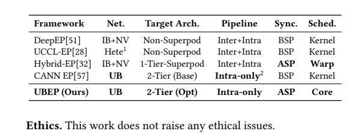

**Original caption:** Table 1: Comparison of MoE communication libraries.

**中文图注:** Table 1: MoE 通信库对比。

**Source:** p.2 S019

**Original:** Although superpods provide a logically unified address space, we demonstrate that physical latency non-uniformity across switching tiers remains a critical yet neglected factor. Current EPCLs treat the fabric as flat and schedule workloads based solely on token counts, ignoring heterogeneous access costs in multi-tier fabrics. We show that this topology-agnostic approach leads to severe stragglers and degraded tail latency — a mismatch between logical abstraction and physical reality that has not been systematically addressed in prior EPCL designs. To address these bottlenecks, we introduce UBEP, a production-ready EPCL designed specifically for modern superpods. Departing from the traditional BSP model, UBEP adopts a dependency-driven execution model (§3.2) that decomposes the monolithic All-to-All primitive into fine-grained tasks scheduled by data availability in-stead of global barriers. This enables aggressive overlap of metadata exchange, token dispatch, and reordering. To mitigate the synchro-nization tax, we propose Data-as-Flag (§3.4), a novel mechanism that embeds synchronization signals directly into data payloads via atomic instructions. This allows implicit, near-zero-overhead co-ordination at the token level, effectively eliminating control-plane overhead. Finally, to overcome the limitations of topology-agnostic scheduling, UBEP employs a hierarchical token-level scheduler (§3.3) that jointly optimizes token-to-core mapping by considering both load balance and physical fabric distance across switching tiers, thereby minimizing stragglers and tail latency. We implemented UBEP on the Huawei CANN stack and evalu-ated it on up to 256 NPU dies allocated from a production CM384 superpod. The evaluation results demonstrate that UBEP reduces All-to-All latency by 52.4% compared to the baseline CANN EP, translating to an 11.1% improvement in end-to-end Time Per Out-put Token (TPOT) for models at the scale of DeepSeek-R1. **Contributions.**Our primary contributions are as follows. • We characterize bottlenecks in BSP-based EPCLs deployed on

**中文:** 尽管超节点（superpod）在逻辑上提供了统一的地址空间，我们证明跨交换层级的物理时延不均匀性仍是一个关键却长期被忽视的因素。现有 EPCL（专家并行通信库）把互连网络当作扁平结构，仅依据 token 数量来调度工作负载，忽略了多层网络中异构的访问成本。我们表明，这种拓扑无关的方法会导致严重的掉队者与恶化的尾时延——这一逻辑抽象与物理现实之间的失配在先前的 EPCL 设计中从未被系统性处理。为解决这些瓶颈，我们提出 UBEP，一个专为现代超节点打造、可直接投入生产的 EPCL。UBEP 摒弃传统 BSP 模型，采用依赖驱动的执行模型（§3.2），将单体式 All-to-All 原语分解为细粒度任务，依据数据可用性而非全局屏障来调度，从而实现元数据交换、token 分发与重排的激进重叠。为消除同步税，我们提出数据即标志（Data-as-Flag，§3.4）这一新颖机制，通过原子指令把同步信号直接嵌入数据载荷，实现 token 级隐式、近零开销的协同，有效消除控制面开销。最后，为克服拓扑无关调度的局限，UBEP 采用分层 token 级调度器（§3.3），在兼顾负载均衡与跨交换层级物理互连网络距离的前提下联合优化 token 到核的映射，从而最小化掉队者与尾时延。我们在华为 CANN 栈上实现了 UBEP，并在一个生产 CM384 超节点中分配的多达 256 个 NPU die 上进行了评估。评估结果表明，与基线 CANN EP 相比，UBEP 将 All-to-All 时延降低 52.4%，对应 DeepSeek-R1 规模模型端到端每输出 token 时间（TPOT，Time Per Output Token）改善 11.1%。**贡献。**我们的主要贡献如下。• 我们刻画了部署在

**Source:** p.2 S020

**Original:** superpods, highlighting how synchronization overhead and seri-

**中文:** 超节点上基于 BSP 的 EPCL 的瓶颈，揭示同步开销与串

**Source:** p.2 S021

**Original:** alization limit bandwidth utilization.

**中文:** 行化如何限制带宽利用率。

**Source:** p.2 S022

**Original:** We design and implement UBEP, an EPCL natively for mod- •

**中文:** • 我们设计并实现了面向现代多

**Source:** p.2 S023

**Original:** ern multi-tier superpods, featuring three core innovations: (1)

**中文:** 层级超节点的原生 EPCL——UBEP，其包含三项核心创新：(1)

**Source:** p.2 S024

**Original:** token-level kernel decomposition to maximize parallelism, (2)

**中文:** token 级核分解以最大化并行度；(2)

**Source:** p.2 S025

**Original:** a hierarchical scheduler that mitigates tail latency from fabric

**中文:** 一个缓解互连网络

**Source:** p.2 S026

**Original:** heterogeneity, and (3) the Data-as-Flag mechanism to minimize

**中文:** 异构性所致尾时延的分层调度器；以及 (3) 用以最小化

**Source:** p.2 S027

**Original:** synchronization overhead. • We evaluate UBEP on a production-scale CM384 superpod,

**中文:** 同步开销的数据即标志（Data-as-Flag）机制。• 我们在生产规模的 CM384 超节点上评估了 UBEP，

**Source:** p.2 S028

**Original:** demonstrating significant latency reduction and end-to-end per-

**中文:** 展示了显著的时延降低与端到端性

**Source:** p.2 S029

**Original:** formance gains for MoE inference. 1 It supports running on heterogeneous GPUs and NICs. 2 UB enables a large-scale superpod execution without inter-node communication.

**中文:** 能提升（针对 MoE 推理）。 1 它支持在异构 GPU 与 NIC 上运行。 2 UB 使大规模超节点执行无需节点间通信。

## 2 BACKGROUND / 2 背景

### 2.1 Model Evolution / 2.1 模型演进

**Source:** p.2 S032

**Original:** The MoE paradigm has**From Dense Model to Sparse Model.** emerged as a dominant strategy for scaling large models effectively. By activating only a small, input-specific subset of its total parame-ters (called), MoE architectures enable a dramatic increase *experts * in model size without a proportional increase in computational cost, thereby improving overall capacity and performance. Con-sequently, many state-of-the-art models have adopted this sparse approach [7, 43, 48]. This architectural shift, however, introduces a fundamental change in communication patterns. Unlike the pre-dictable, structured communication in dense model parallelism, MoE layers generate highly irregular and dynamic inter-GPU com-munication. During inference or training, tokens are dynamically routed to experts via a learned gating function, with each GPU hosting only a subset of the total expert pool. This necessitates a two-step redistribution: first, token activations must be dispatched across the fabric to reach their assigned experts, and later, the pro-cessed outputs must be combined and returned to their original GPUs. The result is a sparse, runtime-dependent all-to-all exchange that forms the core communication bottleneck of MoE models [50], with such communication consuming ∼ 47% of the total execution time on average [24, 49].

**中文:** **从稠密模型到稀疏模型。**MoE 范式已成为有效扩展大模型的主导策略。通过仅激活其总参数中一小部分与输入相关的子集（称为*专家*，experts），MoE 架构能够在计算成本不成比例增加的前提下大幅提升模型规模，从而改善整体容量与性能。因此，许多最先进的模型都采用了这种稀疏化路线 [7, 43, 48]。然而，这一架构转变从根本上改变了通信模式。与稠密模型并行中可预测、结构化的通信不同，MoE 层产生高度不规则、动态的 GPU 间通信。在推理或训练期间，token 经由学习到的门控函数被动态路由到专家，而每张 GPU 仅承载全部专家池的一个子集。这就需要两步重分布：首先，token 激活值必须跨网络分发以到达其被指派的专家；随后，处理后的输出必须被合并并返回其原始 GPU。其结果是一种稀疏、依赖运行时的 all-to-all 交换，它构成 MoE 模型的核心通信瓶颈 [50]，此类通信平均消耗总执行时间的约 47% [24, 49]。

### 2.2 Architectural Evolution / 2.2 架构演进

**Source:** p.2 S034

**Original:** **Beyond Traditional Clusters: The Era of Modern Superpods.** Platforms like NVIDIA’s NVL72 [31] and Huawei’s CM384 [57] illustrate the progression from traditional clusters with multi-node 8-accelerator systems to modern superpods featuring 72- or 384- accelerator integrated fabrics. As illustrated in Figure 1(a), tradi-tional clusters typically employ a hybrid interconnect strategy: NVLink for intra-node GPU-to-GPU communication, and IB/RoCE for inter-node networking. While this architecture supports cluster-scale communication through RDMA, its network bandwidth and topology are primarily optimized for data or pipeline parallelism (DP/PP), which generate relatively modest inter-node traffic [57]. In contrast, tensor parallelism (TP) and expert parallelism (EP) demand frequent, fine-grained, and low-latency communication, a require-ment that is difficult to satisfy efficiently across traditional cluster nodes [57]. Consequently, many deployments are forced to confine TP/EP groups within a single compute node, constraining the scal-ability of the model. Modern superpods, such as those realized by NVL72 and CM384, address this bottleneck by integrating hundreds of accelerators into a single, coherent fabric. These systems exhibit three defining characteristics that are crucial for enabling efficient

**中文:** 如 NVIDIA 的 NVL72 [31] 与华为的 CM384 [57] 等平台所示，系统形态正从由多节点 8 加速器系统构成的传统集群，演进为集成 72 或 384 个加速器统一互连网络的现代超节点。如 Figure 1(a) 所示，传统集群通常采用混合互连策略：节点内 GPU 间通信使用 NVLink，节点间组网使用 IB/RoCE。该架构虽能通过 RDMA 支持集群级通信，但其网络带宽与拓扑主要为数据并行或流水线并行（DP/PP）而优化，二者产生的节点间流量相对有限 [57]。相比之下，张量并行（TP）与专家并行（EP）需要频繁、细粒度、低时延的通信，这一需求难以在传统集群节点间高效满足 [57]。因此，许多部署被迫将 TP/EP 分组限制在单个计算节点内，制约了模型的可扩展性。以 NVL72 与 CM384 为代表的现代超节点通过将数百个加速器整合进单一、一致的互连网络来化解这一瓶颈。这些系统展现出三项关键特性，对实现高效

### 图 1

**Placed near:** S034
**Source:** p.3 C003

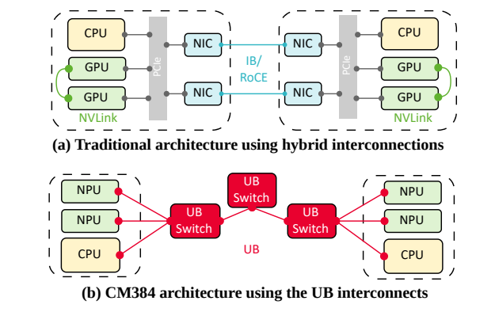

**Original caption:** Figure 1: Comparison of traditional cluster using hybrid in-

**中文图注:** Figure 1: 采用混合互连的传统集群与

**Source:** p.3 S035

**Original:** **terconnects (a) with modern superpod utilizing the UB (b).** communication for MoE: (1) Modern superpods adopt advanced interconnect protocols, including NVLink [34], UB [14], Infinity Fabric [3], UALink [44], and SUE [4], which provide high bandwidth and low latency. For example, Huawei’s UB protocol in CM384 re-moves redundant network layers (Figure 1(b)) and creates a direct connection between the GPU I/O Die and the on-chip Network-on- Chip (NoC), delivering bandwidth nearing 400 GB/s with latencies in the range of hundreds of nanoseconds. Furthermore, these fab-rics employ scalable topologies (e.g., Mesh or CLOS) to aggregate multiple ports, ensuring non-blocking, high-bandwidth connectiv-ity across the entire system [25]. (2) Unified Global Address Space (UGAS): superpod provides a unified memory address space with coherent load/store semantics, where all interconnected devices are mapped into a single, globally unique address domain. This archi-tectural feature enables direct, universal memory access, which is essential for the software synchronization required by fine-grained parallel strategies. (3) Multi-Level, Pooled Resource Management: the superpod implements multi-level resource pooling, abstracting distributed compute, memory, and network resources into a cohe-sive logical pool. This allows for dynamic and flexible scheduling tailored to workload demands.

**中文:** **互连 (a) 与采用统一总线（UB）的现代超节点 (b)。**面向 MoE 的通信而言至关重要：(1) 现代超节点采用先进互连协议，包括 NVLink [34]、UB [14]、Infinity Fabric [3]、UALink [44] 与 SUE [4]，可提供高带宽与低时延。例如，华为 CM384 中的 UB 协议去除了冗余网络层（Figure 1(b)），在 GPU I/O Die 与片上 Network-on-Chip（NoC）之间建立直连，提供接近 400 GB/s 的带宽，时延处于数百纳秒量级。此外，这些互连网络采用可扩展拓扑（如 Mesh 或 CLOS）聚合多个端口，确保整个系统范围的无阻塞、高带宽连接 [25]。(2) 统一全局地址空间（UGAS）：超节点提供具有一致 load/store 语义的统一内存地址空间，所有互连设备被映射到单一的全局唯一地址域。这一架构特性支持直接、通用的内存访问，是细粒度并行策略所需软件同步的关键。(3) 多层级池化资源管理：超节点实现多级资源池化，将分布式的计算、内存与网络资源抽象为统一的逻辑资源池，从而支持按工作负载需求进行动态灵活的调度。

### 2.3 Deploying MoE on CM384: Key Insights / 2.3 在 CM384 上部署 MoE：关键洞察

**Source:** p.3 S037

**Original:** Modern superpods offer significant architectural advantages over traditional clusters; however, the direct deployment of MoE models onto these systems often exposes new challenges. **Terminology.**CM384 is built from a two-tier switching fabric: NPUs on the same baseboard connect through first-tier switches, while multiple baseboards connect through second-tier switches. We classify memory accesses by whether they stay within the local NPU or traverse the switching fabric. Since each NPU contains two compute dies, *Intra-NPU *refers to cross-die HBM access within the local NPU. We do not model same-die HBM access as a sepa-rate class, as its latency is negligible compared with accesses that traverse the switching fabric. *One-Hop *and *Two-Hop *denote NPU-to- NPU accesses that traverse one and two switch layers, respectively.

**中文:** 现代超节点相较传统集群具有显著的架构优势；然而，将 MoE 模型直接部署到这些系统上往往会暴露新的挑战。**术语。**CM384 由两层交换网络构成：同一底板上的 NPU 通过第一层交换机互连，多个底板之间通过第二层交换机互连。我们按内存访问是停留在本地 NPU 内部还是穿越交换网络来对其分类。由于每个 NPU 包含两个计算 die，*NPU 内（Intra-NPU）*指本地 NPU 内跨 die 的 HBM 访问。我们不将同 die 的 HBM 访问单独归类，因为与穿越交换网络的访问相比，其时延可以忽略。*一跳（One-Hop）*与*两跳（Two-Hop）*分别表示穿越一层与两层交换的 NPU 到 NPU 访问。

**Source:** p.3 S038

**Original:** Orthogonal to this topology terminology, we use AIC and AIV to describe the execution hierarchy within each NPU. Each NPU con-tains multiple AI Cores (AICs), and each AIC follows a decoupled 1-to-N design: one Cube Unit for matrix multiplication and multiple Vector Cores (AIVs) for parallel vector processing are orchestrated by a Scalar Unit that manages instruction dispatch and control flow. Typically, MoE layer involves two**Deploying MoE on CM384.** tightly coupled communication stages: (1) a dispatch stage, which routes tokens to remote GPUs hosting the target experts, and (2) a combine stage, which gathers expert outputs and restores the original token order. Figure 2 details the typical execution flow of the dispatch operation on CM384. Prior to execution, each rank allocates a global shared memory region partitioned by source rank and expert. Leveraging the UGAS, the destination rank determines specific memory ranges based solely on per-expert token counts from each source rank. The specific execution steps for the dispatch operation are as follows: (1) Initialization (Phase 1): Tokens are stored in the local Unified Buffer (UBuf) of each AIV. (2) Transmis-sion (Phase 2): Each AIV sends all locally owned tokens to their designated expert locations. A single token may be dispatched to multiple experts, while each expert receives tokens from multiple AIVs. (3) Global Synchronization and Completion Signaling (Phase 3): A SyncAll operation ensures all token data has been written to global memory. AIVs responsible for signaling transmit per-expert flags and token counts to indicate processing readiness. (4) Flag Verification (Phase 4): Verification is performed in parallel; each AIV polls a subset of flag entries in global memory, followed by an-other SyncAll to confirm global completion. (5) Offset Calculation & Reordering (Phase 5): Based on the finalized token counts, the sys-tem computes reordered token offsets and performs a contiguous reordering of tokens in global memory. This intricate process high-lights how the transition from dense to sparse modeling not only changes computational patterns but also demands synchronization-heavy communication protocols to manage the resulting irregular data movement efficiently. **Our Key Insights.**In our effort to optimize communication for MoE models on modern superpods, we have re-architected the EPCL. Through this reconstruction, we derived three key insights that guided our architectural decisions and implementation.

**中文:** 与上述拓扑术语正交，我们用 AIC 与 AIV 描述每个 NPU 内部的执行层级。每个 NPU 包含多个 AI Core（AIC），每个 AIC 采用解耦的 1-to-N 设计：一个负责矩阵乘法的 Cube Unit 与多个负责并行向量处理的 Vector Core（AIV），由管理指令分发与控制流的 Scalar Unit 统一编排。**在 CM384 上部署 MoE。**通常，MoE 层涉及两个紧密耦合的通信阶段：(1) 分发（dispatch）阶段，将 token 路由到托管目标专家的远端 GPU；(2) 合并（combine）阶段，汇聚专家输出并恢复原始 token 顺序。Figure 2 展示了 CM384 上分发操作的典型执行流程。执行前，每个 rank 按源 rank 与专家划分分配一块全局共享内存区域。借助 UGAS，目的 rank 仅凭来自每个源 rank 的每专家 token 计数即可确定具体内存范围。分发操作的具体执行步骤如下：(1) 初始化（Phase 1）：token 存储在每个 AIV 的本地统一缓冲区（UBuf）中。(2) 传输（Phase 2）：每个 AIV 将本地持有的全部 token 发送到其指定专家位置。单个 token 可能被分发到多个专家，而每个专家会从多个 AIV 接收 token。(3) 全局同步与完成信号（Phase 3）：一次 SyncAll 操作确保所有 token 数据已写入全局内存。负责发信号的 AIV 发送每专家标志与 token 计数以指示处理就绪。(4) 标志验证（Phase 4）：验证并行执行；每个 AIV 轮询全局内存中的一部分标志表项，随后再一次 SyncAll 以确认全局完成。(5) 偏移计算与重排（Phase 5）：基于最终确定的 token 计数，系统计算重排后的 token 偏移，并在全局内存中对 token 执行连续重排。这一复杂过程表明，从稠密建模到稀疏建模的转变不仅改变了计算模式，还要求采用重同步的通信协议来高效管理由此产生的不规则数据搬移。**我们的关键洞察。**在为现代超节点上的 MoE 模型优化通信的过程中，我们对 EPCL 进行了重新架构。通过这次重构，我们得到了三条指导架构决策与实现的关键洞察。

### 图 2

**Placed near:** S038
**Source:** p.3 C002

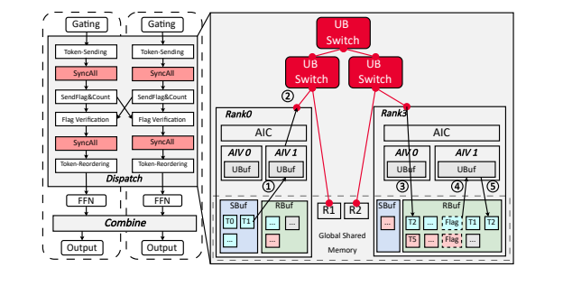

**Original caption:** Figure 2: MoE Dispatch workflow. Left: logical view of se-

**中文图注:** Figure 2: MoE 分发（dispatch）工作流。左：顺序执行

**Source:** p.4 S039

**Original:** **Insight 1: The BSP model’s implicit synchronization incurs** **explicit barriers, creating a critical bottleneck for superpod.** **Unlocking their potential requires fine-grained task decom-** **position to maximize parallelism.**The BSP model organizes MoE communication into a sequence of distinct phases, where each phase is guarded by a global synchronization barrier. While this design ensures correctness, it enforces strict ordering constraints and requires every AIV to perform the exact same type of work within a phase. This approach offers little flexibility in scheduling work across AIVs, resulting in a rigid execution path for the current dispatch. As shown in Figure 2, phases such as SetFlagAndCount and Token-Reordering occur in a strict sequence, and a new phase can only begin once every AIV has reached the synchronization point. Since computation is assigned statically, faster AIVs often sit idle to wait for slower ones, leading to underutilized resources. Figure 3(a) shows that this inefficiency becomes much more visi-ble on modern superpods. In traditional clusters, where scale-out bandwidth was limited (50 GB/s for IB/RoCE v2), the extended time required for data transfer meant that synchronization overhead was simply less pressing compared to the transfer costs. On the CM384 architecture, however, the bandwidth increases by over an order of magnitude to 392 GB/s. As a result, token dispatch reaches bandwidth saturation very quickly, leaving phase-level synchro-nization as the dominant constraint. We observe that only a subset of AIVs is sufficient to saturate the available bandwidth during dispatch, and adding more AIVs beyond this point provides little latency benefit. As illustrated in Figure 3(b), scaling communication cores from 24 to 48 offers minimal benefit, because the extra cores spend most of their time waiting at barriers rather than doing useful work. This suggests an opportunity to re-evaluate the BSP-style execution. Since we do not need every AIV to participate uniformly in every phase, it is possible to break down these rigid boundaries and assign sub-tasks at a finer granularity. This would relax the strict dependencies and allow for more flexible scheduling. **Insight 2: The explicit synchronization overhead on mod-** **ern superpod architectures can dominate execution time.** **Leveraging hardware-guaranteed atomic operations enables**

**中文:** **Insight 1：BSP 模型的隐式同步带来了显式屏障，构成超节点的关键瓶颈。释放其潜力需要细粒度任务分解以最大化并行度。**BSP 模型将 MoE 通信组织为一系列相继的阶段，每个阶段都由全局同步屏障守护。这一设计虽保证正确性，却施加了严格的顺序约束，并要求每个 AIV 在一个阶段内执行完全相同类型的工作。这种方式在跨 AIV 的工作调度上几乎不提供灵活性，使当前分发形成僵化的执行路径。如 Figure 2 所示，SetFlagAndCount 与 Token-Reordering 等阶段严格按序执行，且只有当所有 AIV 都到达同步点后新阶段才能开始。由于计算是静态指派的，较快的 AIV 往往闲置等待较慢者，导致资源利用不足。Figure 3(a) 显示，这种低效在现代超节点上更加显眼。在传统集群中，横向扩展带宽有限（IB/RoCE v2 为 50 GB/s），数据传输所需的时间较长，因此同步开销相比传输成本显得不那么紧迫。而在 CM384 架构上，带宽提升一个数量级以上、达到 392 GB/s。其结果是 token 分发很快达到带宽饱和，阶段级同步成为主导约束。我们观察到，只需一部分 AIV 即可在分发期间打满可用带宽，超过该点后继续增加 AIV 几乎不带来时延收益。如 Figure 3(b) 所示，将通信核从 24 扩展到 48 收益甚微，因为额外的核大部分时间在屏障处等待，而非做有用工作。这提示存在重新审视 BSP 风格执行的机会：既然不需要每个 AIV 都均一地参与每个阶段，就可以打破这些僵化边界，以更细的粒度指派子任务，从而放宽严格的依赖关系、实现更灵活的调度。**Insight 2：现代超节点架构上的显式同步开销可能主导执行时间。利用硬件保证的原子操作可为处理器带来**

### 图 3

**Placed near:** S039
**Source:** p.4 C005

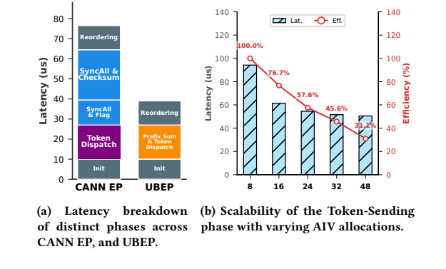

**Original caption:** Figure 3: Performance analysis of All-to-All communication.

**中文图注:** Figure 3: All-to-All 通信的性能分析。

**Source:** p.4 S040

**Original:** **ers with memory-level consistency and forming the foun-** **dation for fine-grained, low-overhead parallel communica-** While decomposing sub-task dependencies improves task**tion.** parallelism, explicit synchronization primitives limit overall effi-ciency due to their overhead. On modern superpod architectures, this is exemplified by operations such as, whose intrin- SyncAll sic cost can account for approximately 15% of total execution time. To address this, we leverage hardware-guaranteed atomic operations—specifically the 512B atomic Load/Store capability sup-ported by the Ascend NPU within the superpod across scale-up and NoC domains. Crucially, the UB Fabric ensures atomicity of these writes and serializes subsequent reads, enabling *implicit synchro- *. This approach replaces costly explicit software barriers *nization * with memory-level consistency, forming the foundation for truly fine-grained, low-overhead parallel communication primitives. **Insight 3: In the hierarchical network of a modern superpod,** **load-balancing tokens without considering the significant la-** **tency gap between one-hop and two-hop memory accesses is** **counterproductive, resulting in stragglers that degrade over-** **all MoE performance.**Modern superpod architectures are rapidly evolving from scales of hundreds of accelerators (e.g., NVL72) to thousands (e.g., CM384, NVL576). To support this massive scale, the interconnect fabric inevitably expands from a single-tier switch to a multi-tier switching architecture. Consequently, while these superpods continue to provide a unified global address space, the underlying physical topology re-introduces distinct Non-Uniform Memory Access (NUMA) characteristics at the cluster level. How-ever, existing implementations remain oblivious to this shift: they are either tailored for single-tier architectures (e.g., NVL72) [32] or focus exclusively on balancing token counts [57], failing to account for the heterogeneous access costs in multi-tier fabrics. This mis-match leads to severe stragglers in phase because, Token-Sending in such hierarchical architectures, NPU-to-NPU memory access falls into three distinct distance categories with markedly differ-ent latencies: (1) *Intra-NPU *access to cross-die HBM within the local NPU (e.g., Rank 0 writing to HBM on another die of its local NPU); (2) *One-Hop *access across a single switch layer (e.g., Rank 0 to Rank 1); and (3) *Two-Hop *access traversing two switch layers. As shown in Table 2, the latency gap is profound, with Two-Hop access reaching up to 11.5 × that of local access, necessitating a scheduling approach that optimizes for both workload distribution and hierarchical memory access distances.

**中文:** **内存级一致性，并为细粒度、低开销的并行通信奠定基础。**尽管分解子任务依赖可以提升任务并行度，显式同步原语却因自身开销而限制整体效率。在现代超节点架构上，典型代表是 SyncAll 等操作，其固有开销可占总执行时间的约 15%。为此，我们利用硬件保证的原子操作——具体是超节点内跨 scale-up 与 NoC 域、由昇腾（Ascend）NPU 支持的 512B 原子 Load/Store 能力。关键在于，UB Fabric 保证这些写入的原子性并串行化后续读取，从而实现*隐式同步*。这一方法以内存级一致性取代代价高昂的显式软件屏障，为真正细粒度、低开销的并行通信原语奠定基础。**Insight 3：在现代超节点的分层网络中，不考虑一跳与两跳内存访问之间显著时延差的负载均衡式 token 分配会适得其反，产生的掉队者将拖累整体 MoE 性能。**现代超节点架构正从数百加速器规模（如 NVL72）快速演进到数千规模（如 CM384、NVL576）。为支撑这一庞大规模，互连网络不可避免地从单层交换扩展为多层交换架构。于是，尽管这些超节点继续提供统一全局地址空间，底层物理拓扑却在集群层面重新引入了明显的非一致内存访问（NUMA）特征。然而，现有实现仍对这一变化无动于衷：它们要么专为单层架构（如 NVL72）定制 [32]，要么只关注均衡 token 计数 [57]，未能考虑多层互连网络中的异构访问成本。这种失配导致 Token-Sending 阶段出现严重掉队者，因为在此类分层架构中，NPU 到 NPU 的内存访问分为三类距离类别、时延差异显著：(1) *NPU 内（Intra-NPU）*：本地 NPU 内跨 die 的 HBM 访问（如 Rank 0 写入本地 NPU 另一 die 的 HBM）；(2) *一跳（One-Hop）*：跨越单层交换的访问（如 Rank 0 到 Rank 1）；(3) *两跳（Two-Hop）*：穿越两层交换的访问。如 Table 2 所示，时延差距悬殊，两跳访问最高可达本地访问的 11.5×，这要求一种同时优化负载分布与分层内存访问距离的调度方法。

### 表 2

**Placed near:** S040
**Source:** p.4 C004

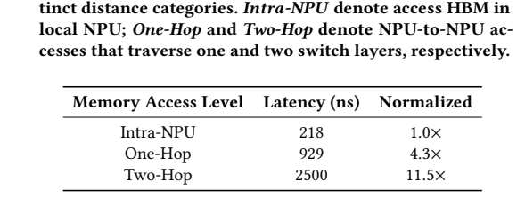

**Original caption:** Table 2: CM384 memory-access latency hierarchy under dis-

**中文图注:** Table 2: 分发（dispatch）下的 CM384 内存访问时延层级

## 3 UBEP / 3 UBEP

### 3.1 Overview / 3.1 概述

**Source:** p.5 S043

**Original:** UBEP (Unified-Bus Expert Parallelism) is a communication library for low-latency MoE inference. We build UBEP on three key designs (Figure 4): First, we introduce**Kernel Decomposition**(§3.2) to break the sequential constraint of traditional BSP models by parti-tioning AIVs into distinct groups to execute independent tasks in parallel and replace global barriers with lightweight point-to-point synchronization. Second, to handle the complex latency differences in superpods, we implement a**Hierarchical Token-level Schedul-** (§3.3). This component utilizes a hardware-accelerated mapper**ing** to generate optimal allocation schedules within 1 $μs$. Finally, to eliminate expensive inter-NPU synchronization, we propose**Data-** **as-Flag**(§3.4). This mechanism leverages the hardware’s native 512-byte atomic load/store support. By embedding control flags di-rectly within the data payload, UBEP achieves implicit consistency without separate control messages. These three mechanisms are synergistic: kernel decomposition exposes the fine-grained tasks that the scheduler must balance across cores and that Data-as-Flag can synchronize without global barriers; without decomposition there would be no fine-grained work to overlap, without sched-uling the workload would become unbalanced across the fabric, and without Data-as-Flag global barriers would reintroduce the synchronization tax. In principle, the proposed techniques of UBEP’s fine-grained par-allelism can be adapted to any BSP-kernel, including both dispatch and combine routines. Since the challenges of global synchroniza-tion overhead and load imbalance are predominantly concentrated in the earlier dispatch phase, which fundamentally limits the overall scalability. In this context, the following sections will take dispatch as an illustrative example, without elaborating on trivial yet intri-cate details in combine.

**中文:** UBEP（Unified-Bus Expert Parallelism，统一总线专家并行）是一种面向低时延 MoE 推理的通信库。我们以三项关键设计构建 UBEP（Figure 4）：第一，我们引入**核分解**（Kernel Decomposition，§3.2），把 AIV 划分为不同分组以并行执行独立任务，并用轻量级点对点同步取代全局屏障，打破传统 BSP 模型的串行约束。第二，为应对超节点中复杂的时延差异，我们实现了**分层 token 级调度**（Hierarchical Token-level Scheduling，§3.3）。该组件利用硬件加速的映射器在 1 µs 内生成最优分配调度。第三，为消除昂贵的 NPU 间同步，我们提出**数据即标志**（Data-as-Flag，§3.4）。该机制利用硬件原生的 512 字节原子 load/store 支持，通过将控制标志直接嵌入数据载荷，在无独立控制消息的情况下实现隐式一致性。这三项机制协同工作：核分解暴露出调度器需要在各核之间均衡、且数据即标志可以在无全局屏障情况下同步的细粒度任务；没有核分解就没有可重叠的细粒度工作，没有调度则负载会在整个互连网络上失衡，而没有数据即标志，全局屏障将重新引入同步税。原则上，UBEP 的细粒度并行技术可适配任何 BSP 核，包括分发与合并两类例程。鉴于全局同步开销与负载不均衡的挑战主要集中在更早的分发阶段——它从根本上限制了整体可扩展性——下文以分发为例展开说明，不再赘述合并中那些琐碎却繁复的细节。

### 图 4

**Placed near:** S043
**Source:** p.5 C006

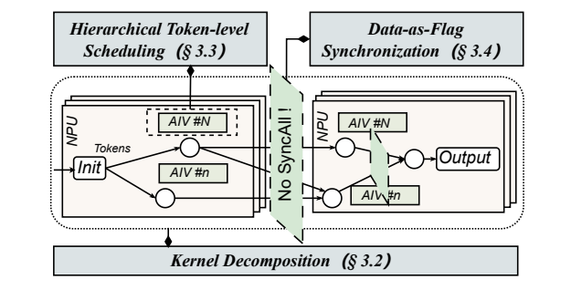

**Original caption:** Figure 4: Overview of the UBEP architecture.

**中文图注:** Figure 4: UBEP 架构概览。

### 3.2 Kernel Decomposition / 3.2 核分解

**Source:** p.5 S045

**Original:** Current MoE dispatch primitive organize communication and data reordering as BSP-style kernel executed. As illustrated in Fig-ure 5(a), the traditional implementation simply divides the com-munication workflow into task phases executed in parallel across multiple AIVs. This simplifies programming and synchronization across AIVs by employing global barriers (*i.e., *SyncAll) to satisfy

**中文:** 当前的 MoE 分发原语将通信与数据重排组织为按 BSP 风格执行的核。如 Figure 5(a) 所示，传统实现只是把通信工作流划分为由多个 AIV 并行执行的任务阶段，并通过采用全局屏障（*即* SyncAll）来简化跨 AIV 的编程与同步，以满足

**Source:** p.5 S046

**Original:** the task decomposition for the entire communication workflow. In this approach, rather than requiring all AIVs to execute the same task sequence, we design a fine-grained partitioning mechanism that assigns independent tasks, such as token transmission and metadata process, to distinct AIVs for execution in parallel. Further-more, we employ lightweight asynchronous signals to handle the synchronization across different AIVs. Specifically, in Figure 5(b), each NPU decomposes and token counts sending Token-Sending () tasks into two distinct AIV groups: most *i.e., *TokenCnt-Sending AIVs send tokens, while other AIVs calculate and send token counts. Once all TokenCnt metadata become available, the latter AIVs com-pute prefix sums to determine HBM offsets for per-expert tokens used in Token-Reordering. This decomposition allows us to over-lap the processing latency of TokenCnt without compromising the bandwidth for token transmission. Further, maximizing overlap and minimizing communication latency poses a constrained problem: given a fixed total number of AIVs, we must determine the optimal allocation ratio between these two groups. In general, the number of AIVs allocated to process token counts is proportional to the number of experts (calculating token counts for more destinations). Meanwhile, the number of AIVs assigned to token transmission is proportional to the product of the batch size and the Top- $k$ (handling larger communication volume). Detailed cost modeling and the derivation of this optimal allocation appear in Appendix A. We also evaluate and verify the model’s impact in Appendix C.3. A data dependency exists within the entire workflow: relies on the addresses calculated by Token-Reordering CalCumSum. Rather than employing global synchronization via SyncAll, we implement point-to-point synchronization based on asynchronous data signals. Specifically, the AIVs tasked with CalCumSum write the calculated addresses into global shared memory and other AIVs poll for corresponding memory offset and execute Token-Reordering immediately upon detecting the update.

**中文:** 整个通信工作流的任务分解。在这一方法中，我们并不要求所有 AIV 执行相同的任务序列，而是设计了一种细粒度划分机制，将 token 传输与元数据处理等相互独立的任务指派给不同的 AIV 并行执行。此外，我们采用轻量级异步信号来处理跨 AIV 的同步。具体地，在 Figure 5(b) 中，每个 NPU 将 Token-Sending（即 token 发送）与 TokenCnt-Sending（即 token 计数）任务分解为两个不同的 AIV 组：大多数 AIV 负责发送 token，其余 AIV 负责计算并发送 token 计数。一旦所有 TokenCnt 元数据可用，后者即计算前缀和，以确定 Token-Reordering 所需的每专家 token 在 HBM 中的偏移。这种分解使我们得以重叠 TokenCnt 的处理时延，而不牺牲 token 传输带宽。进一步地，最大化重叠并最小化通信时延构成一个受约束的问题：在 AIV 总数固定的前提下，必须确定两组之间的最优分配比例。一般而言，分配去处理 token 计数的 AIV 数量与专家数量成正比（要为更多目的地计算 token 计数）；分配去 token 传输的 AIV 数量与批大小和 Top-$k$ 的乘积成正比（要处理更大的通信量）。详细的成本建模与最优分配推导见 Appendix A；我们在 Appendix C.3 中评估并验证了该模型的影响。整个工作流中存在一个数据依赖：Token-Reordering 依赖 CalCumSum 计算出的地址。我们没有采用 SyncAll 式的全局同步，而是实现了基于异步数据信号的点对点同步：负责 CalCumSum 的 AIV 将计算出的地址写入全局共享内存，其余 AIV 轮询相应的内存偏移，一旦检测到更新便立即执行 Token-Reordering。

### 图 5

**Placed near:** S046
**Source:** p.6 C007

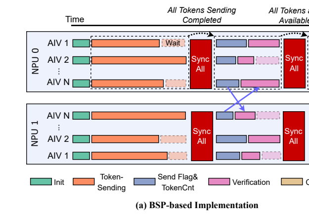

**Original caption:** Figure 5: Comparison of BSP-based multi-phase execution

**中文图注:** Figure 5: 基于 BSP 的多阶段执行对比

### 3.3 Hierarchical Token-level Scheduling / 3.3 分层 token 级调度

**Source:** p.5 S048

**Original:** As highlighted in Insight 3, the structural disparity across multiple tiers induces latency asymmetry. In practical scheduling, this asym-metry manifests primarily between one-hop access and two-hop access traversing multiple switch layers; consequently, we omit the negligible impact of intra-NPU access. Furthermore, employing naive load balancing strategies in token dispatch often exacerbates

**中文:** 如 Insight 3 所强调，多个层级间的结构差异引起时延不对称。在实际调度中，这种不对称主要体现为穿越多层交换时一跳访问与两跳访问之间的差异；因此我们忽略 NPU 内访问这一可忽略不计的影响。此外，在 token 分发中采用朴素的负载均衡策略往往会加剧

**Source:** p.6 S049

**Original:** the straggler problem (as detailed in §5.4). Consequently, we must rethink token scheduling by establishing a unified model that con-siders the impact of load balancing and hierarchy. Consider a specific NPU**Formulation and Hardness Analysis.** within a superpod that outputs $m$ tokens, denoted by the set T = { 1,...,$m$ }, which must be dispatched to $n$ AIVs, represented by C = { 1,...,$n$ }. The goal is to determine an optimal assignment of tokens to AIVs such that the overall communication and processing latency is minimized, subject to satisfy load-balancing and assignment constraints. Denote by ℓ the transmission latency of the token $i$ and $i$ by $RTT$ the round-trip time between the token $i$ and its destination $i$ (relevant when network delays are considered). Binary variables

**中文:** 掉队者问题（详见 §5.4）。因此，我们必须建立一个同时考虑负载均衡与层级影响的统一模型，重新思考 token 调度。**问题形式化与难度分析。**考虑超节点中某个特定 NPU，其输出 $m$ 个 token，记为集合 T = {1,...,$m$}，需被分发到 $n$ 个 AIV，记为 C = {1,...,$n$}。目标是确定 token 到 AIV 的最优指派，使总体通信与处理时延最小，同时满足负载均衡与指派约束。记 ℓ$_i$ 为 token $i$ 的传输时延，$RTT_i$ 为 token $i$ 与其目的地之间的往返时延（在考虑网络时延时相关）。二值变量

**Source:** p.6 S050

**Original:** $xi$, $j$ indicate the assignment between tokens and { $ij$ | ∈ T ∈ C} AIVs; $xij$ = 1 if and only if token $i$ is assigned to AIV $j$; and the set of tokens assigned to AIV $j$ is defined as M $j$ = { $i$ | $xij$ = 1 }. The objective is to minimize the maximum completion time across all AIVs, which consists of the cumulative transmission latency of assigned tokens and the worst-case network delay within each AIV’s token set. minimize max ∑︁ ℓ max RTT (1) (cid:169) $i$ + { $i$ } (cid:170) $j$ ∈{ 1,...,$n$ } (cid:173) $i$ ∈M $j$ (cid:174) $i$ ∈M $j$ (cid:171) (cid:172) $n$ ∑︁ subject to $xij$ = 1, ∀ $i$ ∈ { 1,...,$m$ } (1a) $j$ = 1 $mm$ ∑︁ (cid:108) (cid:109) $xij$ ≤, ∀ $j$ ∈ { 1,...,$n$ } (1b) $ni$ = 1 $xij$ ∈ { 0, 1 }, ∀ $i$, $j$ (1c) The constraint (1a) characterizes that each token is assigned to exactly one AIV. The binary decision variable $x$ indicates whether $ij$ the token $i$ is assigned to AIV $j$. Load balancing is enforced by the constraint (1b) so that no AIV receives more than a fair share of to-kens. This formulation captures both the communication overhead (via ℓ $i$) and the network heterogeneity (via $RTTi$), while ensuring that the workload distribution remains balanced across AIVs—a key requirement for scalable and low-latency token dispatch in

**中文:** $x_{i,j}$（$i$ ∈ T，$j$ ∈ C）表示 token 与 AIV 之间的指派关系；当且仅当 token $i$ 被指派给 AIV $j$ 时 $x_{i,j}$ = 1；指派给 AIV $j$ 的 token 集合定义为 $M_j$ = { $i$ | $x_{i,j}$ = 1 }。目标是最小化所有 AIV 的最大完成时间，它由所分派 token 的累计传输时延与每个 AIV token 集合内的最坏网络时延组成。minimize max_{j ∈ {1,...,$n$}} ( ∑_{i ∈ $M_j$} ℓ$_i$ + max_{i ∈ $M_j$} $RTT_i$ )   (1)   subject to   ∑_{j=1}^{$n$} $x_{i,j}$ = 1, ∀ $i$ ∈ {1,...,$m$}   (1a)   ∑_{i=1}^{$m$} $x_{i,j}$ ≤ ⌈$m$/$n$⌉, ∀ $j$ ∈ {1,...,$n$}   (1b)   $x_{i,j}$ ∈ {0, 1}, ∀ $i$,$j$   (1c)   约束 (1a) 刻画每个 token 恰好被指派给一个 AIV。二值决策变量 $x_{i,j}$ 指示 token $i$ 是否被指派给 AIV $j$。约束 (1b) 强制负载均衡，使任何 AIV 获得的 token 都不超过其公平份额。该形式化同时刻画了通信开销（经由 ℓ$_i$）与网络异构性（经由 $RTT_i$），并保证负载在 AIV 间保持均衡——这是 MoE 架构中可扩展、低时延 token 分发的关键要求。

**Source:** p.6 S051

**Original:** **and kernel decomposition for token dispatch.** MoE-based architectures. We formally prove that the program (1) is NP-hard and the detailed proof is provided in Appendix B. Directly solving this NP-hard opti-**Latency Homogenization.** mization problem to optimality is prohibitively expensive in the context of our sub-microsecond latency budget. Even state-of-the-art integer programming solvers would require much more time to compute a solution, which would itself become the dominant bot-tleneck, utterly negating the performance gains sought from an op-timized schedule. We propose that the objective can be heuristically solved through latency homogenization: making the latency com-position of each AIV similar, thereby avoiding bottlenecks caused by some AIVs processing too many high latency tokens. To approx-imate the NP-hard objective, our heuristic algorithm decomposes the problem based on the two additive terms in the program (1). First, we consider the transmission time. We note two key obser-vations: (1) in LLMs, tokens generally have uniform sizes across the model, which are much smaller than the bandwidth. Therefore, the transmission time per token (ℓ $i$) can be approximately treated as the same; (2) in modern high-bandwidth superpods, the transmission time for a single token (typically at the KB level) is much shorter than the network propagation latency. Based on these observations, we can propose that (cid:205) ℓ (cid:205) $mx$. Therefore, this aspect $i$ ∈M $ji$ ∝ $i$ = 1 $ij$ can be satisfied together with constraint (1b). What’s more, the second observation justifies why our subsequent optimization can focus primarily on the network propagation term in the objective function, as it becomes the dominant source of latency variance. Second, we consider the RTT. We categorize tokens by hop count and aim to equalize the hop-count distribution across AIVs. Let $vj$ be the hop distribution vectors of the AIV $j$ and let Σ be the their covariance matrix. Minimizing the variance of each hop-count component across AIVs is equivalent to minimizing $tr$ Σ. This () reduces the heuristic to the simple per-hop capacity bound $vj$,ℎ ⩽ ⌈ $V$ ℎ / $n$ ⌉, where $V$ ℎ is the total number of ℎ -hop tokens. **Hardware-Accelerated Mapper.**The theoretical formulation of the token scheduling problem provides a foundation for optimizing token assignments. Practical deployment, however, requires a mech-anism that operates efficiently under hardware constraints. In this

**中文:** **以及面向 token 分发的核分解。**我们形式化证明程序 (1) 是 NP 难的，详细证明见 Appendix B。**时延均匀化。**在亚微秒级时延预算下，直接将该 NP 难优化问题求解至最优的代价高得令人望而却步。即便最先进的整数规划求解器也需要多得多的时间来计算解，这本身就会成为主导瓶颈，彻底抵消优化调度本要带来的性能收益。我们提出可通过时延均匀化（latency homogenization）启发式地求解该目标：让每个 AIV 的时延构成彼此相近，从而避免某些 AIV 处理过多高时延 token 造成的瓶颈。为逼近该 NP 难目标，我们的启发式算法基于程序 (1) 中的两个加性项对问题进行分解。首先考虑传输时间。我们注意到两个关键观察：(1) 在 LLM 中，token 的尺寸在全模型范围内基本一致，且远小于带宽所能承载的量，因此每个 token 的传输时间（ℓ$_i$）可近似视为相同；(2) 在现代高带宽超节点中，单个 token（通常为 KB 量级）的传输时间远短于网络传播时延。基于这些观察，我们可以提出 ∑_{i ∈ $M_j$} ℓ$_i$ ∝ ∑_{i=1}^{$mx$} ℓ$_i$。因此，这一方面可与约束 (1b) 一并满足。此外，第二个观察也为后续优化主要聚焦目标函数中的网络传播项提供了依据，因为它成为时延方差的主导来源。其次考虑 RTT。我们按跳数对 token 分类，目标是使各 AIV 的跳数分布均衡。设 $v_j$ 为 AIV $j$ 的跳数分布向量，Σ 为其协方差矩阵。最小化每个跳数分量在 AIV 间的方差等价于最小化 $tr$(Σ)。这将启发式简化为简单的每跳容量上界 $v_{j,h}$ ⩽ ⌈$V_h$ / $n$⌉，其中 $V_h$ 为 $h$ 跳 token 的总数。**硬件加速映射器。**token 调度问题的理论形式化为优化 token 指派奠定了基础。然而，实际部署需要一种在硬件约束下高效运转的机制。在本

**Source:** p.7 S052

**Original:** **Algorithm 1**Quaternary Search **Input:**Reordered Expert List E (tensor), Target Global Token Index $Ttarget$, Total Number of Experts $Nexp$ **Output:**Target Expert ID $Exp$, Local Token Offset $Offsetidx$

**中文:** **Algorithm 1** 四元搜索（Quaternary Search）   **输入：**重排后的专家列表 $E$（张量）、目标全局 token 索引 $T_{target}$、专家总数 $N_{exp}$   **输出：**目标专家 ID $Exp_{idx}$、本地 token 偏移 $Offset_{idx}$

**Source:** p.7 S053

**Original:** 1: ⊲ Initialization

**中文:** 1: ⊲ 初始化

**Source:** p.7 S054

**Original:** 2: $L$,$R$ 0, $N$; $C$ 0; $GapRL$ 4 [ ] ← [ $exp$ ] $L$ ← ← ⌈(−)/ ⌉ $Gap$ 1 3:**while**≥**do** ⊲ Step 1: Define Pivots 4:

**中文:** 2: $L$,$R$ ← 0, $N_{exp}$；$C_L$ ← 0；$Gap_{RL}$ ← ⌈($R$−$L$)/4⌉   3:**while** $Gap$ ≥ 1 **do**   ⊲ 第 1 步：定义枢轴   4:

**Source:** p.7 S055

**Original:** 5: $Pi$ ← $L$ + $i$ · $Gap$ ∀ $i$ ∈ { 1, 2, 3 }

**中文:** 5: $P_i$ ← $L$ + $i$ · $Gap$，∀ $i$ ∈ { 1, 2, 3 }

**Source:** p.7 S056

**Original:** 6: ⊲ Step 2: SIMD Parallel Counting

**中文:** 6: ⊲ 第 2 步：SIMD 并行计数

**Source:** p.7 S057

**Original:** 7: $Ci$ ← VectorCount (E < $Pi$) ∀ $i$ ∈ { 1, 2, 3 }

**中文:** 7: $C_i$ ← VectorCount(E < $P_i$)，∀ $i$ ∈ { 1, 2, 3 }

**Source:** p.7 S058

**Original:** 8: ⊲ Step 3: Narrow down (Find target quadrant $q$)

**中文:** 8: ⊲ 第 3 步：收缩区间（找到目标象限 $q$）

**Source:** p.7 S059

**Original:** 9:**Define**$P$ 0 ← $L$, $P$ 4 ← $R$, $C$ 0 ← $CL$

**中文:** 9: 定义 $P_0$ ← $L$，$P_4$ ← $R$，$C_0$ ← $C_L$

**Source:** p.7 S060

**Original:** 10: Find smallest $q$ ∈ { 1, 2, 3 } such that $T$ < $Ctargetq$

**中文:** 10: 找到最小的 $q$ ∈ { 1, 2, 3 } 使得 $T_{target}$ < $C_q$

**Source:** p.7 S061

**Original:** 11: no such $q$ exists $q$ ← 4**if then** $LP$; $RP$; $CC$ 12:**Update:**← $q$ − 1 ← $qL$ ← $q$ − 1 $GapRL$ 4 13: ← ⌈(−)/ ⌉

**中文:** 11:**if** 不存在这样的 $q$ **then** $q$ ← 4   12: 更新：$L$ ← $P_{q−1}$；$R$ ← $P_q$；$C_L$ ← $C_{q−1}$   13: $Gap_{RL}$ ← ⌈($R$−$L$)/4⌉

**Source:** p.7 S062

**Original:** 14:**if**$R$ ≤ $L$**or**$Gap$ = 0**then**

**中文:** 14:**if** $R$ ≤ $L$ **or** $Gap$ = 0 **then**

**Source:** p.7 S063

**Original:** 15:**break**

**中文:** 15:**break**

**Source:** p.7 S064

**Original:** 16: ⊲ Finalization

**中文:** 16: ⊲ 最终化

**Source:** p.7 S065

**Original:** 17: $Expidx$ ← $L$

**中文:** 17: $Exp_{idx}$ ← $L$

**Source:** p.7 S066

**Original:** 18: $C$ ← VectorCount (E < $Exp$) $finalidx$

**中文:** 18: $C_{final}$ ← VectorCount(E < $Exp_{idx}$)

**Source:** p.7 S067

**Original:** 19: $Offset$ ← $T$ − $Ctargetfinal$

**中文:** 19: $Offset_{idx}$ ← $T_{target}$ − $C_{final}$

**Source:** p.7 S068

**Original:** 20: $Exp$,$Offset$**return**$idx$ work, we propose a hardware-accelerated algorithm design that ensures load balancing over all tokens and maintains balance across categories. The design comprises two tightly coupled components: (1) Expert Remapping via Logical Matrix Transposition: We con-struct a virtual matrix where rows correspond to AIVs and columns to experts. By reading this matrix in column-major order, we gen-erate a remapped expert sequence for each AIV. Using efficient vec-torized matrix operations, we change the original token sequence that AIVs were responsible for sending, thereby ensuring that each AIV accesses a balanced mix of one-hop and two-hop experts, ho-mogenizing the expected communication latency. (2) Token-level Load Partition: The global token sequence is partitioned into con-tiguous slices of equal size, and each AIV is assigned one slice. This guarantees that the maximum load difference between any two AIVs is at most one token. Since the remapped expert sequence produces non-uniform per-expert token counts, this is a prefix-sum search: given a target token index $Ttarget$, find the expert whose cu-mulative token range covers it. Each AIV performs this lookup via quaternary search (Algorithm 1), which maintains a search window [ $L$,$R$ ] over the expert space and evaluates three equidistant pivots per iteration. The cumulative token counts at all three pivots are computed in parallel via a single SIMD VectorCount instruction. The algorithm then narrows the window to the quadrant containing $T$.Upon convergence, the left boundary $L$ gives the expert ID, $target$ and a final VectorCount yields the local offset within that expert’s buffer. The search converges in 4–5 steps for typical expert counts and stays within 1 $μ$ s. **Generalization Beyond Two Tiers.**While we evaluate CM384’s two-tier topology, the scheduler readily extends to an arbitrary number of hop classes $H$ by applying the same per-hop capacity

**中文:** 20:**return** $Exp_{idx}$, $Offset_{idx}$   工作中，我们提出一种硬件加速的算法设计，以确保全体 token 上的负载均衡并维持各类别间的均衡。该设计包含两个紧密耦合的组件：(1) 基于逻辑矩阵转置的专家重映射：我们构造一个虚拟矩阵，行对应 AIV、列对应专家；按列优先顺序读取该矩阵，为每个 AIV 生成重映射后的专家序列。借助高效的向量化矩阵运算，我们改变 AIV 原本负责发送的 token 序列，从而确保每个 AIV 访问一跳与两跳专家的均衡组合，使预期通信时延均匀化。(2) token 级负载划分：全局 token 序列被划分为等大小的连续分片，每个 AIV 分得一片。这保证任意两个 AIV 之间的最大负载差至多一个 token。由于重映射后的专家序列会产生不均匀的每专家 token 计数，这实质上是一个前缀和搜索：给定目标 token 索引 $T_{target}$，找到其累积 token 区间覆盖该索引的专家。每个 AIV 通过四元搜索（Algorithm 1）完成该查找：在专家空间上维护搜索窗口 [$L$,$R$]，每次迭代评估三个等距枢轴；三个枢轴处的累积 token 计数通过单条 SIMD VectorCount 指令并行计算；随后算法将窗口收缩到包含 $T_{target}$ 的象限。收敛后，左边界 $L$ 给出专家 ID，再执行一次最终的 VectorCount 即得到该专家缓冲区内的本地偏移。对典型的专家数量，该搜索在 4–5 步内收敛，耗时保持在 1 µs 以内。**超越两层拓扑的泛化。**虽然我们评估的是 CM384 的两层拓扑，但只需应用同样的每跳容量

**Source:** p.7 S069

**Original:** constraint, ⌈ $V$ / $n$ ⌉. Provided the topology exhibits distinguishable ℎ latency between different hops, the scheduler effectively balances tokens across AIVs. On fabrics like CM384, where per-hop latency variance is large, the benefits of the scheduling strategy are most pronounced.

**中文:** 约束 ⌈$V_h$ / $n$⌉，调度器即可扩展到任意数量的跳类别 $H$。只要拓扑在不同跳之间表现出可区分的时延，调度器就能有效均衡各 AIV 间的 token。在 CM384 这类每跳时延差异较大的互连网络上，该调度策略的收益最为显著。

### 3.4 Data-as-Flag Synchronization / 3.4 数据即标志（Data-as-Flag）同步

**Source:** p.7 S071

**Original:** Unlike strictly ordered systems, data transfer with memory seman-tic within the modern superpod necessitate explicit memory barri-ers to enforce visibility ordering between payload and flags, causing hardware pipeline stalls. To alleviate this, we propose Data-as-Flag, a lightweight synchronization scheme that ensures correctness through verification at a smaller scale by leveraging the 512 bytes atomic memory access capability of the CM384. As illustrated in Figure 6(a), Token-Flag Fusion (TFF) encap-sulates the payload and the synchronization flag within a single 512 bytes DataBlock, where the 32 bytes leading serves as the flag field and utilizing only the remaining 480 bytes for payload. Mem-ory semantic enables direct load/store from the local memory of a source NPU to the HBM of a destination NPU. This mechanism necessitates the movement of token data from the HBM to the local memory, where a leading flag is naturally embedded to construct a 512 bytes DataBlock. Subsequently, each DataBlock is written atom-ically into the HBM of the receiver. Verification of the flag alone is sufficient to ensure entire data transmission has been completed. This approach eliminates the barrier on the sender side, thereby achieving barrier-free communication. However, embedding the flag within the DataBlock introduces an additional transmission overhead, which leads to a reduction in effective bandwidth. To further reduce the overhead introduced by embedded flags, Data-for-Checksum (DC) completely eliminate explicit flags and instead leverage the token data itself for verification. Specifically, as illustrated in Figure 6(b), the leading 32 bytes of each DataBlock is utilized as a verification marker. Upon completing the token trans-mission, the sender calculates an accumulated checksum of these data markers and transmits it as a separate packet. The receiver then uses this checksum to verify data integrity and confirm the completion of transmission. However, while this approach improves bandwidth utilization, it necessitates waiting for the checksum of an entire batch, which hinders fine-grained, token-level pipelining. Sentinel Polling (SP) further mitigates the overhead of flag gen-eration and verification by shifting both operations entirely to the receiver, as illustrated in Figure 6(c). Before communication, the receiver initializes the receive buffer with a specific initial value, while the sender transmits raw payload without any pre-processing. The receiver then determines data arrival by verifying whether the designated bytes (*e.g., *32 B) within DataBlocks differ from the initial value. Although this approach eliminates the need for flag transmis-sion and theoretically achieves 100% effective bandwidth utilization, it necessitates active resetting of the receive buffer after data con-sumption. More critically, a synchronization deadlock occurs if the transmitted data is identical to the initial value. While increasing the number of comparison bytes can mitigate the collision proba-bility, it escalates the computational overhead, and this probability theoretically never reaches zero.

**中文:** 与严格有序的系统不同，现代超节点内具有内存语义的数据传输需要显式内存屏障来强制载荷与标志之间的可见性顺序，从而造成硬件流水线停顿。为缓解这一问题，我们提出数据即标志（Data-as-Flag）——一种轻量级同步方案，利用 CM384 的 512 字节原子内存访问能力，通过更小规模的验证来保证正确性。如 Figure 6(a) 所示，Token-Flag Fusion（TFF）将载荷与同步标志封装在单个 512 字节 DataBlock 内，其中前导 32 字节作为标志字段，仅将剩余 480 字节用于载荷。内存语义支持从源 NPU 的本地内存直接 load/store 到目的 NPU 的 HBM。该机制需要将 token 数据从 HBM 移至本地内存，并自然地嵌入前导标志以构成 512 字节 DataBlock。随后，每个 DataBlock 被原子地写入接收方的 HBM。仅验证标志即可确保整个数据传输已经完成。该方法消除了发送侧的屏障，从而实现无屏障通信。然而，将标志嵌入 DataBlock 会引入额外传输开销，导致有效带宽下降。为进一步降低嵌入标志带来的开销，Data-for-Checksum（DC）完全取消显式标志，转而利用 token 数据本身进行验证。具体而言，如 Figure 6(b) 所示，每个 DataBlock 的前 32 字节被用作验证标记。token 传输完成后，发送方计算这些数据标记的累积校验和，并作为独立数据包发送。接收方随后使用该校验和验证数据完整性并确认传输完成。然而，该方法虽然提升了带宽利用率，却需要等待整批数据的校验和，阻碍了细粒度的 token 级流水线。Sentinel Polling（SP）则将标志生成与验证两种操作完全转移到接收方，进一步降低其开销，如 Figure 6(c) 所示。通信开始前，接收方用特定初始值初始化接收缓冲区，而发送方直接发送原始载荷、不做任何预处理。接收方随后通过验证 DataBlock 中指定字节（*如* 32 B）是否与初始值不同来判定数据到达。该方法虽然免除了标志传输、理论上可实现 100% 的有效带宽利用率，但需要在数据被消费后主动重置接收缓冲区。更关键的是，若所传输数据恰好等于初始值，会发生同步死锁。虽然增加比较字节数可以降低碰撞概率，但会推高计算开销，且该概率理论上永远不会降为零。

### 图 6

**Placed near:** S071
**Source:** p.8 C008

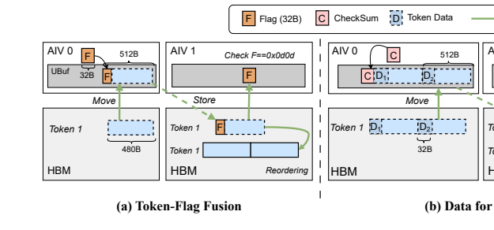

**Original caption:** Figure 6: Comparison of three Data-as-Flag–based

**中文图注:** Figure 6：三种基于数据即标志（Data-as-Flag）的同步机制对比

**Source:** p.8 S072

**Original:** Data-as-Flag relies on**Correctness and safety assumptions.**

**中文:** 数据即标志（Data-as-Flag）依赖于**正确性与安全性假设。**

**Source:** p.8 S073

**Original:** To eliminate SP’s theoretical deadlock when payload matches the sentinel, we reserve a sentinel encoding that cannot be produced by normal computation (e.g., an unused bit pattern in BF16/FP16) and verify at model initialization that the MoE weights and activations never emit it. With a 32B (256 bits) sentinel, the probability of 256 accidental collision under a uniform value distribution is 2 −; in practice the bound is far lower because valid activations occupy a narrow subset of the value space.

**中文:** 为消除 SP 在载荷恰好等于哨兵值时的理论死锁，我们预留了一种正常计算无法产生的哨兵编码（例如 BF16/FP16 中未使用的位模式），并在模型初始化时验证 MoE 权重与激活值绝不会产生该编码。对于 32B（256 位）的哨兵值，在均匀取值分布下发生意外碰撞的概率为 2^-256；实践中这一上界远低于此，因为有效激活值仅占据值空间的一个狭窄子集。

## 4 IMPLEMENTATION / 4 实现

**Source:** p.8 S075

**Original:** We implemented UBEP based on the CANN software stack [15], developing an optimized EPCL in approximately 10K lines of As-cend C. The implementation builds on UB primitives to leverage the available high-bandwidth, low-latency interconnect. We leverage the vector instruc-**SIMD Vectorized Operation.** tion set of Ascend NPU throughout UBEP’s communication ker-nels to avoid scalar per-token loops. For the hierarchical map-per, VectorCount performs parallel prefix-sum lookups in a single instruction (Algorithm 1). For the Token-Sending path, we use CompareScalar for masking and validation, and FindFirstValue to locate token indices. This structure lets the kernel handle small batches efficiently while keeping the control flow straightforward. To**Global Load/Store for Point-to-Point Synchronization.** support kernel decomposition, we replace BSP-based barriers with fine-grained point-to-point synchronization (§3.2). On conventional

**中文:** 我们基于 CANN 软件栈 [15] 实现了 UBEP，用约 1 万行 Ascend C 代码开发了一个经过优化的 EPCL。该实现构建于 UB 原语之上，以充分利用可用的高带宽、低时延互连。我们在 UBEP 的所有通信内核中利用 Ascend NPU 的向量指令集，以避免标量的逐 token 循环。**SIMD 向量化运算。**对于分层映射器，VectorCount 以单条指令完成并行前缀和查找（Algorithm 1）。对于 Token-Sending 路径，我们使用 CompareScalar 进行掩码与校验，并使用 FindFirstValue 定位 token 索引。这种结构使内核既能高效处理小批量，又保持控制流的简洁。**面向点到点同步的全局加载/存储。**为支持核分解，我们用细粒度的点到点同步（§3.2）取代基于 BSP 的屏障。在传统

**Source:** p.8 S076

**Original:** **synchronization mechanisms across NPUs.**

**中文:** **跨 NPU 的同步机制。**

**Source:** p.8 S077

**Original:** **and shared experts.**

**中文:** **与共享专家。**

## 5 EVALUATION / 5 评估

**Source:** p.8 S079

**Original:** In this section, we first examine UBEP’s operator-level performance gains by focusing on core communication improvements (§5.2). We then demonstrate AIV-level pipelining enabled by UBEP’s kernel decomposition (§5.3). Next, we analyze the hierarchical token-level scheduling and the synchronization mechanism (§5.4) through ab-lation studies. Finally, we demonstrate UBEP’s end-to-end perfor-mance improvements across different models and verify the gains under various MoE model configurations (§5.5).

**中文:** 在本节中，我们首先聚焦核心通信改进，考察 UBEP 的算子级性能收益（§5.2）。随后，我们展示 UBEP 的核分解所带来的 AIV 级流水线（§5.3）。接着，我们通过消融实验分析分层 token 级调度与同步机制（§5.4）。最后，我们展示 UBEP 在不同模型上的端到端性能提升，并在多种 MoE 模型配置下验证这些收益（§5.5）。

### 5.1 Setup / 5.1 实验设置

**Source:** p.8 S081

**Original:** **Testbed.**We evaluate UBEP on a production-scale Huawei CM384 superpod. Our deployment consists of 16 Ascend servers allocated from this superpod, interconnected via a high-bandwidth, low-latency unified fabric, totaling 256 NPU Dies. To demonstrate the versatility and robust-**Models and workload.** ness of UBEP across a wide spectrum of model architectures, we evaluate our system using a diverse suite of four state-of-the-art LLMs, ranging from 30B to 685B parameters. Detailed specifications for all evaluated models are summarized in Table 3. We deploy these models on the CM384 cluster, adjusting the parallelism strategies (TP, DP, EP) according to each model’s scale to ensure optimal hardware utilization. **Baseline.**We evaluate UBEP against the following baselines:

**中文:** **测试平台。**我们在生产规模的华为 CM384 超节点（superpod）上评估 UBEP。我们的部署由从该超节点中分配的 16 台 Ascend 服务器组成，通过高带宽、低时延的统一互连网络互连，共计 256 个 NPU Die。**模型与工作负载。**为展示 UBEP 在广泛模型架构上的通用性与鲁棒性，我们使用由四款最先进 LLM 组成的多样化套件评估系统，参数规模从 30B 到 685B。所有被评估模型的详细规格汇总于 Table 3。我们将这些模型部署在 CM384 集群上，并按各模型的规模调整并行策略（TP、DP、EP），以确保最优的硬件利用率。**基线。**我们将 UBEP 与以下基线进行对比评估：

### 表 3

**Placed near:** S081
**Source:** p.8 C009

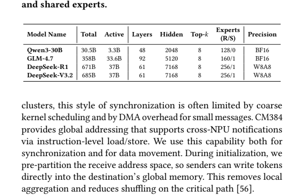

**Original caption:** Table 3: MoE Model configurations. R/S experts means routed

**中文图注:** Table 3：MoE 模型配置。R/S 专家分别指路由（routed）

**Source:** p.9 S082

**Original:** **as a protocol-capability reference on H800.**

**中文:** **作为 H800 上的协议能力参考。**

### 5.2 Performance Evaluation / 5.2 性能评估

**Source:** p.9 S084

**Original:** **EP Performance Comparison.**We first evaluate the commu-nication latency and effective bandwidth of UBEP in large-scale clusters. Table 4 details the results. UBEP improves performance by implementing kernel decomposition to increase parallelism, using Data-as-Flag mechanism to remove global synchronization barri-ers, and applying fine-grained AIV-level scheduling. Compared to CANN EP on identical hardware and topology, UBEP improves bandwidth by 35.3%–40.8%, isolating the algorithmic gains of our design. **Sensitivity to Workload Parameters.**To analyze the perfor-mance characteristics of UBEP in more detail, we evaluate it under different batch sizes, cluster scales, and expert counts. Unless oth-erwise stated, experiments use 128 ranks, a batch size of 64, and 1 expert per NPU. A more comprehensive analysis across differ-ent parameters is deferred to Appendix C.1 and C.2 due to space constraints. Figure 7(a) shows that UBEP demonstrates consistent improve-ments across BS ranging from 8 to 64. By replacing the base-line mechanism with fine-grained, token-level pipelining, UBEP achieves an average gain of approximately 46.4%. However, at $BS$ = 128, the gain decreases to 35.9%. This decline is primarily due to the increased communication volume associated with larger

**中文:** **EP 性能对比。**我们首先评估 UBEP 在大规模集群中的通信时延与有效带宽，Table 4 给出了详细结果。UBEP 通过实施核分解以提高并行度、利用数据即标志（Data-as-Flag）机制消除全局同步屏障，以及应用细粒度的 AIV 级调度来改进性能。在相同硬件与拓扑下，与 CANN EP 相比，UBEP 将带宽提升 35.3%–40.8%，分离出了我们设计中的算法性收益。**对工作负载参数的敏感性。**为更细致地分析 UBEP 的性能特性，我们在不同批量大小、集群规模与专家数量下对其进行评估。除非另有说明，实验使用 128 个 rank、批量大小 64、每 NPU 1 个专家。受篇幅所限，跨不同参数的更全面分析推迟至附录 C.1 与 C.2。Figure 7(a) 显示，UBEP 在 BS 从 8 到 64 的范围内表现出一致的改进。通过用细粒度的 token 级流水线取代基线机制，UBEP 获得了平均约 46.4% 的收益。然而，当 $BS$ = 128 时，收益降至 35.9%。这一下降主要源于更大批量

### 图 7

**Placed near:** S084
**Source:** p.10 C011

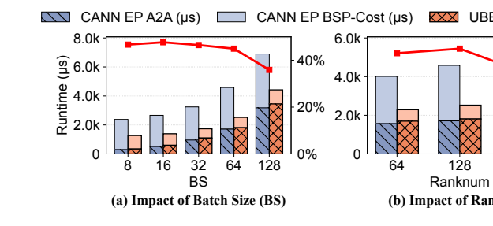

**Original caption:** Figure 7: Latency composition of the MoE dispatch operator

**中文图注:** Figure 7：MoE 分发（dispatch）算子的时延构成

### 表 4

**Placed near:** S084
**Source:** p.9 C010

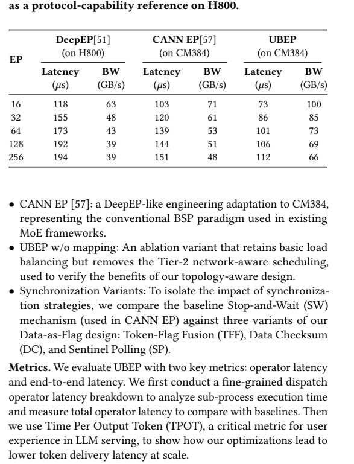

**Original caption:** Table 4: Performance of different EPCLs. DeepEP is included

**中文图注:** Table 4：不同 EPCL 的性能。其中包含 DeepEP

**Source:** p.9 S085

**Original:** batch sizes. Although we minimize the kernel resources for the

**中文:** 批量大小。尽管我们已尽量减少为此占用的内核资源，

### 5.3 Latency Breakdown / 5.3 时延分解

**Source:** p.9 S087

**Original:** To evaluate the effect of Kernel Decomposition, we conducted the tests with a fixed EP scale of 64 NPUs, using a configuration of one expert per NPU. Figure 8 illustrates the detailed latency breakdown of the dispatch operator for three specific batch sizes. In CANN EP, execution proceeds through five stages: Init, Token-Sending,, and. SendFlag & Verification CalCumSum Token-Reordering Global barriers need to be inserted between the two phases where data dependencies exist, causing stragglers to increase the latency of the entire operator. UBEP removes these global barriers by com-bining Kernel Decomposition with Data-as-Flag synchronization, reducing the idle tome of AIVs. Furthermore, fine-grained kernel decomposition enables parallel execution of Token-Sending and CalCumSum. Since the number of AIVs assigned to token transmis-sion scales in proportion to the sending volume, the AIVs available for decrease as the batch size increases. The experi- CalCumSum ment results indicate that UBEP overlap the processing latency of with the communication latency of CalCumSum Token-Sending across different batch sizes, resulting in a performance improve-ment from 34.7% to 52.4% over CANN EP. We also evaluated optimal decomposition strategies under different EP scales, and the detailed experimental results are provided in the Appendix C.3.

**中文:** 为评估核分解的效果，我们在固定 64 个 NPU 的 EP 规模下进行测试，采用每 NPU 一个专家的配置。Figure 8 展示了三种批量大小下分发（dispatch）算子的详细时延分解。在 CANN EP 中，执行过程经历五个阶段：Init、Token-Sending、SendFlag & Verification、CalCumSum、Token-Reordering。在存在数据依赖的两个阶段之间需要插入全局屏障，导致掉队者（straggler）增加整个算子的时延。UBEP 通过将核分解与数据即标志（Data-as-Flag）同步相结合来消除这些全局屏障，减少了 AIV 的空闲时间。此外，细粒度的核分解使 Token-Sending 与 CalCumSum 得以并行执行。由于分配给 token 传输的 AIV 数量随发送量成比例伸缩，可用于 CalCumSum 的 AIV 随批量大小增大而减少。实验结果表明，UBEP 在不同批量大小下均能将 CalCumSum 的处理时延与 Token-Sending 的通信时延相重叠，相比 CANN EP 带来 34.7% 到 52.4% 的性能提升。我们还评估了不同 EP 规模下的最优分解策略，详细实验结果见附录 C.3。

### 图 8

**Placed near:** S087
**Source:** p.10 C012

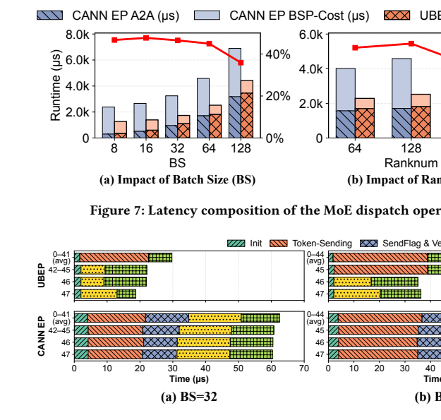

**Original caption:** Figure 8: Task-wise latency breakdown of the

**中文图注:** Figure 8：分发算子按任务的时延分解

### 5.4 Ablation Study / 5.4 消融实验

### 图 9

**Placed near:** S088
**Source:** p.10 C013

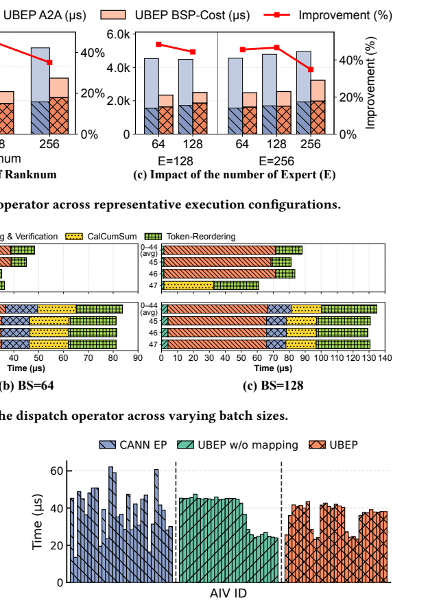

**Original caption:** Figure 9: AIV-Level token dispatch latency under different

**中文图注:** Figure 9：不同条件下 AIV 级 token 分发时延

### 图 10

**Placed near:** S088
**Source:** p.10 C014

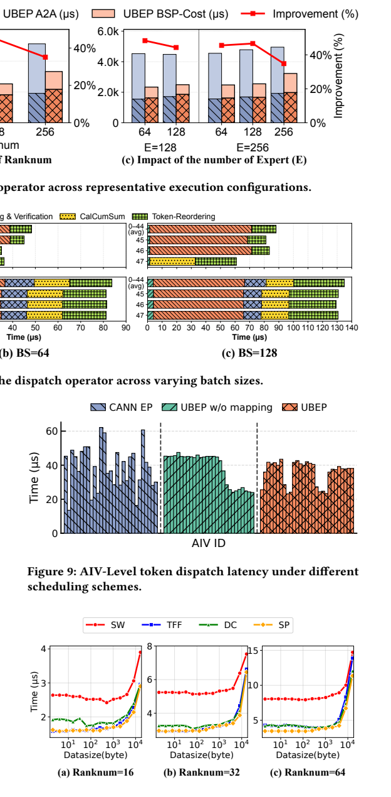

**Original caption:** Figure 10: Dispatch latency of Data-as-Flag variants versus

**中文图注:** Figure 10：数据即标志（Data-as-Flag）各变体相对

**Source:** p.10 S089

**Original:** EP with these variants. Across different granularities and rank num-bers, all Data-as-Flag methods reduce latency up to 31.0%–57.1% relative to CANN EP, mainly by removing the stop-and-wait execu-tion pattern and reducing cross-AIV synchronization overhead. On

**中文:** EP 与这些变体。在不同的同步粒度与 rank 数量下，所有数据即标志（Data-as-Flag）方法相对 CANN EP 均可将时延最多降低 31.0%–57.1%，主要归功于去除了停等式（stop-and-wait）执行模式并减少了跨 AIV 的同步开销。

**Source:** p.10 S090

**Original:** **the CANN EP across varying synchronization granularity** **and ranks.**

**中文:** **不同同步粒度** **与 rank 数量下的 CANN EP。**

**Source:** p.11 S091

**Original:** **UBEP** the other hand, The benefit decreases as synchronization granular-ity increases. At a typical dispatch granularity of around 10 KB, the gain stays at about 1 $μs$. This occurs because as the synchronization granularity increases, the communication time accounts for a larger proportion of the total time, which gradually reduces the relative gain obtained from optimizing synchronization. Furthermore, as the number of ranks increases, the synchronization overhead grows. Consequently, the absolute performance gain of TFF, DC, and SP reaches 3.7–4.6 $μs$ when the data volume is small. Among the three variants, DC shows higher latency under small granularity or fewer NPUs because it waits for token batches, which weakens token-level pipelining. SP better balances bandwidth utilization and pipelining, and delivers lower latency across most settings, although it may encounter a rare deadlock if the sentinel value matches actual data.

**中文:** **UBEP** 另一方面，收益随同步粒度的增大而下降。在约 10 KB 的典型分发粒度下，收益保持在约 1 µs。这是因为随同步粒度增大，通信时间占总时间的比例上升，从而逐渐削弱通过优化同步所获得的相对收益。此外，随 rank 数量增加，同步开销也随之增长。因此，当数据量较小时，TFF、DC 与 SP 的绝对性能收益可达 3.7–4.6 µs。在三个变体中，DC 在小粒度或 NPU 数量较少时表现出更高的时延，因为它需要等待 token 批次，削弱了 token 级流水线。SP 在带宽利用与流水线之间取得了更好的平衡，在大多数设置下时延更低，但当哨兵值与真实数据恰好相同时，可能遭遇罕见的死锁。

### 5.5 End-to-End Inference Performance / 5.5 端到端推理性能

**Source:** p.11 S093

**Original:** In this section, based on the vLLM-Ascend v0.14.0 [45] (a hardware plugin for vLLM [21] on Ascend NPU), we evaluate the end-to-end inference performance of UBEP on Mixture-of-Experts (MoE) large language models across varying scales, including Qwen3, GLM and DeepSeek. For Qwen3-30B model, we deploy it on 16 ranks. GLM-4.7 are deployed on 128 and 160 ranks respectively, adopting one-expert-per-rank mapping. DeepSeek-R1 and DeepSeek-V3.2 are evaluated on 128 ranks with a configuration of two experts per rank. Figure 11 reports the normalized end-to-end TPOT distribution across MoE models, with each per-token latency sample normal-ized to the corresponding CANN EP baseline. UBEP reduces P99 end-to-end latency by up to 11.1%, shifting the distribution down-ward, though the gain is smaller than the operator-level speedup because MoE All-to-All communication is only one component of the decoding step. Profiling further shows that MoE communication accounts for roughly 50% of per-token latency (consistent with prior work [49]) but only about 20% of actual hardware execution time, suggesting substantial dependency stalls and runtime overhead. The remaining time is spent on FFN computation, attention, frame-work scheduling, kernel launch, and memory movement. These findings motivate future work to extend the same fine-grained dependency-driven machinery to other collective communication operations and computation. Because model configurations lead to different operator-level characteristics, the normalized gains vary across models. Each box is collected from at least 100 decoding steps.

**中文:** 在本节中，我们基于 vLLM-Ascend v0.14.0 [45]（vLLM [21] 在 Ascend NPU 上的硬件插件），评估 UBEP 在不同规模的混合专家（MoE）大语言模型上的端到端推理性能，包括 Qwen3、GLM 与 DeepSeek。Qwen3-30B 模型部署在 16 个 rank 上；GLM-4.7 分别部署在 128 和 160 个 rank 上，采用每 rank 一个专家的映射；DeepSeek-R1 与 DeepSeek-V3.2 在 128 个 rank 上评估，配置为每 rank 两个专家。Figure 11 报告了各 MoE 模型归一化后的端到端 TPOT 分布，每个单 token 时延样本均以对应的 CANN EP 基线归一化。UBEP 将端到端 P99 时延最多降低 11.1%，使分布整体下移；不过该收益小于算子级加速，因为 MoE all-to-all 通信只是解码步骤的组成部分之一。性能剖析进一步显示，MoE 通信约占单 token 时延的 50%（与已有工作 [49] 一致），却仅占实际硬件执行时间的约 20%，这表明存在大量依赖停顿与运行时开销。其余时间花费在 FFN 计算、注意力、框架调度、内核启动与内存搬移上。这些发现提示：未来工作可将同样的细粒度依赖驱动机制扩展到其他集合通信操作与计算。由于模型配置不同会带来不同的算子级特性，归一化收益在不同模型之间存在差异。每个箱线图的数据至少采集自 100 个解码步骤。

### 图 11

**Placed near:** S093
**Source:** p.11 C015

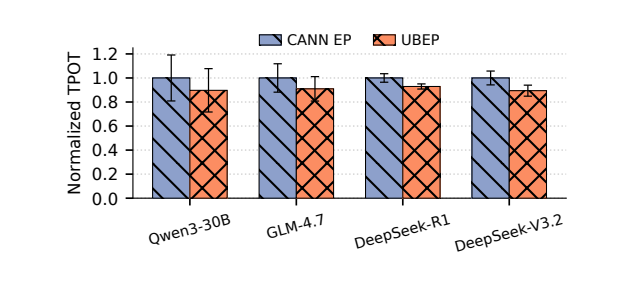

**Original caption:** Figure 11: Normalized TPOT performance of CANN EP and

**中文图注:** Figure 11：CANN EP 与 UBEP 的归一化 TPOT 性能

## 6 DISCUSSION / 6 讨论

**Source:** p.11 S095

**Original:** hop-distance mix. These ideas apply whenever the fabric provides a unified global address space with remote load/store and enough fine-grained concurrency units to exploit the exposed parallelism. Three assumptions are currently tuned to CM384, summarized in Table 5: (1) Data-as-Flag uses the 512B atomic write granu-larity provided by the UB fabric. On fabrics with smaller atomic units, UBEP can use smaller DataBlocks at lower payload efficiency; without atomic writes, it falls back to DC or explicit fences/acks; (2) UBEP uses AIV-level concurrency for fine-grained decompo-sition and overlap. On GPU-like architectures, this role maps to warp-or thread-block-level specialization, including NVIDIA-style persistent kernels. Unlike fused persistent kernels that often rely on rigid resource allocation and software-managed completion polling, UBEP uses receiver-driven data signals and instruction-level atomics to interleave communication and computation at sub-microsecond granularity; (3) the hierarchical scheduler assumes a multi-tier fabric with uniform bandwidth but hop-dependent la-tency. On flatter fabrics, it reduces to token-level load balancing with weaker straggler mitigation. **Attention-FFN Disaggregation (AFD).**To address the resource di-chotomy between memory-intensive Attention layers and compute-heavy FFN experts, recent architectures [42, 55] propose AFD to physically decouple these components onto specialized clusters. This paradigm fundamentally alters the communication topology from symmetric All-to-All to a bipartite Many-to-Many (M2N) pat-tern, where nodes assume distinct sender or receiver roles. Crucially, our design philosophy remains invariant under this shift. Within the superpod context, UBEP’s fine-grained, dependency-driven or-chestration is topology-agnostic; it effectively overlaps the latency of M2N data transfers by decoupling synchronization from payload movement, regardless of the underlying traffic asymmetry. **Next-Generation Fabric Semantics.**We demonstrated the effi-ciency of AIV-level parallelism in UBEP on the CM384 superpod. As inference kernels enter the microsecond regime, breaking the global synchronous barriers of BSP becomes critical. While UBEP leverages UGAS to optimize bandwidth and hierarchical access, software overheads like Data-as-Flag (§3.4) still limit fine-grained scaling. Offloading these control signals to dedicated hardware units represents a more promising mechanism—notable examples include the Scatter-Gather Engine within the SparseCore of TPUs (e.g., TPUv7 [10]) or the CC-Core in AWS Trainium [2]. Meanwhile, enforcing receiver-side ordering capabilities, like *Write-with-Notify * or semantics, can immediately trigger down- *Remote-Sync-Write * stream computation pipelines. Representing the key evolutionary direction for UB, these capabilities would reduce programming

**中文:** 跳数距离的混合。只要互连网络提供具备远端 load/store 的统一全局地址空间（UGAS），并提供足够多的细粒度并发单元来利用由此暴露的并行性，这些思路即可适用。目前有三项假设针对 CM384 进行了调优，汇总于 Table 5：(1) 数据即标志（Data-as-Flag）利用 UB 互连提供的 512B 原子写粒度。在原子单元更小的网络上，UBEP 可以使用更小的 DataBlock，但载荷效率更低；若不支持原子写，则回退到 DC 或显式的 fence/ack；(2) UBEP 使用 AIV 级并发来实现细粒度分解与重叠。在类 GPU 架构上，这一角色对应于 warp 级或线程块级的专门化，包括 NVIDIA 风格的常驻内核（persistent kernel）。与通常依赖僵化资源分配和软件管理的完成轮询的融合常驻内核不同，UBEP 使用接收方驱动的数据信号与指令级原子操作，以亚微秒粒度交错通信与计算；(3) 分层调度器假设网络为多层结构、带宽均匀但时延随跳数变化。在更扁平的网络上，它退化为 token 级负载均衡，对掉队者的缓解较弱。**注意力-FFN 解耦（AFD）。**为解决内存密集的注意力层与计算密集的 FFN 专家之间的资源二分问题，近期架构 [42, 55] 提出 AFD，将这两类组件物理解耦到专用集群上。这一范式将通信拓扑从对称的 all-to-all 根本性地转变为二部多对多（Many-to-Many，M2N）模式，其中节点承担明确的发送方或接收方角色。关键在于，我们的设计理念在这一转变下保持不变。在超节点语境下，UBEP 细粒度、依赖驱动的编排与拓扑无关；它通过将同步与载荷搬移解耦，能够有效重叠 M2N 数据传输的时延，而不管底层流量的不对称性如何。**下一代互连网络语义。**我们在 CM384 超节点上验证了 UBEP 中 AIV 级并行的高效性。随着推理内核进入微秒量级，打破 BSP 的全局同步屏障变得至关重要。虽然 UBEP 利用统一全局地址空间（UGAS）优化带宽与分层访问，但数据即标志（§3.4）之类的软件开销仍限制细粒度扩展。将这些控制信号卸载到专用硬件单元是更有前景的机制——典型例子包括 TPU SparseCore 中的 Scatter-Gather Engine（如 TPUv7 [10]）以及 AWS Trainium [2] 中的 CC-Core。同时，强化接收侧的排序能力，如 Write-with-Notify 或 Remote-Sync-Write 语义，可以立即触发下游计算流水线。作为 UB 的关键演进方向，这些能力将减少编程

### 表 5

**Placed near:** S095
**Source:** p.12 C016

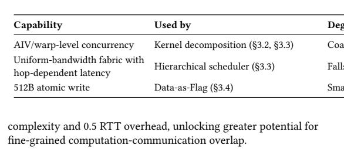

**Original caption:** Table 5: Portability checklist

**中文图注:** Table 5：可移植性核对清单

## 7 RELATED WORK / 7 相关工作

**Source:** p.12 S097

**Original:** Efficient All-to-All communica-**Communication Optimization.** tion is pivotal for MoE scalability [8, 20, 30, 37]. A large body of work has optimized this primitive through specialized EPCLs or general-purpose communication runtimes. EPCLs such as DeepEP [51] and UCCL-EP [28] target traditional IB/NVLink clusters with coarse-grained, BSP-style kernels. Hybrid-EP [32] adopts asynchronous parallelism for single-tier superpods but does not address hierar-chical topologies. FUSCO [56] reduces overhead by fusing layout handling, yet it does not target the superpod. More general run-times such as NVSHMEM [33] and MSCCL++ [16] support flexible data movement but rely on explicit ordering between data move-ment and notification (e.g., software fences, work-queue entries, or separate flag updates). These designs—whether MoE-specific or generic—target traditional scale-up/scale-out pipelines or flat single-tier superpods; they do not exploit the unified memory se-mantics and hierarchical topology of modern multi-tier superpods, where traffic patterns and latency non-uniformity render existing adaptation techniques ineffective [18, 41]. Hiding latency**Computation-Communication Overlapping.** via concurrency is a standard optimization in MoE systems [1, 12, 13, 17, 19, 23, 26, 29, 39, 40, 49, 52, 53]. One line of work schedules decomposed All-to-All operations alongside expert computation, as in FasterMoE [12], PipeMoE [39], and Comet [49]. Another line relies on persistent or fused kernels to blur the boundary between communication and computation. FlashDMoE [1] uses persistent kernels for device-initiated asynchronous communication and fine-grained pipelining, while UniEP [53] integrates dispatch, grouped GEMM, and combine within MoE megakernels. System-level frame-works such as Tutel [17], Lancet [19], and HierMoE [26] optimize scheduling and communication, but target conventional GPU clus-ters with NVLink+IB interconnects rather than unified-memory superpods. These overlap strategies, whether based on data slic-ing, persistent kernels, or megakernels, require resolving complex data dependencies and allocating runtime resources precisely. The resulting contention and synchronization overheads can negate the intended speedups [35, 36, 46]. Unlike prior work that overlaps EP communication with expert computation, UBEP hides latency within the EP communication primitive itself by decomposing it into data-dependency-aware sub-tasks, such as overlapping address calculation with token transmission. **Load Balance.**Prior works primarily address straggler effects at the *algorithm-level *[5, 6, 9, 11, 17, 22, 24, 27, 38, 47, 54]. Ap-proaches include dynamic routing optimization [5, 6, 27], expert

**中文:** **通信优化。**高效的 all-to-all 通信对 MoE 的可扩展性至关重要 [8, 20, 30, 37]。大量工作通过专用的 EPCL 或通用通信运行时优化了这一原语。DeepEP [51] 与 UCCL-EP [28] 等 EPCL 面向采用粗粒度、BSP 风格内核的传统 IB/NVLink 集群。Hybrid-EP [32] 为单层超节点采用异步并行，但未处理分层拓扑。FUSCO [56] 通过融合布局处理降低开销，但并未面向超节点。NVSHMEM [33] 与 MSCCL++ [16] 等更通用的运行时支持灵活的数据搬移，但依赖数据搬移与通知之间的显式排序（如软件 fence、工作队列条目或单独的标志更新）。这些设计——无论是 MoE 专用还是通用——面向的都是传统的 scale-up/scale-out 流水线或扁平的单层超节点；它们没有利用现代多层超节点的统一内存语义与分层拓扑，而在后者中，流量模式与时延非均匀性使现有适配技术失效 [18, 41]。**计算-通信重叠。**通过并发隐藏时延是 MoE 系统中的标准优化手段 [1, 12, 13, 17, 19, 23, 26, 29, 39, 40, 49, 52, 53]。一条技术路线将分解后的 all-to-all 操作与专家计算调度在一起，如 FasterMoE [12]、PipeMoE [39] 与 Comet [49]。另一条路线依赖常驻内核或融合内核来模糊通信与计算的边界。FlashDMoE [1] 使用常驻内核实现设备发起的异步通信与细粒度流水线，而 UniEP [53] 在 MoE 巨型内核（megakernel）中集成分发、分组 GEMM 与合并。Tutel [17]、Lancet [19] 与 HierMoE [26] 等系统级框架优化调度与通信，但面向的是采用 NVLink+IB 互连的传统 GPU 集群，而非统一内存超节点。这些重叠策略——无论基于数据切片、常驻内核还是巨型内核——都需要化解复杂的数据依赖并精确分配运行时资源，由此产生的争用与同步开销可能抵消预期的加速 [35, 36, 46]。与将 EP 通信与专家计算相重叠的已有工作不同，UBEP 在 EP 通信原语内部隐藏时延：将其分解为数据依赖感知的子任务，例如让地址计算与 token 传输相重叠。**负载均衡。**已有工作主要在算法层面应对掉队者效应 [5, 6, 9, 11, 17, 22, 24, 27, 38, 47, 54]，方法包括动态路由优化 [5, 6, 27]、专家

**Source:** p.12 S098

**Original:** **for UBEP components.**

**中文:** **面向 UBEP 各组件。**

**Source:** p.12 S099

**Original:** For instance, EPLB [6] and LPLB [5] mitigate skew by dynamically altering token assignments based on global statistics, effectively reshaping the traffic pattern at the application layer. In contrast, UBEP targets orchestration. We accept the irregular *system-level * traffic patterns generated by these upper-layer strategies and op-timize the underlying dataflow and synchronization mechanisms to maximize effective bandwidth utilization on high-performance superpods without altering model semantics.

**中文:** 例如，EPLB [6] 与 LPLB [5] 通过基于全局统计动态调整 token 分配来缓解偏斜，实际上是在应用层重塑流量模式。与之相对，UBEP 着眼于系统级编排。我们接受这些上层策略所产生的不规则系统级流量模式，转而优化底层数据流与同步机制，在不改变模型语义的前提下，最大化高性能超节点上的有效带宽利用率。

## 8 CONCLUSION / 8 结论

**Source:** p.12 S101

**Original:** In this paper, we presented UBEP, a production-ready communica-tion library re-architected for the era of superpods. UBEP disman-tles the rigid BSP execution model by decomposing the monolithic All-to-All primitive into dependency-driven tasks. To eliminate explicit software barriers, we propose the Data-as-Flag synchro-nization protocol that leverages hardware-native atomic semantics. Furthermore, our hierarchical token-level scheduling mechanism neutralizes the load imbalance among AIVs and the straggler ef-fects caused by hierarchical network latencies. Deployed on the Huawei’s CM384 superpod, UBEP demonstrates significant per-formance gains, reducing All-to-All latency by up to 52.4% and improving end-to-end MoE inference TPOT by up to 11.1%. These results validate that to fully unleash the potential of next-generation AI superpods, communication software should evolve from coarse-grained orchestration to fine-grained parallelism. **ACKNOWLEDGMENTS** We sincerely thank all the anonymous reviewers and our shepherd for their helpful comments on drafts of this paper. The work is partly supported by the Fundamental and Interdisciplinary Disci-plines Breakthrough Plan of the Ministry of Education of China (JYB2025XDXM901) and the NSF of China (62422207). **REFERENCES**

**中文:** 本文提出了 UBEP——一个为超节点时代重新架构、可直接用于生产环境的通信库。UBEP 通过将单体式的 all-to-all 原语分解为依赖驱动的任务，瓦解了僵化的 BSP 执行模型。为消除显式软件屏障，我们提出了利用硬件原生原子语义的数据即标志（Data-as-Flag）同步协议。此外，我们的分层 token 级调度机制中和了 AIV 之间的负载不均衡，以及由分层网络时延引起的掉队者效应。部署在华为 CM384 超节点上，UBEP 展现出显著的性能收益：将 all-to-all 时延最多降低 52.4%，将端到端 MoE 推理 TPOT 最多提升 11.1%。这些结果验证了：要充分释放下一代 AI 超节点的潜力，通信软件应当从粗粒度编排演进到细粒度并行。**致谢** 我们衷心感谢所有匿名审稿人与我们的 shepherd（责任审稿人）对本文草稿提出的有益意见。本工作部分受到中国教育部基础与交叉学科突破计划（JYB2025XDXM901）和中国国家自然科学基金（62422207）的资助。**参考文献**

**Source:** p.12 S102

**Original:** [1] OsayamenJonathanAimuyo,ByungsooOh,andRacheeSingh.2025. FlashDMoE: Fast Distributed MoE in a Single Kernel. (2025). arXiv:cs.DC/2506.04667 https: //arxiv.org/abs/2506.04667v2

**中文:** [1] OsayamenJonathanAimuyo,ByungsooOh,andRacheeSingh.2025. FlashDMoE: Fast Distributed MoE in a Single Kernel. (2025). arXiv:cs.DC/2506.04667 https: //arxiv.org/abs/2506.04667v2

**Source:** p.12 S103

**Original:** [2] Amazon Web Services. 2025. Trainium2 Architecture — AWS Neuron Docu-mentation. (2025). https://awsdocs-neuron.readthedocs-hosted.com/en/latest/ about-neuron/arch/neuron-hardware/trainium2.html Official AWS documenta-tion. Trainium2 includes 16 CC-Cores for collective communication. Accessed June 2026.

**中文:** [2] Amazon Web Services. 2025. Trainium2 Architecture — AWS Neuron Docu-mentation. (2025). https://awsdocs-neuron.readthedocs-hosted.com/en/latest/ about-neuron/arch/neuron-hardware/trainium2.html Official AWS documenta-tion. Trainium2 includes 16 CC-Cores for collective communication. Accessed June 2026.

**Source:** p.12 S104

**Original:** [3] AMD. 2021. Introducing AMD CDNA 2 Architecture. (2021). https: //www.amd.com/content/dam/amd/en/documents/instinct-business-docs/ white-papers/amd-cdna2-white-paper.pdf

**中文:** [3] AMD. 2021. Introducing AMD CDNA 2 Architecture. (2021). https: //www.amd.com/content/dam/amd/en/documents/instinct-business-docs/ white-papers/amd-cdna2-white-paper.pdf

**Source:** p.12 S105

**Original:** [4] Broadcom Inc. 2024. *Scale-Up Ethernet Framework (SUE) *. Technical Report. Broadcom Inc. https://docs.broadcom.com/doc/scale-up-ethernet-framework White Paper.

**中文:** [4] Broadcom Inc. 2024. *Scale-Up Ethernet Framework (SUE) *. Technical Report. Broadcom Inc. https://docs.broadcom.com/doc/scale-up-ethernet-framework White Paper.

**Source:** p.13 S106

**Original:** [5] DeepSeek-AI. 2025. An early research stage expert-parallel load balancer for MoEmodelsbasedonlinearprogramming. https://github.com/deepseek-ai/LPLB. (2025).

**中文:** [5] DeepSeek-AI. 2025. An early research stage expert-parallel load balancer for MoEmodelsbasedonlinearprogramming. https://github.com/deepseek-ai/LPLB. (2025).

**Source:** p.13 S107

**Original:** [6] DeepSeek-AI. 2025. Expert Parallelism Load Balancer. https://github.com/ deepseek-ai/eplb. (2025).

**中文:** [6] DeepSeek-AI. 2025. Expert Parallelism Load Balancer. https://github.com/ deepseek-ai/eplb. (2025).

**Source:** p.13 S108

**Original:** [7] DeepSeek-AI, Aixin Liu, Bei Feng, Bing Xue, Bingxuan Wang, Bochao Wu, Chengda Lu, Chenggang Zhao, Chengqi Deng, Chenyu Zhang, Chong Ruan, Damai Dai, Daya Guo, Dejian Yang, Deli Chen, Dongjie Ji, Erhang Li, Fangyun Lin, Fucong Dai, Fuli Luo, Guangbo Hao, Guanting Chen, Guowei Li, H. Zhang, Han Bao, Hanwei Xu, Haocheng Wang, Haowei Zhang, Honghui Ding, Huajian Xin, Huazuo Gao, Hui Li, Hui Qu, J. L. Cai, Jian Liang, Jianzhong Guo, Jiaqi Ni, Jiashi Li, Jiawei Wang, Jin Chen, Jingchang Chen, Jingyang Yuan, Junjie Qiu, Junlong Li, Junxiao Song, Kai Dong, Kai Hu, Kaige Gao, Kang Guan, Kexin Huang, Kuai Yu, Lean Wang, Lecong Zhang, Lei Xu, Leyi Xia, Liang Zhao, Litong Wang,LiyueZhang,MengLi,MiaojunWang,MingchuanZhang,MinghuaZhang, MinghuiTang,MingmingLi,NingTian,PanpanHuang,PeiyiWang,PengZhang, Qiancheng Wang, Qihao Zhu, Qinyu Chen, Qiushi Du, R. J. Chen, R. L. Jin, Ruiqi Ge, Ruisong Zhang, Ruizhe Pan, Runji Wang, Runxin Xu, Ruoyu Zhang, Ruyi Chen, S. S. Li, Shanghao Lu, Shangyan Zhou, Shanhuang Chen, Shaoqing Wu, Shengfeng Ye, Shengfeng Ye, Shirong Ma, Shiyu Wang, Shuang Zhou, Shuiping Yu, Shunfeng Zhou, Shuting Pan, T. Wang, Tao Yun, Tian Pei, Tianyu Sun, W. L. Xiao, Wangding Zeng, Wanjia Zhao, Wei An, Wen Liu, Wenfeng Liang, Wenjun Gao, Wenqin Yu, Wentao Zhang, X. Q. Li, Xiangyue Jin, Xianzu Wang, Xiao Bi, Xiaodong Liu, Xiaohan Wang, Xiaojin Shen, Xiaokang Chen, Xiaokang Zhang, Xiaosha Chen, Xiaotao Nie, Xiaowen Sun, Xiaoxiang Wang, Xin Cheng, Xin Liu, XinXie,XingchaoLiu,XingkaiYu,XinnanSong,XinxiaShan,XinyiZhou,Xinyu Yang, Xinyuan Li, Xuecheng Su, Xuheng Lin, Y. K. Li, Y. Q. Wang, Y. X. Wei, Y. X. Zhu, Yang Zhang, Yanhong Xu, Yanhong Xu, Yanping Huang, Yao Li, Yao Zhao, Yaofeng Sun, Yaohui Li, Yaohui Wang, Yi Yu, Yi Zheng, Yichao Zhang, Yifan Shi, Yiliang Xiong, Ying He, Ying Tang, Yishi Piao, Yisong Wang, Yixuan Tan, Yiyang Ma, Yiyuan Liu, Yongqiang Guo, Yu Wu, Yuan Ou, Yuchen Zhu, Yuduan Wang, Yue Gong, Yuheng Zou, Yujia He, Yukun Zha, Yunfan Xiong, Yunxian Ma, Yuting Yan, Yuxiang Luo, Yuxiang You, Yuxuan Liu, Yuyang Zhou, Z. F. Wu, Z. Z. Ren, Zehui Ren, Zhangli Sha, Zhe Fu, Zhean Xu, Zhen Huang, Zhen Zhang, Zhenda Xie, Zhengyan Zhang, Zhewen Hao, Zhibin Gou, Zhicheng Ma, Zhigang Yan, Zhihong Shao, Zhipeng Xu, Zhiyu Wu, Zhongyu Zhang, Zhuoshu Li, Zihui Gu, Zijia Zhu, Zijun Liu, Zilin Li, Ziwei Xie, Ziyang Song, Ziyi Gao, and Zizheng Pan. 2025. DeepSeek-V3 Technical Report. (2025). arXiv:cs.CL/2412.19437 https://arxiv.org/abs/2412.19437

**中文:** [7] DeepSeek-AI, Aixin Liu, Bei Feng, Bing Xue, Bingxuan Wang, Bochao Wu, Chengda Lu, Chenggang Zhao, Chengqi Deng, Chenyu Zhang, Chong Ruan, Damai Dai, Daya Guo, Dejian Yang, Deli Chen, Dongjie Ji, Erhang Li, Fangyun Lin, Fucong Dai, Fuli Luo, Guangbo Hao, Guanting Chen, Guowei Li, H. Zhang, Han Bao, Hanwei Xu, Haocheng Wang, Haowei Zhang, Honghui Ding, Huajian Xin, Huazuo Gao, Hui Li, Hui Qu, J. L. Cai, Jian Liang, Jianzhong Guo, Jiaqi Ni, Jiashi Li, Jiawei Wang, Jin Chen, Jingchang Chen, Jingyang Yuan, Junjie Qiu, Junlong Li, Junxiao Song, Kai Dong, Kai Hu, Kaige Gao, Kang Guan, Kexin Huang, Kuai Yu, Lean Wang, Lecong Zhang, Lei Xu, Leyi Xia, Liang Zhao, Litong Wang,LiyueZhang,MengLi,MiaojunWang,MingchuanZhang,MinghuaZhang, MinghuiTang,MingmingLi,NingTian,PanpanHuang,PeiyiWang,PengZhang, Qiancheng Wang, Qihao Zhu, Qinyu Chen, Qiushi Du, R. J. Chen, R. L. Jin, Ruiqi Ge, Ruisong Zhang, Ruizhe Pan, Runji Wang, Runxin Xu, Ruoyu Zhang, Ruyi Chen, S. S. Li, Shanghao Lu, Shangyan Zhou, Shanhuang Chen, Shaoqing Wu, Shengfeng Ye, Shengfeng Ye, Shirong Ma, Shiyu Wang, Shuang Zhou, Shuiping Yu, Shunfeng Zhou, Shuting Pan, T. Wang, Tao Yun, Tian Pei, Tianyu Sun, W. L. Xiao, Wangding Zeng, Wanjia Zhao, Wei An, Wen Liu, Wenfeng Liang, Wenjun Gao, Wenqin Yu, Wentao Zhang, X. Q. Li, Xiangyue Jin, Xianzu Wang, Xiao Bi, Xiaodong Liu, Xiaohan Wang, Xiaojin Shen, Xiaokang Chen, Xiaokang Zhang, Xiaosha Chen, Xiaotao Nie, Xiaowen Sun, Xiaoxiang Wang, Xin Cheng, Xin Liu, XinXie,XingchaoLiu,XingkaiYu,XinnanSong,XinxiaShan,XinyiZhou,Xinyu Yang, Xinyuan Li, Xuecheng Su, Xuheng Lin, Y. K. Li, Y. Q. Wang, Y. X. Wei, Y. X. Zhu, Yang Zhang, Yanhong Xu, Yanhong Xu, Yanping Huang, Yao Li, Yao Zhao, Yaofeng Sun, Yaohui Li, Yaohui Wang, Yi Yu, Yi Zheng, Yichao Zhang, Yifan Shi, Yiliang Xiong, Ying He, Ying Tang, Yishi Piao, Yisong Wang, Yixuan Tan, Yiyang Ma, Yiyuan Liu, Yongqiang Guo, Yu Wu, Yuan Ou, Yuchen Zhu, Yuduan Wang, Yue Gong, Yuheng Zou, Yujia He, Yukun Zha, Yunfan Xiong, Yunxian Ma, Yuting Yan, Yuxiang Luo, Yuxiang You, Yuxuan Liu, Yuyang Zhou, Z. F. Wu, Z. Z. Ren, Zehui Ren, Zhangli Sha, Zhe Fu, Zhean Xu, Zhen Huang, Zhen Zhang, Zhenda Xie, Zhengyan Zhang, Zhewen Hao, Zhibin Gou, Zhicheng Ma, Zhigang Yan, Zhihong Shao, Zhipeng Xu, Zhiyu Wu, Zhongyu Zhang, Zhuoshu Li, Zihui Gu, Zijia Zhu, Zijun Liu, Zilin Li, Ziwei Xie, Ziyang Song, Ziyi Gao, and Zizheng Pan. 2025. DeepSeek-V3 Technical Report. (2025). arXiv:cs.CL/2412.19437 https://arxiv.org/abs/2412.19437

**Source:** p.13 S109

**Original:** [8] Nan Du, Yanping Huang, Andrew M Dai, Simon Tong, Dmitry Lepikhin, Yuanzhong Xu, Maxim Krikun, Yanqi Zhou, Adams Wei Yu, Orhan Firat, Barret Zoph, Liam Fedus, Maarten P Bosma, Zongwei Zhou, Tao Wang, Emma Wang, Kellie Webster, Marie Pellat, Kevin Robinson, Kathleen Meier-Hellstern, Toju Duke, Lucas Dixon, Kun Zhang, Quoc Le, Yonghui Wu, Zhifeng Chen, and Claire Cui. 2022. GLaM: Efficient Scaling of Language Models with Mixture-of-Experts. In *Proceedings of the 39th International Conference on Machine Learning (Pro- * *ceedings of Machine Learning Research) *, Kamalika Chaudhuri, Stefanie Jegelka, Le Song, Csaba Szepesvari, Gang Niu, and Sivan Sabato (Eds.), Vol. 162. PMLR, 5547–5569. https://proceedings.mlr.press/v162/du22c.html

**中文:** [8] Nan Du, Yanping Huang, Andrew M Dai, Simon Tong, Dmitry Lepikhin, Yuanzhong Xu, Maxim Krikun, Yanqi Zhou, Adams Wei Yu, Orhan Firat, Barret Zoph, Liam Fedus, Maarten P Bosma, Zongwei Zhou, Tao Wang, Emma Wang, Kellie Webster, Marie Pellat, Kevin Robinson, Kathleen Meier-Hellstern, Toju Duke, Lucas Dixon, Kun Zhang, Quoc Le, Yonghui Wu, Zhifeng Chen, and Claire Cui. 2022. GLaM: Efficient Scaling of Language Models with Mixture-of-Experts. In *Proceedings of the 39th International Conference on Machine Learning (Pro- * *ceedings of Machine Learning Research) *, Kamalika Chaudhuri, Stefanie Jegelka, Le Song, Csaba Szepesvari, Gang Niu, and Sivan Sabato (Eds.), Vol. 162. PMLR, 5547–5569. https://proceedings.mlr.press/v162/du22c.html

**Source:** p.13 S110

**Original:** [9] William Fedus, Barret Zoph, and Noam Shazeer. 2022. Switch Transformers: Scaling to Trillion Parameter Models with Simple and Efficient Sparsity. *Journal * *of Machine Learning Research *23, 120 (2022), 1–39. http://jmlr.org/papers/v23/ 21-0998.html [10] Google Cloud. 2025. TPU7x (Ironwood). (2025). https://docs.cloud.google.com/ tpu/docs/tpu7x Google Cloud official documentation. Accessed June 2026. [11] Yu Han, Lehan Pan, Jie Peng, Ziyang Tao, Wuyang Zhang, and Yanyong Zhang. 2025. GRACE-MoE: Grouping and Replication with Locality-Aware Routing for Efficient Distributed MoE Inference. *arXiv preprint arXiv:2509.25041 *(2025). [12] Jiaao He, Jidong Zhai, Tiago Antunes, Haojie Wang, Fuwen Luo, Shangfeng Shi, and Qin Li. 2022. FasterMoE: modeling and optimizing training of large-scale dynamicpre-trainedmodels.In *Proceedingsofthe27thACMSIGPLANSymposium * *on Principles and Practice of Parallel Programming (PPoPP ’22) *. Association for Computing Machinery, New York, NY, USA, 120–134. https://doi.org/10.1145/ 3503221.3508418 [13] Yanping Huang, Youlong Cheng, Ankur Bapna, Orhan Firat, Dehao Chen, Mia Chen, HyoukJoong Lee, Jiquan Ngiam, Quoc V Le, Yonghui Wu, and zhifeng Chen. 2019. GPipe: Efficient Training of Giant Neural Networks using Pipeline Parallelism. In *Advances in Neural Information Processing Systems *, H. Wallach, H.Larochelle,A.Beygelzimer,F.d'Alché-Buc,E.Fox,andR.Garnett(Eds.),Vol.32. Curran Associates, Inc. https://proceedings.neurips.cc/paper_files/paper/2019/ file/093f65e080a295f8076b1c5722a46aa2-Paper.pdf [14] Huawei. 2025. unifiedbus 2.0 Specification. (2025). https://www.unifiedbus.com/ [15] Huawei Technologies Co., Ltd. 2025. CANN: Compute Architecture for Neural Networks. (2025). https://www.hiascend.com/en/software/cann [16] Changho Hwang, Peng Cheng, Roshan Dathathri, Abhinav Jangda, Saeed Maleki, Madan Musuvathi, Olli Saarikivi, Aashaka Shah, Ziyue Yang, Binyang Li, Caio Rocha, Qinghua Zhou, Mahdieh Ghazimirsaeed, Sreevatsa Anantharamu, and JithinJose.2026. MSCCL++:RethinkingGPUCommunicationAbstractionsforAI

**中文:** [9] William Fedus, Barret Zoph, and Noam Shazeer. 2022. Switch Transformers: Scaling to Trillion Parameter Models with Simple and Efficient Sparsity. *Journal * *of Machine Learning Research *23, 120 (2022), 1–39. http://jmlr.org/papers/v23/ 21-0998.html [10] Google Cloud. 2025. TPU7x (Ironwood). (2025). https://docs.cloud.google.com/ tpu/docs/tpu7x Google Cloud official documentation. Accessed June 2026. [11] Yu Han, Lehan Pan, Jie Peng, Ziyang Tao, Wuyang Zhang, and Yanyong Zhang. 2025. GRACE-MoE: Grouping and Replication with Locality-Aware Routing for Efficient Distributed MoE Inference. *arXiv preprint arXiv:2509.25041 *(2025). [12] Jiaao He, Jidong Zhai, Tiago Antunes, Haojie Wang, Fuwen Luo, Shangfeng Shi, and Qin Li. 2022. FasterMoE: modeling and optimizing training of large-scale dynamicpre-trainedmodels.In *Proceedingsofthe27thACMSIGPLANSymposium * *on Principles and Practice of Parallel Programming (PPoPP ’22) *. Association for Computing Machinery, New York, NY, USA, 120–134. https://doi.org/10.1145/ 3503221.3508418 [13] Yanping Huang, Youlong Cheng, Ankur Bapna, Orhan Firat, Dehao Chen, Mia Chen, HyoukJoong Lee, Jiquan Ngiam, Quoc V Le, Yonghui Wu, and zhifeng Chen. 2019. GPipe: Efficient Training of Giant Neural Networks using Pipeline Parallelism. In *Advances in Neural Information Processing Systems *, H. Wallach, H.Larochelle,A.Beygelzimer,F.d'Alché-Buc,E.Fox,andR.Garnett(Eds.),Vol.32. Curran Associates, Inc. https://proceedings.neurips.cc/paper_files/paper/2019/ file/093f65e080a295f8076b1c5722a46aa2-Paper.pdf [14] Huawei. 2025. unifiedbus 2.0 Specification. (2025). https://www.unifiedbus.com/ [15] Huawei Technologies Co., Ltd. 2025. CANN: Compute Architecture for Neural Networks. (2025). https://www.hiascend.com/en/software/cann [16] Changho Hwang, Peng Cheng, Roshan Dathathri, Abhinav Jangda, Saeed Maleki, Madan Musuvathi, Olli Saarikivi, Aashaka Shah, Ziyue Yang, Binyang Li, Caio Rocha, Qinghua Zhou, Mahdieh Ghazimirsaeed, Sreevatsa Anantharamu, and JithinJose.2026. MSCCL++:RethinkingGPUCommunicationAbstractionsforAI

**Source:** p.13 S111

**Original:** Inference.In *Proceedingsofthe31stACMInternationalConferenceonArchitectural * *Support for Programming Languages and Operating Systems, Volume 2 *. ACM, 1201–1215. https://doi.org/10.1145/3779212.3790188 [17] Changho Hwang, Wei Cui, Yifan Xiong, Ziyue Yang, Ze Liu, Han Hu, Zilong Wang, Rafael Salas, Jithin Jose, Prabhat Ram, HoYuen Chau, Peng Cheng, Fan Yang, Mao Yang, and Yongqiang Xiong. 2023. Tutel: Adaptive Mixture-of-Experts at Scale. In *Proceedings of Machine Learning and Systems *, D. Song, M. Carbin, and T. Chen (Eds.), Vol. 5. Curan, 269–287. https://proceedings.mlsys.org/paper_files/ paper/2023/file/5616d34cf8ff73942cfd5aa922842556-Paper-mlsys2023.pdf [18] Alexander Ishii and Ryan Wells. 2022. The NVLink-Network Switch: NVIDIA’s Switch Chip for High Communication-Bandwidth Superpods. In *2022 IEEE Hot *. https://doi.org/10.1109/HCS55958.2022.9895480 *Chips 34 Symposium (HCS) * [19] Chenyu Jiang, Ye Tian, Zhen Jia, Shuai Zheng, Chuan Wu, and Yida Wang. 2024. Lancet: Accelerating Mixture-of-Experts Training via Whole Graph Computation-Communication Overlapping. In *Proceedings of Ma- *, P. Gibbons, G. Pekhimenko, and C. De Sa *chine Learning and Systems * (Eds.), Vol. 6. 74–86. https://proceedings.mlsys.org/paper_files/paper/2024/file/ 339caf45a6fa281cae8adc6465343464-Paper-Conference.pdf [20] Chao Jin, Ziheng Jiang, Zhihao Bai, Zheng Zhong, Juncai Liu, Xiang Li, Ningxin Zheng, Xi Wang, Cong Xie, Qi Huang, Wen Heng, Yiyuan Ma, Wenlei Bao, Size Zheng, Yanghua Peng, Haibin Lin, Xuanzhe Liu, Xin Jin, and Xin Liu. 2025. MegaScale-MoE: Large-Scale Communication-Efficient Training of Mixture-of- Experts Models in Production. (2025). arXiv:cs.LG/2505.11432 https://arxiv.org/ abs/2505.11432 [21] Woosuk Kwon, Zhuohan Li, Siyuan Zhuang, Ying Sheng, Lianmin Zheng, Cody Hao Yu, Joseph Gonzalez, Hao Zhang, and Ion Stoica. 2023. Efficient memory management for large language model serving with pagedattention. In *Proceedings of the 29th symposium on operating systems principles *. 611–626. [22] Dmitry Lepikhin, HyoukJoong Lee, Yuanzhong Xu, Dehao Chen, Orhan Firat, Yanping Huang, Maxim Krikun, Noam Shazeer, and Zhifeng Chen. 2020. Gshard: Scalinggiantmodelswithconditionalcomputationandautomaticsharding. *arXiv * *preprint arXiv:2006.16668 *(2020). [23] Jiamin Li, Yimin Jiang, Yibo Zhu, Cong Wang, and Hong Xu. 2023. Accelerating Distributed MoE Training and Inference with Lina. In *2023 USENIX Annual *. USENIX Association, Boston, MA, 945– *Technical Conference (USENIX ATC 23) * 959. https://www.usenix.org/conference/atc23/presentation/li-jiamin [24] Yan Li, Pengfei Zheng, Shuang Chen, Zewei Xu, Yuanhao Lai, Yunfei Du, and Zhengang Wang. 2025. Speculative MoE: Communication Efficient Parallel MoE Inference with Speculative Token and Expert Pre-scheduling. (2025). arXiv:cs.LG/2503.04398 https://arxiv.org/abs/2503.04398 [25] Heng Liao, Bingyang Liu, Xianping Chen, Zhigang Guo, Chuanning Cheng, Jianbing Wang, Xiangyu Chen, Peng Dong, Rui Meng, Wenjie Liu, Zhe Zhou, Ziyang Zhang, Yuhang Gai, Cunle Qian, Yi Xiong, Zhongwu Cheng, Jing Xia, Yuli Ma, Xi Chen, Wenhua Du, Shizhong Xiao, Chungang Li, Yong Qin, Liudong Xiong, Zhou Yu, Lv Chen, Lei Chen, Buyun Wang, Pei Wu, Junen Gao, Xiaochu Li, Jian He, Shizhuan Yan, and Bill McColl. 2025. UB-Mesh: A Hierarchically Localized nD-FullMesh Data Center Network Architecture. *IEEE Micro *45, 5 (2025), 20–29. https://doi.org/10.1109/MM.2025.3592688 [26] Wenxiang Lin, Xinglin Pan, Lin Zhang, Shaohuai Shi, Xuan Wang, and Xi-aowen Chu. 2025. HierMoE: Accelerating MoE Training with Hierarchical Token Deduplication and Expert Swap. (2025). arXiv:cs.DC/2508.09591 https: //arxiv.org/abs/2508.09591 [27] Xinyi Liu, Yujie Wang, Fangcheng Fu, Xupeng Miao, Shenhan Zhu, Xiao-nan Nie, and Bin Cui. 2025. NetMoE: Accelerating MoE Training through Dynamic Sample Placement. In *The Thirteenth International Conference on * *Learning Representations *. https://proceedings.iclr.cc/paper_files/paper/2025/file/ e0c256700465c158de71081b4cf5e8c3-Paper-Conference.pdf [28] Ziming Mao, Yihan Zhang, Chihan Cui, Kaichao You, Zhongjie Chen, Zhiying Xu, Scott Shenker, Costin Raiciu, Yang Zhou, and Ion Stoica. 2025. UCCL-EP: Portable Expert-Parallel Communication. (2025). arXiv:cs.DC/2512.19849 https: //arxiv.org/abs/2512.19849 [29] Deepak Narayanan, Aaron Harlap, Amar Phanishayee, Vivek Seshadri, Nikhil R. Devanur, Gregory R. Ganger, Phillip B. Gibbons, and Matei Zaharia. 2019. PipeDream: generalized pipeline parallelism for DNN training. In *Proceedings of *. Association *the 27th ACM Symposium on Operating Systems Principles (SOSP ’19) * for Computing Machinery, New York, NY, USA, 1–15. https://doi.org/10.1145/ 3341301.3359646 [30] Xiaonan Nie, Qibin Liu, Fangcheng Fu, Shenhan Zhu, Xupeng Miao, Xiaoyang Li, Yang Zhang, Shouda Liu, and Bin Cui. 2024. LSH-MoE: Communication-efficient MoE Training via Locality-Sensitive Hashing. In *Advances in Neural Information * *Processing Systems *, A. Globerson, L. Mackey, D. Belgrave, A. Fan, U. Paquet, J. Tomczak, and C. Zhang (Eds.), Vol. 37. Curran Associates, Inc., 54161–54182. https://doi.org/10.52202/079017-1716 [31] NVIDIA. 2024. NVIDIA GB200 NVL72. (2024). https://www.nvidia.com/en-us/ data-center/gb200-nvl72/ [32] NVIDIA. 2025. Hybrid-EP. https://github.com/deepseek-ai/DeepEP/tree/ hybrid-ep. (2025).

**中文:** Inference.In *Proceedingsofthe31stACMInternationalConferenceonArchitectural * *Support for Programming Languages and Operating Systems, Volume 2 *. ACM, 1201–1215. https://doi.org/10.1145/3779212.3790188 [17] Changho Hwang, Wei Cui, Yifan Xiong, Ziyue Yang, Ze Liu, Han Hu, Zilong Wang, Rafael Salas, Jithin Jose, Prabhat Ram, HoYuen Chau, Peng Cheng, Fan Yang, Mao Yang, and Yongqiang Xiong. 2023. Tutel: Adaptive Mixture-of-Experts at Scale. In *Proceedings of Machine Learning and Systems *, D. Song, M. Carbin, and T. Chen (Eds.), Vol. 5. Curan, 269–287. https://proceedings.mlsys.org/paper_files/ paper/2023/file/5616d34cf8ff73942cfd5aa922842556-Paper-mlsys2023.pdf [18] Alexander Ishii and Ryan Wells. 2022. The NVLink-Network Switch: NVIDIA’s Switch Chip for High Communication-Bandwidth Superpods. In *2022 IEEE Hot *. https://doi.org/10.1109/HCS55958.2022.9895480 *Chips 34 Symposium (HCS) * [19] Chenyu Jiang, Ye Tian, Zhen Jia, Shuai Zheng, Chuan Wu, and Yida Wang. 2024. Lancet: Accelerating Mixture-of-Experts Training via Whole Graph Computation-Communication Overlapping. In *Proceedings of Ma- *, P. Gibbons, G. Pekhimenko, and C. De Sa *chine Learning and Systems * (Eds.), Vol. 6. 74–86. https://proceedings.mlsys.org/paper_files/paper/2024/file/ 339caf45a6fa281cae8adc6465343464-Paper-Conference.pdf [20] Chao Jin, Ziheng Jiang, Zhihao Bai, Zheng Zhong, Juncai Liu, Xiang Li, Ningxin Zheng, Xi Wang, Cong Xie, Qi Huang, Wen Heng, Yiyuan Ma, Wenlei Bao, Size Zheng, Yanghua Peng, Haibin Lin, Xuanzhe Liu, Xin Jin, and Xin Liu. 2025. MegaScale-MoE: Large-Scale Communication-Efficient Training of Mixture-of- Experts Models in Production. (2025). arXiv:cs.LG/2505.11432 https://arxiv.org/ abs/2505.11432 [21] Woosuk Kwon, Zhuohan Li, Siyuan Zhuang, Ying Sheng, Lianmin Zheng, Cody Hao Yu, Joseph Gonzalez, Hao Zhang, and Ion Stoica. 2023. Efficient memory management for large language model serving with pagedattention. In *Proceedings of the 29th symposium on operating systems principles *. 611–626. [22] Dmitry Lepikhin, HyoukJoong Lee, Yuanzhong Xu, Dehao Chen, Orhan Firat, Yanping Huang, Maxim Krikun, Noam Shazeer, and Zhifeng Chen. 2020. Gshard: Scalinggiantmodelswithconditionalcomputationandautomaticsharding. *arXiv * *preprint arXiv:2006.16668 *(2020). [23] Jiamin Li, Yimin Jiang, Yibo Zhu, Cong Wang, and Hong Xu. 2023. Accelerating Distributed MoE Training and Inference with Lina. In *2023 USENIX Annual *. USENIX Association, Boston, MA, 945– *Technical Conference (USENIX ATC 23) * 959. https://www.usenix.org/conference/atc23/presentation/li-jiamin [24] Yan Li, Pengfei Zheng, Shuang Chen, Zewei Xu, Yuanhao Lai, Yunfei Du, and Zhengang Wang. 2025. Speculative MoE: Communication Efficient Parallel MoE Inference with Speculative Token and Expert Pre-scheduling. (2025). arXiv:cs.LG/2503.04398 https://arxiv.org/abs/2503.04398 [25] Heng Liao, Bingyang Liu, Xianping Chen, Zhigang Guo, Chuanning Cheng, Jianbing Wang, Xiangyu Chen, Peng Dong, Rui Meng, Wenjie Liu, Zhe Zhou, Ziyang Zhang, Yuhang Gai, Cunle Qian, Yi Xiong, Zhongwu Cheng, Jing Xia, Yuli Ma, Xi Chen, Wenhua Du, Shizhong Xiao, Chungang Li, Yong Qin, Liudong Xiong, Zhou Yu, Lv Chen, Lei Chen, Buyun Wang, Pei Wu, Junen Gao, Xiaochu Li, Jian He, Shizhuan Yan, and Bill McColl. 2025. UB-Mesh: A Hierarchically Localized nD-FullMesh Data Center Network Architecture. *IEEE Micro *45, 5 (2025), 20–29. https://doi.org/10.1109/MM.2025.3592688 [26] Wenxiang Lin, Xinglin Pan, Lin Zhang, Shaohuai Shi, Xuan Wang, and Xi-aowen Chu. 2025. HierMoE: Accelerating MoE Training with Hierarchical Token Deduplication and Expert Swap. (2025). arXiv:cs.DC/2508.09591 https: //arxiv.org/abs/2508.09591 [27] Xinyi Liu, Yujie Wang, Fangcheng Fu, Xupeng Miao, Shenhan Zhu, Xiao-nan Nie, and Bin Cui. 2025. NetMoE: Accelerating MoE Training through Dynamic Sample Placement. In *The Thirteenth International Conference on * *Learning Representations *. https://proceedings.iclr.cc/paper_files/paper/2025/file/ e0c256700465c158de71081b4cf5e8c3-Paper-Conference.pdf [28] Ziming Mao, Yihan Zhang, Chihan Cui, Kaichao You, Zhongjie Chen, Zhiying Xu, Scott Shenker, Costin Raiciu, Yang Zhou, and Ion Stoica. 2025. UCCL-EP: Portable Expert-Parallel Communication. (2025). arXiv:cs.DC/2512.19849 https: //arxiv.org/abs/2512.19849 [29] Deepak Narayanan, Aaron Harlap, Amar Phanishayee, Vivek Seshadri, Nikhil R. Devanur, Gregory R. Ganger, Phillip B. Gibbons, and Matei Zaharia. 2019. PipeDream: generalized pipeline parallelism for DNN training. In *Proceedings of *. Association *the 27th ACM Symposium on Operating Systems Principles (SOSP ’19) * for Computing Machinery, New York, NY, USA, 1–15. https://doi.org/10.1145/ 3341301.3359646 [30] Xiaonan Nie, Qibin Liu, Fangcheng Fu, Shenhan Zhu, Xupeng Miao, Xiaoyang Li, Yang Zhang, Shouda Liu, and Bin Cui. 2024. LSH-MoE: Communication-efficient MoE Training via Locality-Sensitive Hashing. In *Advances in Neural Information * *Processing Systems *, A. Globerson, L. Mackey, D. Belgrave, A. Fan, U. Paquet, J. Tomczak, and C. Zhang (Eds.), Vol. 37. Curran Associates, Inc., 54161–54182. https://doi.org/10.52202/079017-1716 [31] NVIDIA. 2024. NVIDIA GB200 NVL72. (2024). https://www.nvidia.com/en-us/ data-center/gb200-nvl72/ [32] NVIDIA. 2025. Hybrid-EP. https://github.com/deepseek-ai/DeepEP/tree/ hybrid-ep. (2025).

**Source:** p.14 S112

**Original:** [33] NVIDIA. 2026. NVSHMEM Memory Ordering. https://docs.nvidia.com/ nvshmem/api/gen/api/ordering.html. (2026). [34] NVIDIA Corporation. 2024. NVIDIA NVLink. (2024). https://www.nvidia.com/ en-us/products/workstations/nvlink-bridges/ [35] Yanghua Peng, Yibo Zhu, Yangrui Chen, Yixin Bao, Bairen Yi, Chang Lan, Chuan Wu, and Chuanxiong Guo. 2019. A generic communication scheduler for dis-tributedDNNtrainingacceleration.In *Proceedingsofthe27thACMSymposiumon * *Operating Systems Principles (SOSP ’19) *. Association for Computing Machinery, New York, NY, USA, 16–29. https://doi.org/10.1145/3341301.3359642 [36] Kishore Punniyamurthy, Khaled Hamidouche, and Bradford M. Beckmann. 2024. Optimizing Distributed ML Communication with Fused Computation-Collective Operations. In *SC24: International Conference for High Performance Computing, * *Networking, Storage and Analysis *. 1–17. https://doi.org/10.1109/SC41406.2024. 00094 [37] Samyam Rajbhandari, Conglong Li, Zhewei Yao, Minjia Zhang, {Reza Yazdani} Aminabadi,{AmmarAhmad}Awan,JeffRasley,andYuxiongHe.2022. DeepSpeed- MoE: Advancing Mixture-of-Experts Inference and Training to Power Next- Generation AI Scale. 162 (2022), 18332– *Proceedings of Machine Learning Research * 18346. PublisherCopyright:Copyright©2022bytheauthor(s);39thInternational Conference on Machine Learning, ICML 2022; Conference date: 17-07-2022 Through 23-07-2022. [38] Noam Shazeer, Azalia Mirhoseini, Krzysztof Maziarz, Andy Davis, Quoc Le, Geoffrey Hinton, and Jeff Dean. 2017. Outrageously Large Neural Networks: The Sparsely-GatedMixture-of-ExpertsLayer.In *InternationalConferenceonLearning * *Representations *. https://arxiv.org/abs/1701.06538 [39] Shaohuai Shi, Xinglin Pan, Xiaowen Chu, and Bo Li. 2023. PipeMoE: Acceler-ating Mixture-of-Experts through Adaptive Pipelining. In *IEEE INFOCOM 2023 * *- IEEE Conference on Computer Communications *. 1–10. https://doi.org/10.1109/ INFOCOM53939.2023.10228874 [40] Shaohuai Shi, Xinglin Pan, Qiang Wang, Chengjian Liu, Xiaozhe Ren, Zhongzhe Hu, Yu Yang, Bo Li, and Xiaowen Chu. 2024. ScheMoE: An Extensible Mixture-of- Experts Distributed Training System with Tasks Scheduling. In *Proceedings of the *. Association *Nineteenth European Conference on Computer Systems (EuroSys ’24) * for Computing Machinery, New York, NY, USA, 236–249. https://doi.org/10.1145/ 3627703.3650083 [41] Xiaoyong Song, Danyuan Zhou, Kai Li, Jiayuan Chen, Hao Zhang, Xiaoguang Zhang, and Xuxia Zhong. 2025. Survey of Intra-Node GPU Interconnection in Scale-Up Network: Challenges, Status, Insights, and Future Directions. *Future * *Internet *17, 12 (2025). https://doi.org/10.3390/fi17120537 [42] StepFun, Bin Wang, Bojun Wang, Changyi Wan, Guanzhe Huang, Hanpeng Hu, Haonan Jia, Hao Nie, Mingliang Li, Nuo Chen, Siyu Chen, Song Yuan, Wuxun Xie, Xiaoniu Song, Xing Chen, Xingping Yang, Xuelin Zhang, Yanbo Yu, Yaoyu Wang, Yibo Zhu, Yimin Jiang, Yu Zhou, Yuanwei Lu, Houyi Li, Jingcheng Hu, Ka Man Lo, Ailin Huang, Binxing Jiao, Bo Li, Boyu Chen, Changxin Miao, Chang Lou, Chen Hu, Chen Xu, Chenfeng Yu, Chengyuan Yao, Daokuan Lv, Dapeng Shi, Deshan Sun, Ding Huang, Dingyuan Hu, Dongqing Pang, Enle Liu, Fajie Zhang, Fanqi Wan, Gulin Yan, Han Zhang, Han Zhou, Hanghao Wu, Hangyu Guo, Hanqi Chen, Hanshan Zhang, Hao Wu, Haocheng Zhang, Haolong Yan, Haoran Lv, Haoran Wei, Hebin Zhou, Heng Wang, Heng Wang, Hongxin Li, Hongyu Zhou, Hongyuan Wang, Huiyong Guo, Jia Wang, Jiahao Gong, Jialing Xie, Jian Zhou, Jianjian Sun, Jiaoren Wu, Jiaran Zhang, Jiayu Liu, Jie Cheng, Jie Luo, Jie Yan, Jie Yang, Jieyi Hou, Jinguang Zhang, Jinlan Cao, Jisheng Yin, Junfeng Liu, Junhao Huang,JunzheLin,KaijunTan,KaixiangLi,KangAn,KanghengLin,KenkunLiu, Lei Yang, Liang Zhao, Liangyu Chen, Lieyu Shi, Liguo Tan, Lin Lin, Lin Zhang, Lina Chen, Liwen Huang, Liying Shi, Longlong Gu, Mei Chen, Mengqiang Ren, Ming Li, Mingzhe Chen, Na Wang, Nan Wu, Qi Han, Qian Zhao, Qiang Zhang, Qianni Liu, Qiaohui Chen, Qiling Wu, Qinglin He, Qinyuan Tan, Qiufeng Wang, Qiuping Wu, Qiuyan Liang, Quan Sun, Rui Li, Ruihang Miao, Ruosi Wan, Ruyan Guo, Shangwu Zhong, Shaoliang Pang, Shengjie Fan, Shijie Shang, Shilei Jiang, Shiliang Yang, Shiming Hao, Shuli Gao, Siming Huang, Siqi Liu, Tiancheng Cao, Tianhao Cheng, Tianhao Peng, Wang You, Wei Ji, Wen Sun, Wenjin Deng, Wenqing He, Wenzhen Zheng, Xi Chen, Xiangwen Kong, Xianzhen Luo, Xiaobo Yang, Xiaojia Liu, Xiaoxiao Ren, Xin Han, Xin Li, Xin Wu, Xu Zhao, Yanan Wei, Yang Li, Yangguang Li, Yangshijie Xu, Yanming Xu, Yaqiang Shi, Yeqing Shen, Yi Yang,YifeiYang,YifengGong,YihanChen,YijingYang,YinminZhang,Yizhuang Zhou, Yuanhao Ding, Yuantao Fan, Yuanzhen Yang, Yuchu Luo, Yue Peng, Yufan Lu, Yuhang Deng, Yuhe Yin, Yujie Liu, Yukun Chen, Yuling Zhao, Yun Mou, Yunlong Li, Yunzhou Ju, Yusheng Li, Yuxiang Yang, Yuxiang Zhang, Yuyang Chen, Zejia Weng, Zhe Xie, Zheng Ge, Zheng Gong, Zhenyi Lu, Zhewei Huang, ZhichaoChang,ZhiguoHuang,ZhiruiWang,ZidongYang,ZiliWang,ZiqiWang, Zixin Zhang, Binxing Jiao, Daxin Jiang, Heung-Yeung Shum, and Xiangyu Zhang. 2025. Step-3 is Large yet Affordable: Model-system Co-design for Cost-effective Decoding. (2025). arXiv:cs.LG/2507.19427 https://arxiv.org/abs/2507.19427 [43] GLM Team, Aohan Zeng, Xin Lv, Qinkai Zheng, Zhenyu Hou, Bin Chen, Chengx-ing Xie, Cunxiang Wang, Da Yin, Hao Zeng, Jiajie Zhang, Kedong Wang, Lucen Zhong, Mingdao Liu, Rui Lu, Shulin Cao, Xiaohan Zhang, Xuancheng Huang, Yao Wei, Yean Cheng, Yifan An, Yilin Niu, Yuanhao Wen, Yushi Bai, Zhengxiao Du, Zihan Wang, Zilin Zhu, Bohan Zhang, Bosi Wen, Bowen Wu, Bowen Xu, Can

**中文:** [33] NVIDIA. 2026. NVSHMEM Memory Ordering. https://docs.nvidia.com/ nvshmem/api/gen/api/ordering.html. (2026). [34] NVIDIA Corporation. 2024. NVIDIA NVLink. (2024). https://www.nvidia.com/ en-us/products/workstations/nvlink-bridges/ [35] Yanghua Peng, Yibo Zhu, Yangrui Chen, Yixin Bao, Bairen Yi, Chang Lan, Chuan Wu, and Chuanxiong Guo. 2019. A generic communication scheduler for dis-tributedDNNtrainingacceleration.In *Proceedingsofthe27thACMSymposiumon * *Operating Systems Principles (SOSP ’19) *. Association for Computing Machinery, New York, NY, USA, 16–29. https://doi.org/10.1145/3341301.3359642 [36] Kishore Punniyamurthy, Khaled Hamidouche, and Bradford M. Beckmann. 2024. Optimizing Distributed ML Communication with Fused Computation-Collective Operations. In *SC24: International Conference for High Performance Computing, * *Networking, Storage and Analysis *. 1–17. https://doi.org/10.1109/SC41406.2024. 00094 [37] Samyam Rajbhandari, Conglong Li, Zhewei Yao, Minjia Zhang, {Reza Yazdani} Aminabadi,{AmmarAhmad}Awan,JeffRasley,andYuxiongHe.2022. DeepSpeed- MoE: Advancing Mixture-of-Experts Inference and Training to Power Next- Generation AI Scale. 162 (2022), 18332– *Proceedings of Machine Learning Research * 18346. PublisherCopyright:Copyright©2022bytheauthor(s);39thInternational Conference on Machine Learning, ICML 2022; Conference date: 17-07-2022 Through 23-07-2022. [38] Noam Shazeer, Azalia Mirhoseini, Krzysztof Maziarz, Andy Davis, Quoc Le, Geoffrey Hinton, and Jeff Dean. 2017. Outrageously Large Neural Networks: The Sparsely-GatedMixture-of-ExpertsLayer.In *InternationalConferenceonLearning * *Representations *. https://arxiv.org/abs/1701.06538 [39] Shaohuai Shi, Xinglin Pan, Xiaowen Chu, and Bo Li. 2023. PipeMoE: Acceler-ating Mixture-of-Experts through Adaptive Pipelining. In *IEEE INFOCOM 2023 * *- IEEE Conference on Computer Communications *. 1–10. https://doi.org/10.1109/ INFOCOM53939.2023.10228874 [40] Shaohuai Shi, Xinglin Pan, Qiang Wang, Chengjian Liu, Xiaozhe Ren, Zhongzhe Hu, Yu Yang, Bo Li, and Xiaowen Chu. 2024. ScheMoE: An Extensible Mixture-of- Experts Distributed Training System with Tasks Scheduling. In *Proceedings of the *. Association *Nineteenth European Conference on Computer Systems (EuroSys ’24) * for Computing Machinery, New York, NY, USA, 236–249. https://doi.org/10.1145/ 3627703.3650083 [41] Xiaoyong Song, Danyuan Zhou, Kai Li, Jiayuan Chen, Hao Zhang, Xiaoguang Zhang, and Xuxia Zhong. 2025. Survey of Intra-Node GPU Interconnection in Scale-Up Network: Challenges, Status, Insights, and Future Directions. *Future * *Internet *17, 12 (2025). https://doi.org/10.3390/fi17120537 [42] StepFun, Bin Wang, Bojun Wang, Changyi Wan, Guanzhe Huang, Hanpeng Hu, Haonan Jia, Hao Nie, Mingliang Li, Nuo Chen, Siyu Chen, Song Yuan, Wuxun Xie, Xiaoniu Song, Xing Chen, Xingping Yang, Xuelin Zhang, Yanbo Yu, Yaoyu Wang, Yibo Zhu, Yimin Jiang, Yu Zhou, Yuanwei Lu, Houyi Li, Jingcheng Hu, Ka Man Lo, Ailin Huang, Binxing Jiao, Bo Li, Boyu Chen, Changxin Miao, Chang Lou, Chen Hu, Chen Xu, Chenfeng Yu, Chengyuan Yao, Daokuan Lv, Dapeng Shi, Deshan Sun, Ding Huang, Dingyuan Hu, Dongqing Pang, Enle Liu, Fajie Zhang, Fanqi Wan, Gulin Yan, Han Zhang, Han Zhou, Hanghao Wu, Hangyu Guo, Hanqi Chen, Hanshan Zhang, Hao Wu, Haocheng Zhang, Haolong Yan, Haoran Lv, Haoran Wei, Hebin Zhou, Heng Wang, Heng Wang, Hongxin Li, Hongyu Zhou, Hongyuan Wang, Huiyong Guo, Jia Wang, Jiahao Gong, Jialing Xie, Jian Zhou, Jianjian Sun, Jiaoren Wu, Jiaran Zhang, Jiayu Liu, Jie Cheng, Jie Luo, Jie Yan, Jie Yang, Jieyi Hou, Jinguang Zhang, Jinlan Cao, Jisheng Yin, Junfeng Liu, Junhao Huang,JunzheLin,KaijunTan,KaixiangLi,KangAn,KanghengLin,KenkunLiu, Lei Yang, Liang Zhao, Liangyu Chen, Lieyu Shi, Liguo Tan, Lin Lin, Lin Zhang, Lina Chen, Liwen Huang, Liying Shi, Longlong Gu, Mei Chen, Mengqiang Ren, Ming Li, Mingzhe Chen, Na Wang, Nan Wu, Qi Han, Qian Zhao, Qiang Zhang, Qianni Liu, Qiaohui Chen, Qiling Wu, Qinglin He, Qinyuan Tan, Qiufeng Wang, Qiuping Wu, Qiuyan Liang, Quan Sun, Rui Li, Ruihang Miao, Ruosi Wan, Ruyan Guo, Shangwu Zhong, Shaoliang Pang, Shengjie Fan, Shijie Shang, Shilei Jiang, Shiliang Yang, Shiming Hao, Shuli Gao, Siming Huang, Siqi Liu, Tiancheng Cao, Tianhao Cheng, Tianhao Peng, Wang You, Wei Ji, Wen Sun, Wenjin Deng, Wenqing He, Wenzhen Zheng, Xi Chen, Xiangwen Kong, Xianzhen Luo, Xiaobo Yang, Xiaojia Liu, Xiaoxiao Ren, Xin Han, Xin Li, Xin Wu, Xu Zhao, Yanan Wei, Yang Li, Yangguang Li, Yangshijie Xu, Yanming Xu, Yaqiang Shi, Yeqing Shen, Yi Yang,YifeiYang,YifengGong,YihanChen,YijingYang,YinminZhang,Yizhuang Zhou, Yuanhao Ding, Yuantao Fan, Yuanzhen Yang, Yuchu Luo, Yue Peng, Yufan Lu, Yuhang Deng, Yuhe Yin, Yujie Liu, Yukun Chen, Yuling Zhao, Yun Mou, Yunlong Li, Yunzhou Ju, Yusheng Li, Yuxiang Yang, Yuxiang Zhang, Yuyang Chen, Zejia Weng, Zhe Xie, Zheng Ge, Zheng Gong, Zhenyi Lu, Zhewei Huang, ZhichaoChang,ZhiguoHuang,ZhiruiWang,ZidongYang,ZiliWang,ZiqiWang, Zixin Zhang, Binxing Jiao, Daxin Jiang, Heung-Yeung Shum, and Xiangyu Zhang. 2025. Step-3 is Large yet Affordable: Model-system Co-design for Cost-effective Decoding. (2025). arXiv:cs.LG/2507.19427 https://arxiv.org/abs/2507.19427 [43] GLM Team, Aohan Zeng, Xin Lv, Qinkai Zheng, Zhenyu Hou, Bin Chen, Chengx-ing Xie, Cunxiang Wang, Da Yin, Hao Zeng, Jiajie Zhang, Kedong Wang, Lucen Zhong, Mingdao Liu, Rui Lu, Shulin Cao, Xiaohan Zhang, Xuancheng Huang, Yao Wei, Yean Cheng, Yifan An, Yilin Niu, Yuanhao Wen, Yushi Bai, Zhengxiao Du, Zihan Wang, Zilin Zhu, Bohan Zhang, Bosi Wen, Bowen Wu, Bowen Xu, Can

**Source:** p.14 S113

**Original:** Huang, Casey Zhao, Changpeng Cai, Chao Yu, Chen Li, Chendi Ge, Chenghua Huang, Chenhui Zhang, Chenxi Xu, Chenzheng Zhu, Chuang Li, Congfeng Yin, Daoyan Lin, Dayong Yang, Dazhi Jiang, Ding Ai, Erle Zhu, Fei Wang, Gengzheng Pan, Guo Wang, Hailong Sun, Haitao Li, Haiyang Li, Haiyi Hu, Hanyu Zhang, Hao Peng, Hao Tai, Haoke Zhang, Haoran Wang, Haoyu Yang, He Liu, He Zhao, Hongwei Liu, Hongxi Yan, Huan Liu, Huilong Chen, Ji Li, Jiajing Zhao, Jiamin Ren,JianJiao,JianiZhao,JianyangYan,JiaqiWang,JiayiGui,JiayueZhao,JieLiu, Jijie Li, Jing Li, Jing Lu, Jingsen Wang, Jingwei Yuan, Jingxuan Li, Jingzhao Du, JinhuaDu,JinxinLiu,JunkaiZhi,JunliGao,KeWang,LekangYang,LiangXu,Lin Fan, Lindong Wu, Lintao Ding, Lu Wang, Man Zhang, Minghao Li, Minghuan Xu, MingmingZhao,MingshuZhai,PengfanDu,QianDong,ShangdeLei,Shangqing Tu, Shangtong Yang, Shaoyou Lu, Shijie Li, Shuang Li, Shuang-Li, Shuxun Yang, Sibo Yi, Tianshu Yu, Wei Tian, Weihan Wang, Wenbo Yu, Weng Lam Tam, Wenjie Liang,WentaoLiu,XiaoWang,XiaohanJia,XiaotaoGu,XiaoyingLing,XinWang, Xing Fan, Xingru Pan, Xinyuan Zhang, Xinze Zhang, Xiuqing Fu, Xunkai Zhang, Yabo Xu, Yandong Wu, Yida Lu, Yidong Wang, Yilin Zhou, Yiming Pan, Ying Zhang, Yingli Wang, Yingru Li, Yinpei Su, Yipeng Geng, Yitong Zhu, Yongkun Yang, Yuhang Li, Yuhao Wu, Yujiang Li, Yunan Liu, Yunqing Wang, Yuntao Li, Yuxuan Zhang, Zezhen Liu, Zhen Yang, Zhengda Zhou, Zhongpei Qiao, Zhuoer Feng, Zhuorui Liu, Zichen Zhang, Zihan Wang, Zijun Yao, Zikang Wang, Ziqiang Liu, Ziwei Chai, Zixuan Li, Zuodong Zhao, Wenguang Chen, Jidong Zhai, Bin Xu, Minlie Huang, Hongning Wang, Juanzi Li, Yuxiao Dong, and Jie Tang. 2025. GLM-4.5: Agentic, Reasoning, and Coding (ARC) Foundation Models. (2025). arXiv:cs.CL/2508.06471 https://arxiv.org/abs/2508.06471 [44] ULTRA ACCELERATOR LINK CONSORTIUM. 2025. *Introducing UALink 200G * *1.0 Specification *. Technical Report. ULTRA ACCELERATOR LINK CONSOR- TIUM. https://ualinkconsortium.org/wp-content/uploads/2025/04/UALink-1. 0-White_Paper_FINAL.pdf White Paper. [45] vllm-project.2025. CommunitymaintainedhardwarepluginforvLLMonAscend. https://github.com/vllm-project/vllm-ascend. (2025). [46] Hulin Wang, Yaqi Xia, Donglin Yang, Xiaobo Zhou, and Dazhao Cheng. 2025. Harnessing Inter-GPU Shared Memory for Seamless MoE Communication- ComputationFusion.In *Proceedingsofthe30thACMSIGPLANAnnualSymposium * *on Principles and Practice of Parallel Programming, PPoPP 2025, Las Vegas, NV, *. ACM, 170–182. https://doi.org/10.1145/3710848.3710868 *USA, March 1-5, 2025 * [47] Tian Wu, Liming Wang, Zijian Wen, Xiaoxi Zhang, Jingpu Duan, Xianwei Zhang, and Jinhang Zuo. 2025. Accelerating Edge Inference for Distributed MoE Mod-els with Latency-Optimized Expert Placement. *arXiv preprint arXiv:2508.12851 * (2025). [48] An Yang, Anfeng Li, Baosong Yang, Beichen Zhang, Binyuan Hui, Bo Zheng, Bowen Yu, Chang Gao, Chengen Huang, Chenxu Lv, Chujie Zheng, Dayiheng Liu, Fan Zhou, Fei Huang, Feng Hu, Hao Ge, Haoran Wei, Huan Lin, Jialong Tang, Jian Yang, Jianhong Tu, Jianwei Zhang, Jianxin Yang, Jiaxi Yang, Jing Zhou, Jingren Zhou, Junyang Lin, Kai Dang, Keqin Bao, Kexin Yang, Le Yu, Lianghao Deng, Mei Li, Mingfeng Xue, Mingze Li, Pei Zhang, Peng Wang, Qin Zhu, Rui Men, Ruize Gao, Shixuan Liu, Shuang Luo, Tianhao Li, Tianyi Tang, Wenbiao Yin, Xingzhang Ren, Xinyu Wang, Xinyu Zhang, Xuancheng Ren, Yang Fan, Yang Su, Yichang Zhang, Yinger Zhang, Yu Wan, Yuqiong Liu, Zekun Wang, Zeyu Cui, Zhenru Zhang, Zhipeng Zhou, and Zihan Qiu. 2025. Qwen3 Technical Report. (2025). arXiv:cs.CL/2505.09388 https://arxiv.org/abs/2505.09388 [49] Shulai Zhang, Ningxin Zheng, Haibin Lin, Ziheng Jiang, Wenlei Bao, Chengquan Jiang, Qi Hou, Weihao Cui, Size Zheng, Li-Wen Chang, Quan Chen, and Xin Liu. 2025. Comet: Fine-grained Computation-communication Overlapping for Mixture-of-Experts. (2025). arXiv:cs.DC/2502.19811 https://arxiv.org/abs/2502. 19811 [50] Chenggang Zhao, Chengqi Deng, Chong Ruan, Damai Dai, Huazuo Gao, Jiashi Li, Liyue Zhang, Panpan Huang, Shangyan Zhou, Shirong Ma, Wenfeng Liang, Ying He, Yuqing Wang, Yuxuan Liu, and Y.X. Wei. 2025. Insights into DeepSeek- V3: Scaling Challenges and Reflections on Hardware for AI Architectures. In *Proceedingsofthe52ndAnnualInternationalSymposiumonComputerArchitecture *.AssociationforComputingMachinery,NewYork,NY,USA,1731–1745. *(ISCA’25) * https://doi.org/10.1145/3695053.3731412 [51] Chenggang Zhao, Shangyan Zhou, Liyue Zhang, Chengqi Deng, Zhean Xu, Yuxuan Liu, Kuai Yu, Jiashi Li, and Liang Zhao. 2025. DeepEP: an efficient expert-parallel communication library. https://github.com/deepseek-ai/DeepEP. (2025). [52] Lianmin Zheng, Zhuohan Li, Hao Zhang, Yonghao Zhuang, Zhifeng Chen, Yan-ping Huang, Yida Wang, Yuanzhong Xu, Danyang Zhuo, Eric P. Xing, Joseph E. Gonzalez, and Ion Stoica. 2022. Alpa: Automating Inter-and Intra-Operator Parallelism for Distributed Deep Learning. In *16th USENIX Symposium on Op- * *erating Systems Design and Implementation (OSDI 22) *. USENIX Association, Carlsbad, CA, 559–578. https://www.usenix.org/conference/osdi22/presentation/ zheng-lianmin [53] Size Zheng, Xuegui Zheng, Li wen Chang, and Jidong Zhai. 2026. UniEP: Unified Expert-Parallel MoE MegaKernel for LLM Training. (2026). arXiv:cs.DC/2604.19241 https://arxiv.org/abs/2604.19241 [54] Yanqi Zhou, Tao Lei, Hanxiao Liu, Nan Du, Yanping Huang, Vincent Y. Zhao, AndrewDai,ZhifengChen,QuocLe,andJamesLaudon.2022. Mixture-of-experts

**中文:** Huang, Casey Zhao, Changpeng Cai, Chao Yu, Chen Li, Chendi Ge, Chenghua Huang, Chenhui Zhang, Chenxi Xu, Chenzheng Zhu, Chuang Li, Congfeng Yin, Daoyan Lin, Dayong Yang, Dazhi Jiang, Ding Ai, Erle Zhu, Fei Wang, Gengzheng Pan, Guo Wang, Hailong Sun, Haitao Li, Haiyang Li, Haiyi Hu, Hanyu Zhang, Hao Peng, Hao Tai, Haoke Zhang, Haoran Wang, Haoyu Yang, He Liu, He Zhao, Hongwei Liu, Hongxi Yan, Huan Liu, Huilong Chen, Ji Li, Jiajing Zhao, Jiamin Ren,JianJiao,JianiZhao,JianyangYan,JiaqiWang,JiayiGui,JiayueZhao,JieLiu, Jijie Li, Jing Li, Jing Lu, Jingsen Wang, Jingwei Yuan, Jingxuan Li, Jingzhao Du, JinhuaDu,JinxinLiu,JunkaiZhi,JunliGao,KeWang,LekangYang,LiangXu,Lin Fan, Lindong Wu, Lintao Ding, Lu Wang, Man Zhang, Minghao Li, Minghuan Xu, MingmingZhao,MingshuZhai,PengfanDu,QianDong,ShangdeLei,Shangqing Tu, Shangtong Yang, Shaoyou Lu, Shijie Li, Shuang Li, Shuang-Li, Shuxun Yang, Sibo Yi, Tianshu Yu, Wei Tian, Weihan Wang, Wenbo Yu, Weng Lam Tam, Wenjie Liang,WentaoLiu,XiaoWang,XiaohanJia,XiaotaoGu,XiaoyingLing,XinWang, Xing Fan, Xingru Pan, Xinyuan Zhang, Xinze Zhang, Xiuqing Fu, Xunkai Zhang, Yabo Xu, Yandong Wu, Yida Lu, Yidong Wang, Yilin Zhou, Yiming Pan, Ying Zhang, Yingli Wang, Yingru Li, Yinpei Su, Yipeng Geng, Yitong Zhu, Yongkun Yang, Yuhang Li, Yuhao Wu, Yujiang Li, Yunan Liu, Yunqing Wang, Yuntao Li, Yuxuan Zhang, Zezhen Liu, Zhen Yang, Zhengda Zhou, Zhongpei Qiao, Zhuoer Feng, Zhuorui Liu, Zichen Zhang, Zihan Wang, Zijun Yao, Zikang Wang, Ziqiang Liu, Ziwei Chai, Zixuan Li, Zuodong Zhao, Wenguang Chen, Jidong Zhai, Bin Xu, Minlie Huang, Hongning Wang, Juanzi Li, Yuxiao Dong, and Jie Tang. 2025. GLM-4.5: Agentic, Reasoning, and Coding (ARC) Foundation Models. (2025). arXiv:cs.CL/2508.06471 https://arxiv.org/abs/2508.06471 [44] ULTRA ACCELERATOR LINK CONSORTIUM. 2025. *Introducing UALink 200G * *1.0 Specification *. Technical Report. ULTRA ACCELERATOR LINK CONSOR- TIUM. https://ualinkconsortium.org/wp-content/uploads/2025/04/UALink-1. 0-White_Paper_FINAL.pdf White Paper. [45] vllm-project.2025. CommunitymaintainedhardwarepluginforvLLMonAscend. https://github.com/vllm-project/vllm-ascend. (2025). [46] Hulin Wang, Yaqi Xia, Donglin Yang, Xiaobo Zhou, and Dazhao Cheng. 2025. Harnessing Inter-GPU Shared Memory for Seamless MoE Communication- ComputationFusion.In *Proceedingsofthe30thACMSIGPLANAnnualSymposium * *on Principles and Practice of Parallel Programming, PPoPP 2025, Las Vegas, NV, *. ACM, 170–182. https://doi.org/10.1145/3710848.3710868 *USA, March 1-5, 2025 * [47] Tian Wu, Liming Wang, Zijian Wen, Xiaoxi Zhang, Jingpu Duan, Xianwei Zhang, and Jinhang Zuo. 2025. Accelerating Edge Inference for Distributed MoE Mod-els with Latency-Optimized Expert Placement. *arXiv preprint arXiv:2508.12851 * (2025). [48] An Yang, Anfeng Li, Baosong Yang, Beichen Zhang, Binyuan Hui, Bo Zheng, Bowen Yu, Chang Gao, Chengen Huang, Chenxu Lv, Chujie Zheng, Dayiheng Liu, Fan Zhou, Fei Huang, Feng Hu, Hao Ge, Haoran Wei, Huan Lin, Jialong Tang, Jian Yang, Jianhong Tu, Jianwei Zhang, Jianxin Yang, Jiaxi Yang, Jing Zhou, Jingren Zhou, Junyang Lin, Kai Dang, Keqin Bao, Kexin Yang, Le Yu, Lianghao Deng, Mei Li, Mingfeng Xue, Mingze Li, Pei Zhang, Peng Wang, Qin Zhu, Rui Men, Ruize Gao, Shixuan Liu, Shuang Luo, Tianhao Li, Tianyi Tang, Wenbiao Yin, Xingzhang Ren, Xinyu Wang, Xinyu Zhang, Xuancheng Ren, Yang Fan, Yang Su, Yichang Zhang, Yinger Zhang, Yu Wan, Yuqiong Liu, Zekun Wang, Zeyu Cui, Zhenru Zhang, Zhipeng Zhou, and Zihan Qiu. 2025. Qwen3 Technical Report. (2025). arXiv:cs.CL/2505.09388 https://arxiv.org/abs/2505.09388 [49] Shulai Zhang, Ningxin Zheng, Haibin Lin, Ziheng Jiang, Wenlei Bao, Chengquan Jiang, Qi Hou, Weihao Cui, Size Zheng, Li-Wen Chang, Quan Chen, and Xin Liu. 2025. Comet: Fine-grained Computation-communication Overlapping for Mixture-of-Experts. (2025). arXiv:cs.DC/2502.19811 https://arxiv.org/abs/2502. 19811 [50] Chenggang Zhao, Chengqi Deng, Chong Ruan, Damai Dai, Huazuo Gao, Jiashi Li, Liyue Zhang, Panpan Huang, Shangyan Zhou, Shirong Ma, Wenfeng Liang, Ying He, Yuqing Wang, Yuxuan Liu, and Y.X. Wei. 2025. Insights into DeepSeek- V3: Scaling Challenges and Reflections on Hardware for AI Architectures. In *Proceedingsofthe52ndAnnualInternationalSymposiumonComputerArchitecture *.AssociationforComputingMachinery,NewYork,NY,USA,1731–1745. *(ISCA’25) * https://doi.org/10.1145/3695053.3731412 [51] Chenggang Zhao, Shangyan Zhou, Liyue Zhang, Chengqi Deng, Zhean Xu, Yuxuan Liu, Kuai Yu, Jiashi Li, and Liang Zhao. 2025. DeepEP: an efficient expert-parallel communication library. https://github.com/deepseek-ai/DeepEP. (2025). [52] Lianmin Zheng, Zhuohan Li, Hao Zhang, Yonghao Zhuang, Zhifeng Chen, Yan-ping Huang, Yida Wang, Yuanzhong Xu, Danyang Zhuo, Eric P. Xing, Joseph E. Gonzalez, and Ion Stoica. 2022. Alpa: Automating Inter-and Intra-Operator Parallelism for Distributed Deep Learning. In *16th USENIX Symposium on Op- * *erating Systems Design and Implementation (OSDI 22) *. USENIX Association, Carlsbad, CA, 559–578. https://www.usenix.org/conference/osdi22/presentation/ zheng-lianmin [53] Size Zheng, Xuegui Zheng, Li wen Chang, and Jidong Zhai. 2026. UniEP: Unified Expert-Parallel MoE MegaKernel for LLM Training. (2026). arXiv:cs.DC/2604.19241 https://arxiv.org/abs/2604.19241 [54] Yanqi Zhou, Tao Lei, Hanxiao Liu, Nan Du, Yanping Huang, Vincent Y. Zhao, AndrewDai,ZhifengChen,QuocLe,andJamesLaudon.2022. Mixture-of-experts

**Source:** p.15 S114

**Original:** with expert choice routing. In *Proceedings of the 36th International Conference * *on Neural Information Processing Systems (NIPS ’22) *. Curran Associates Inc., Red Hook, NY, USA, Article 515, 12 pages. [55] Ruidong Zhu, Ziheng Jiang, Chao Jin, Peng Wu, Cesar A. Stuardo, Dongyang Wang, Xinlei Zhang, Huaping Zhou, Haoran Wei, Yang Cheng, Jianzhe Xiao, XinyiZhang,LingjunLiu,HaibinLin,Li-WenChang,JianxiYe,XiaoYu,Xuanzhe Liu, Xin Jin, and Xin Liu. 2025. MegaScale-Infer: Serving Mixture-of-Experts at Scale with Disaggregated Expert Parallelism. (2025). arXiv:cs.DC/2504.02263 https://arxiv.org/abs/2504.02263 [56] Zhuoran Zhu, Chunyang Zhu, Hao Lin, Xu Fu, Yiming Zhou, Quanlu Zhang, Zhenhua Li, Feng Qian, Chao Yu, Boxun Li, Guohao Dai, and Yu Wang. 2025. FUSCO: High-Performance Distributed Data Shuffling via Transformation- Communication Fusion. *arXiv preprint arXiv:2512.22036 *(2025). [57] Pengfei Zuo, Huimin Lin, Junbo Deng, Nan Zou, Xingkun Yang, Yingyu Diao, Weifeng Gao, Ke Xu, Zhangyu Chen, Shirui Lu, Zhao Qiu, Peiyang Li, Xianyu Chang, Zhengzhong Yu, Fangzheng Miao, Jia Zheng, Ying Li, Yuan Feng, Bei Wang, Zaijian Zong, Mosong Zhou, Wenli Zhou, Houjiang Chen, Xingyu Liao, Yipeng Li, Wenxiao Zhang, Ping Zhu, Yinggang Wang, Chuanjie Xiao, Depeng Liang,DongCao,JunchengLiu,YongqiangYang,XiaolongBai,YiLi,HuaguoXie, Huatao Wu, Zhibin Yu, Lv Chen, Hu Liu, Yujun Ding, Haipei Zhu, Jing Xia, Yi Xiong,ZhouYu,andHengLiao.2025. ServingLargeLanguageModelsonHuawei CloudMatrix384. (2025). arXiv:cs.DC/2506.12708https://arxiv.org/abs/2506.12708

**中文:** with expert choice routing. In *Proceedings of the 36th International Conference * *on Neural Information Processing Systems (NIPS ’22) *. Curran Associates Inc., Red Hook, NY, USA, Article 515, 12 pages. [55] Ruidong Zhu, Ziheng Jiang, Chao Jin, Peng Wu, Cesar A. Stuardo, Dongyang Wang, Xinlei Zhang, Huaping Zhou, Haoran Wei, Yang Cheng, Jianzhe Xiao, XinyiZhang,LingjunLiu,HaibinLin,Li-WenChang,JianxiYe,XiaoYu,Xuanzhe Liu, Xin Jin, and Xin Liu. 2025. MegaScale-Infer: Serving Mixture-of-Experts at Scale with Disaggregated Expert Parallelism. (2025). arXiv:cs.DC/2504.02263 https://arxiv.org/abs/2504.02263 [56] Zhuoran Zhu, Chunyang Zhu, Hao Lin, Xu Fu, Yiming Zhou, Quanlu Zhang, Zhenhua Li, Feng Qian, Chao Yu, Boxun Li, Guohao Dai, and Yu Wang. 2025. FUSCO: High-Performance Distributed Data Shuffling via Transformation- Communication Fusion. *arXiv preprint arXiv:2512.22036 *(2025). [57] Pengfei Zuo, Huimin Lin, Junbo Deng, Nan Zou, Xingkun Yang, Yingyu Diao, Weifeng Gao, Ke Xu, Zhangyu Chen, Shirui Lu, Zhao Qiu, Peiyang Li, Xianyu Chang, Zhengzhong Yu, Fangzheng Miao, Jia Zheng, Ying Li, Yuan Feng, Bei Wang, Zaijian Zong, Mosong Zhou, Wenli Zhou, Houjiang Chen, Xingyu Liao, Yipeng Li, Wenxiao Zhang, Ping Zhu, Yinggang Wang, Chuanjie Xiao, Depeng Liang,DongCao,JunchengLiu,YongqiangYang,XiaolongBai,YiLi,HuaguoXie, Huatao Wu, Zhibin Yu, Lv Chen, Hu Liu, Yujun Ding, Haipei Zhu, Jing Xia, Yi Xiong,ZhouYu,andHengLiao.2025. ServingLargeLanguageModelsonHuawei CloudMatrix384. (2025). arXiv:cs.DC/2506.12708https://arxiv.org/abs/2506.12708

**Source:** p.16 S115

**Original:** **APPENDICES** Appendices are supporting material that has not been peer-reviewed. **A ANALYTICAL MODELING OF DISPATCH** **LATENCY** We model the MoE dispatch process as two parallel groups execut-ing on partitioned hardware resources:**token count processing** and. To minimize the total latency, we aim to**token dispatching** find the optimal resource partitioning that balances the execution time of these two groups. **Cost Models.**Let $n$ denote the total number of available AIVs. We partition these resources into $ncount$ AIVs for processing to-ken counts and $ntoken$ cores for dispatching token data, such that $n$ = $n$ − $n$. We define the time cost functions for both $tokencount$ groups as follows: •**Token Count Processing (**$Tcount$**):**The latency is propor-tional to the number of experts ($Nexp$) and inversely propor-tional to the allocated compute resources ($ncount$). (cid:18) (cid:19) $NexpTcount$ = $G$ + $bcount$ (2) $ncount$ •**Token Dispatching (**$Ttoken$**):**The latency is proportional to the total token load, defined by the product of the Top- $k$ value ($Ktop$) and the batch size ($Bsz$), and inversely proportional to the allocated communication resources ($n$ − $n$). $count$ (cid:18) $Ktop$ × $Bsz$ (cid:19) $T$ = $F$ + $b$ (3) $tokenn$ − $ntokencount$ Here, $F$ (·) and $G$ (·) represent the linear scaling functions of com-munication and computation, respectively. $b$ and $b$ denote $tokencount$ the constant hardware overheads (e.g., kernel launch latency). Since the two AIV groups execute in**Optimization Objective.** parallel, the total dispatch latency $T$ is determined by the $dispatc$ℎ slower group (the bottleneck). Our objective is to solve the Min-Max problem: (cid:16) (cid:17) min max ($Tcount$,$Ttoken$) (4) $ncount$ According to the pipeline parallelism principle, the optimal la-tency is achieved when the two groups are perfectly overlapped, $TT$. Substituting the cost models, we get: *i.e., *$count$ = $token$ (cid:18) $N$ (cid:19) (cid:18) $K$ × $B$ (cid:19) $GexpbFtopszb$ (5) + $count$ = + $tokenncountn$ − $ncount$ **Approximation and Solution.**To derive an analytical relation-ship for optimal resource allocation, we introduce two practical assumptions based on the workload characteristics of large-scale MoE models: (1)**Communication Dominance:**The token dispatching group is significantly more resource-intensive than token count processing. Consequently, the majority of cores are allocated to communication ($n$ ≫ $n$), implying: $tokencountn$ − $n$ ≈ $n$ (6) $count$ (2)**Negligible Constant Overhead:**Under high-load scenarios (large batch size and Top- $k$), the variable processing time

**中文:** **附录** 附录为未经同行评审的支撑材料。**A 分发时延的解析建模** 我们将 MoE 分发过程建模为在划分后的硬件资源上并行执行的两组任务：**token 计数处理**与 **token 分发**。为使总时延最小化，我们要求解使这两组任务执行时间相平衡的最优资源划分。**代价模型。** 设 $n$ 为可用 AIV 总数。我们将这些资源划分为用于处理 token 计数的 $n_{count}$ 个 AIV 和用于分发 token 数据的 $n_{token}$ 个核心，满足 $n_{token} = n - n_{count}$。两组任务的时延代价函数定义如下：• **token 计数处理（$T_{count}$）：** 时延与专家数（$N_{exp}$）成正比，与所分配的计算资源（$n_{count}$）成反比：$T_{count} = G(N_{exp}/n_{count}) + b_{count}$ (2) • **token 分发（$T_{token}$）：** 时延与总 token 负载（由 Top-$k$ 值（$K_{top}$）与批大小（$Bs_{z}$）的乘积定义）成正比，与所分配的通信资源（$n - n_{count}$）成反比：$T_{token} = F((K_{top} \times Bs_{z})/(n - n_{count})) + b_{token}$ (3) 其中，$F(\cdot)$ 与 $G(\cdot)$ 分别表示通信与计算的线性扩展函数；$b_{token}$ 与 $b_{count}$ 为常量硬件开销（如内核启动时延）。**优化目标。** 由于两组 AIV 并行执行，总分发时延 $T_{dispatch}$ 由较慢的一组（瓶颈）决定。我们的目标是求解如下 Min-Max 问题：$\min_{n_{count}} \max(T_{count}, T_{token})$ (4) 根据流水线并行原理，当两组任务完全重叠（即 $T_{count} = T_{token}$）时取得最优时延。代入代价模型可得：$G(N_{exp}/n_{count}) + b_{count} = F((K_{top} \times Bs_{z})/(n - n_{count})) + b_{token}$ (5) **近似与求解。** 为推导最优资源分配的解析关系，我们基于大规模 MoE 模型的负载特性引入两个实用假设：(1) **通信主导：** token 分发组的资源消耗显著高于 token 计数处理。因此大部分核心被分配给通信（$n_{token} \gg n_{count}$），即：$n - n_{count} \approx n$ (6) (2) **常量开销可忽略：** 在高负载场景（大批大小与 Top-$k$）下，可变处理时间远大于常量开销。因此我们近似取 $b_{count} \approx 0$、$b_{token} \approx 0$。假设 $F(x) = \alpha x$ 与 $G(x) = \beta x$ 为线性函数，式 5 可化简为：$\beta \cdot N_{exp}/n_{count} \approx \alpha \cdot (K_{top} \times Bs_{z})/n$ (7) 对 $n_{count}$ 求解，可得：$n_{count} \approx (N_{exp} \cdot \beta)/(\alpha \cdot K_{top} \times Bs_{z}) \cdot n$ (8) 该推导给出如下比例关系：$n_{count} \propto (N_{exp} \cdot n)/(K_{top} \times Bs_{z})$ (9) 该结果表明：为维持最优流水线重叠，分配给 token 计数处理的核心数（$n_{count}$）应**与专家数（$N_{exp}$）成正比**，并**与 token 负载（$K_{top} \times Bs_{z}$）成反比**。随着通信负载增大，必须将资源从计算侧向通信侧转移，以避免分发组成为瓶颈。

**Source:** p.16 S116

**Original:** dominates the constant overheads. Thus, we approximate $b$ 0 and $b$ 0. $count$ ≈ $token$ ≈ Assuming $F$ ($x$) = $αx$ and $G$ ($x$) = $βx$ are linear functions, Eq. 5 simplifies to: $NKBexptop$ × $szβ$ · ≈ $α$ · (7) $ncountn$ Solving for $ncount$, we obtain: $Nβexpncount$ ≈ · $n$ · (8) $αKtop$ × $Bsz$ The derivation leads to the following proportionality: $Nexpn$ ∝ (9) $countKBtop$ × $sz$ This result indicates that to maintain optimal pipeline overlap, the number of cores allocated to token count processing ($n$) $count$ should be $N$**directly proportional to the number of experts (**$exp$**)** and $KB$. As**inversely proportional to the token load (**$top$ × $sz$**)** the communication load increases, resources must be shifted from calculation to communication to prevent the dispatch group from becoming the bottleneck. **B HARDNESS ANALYSIS** (1)**Theorem 1.***Program is NP-Hard. * Proof. We analyze the hardness by reducing from the**Subset** **Sum Problem (SSP)**. Consider a Subset Sum Problem Instance $k$ 1 I 2 = { $a$ 0,$a$ 1,...,$ak$ 1 }, where (cid:205) − $ai$ = 2 $B$. − $i$ = 0 We construct an instance I of the original scheduling problem $n$ consisting of a set of $k$ · $n$ tokens: ($a$ 0, 0),..., ($ak$ − 1, 0),  $B$, 0,..., $B$, 0, 0, 0,..., 0, 0  I $n$ = () () () () (10) (cid:32)(cid:32)(cid:32)(cid:32)(cid:32)(cid:32)(cid:32)(cid:32)(cid:32)(cid:32)(cid:32)(cid:32)(cid:32)(cid:32) (cid:32)(cid:32)(cid:32)(cid:32)(cid:32)(cid:32)(cid:32)(cid:32)(cid:32)(cid:32)(cid:32)(cid:32)(cid:32)(cid:32) (cid:32)(cid:32)(cid:32)(cid:32)(cid:32)(cid:32)(cid:32)(cid:32)(cid:32)(cid:32)(cid:32)(cid:32)(cid:32) (cid:32)(cid:32)(cid:32)(cid:32)(cid:32)(cid:32)(cid:32)(cid:32)(cid:32)(cid:32)(cid:32)(cid:32)(cid:32)  (cid:124) (cid:123)(cid:122) (cid:125) (cid:124) (cid:123)(cid:122) (cid:125)  ($n$ − 2)×($B$, 0) ’s (($k$ − 1)($n$ − 1)+ 1)×(0, 0) ’s   Consider the following decision problem: Does there exist an assignment { $xij$ } such that: min max ∑︁ ℓ max RTT $B$ (11) (cid:169) $i$ + { $i$ } (cid:170) ≤ { $xij$ } $j$ (cid:173) $i$ ∈ $Mj$ (cid:174) $i$ ∈ $Mj$ (cid:171) (cid:172) If, for, there exists an $n$ -partition $M$,$M$,...,$M$ that satisfies I $n$ 1 2 $n$ the requirements of the original problem: Because the total load is: $k$ − 1 ∑︁ ($n$ − 2) · $B$ + $ai$ = ($n$ − 2) · $B$ + 2 $B$ = $n$ · $B$ (12) $i$ = 0 And due to the cardinality constraint: | $M$ | = | $M$ | = · · · = | $M$ | = $k$ (13) 1 2 $n$ Therefore, among $M$ 1,$M$ 2,...,$Mn$, there must be exactly ($n$ − 2) partitions that take the form:   ($B$, 0), (0, 0), (0, 0),..., (0, 0) (14) (cid:32)(cid:32)(cid:32)(cid:32)(cid:32)(cid:32)(cid:32)(cid:32)(cid:32)(cid:32)(cid:32)(cid:32)(cid:32)(cid:32)(cid:32)(cid:32)(cid:32)(cid:32)(cid:32)(cid:32)(cid:32)(cid:32) (cid:32)(cid:32)(cid:32)(cid:32)(cid:32)(cid:32)(cid:32)(cid:32)(cid:32)(cid:32)(cid:32)(cid:32)(cid:32)(cid:32)(cid:32)(cid:32)(cid:32)(cid:32)(cid:32)(cid:32)(cid:32)(cid:32) (cid:124) (cid:123)(cid:122) (cid:125)   ($k$ − 1)×(0, 0) ’s   Without loss of generality, let these be $M$,$M$,...,$M$ as shown 3 4 $n$ above.

**中文:** **B 难度分析** (1) **定理 1.** *该 Program 是 NP-Hard 的。* 证明. 我们通过从**子集和问题（Subset Sum Problem, SSP）**归约来分析该问题的难度。考虑子集和问题实例 $I_1$ = {$a_0$, $a_1$, …, $a_{k-1}$}，其中 $\sum_{i=0}^{k-1} a_i = 2B$。我们为原调度问题构造实例 $I$，由 $k \cdot n$ 个 token 组成：$I_n$ = {($a_0$, 0), …, ($a_{k-1}$, 0), ($B$, 0), …, ($B$, 0), (0, 0), …, (0, 0)} (10) 其中含 ($n-2$) 个 ($B$, 0) 与 (($k-1$)($n-1$)+1) 个 (0, 0)。考虑如下判定问题：是否存在某个分配 {$x_{ij}$}，使得 $\min_{\{x_{ij}\}} \max_i \left( \sum_{j,\ i \in M_j} \ell_i + RTT_i \right) \le B$ (11) 若对 $I_n$ 存在满足原问题要求的 $n$ 划分 $M_1$, $M_2$, …, $M_n$：由于总负载为 $(n-2) \cdot B + \sum_{i=0}^{k-1} a_i = (n-2) \cdot B + 2B = n \cdot B$ (12) 且由基数约束 $|M_1| = |M_2| = \cdots = |M_n| = k$ (13) 可知，$M_1$, $M_2$, …, $M_n$ 中必恰有 ($n-2$) 个划分形如：{($B$, 0), (0, 0), (0, 0), …, (0, 0)} (14) 其中含 ($k-1$) 个 (0, 0)。不失一般性，设这些划分即上示的 $M_3$, $M_4$, …, $M_n$。

**Source:** p.17 S117

**Original:** best group size increases with rank count. We fix one expert per NPU die, so more ranks mean more experts and more validation work. Allocating more CalCumSum cores increases parallelism and reduces stragglers on the verification path.

**中文:** 最优分组大小随 rank 数量的增加而增大。我们在每个 NPU die 上固定一个专家，因此更多的 rank 意味着更多的专家和更多的验证工作。分配更多的 CalCumSum 核心可提升并行度，并减少验证路径上的掉队者（straggler）。

### 图 12

**Placed near:** S117
**Source:** p.17 C017

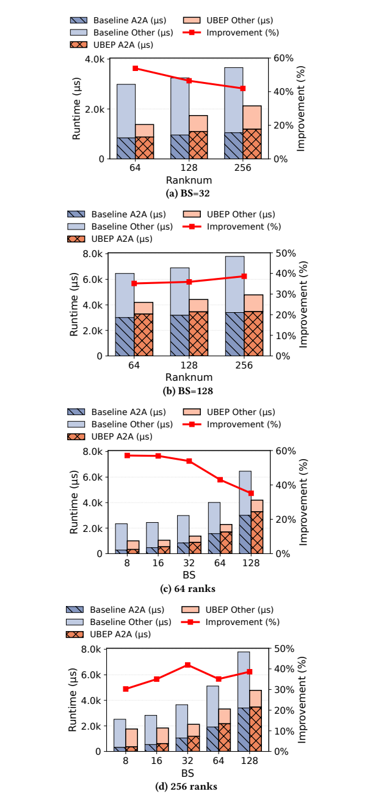

**Original caption:** Figure 12: Supplementary latency analysis of the MoE Dis-

**中文图注:** Figure 12: MoE 分发（Dispatch）的补充时延分析

**Source:** p.17 S118

**Original:** **patch primitive**

**中文:** patch 原语

### 图 13

**Placed near:** ?
**Source:** p.18 C018

**Original caption:** Figure 13: Performance scalability of different Top-.

**中文图注:** Figure 13: 不同 Top-$k$ 取值下的性能可扩展性

### 图 14

**Placed near:** ?
**Source:** p.18 C019

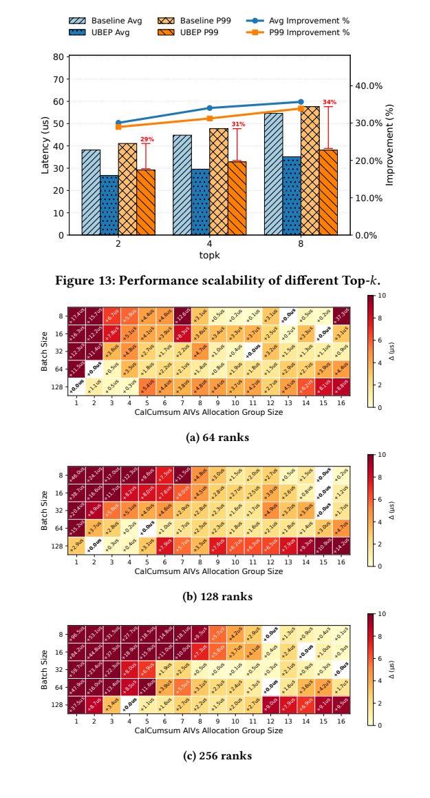

**Original caption:** Figure 14: Heatmaps illustrating the relationship between the CalCumSum AIVs allocation group size, batch size, and varying rank numbers

**中文图注:** Figure 14: 展示 CalCumSum AIV 分配的分组大小、批大小与不同 rank 数量之间关系的热力图

## References / 参考文献

**Source:** p.54–58 S119（共 0 条，保留英文原文不译）

